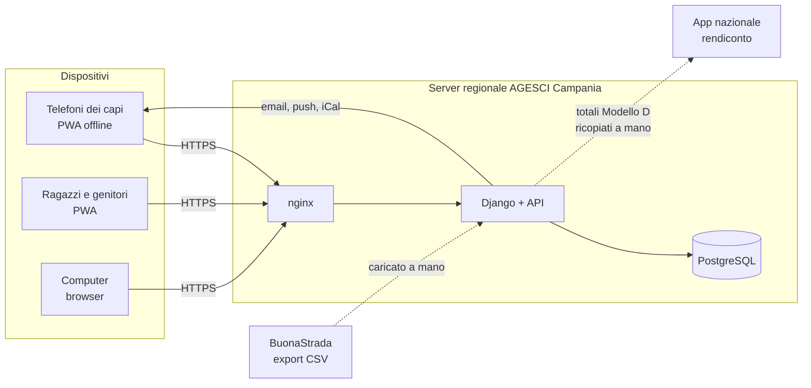

# Quaderno di Caccia (QdC) — Analisi dei requisiti

> **Copia nel repository** del documento di analisi (revisione 39, 30 ottobre 2026), da
> cui provengono i codici `DEC-nn` citati nel codice. L'originale condiviso, con commenti,
> è su claude.ai: <https://claude.ai/artifact/Y8hDa3xkQ1cXVSToLTa7H7>. Una decisione nuova o
> cambiata si aggiorna in entrambi i posti, nello stesso commit/giorno.

Oct 21, 2026 · @Andrea Bruno

## Sintesi

Quaderno di Caccia (QdC) è l'app con cui i capi del Gruppo AGESCI Avellino 1 gestiscono anagrafica, fascicolo personale, Progressione Personale, eventi, presenze, quote e cassa. I ragazzi e i genitori la usano per consultare la propria parte. Si parte da anagrafica e quote, con il reparto come unità pilota; altri gruppi potranno installare la propria copia.

Il documento raccoglie le decisioni prese nell'analisi del 21 ottobre 2026; quelle da DEC-110 in poi sono state prese con il maintainer durante lo sviluppo delle fasi 1, 2 e 3 (28, 29 e 30 ottobre 2026), e nella colonna **Origine** riportano la data e la decisione che precisano. Ogni decisione ha un codice (**DEC-nn**) da citare nello sviluppo, e la colonna **Origine** rimanda alla domanda da cui nasce: le domande sono nel documento "Analisi requisiti — App di Gruppo (Avellino 1)". Le parti marcate *\[da verificare\]* sono inferenze non ancora confermate. Le sigle sono spiegate nel glossario in fondo.

Il nome dell'app coincide con quello del quaderno cartaceo dei ragazzi, che resta: nei testi per le famiglie conviene scrivere "l'app QdC".

## Perimetro

QdC sostituisce quaderni, fogli volanti ed Excel condivisi a mano: oggi la PP si perde, i fascicoli non esistono più da anni e la cassa contanti vive su foglietti (V-01).

| ID | Decisione | Origine |
| --- | --- | --- |
| DEC-01 | Criterio di successo: a fine anno associativo (30 settembre) la cassa è stata usata e ogni ragazzo ha il fascicolo con dati e PP dell'anno. | V-03 |
| DEC-02 | QdC non sostituisce BuonaStrada: ne importa i dati e ne resta subordinata. | V-04, H-5 |
| DEC-03 | Nessuna chat e nessun nuovo canale di comunicazione con i genitori; solo notifiche e, in seguito, una bacheca di soli avvisi. | V-04, N-22 |
| DEC-04 | Il quaderno di caccia cartaceo resta: l'app lo affianca, non lo sostituisce. | V-05 |
| DEC-05 | Nessun caricamento di storico pregresso; sui singoli si inserisce al massimo l'anno di ingresso e dati simili. | V-06, T-05 |
| DEC-06 | Fuori perimetro: rendiconto e bilancio (si fanno sull'app nazionale), pagamenti online, viste per Zona e Regione, integrazione con Plancia, percorso delle specialità di squadriglia, gamification e classifiche. | H-4, F-05, R-09, M-06, E-04, P-08 |
| DEC-07 | Manutenzione affidata alla pattuglia informatica regionale; allo sviluppo contribuiscono anche altri sviluppatori. | V-07, X-06 |
| DEC-08 | Mandato: l'adozione è decisa dalla Co.Ca. | V-02 |

## Fasi di sviluppo

L'ordine segue le priorità della Co.Ca. (Z-01, Z-02); non ci sono date vincolanti (Z-04). Il reparto è l'unità pilota e tutti gli staff sono disponibili a seguire (Z-03). Nel 2025/26 l'AV1 ha reparto femminile, reparto maschile, Clan/Fuoco e Co.Ca., senza branco o cerchio attivi: la PP L/C può arrivare per ultima.

1. **Fondamenta:** account e accesso, ruoli, unità, importazione da BuonaStrada, profili dei genitori e nuclei familiari.
2. **Quote e cassa:** tipi di quota, sconti e agevolazioni, pagamenti e ricevute, prima nota con voci del Modello D.
3. **Eventi e presenze:** eventi a quattro livelli, riunioni ricorrenti, presenze offline, feed di calendario.
4. **Progressione Personale:** prima E/G (pilota, con imprese), poi R/S e L/C; passaggi di branca.
5. **Fascicolo completo:** scheda medica con stampa, note con visibilità, archiviazione, fascicolo dei capi, report per i passaggi.
6. **Dopo:** bacheca avvisi, esperienze collegate agli impegni, lettura dell'estratto conto bancario, testo della Carta di clan in consultazione.

La scheda medica è nella fase 5 per completezza del fascicolo, ma può essere anticipata se serve già per i campi della prima estate.

## Ruoli e permessi

Ogni capo vede tutto di tutti i ragazzi del gruppo; gli altri ruoli vedono solo la propria parte. La Co.Ca. firma una liberatoria privacy che copre questa condivisione (R-01).

| ID | Decisione | Origine |
| --- | --- | --- |
| DEC-09 | **Capo** (tirocinanti e AE compresi): legge tutti i dati di tutti i ragazzi, compresi dati sanitari, PP e note, anche quelle delicate. L'unità è solo un filtro di visualizzazione. Scrive per l'unità di cui è staff. | R-01, R-02, N-14 |
| DEC-10 | **Capigruppo** (diarchia): creano unità e branche e assegnano gli staff; importano da BuonaStrada; riaprono un anno chiuso; revocano i dispositivi persi. Non hanno altri poteri sugli altri capi. | R-02, N-08, N-19, N-21 |
| DEC-11 | **Tesoriere** di gruppo e di unità: ruolo distinto e cumulabile, ricoperto da un capo. In R/S può essere un rover o una scolta, con gli stessi permessi ma senza vedere le agevolazioni. L'ultima parola sul saldo di una cassa spetta al tesoriere o al capo unità. | R-04, N-20, F-10 |
| DEC-12 | **Amministratore tecnico**: gestisce cataloghi, importazioni e account; ruolo separato dai capigruppo, che si può cumulare con gli altri. Come si nomina: DEC-166. | N-21 |
| DEC-13 | **CSQ**: legge mete, impegni, specialità e brevetti della propria squadriglia; scrive note sui suoi squadriglieri; può proporre qualsiasi convalida, che lo staff conferma. Contatti nella squadriglia: DEC-115. | R-05, A-02, N-23 |
| DEC-14 | **VCSQ**: nessun permesso di base. Il capo unità può abilitarlo; il CSQ può delegarlo per un periodo limitato (es. un'assenza). | R-05 |
| DEC-15 | **Ragazzo**: vede i propri dati, la propria PP e le note condivise con lui; in E/G può inserire le proprie mete e impegni, da convalidare. | P-02, V-05 |
| DEC-16 | **Genitore o tutore**: vede quote dovute e pagate con il dettaglio di sconti e agevolazioni; vede prede, mete, impegni e specialità di L/C, E/G e R/S minorenni; aggiorna la scheda medica; vede le note rese visibili ai genitori. Dai 18 anni decide l'R/S. Chi non esercita la responsabilità genitoriale non ha account. | R-07, N-17, S-04, N-28, G-2 |
| DEC-17 | Sestiglie, pattuglie R/S, Alta Squadriglia e Con.Ca. si registrano solo come appartenenza, senza permessi; capi sestiglia e capi pattuglia sono titoli. Il Consiglio della Rupe non si modella. | R-06, E-07 |
| DEC-18 | La diarchia si modella esplicitamente: due titolari per ruolo, posto vacante possibile. | R-10 |
| DEC-19 | Senza accesso: R/S e novizi in servizio ai dati altrui, adulti non censiti, maestri di specialità esterni, Zona e Regione. | R-03, R-09, PP-G |
| DEC-20 | Un capo che è anche genitore agisce come capo. Chi lascia il servizio perde subito l'accesso; i suoi contributi restano a suo nome. | R-11, R-12 |
| DEC-110 | Lo staff dell'unità (DEC-09) si registra come incarico "Staff di unità", oltre al capo unità, senza limite di persone; i capi restano nella Co.Ca. come appartenenza. | DEC-09, 28/10 |
| DEC-111 | Chi nomina: capo squadriglia e vice tutto lo staff del reparto; capigruppo e tesoriere di gruppo i capigruppo in carica (l'amministratore tecnico solo al primo avvio o se non ce ne sono); tesoriere di unità il capo unità e i capigruppo. "A disposizione" e amministratore tecnico: DEC-165, DEC-166. | DEC-10, DEC-11, DEC-14, 28/10 |
| DEC-112 | Le squadriglie le creano, chiudono e compongono lo staff del reparto e i capigruppo. Un ragazzo è in una squadriglia alla volta; capo squadriglia e vice ne fanno parte e chiudono l'incarico prima di cambiarla. | DEC-30, 28/10 |
| DEC-113 | I dati sanitari li scrivono, oltre a genitori e maggiorenni (DEC-50), lo staff dell'unità della persona e i capigruppo, per tutte le unità. | DEC-50, DEC-55, 28/10 |
| DEC-114 | Il registro delle modifiche, anche dei dati sanitari, è visibile all'amministratore tecnico, che è sempre un capo o ha la delega dei capigruppo per i dati. | DEC-12, 28/10 |
| DEC-115 | Contatti in squadriglia: ogni squadrigliere vede il solo telefono degli altri; il capo squadriglia anche il telefono dei genitori di tutta la squadriglia; il vice vede come uno squadrigliere. Niente email. Il numero mostrato è il cellulare del ragazzo in BuonaStrada se c'è; altrimenti quello di un genitore o tutore scelto per quel figlio; altrimenti quello scelto per tutti i figli senza cellulare; altrimenti nessuno. Il genitore (o il maggiorenne) può nasconderlo agli squadriglieri, non al capo squadriglia; lo impostano genitore, maggiorenne, staff dell'unità e capigruppo. Copia cifrata sul telefono per le uscite. | DEC-13, 29/10 |
| DEC-165 | Gli incarichi sono di due tipi. **Di servizio**: capo unità, staff di unità e **a disposizione**, per i capi della Co.Ca. che al momento non fanno servizio in un'unità. **Aggiuntivi**: capogruppo, tesoriere di gruppo, tesoriere di unità, amministratore tecnico. Gli aggiuntivi si sommano tra loro e al servizio (lo stesso capo può essere capo unità, capogruppo, tesoriere e amministratore). Un capo può servire in più unità; "a disposizione" esclude il servizio in un'unità e finisce da sé quando il capo viene assegnato a un'unità. Lo nominano i capigruppo, che vedono l'elenco dei capi senza alcun servizio da sistemare. | DEC-09, DEC-10, DEC-110, 30/10 |
| DEC-166 | L'amministratore tecnico (DEC-12) è un incarico aggiuntivo: il primo si crea all'installazione, poi lo nominano i capigruppo, sempre tra i capi (DEC-114). L'incarico dà i poteri dell'amministratore dentro l'app e l'accesso all'amministrazione del server, finché dura. | DEC-12, DEC-111, DEC-114, 30/10 |
| DEC-167 | **Usare l'app al posto di un altro**, per aiutarlo a compilare o vedere un problema come lo vede lui. Possono farlo i capigruppo e gli amministratori tecnici con chiunque abbia un account, lo staff di un'unità con i suoi ragazzi e i loro genitori (mai con altri capi); sempre e solo capi censiti in BuonaStrada, così non vedono nulla in più di quanto vede un capo (DEC-09, DEC-12). Serve un motivo; dura al massimo 30 minuti; una barra lo ricorda sempre, con "Torna a te". Si fa tutto quello che fa la persona, tranne cambiare il suo account (password, email, accessi, dispositivi) e le sue scelte personali (consensi, email da ricevere, cosa vedono i genitori, richieste per i diritti). Nulla si salva sul telefono. Lo storico delle modifiche e il registro degli accessi (DEC-101) riportano chi ha agito davvero, "al posto di" chi. La persona vede nel suo account chi ha usato l'app al suo posto, quando e perché; la Co.Ca. vede l'elenco completo. | DEC-09, DEC-12, DEC-101, 30/10 |

## Account e accesso

Si entra con email e passkey, oppure con Google o Apple; la sessione resta valida 30 giorni anche senza rete.

| ID | Decisione | Origine |
| --- | --- | --- |
| DEC-21 | Registrazione con email personale, attivata da un capo unità o capogruppo oppure tramite link o codice di invito. Nessun account Google Workspace creato dal gruppo. Iscrizione di nuovi soci con codice: DEC-120…DEC-127. | M-07 |
| DEC-22 | Accesso con email e passkey, codice via email come riserva, più accesso con Google e con Apple. | O-07, N-19 |
| DEC-23 | Sessione di 30 giorni sul dispositivo; i capigruppo possono revocare un dispositivo perso. | N-19, O-05 |
| DEC-24 | Sotto i 14 anni il ragazzo ha un account proprio solo con il consenso del genitore. L'app registra chi ha dato il consenso, quando e come è stato verificato che fosse il genitore (art. 2-quinquies del Codice privacy). Dai 14 anni: DEC-117. | R-08, N-18 |
| DEC-25 | ~~Gli inviti ai ragazzi senza email propria passano dall'email dei genitori.~~ *Superata da DEC-116: ogni account ha la sua email.* | Export BuonaStrada |
| DEC-26 | Ai 18 anni l'R/S decide cosa resta visibile ai genitori; il genitore resta collegato alle quote finché l'R/S non lo scollega. Alla Partenza l'account diventa un account da capo. Dettagli: DEC-119. | S-04, N-17, S-05 |
| DEC-116 | Ogni account ha la sua email: un ragazzo non si invita né si iscrive con l'email di un genitore. | DEC-25, 28/10 |
| DEC-117 | Dai 14 anni l'account si apre con l'invito del capo unità o di un capogruppo, senza approvazione del genitore. | DEC-24, 29/10 |
| DEC-118 | Chi si registra da un invito non conferma l'email una seconda volta: l'invito è arrivato a quell'indirizzo. | DEC-21, 29/10 |
| DEC-119 | Ai 18 anni l'R/S sceglie per categoria, uguale per tutti i genitori, cosa vedono: contatti e indirizzo; farmaci, allergie e alimentazione; scheda e attività. Finché non sceglie vedono tutto, senza poter modificare. Email all'R/S e a ciascun genitore un mese prima e il giorno del compleanno; se non ha un account la pagina dell'unità lo segnala ai capi. Il collegamento alle quote arriva con la fase 2. | DEC-26, 29/10 |

**Iscrizione dall'app.** Un nuovo socio può iscriversi dall'app prima di essere in BuonaStrada.

| ID | Decisione | Origine |
| --- | --- | --- |
| DEC-120 | Il nuovo socio usa un codice di iscrizione (anche come link o QR code): per l'unità, valido fino a una data, oppure personale, valido una volta. Lo creano lo staff dell'unità e i capigruppo; per la Co.Ca. solo i capigruppo. | DEC-21, 29/10 |
| DEC-121 | Il genitore iscrive il figlio minorenne (il figlio avrà poi un account con un invito); il maggiorenne si iscrive da sé; in Co.Ca. solo maggiorenni. L'account resta "in attesa" finché la richiesta non è accolta. | 29/10 |
| DEC-122 | La richiesta la accolgono lo staff dell'unità o i capigruppo; per i capi solo i capigruppo. Accolta, il socio ha un codice socio provvisorio: 9 seguito da un progressivo, 10 cifre (es. 9000000001). L'importazione lo ritrova dal codice fiscale e lo sostituisce con il codice vero: su codice socio e dati vince BuonaStrada. | DEC-02, DEC-29, 29/10 |
| DEC-123 | Un capo non ancora in BuonaStrada vede organizzazione e nomi, ma non i dati delicati degli altri soci. | DEC-09, 29/10 |
| DEC-124 | All'iscrizione si chiedono nome, cognome, codice fiscale e data di nascita; il resto entro una scadenza fissata da chi accoglie: sesso, luogo di nascita, indirizzo, comune, provincia, CAP; cellulare ed email propri per il maggiorenne (in qualsiasi unità) e per il minore in clan/fuoco o noviziato; per il minore i genitori, come in BuonaStrada (genitore singolo con affidamento esclusivo oppure entrambi i genitori o tutori), con codice fiscale, cellulare ed email; i consensi (2A, 2B, 2C, riviste) dai moduli firmati. | DEC-30, 29/10 |
| DEC-125 | Promemoria alla famiglia 7 giorni prima della scadenza; scaduto il termine l'iscrizione è sospesa: la famiglia non vede più quel socio finché non completa (un maggiorenne iscritto da sé torna in attesa). Lo staff la vede come sospesa. | 29/10 |
| DEC-126 | I capigruppo caricano i moduli vuoti (informativa, consensi); la famiglia li scarica, li firma a mano e carica le scansioni; un capo dello staff o un capogruppo le verifica e riporta i consensi. Le scansioni si conservano finché il socio resta nel gruppo; le vedono i capi, con il registro degli accessi. | DEC-42, DEC-101, 29/10 |
| DEC-127 | I capigruppo hanno l'elenco delle iscrizioni da inserire in BuonaStrada, esportabile in Excel e PDF, e le segnano come inserite. | DEC-02, 29/10 |

## Anagrafica e importazione da BuonaStrada

BuonaStrada è la fonte di verità dell'anagrafica: QdC importa l'export "Ricerca Soci" (CSV) e non lo sostituisce. Le correzioni fatte nell'app non vengono mai cancellate in silenzio da un'importazione.

| ID | Decisione | Origine |
| --- | --- | --- |
| DEC-27 | L'importazione la fa un capogruppo o l'amministratore tecnico, a inizio anno dopo il censimento e quando serve; prima di applicarla l'app mostra le differenze. | N-08 |
| DEC-28 | Si importano solo i soci con stato R (rinnovo) e S (sospeso, in attesa di rinnovo). Gli ex soci (D) non si importano; se sono già nell'app, si chiude la loro appartenenza. Durante il censimento, quando tutti risultano sospesi, nessuno viene disattivato. | I-1 |
| DEC-29 | La chiave del socio è il codice socio. Il file va letto saltando la riga "sep=", gestendo il BOM, togliendo l'involucro ="..." e ignorando la virgola finale di ogni riga; le date sono gg/mm/aaaa. | Export BuonaStrada |
| DEC-30 | Comanda BuonaStrada: nome, cognome, sesso, nascita, codice fiscale, codice socio, indirizzo, contatti, unità di censimento, consensi, dati dei genitori. Comanda l'app: noviziato, squadriglie, incarichi, scheda medica, PP, quote. | N-07, I-2 |
| DEC-31 | Se un genitore o un capo corregge un dato di BuonaStrada, la correzione vale subito nell'app, segnata "in attesa di BuonaStrada", e arriva ai capigruppo, che la inoltrano alla segreteria regionale. L'importazione successiva mostra le differenze invece di sovrascrivere. Dettagli: DEC-129, DEC-130. | M-04, N-07 |
| DEC-32 | I profili dei genitori si creano dalle colonne RESP.GENITORIALE (tipo "Genitori" o "Unico genitore"; dati con nome, codice fiscale, nascita, email, cellulare). La residenza la completa il genitore. Le righe che non si riescono a leggere vengono segnalate. | I-2, G-1 |
| DEC-33 | Il nucleo familiare si riconosce in automatico: fratelli sono i soci con un genitore con lo stesso codice fiscale. | A-09, I-2 |
| DEC-34 | Noviziato e Clan/Fuoco: la comunità iniziale viene dalla colonna COMUNITA SOCIO; in app il noviziato è un'unità a sé, può mancare, e un capo può registrare il passaggio al clan anche durante l'anno. | S-01, I-6 |
| DEC-35 | Dall'export si leggono anche le unità (tipo, codice, progressivo, ambiente, durata), i dati dei capi (livello di formazione, anno di ingresso in Co.Ca., nomina) e i dati del gruppo per le ricevute (codice fiscale, denominazione, rappresentante legale). Date nel futuro e valori incoerenti vengono segnalati. | A-08, N-29, Export |
| DEC-36 | I reparti paralleli maschile e femminile sono due unità, collegate da una nota. | E-08 |
| DEC-37 | Anno associativo dal 1 ottobre al 30 settembre. L'età si calcola al 30 aprile (data configurabile); i capi possono fare eccezioni. | V-03, T-02 |
| DEC-128 | Il nome dell'unità lo dà il gruppo (non è in BuonaStrada) e può ripetersi: è obbligatorio tranne per la Co.Ca. Il codice unità di BuonaStrada (lettera e progressivo, es. O1; G1 per la Co.Ca.) è univoco. L'unità si mostra sempre come tipo, nome e codice: "Clan/Fuoco Hirpinia (T1)". Le unità create dall'importazione nascono senza nome, segnalate finché il gruppo non lo dà. | DEC-35, 29/10 |
| DEC-129 | Correzioni: contatti e indirizzo li correggono il genitore (suoi e dei figli minorenni), il maggiorenne (i suoi, anche i consensi), lo staff dell'unità e i capigruppo; sesso e luogo di nascita lo staff e i capigruppo; nome, cognome, data di nascita e codice fiscale solo i capigruppo; l'amministratore tecnico corregge tutto. I capigruppo e l'amministratore tecnico le inoltrano alla segreteria e le segnano "inoltrate", oppure le scartano con un motivo (torna il valore di prima). Email riassuntiva ai capigruppo, al massimo una al giorno. La correzione si chiude quando l'importazione la ritrova. | DEC-31, 29/10 |
| DEC-130 | Differenze all'importazione: chi importa indica la data di aggiornamento dei dati di BuonaStrada; per ogni differenza (dati corretti nell'app, unità assegnate nell'app) sceglie quale dato vince; è proposto il più recente, a parità l'app. Se vince BuonaStrada la correzione si chiude come "superata". | DEC-31, DEC-34, 29/10 |
| DEC-131 | Le squadriglie sono maschili o femminili: il sesso si controlla all'inserimento; se manca in BuonaStrada l'inserimento è permesso e la pagina del reparto lo segnala. | 28/10 |
| DEC-132 | Eccezioni alla squadriglia (identità di genere, transizioni): le decide la Co.Ca., le registra un capogruppo con la motivazione; le vedono solo i capi e ogni lettura va nel registro degli accessi; valgono finché la persona resta nel reparto. | DEC-101, 28/10 |
| DEC-133 | La squadriglia è organo di base del reparto: chi esce dal reparto esce dalla squadriglia e dagli incarichi di capo e vice. | DEC-28, 28/10 |

**Consensi importati.** I nomi nell'app sostituiscono le sigle dell'export; la corrispondenza viene dall'informativa AGESCI del 10 novembre 2024.

| Colonna export | Nome nell'app | Contenuto |
| --- | --- | --- |
| CONSENSO 2A | Consenso iscrizione e attività | Trattamento dei dati per iscrizione e attività, compresi i dati sanitari. Obbligatorio. |
| CONSENSO 2B | Consenso foto e video | Uso di foto e riprese per fini istituzionali; firma di entrambi i genitori. In evidenza per i capi. |
| CONSENSO 2C | Consenso comunicazioni commerciali | Promozioni del "Sistema AGESCI"; vale 24 mesi. |
| CONSENSO RIVISTE | Consenso invio riviste | Volontà di ricevere o no a casa la rivista associativa. |

I consensi dati dai genitori cessano ai 18 anni: l'app segnala gli R/S che diventano maggiorenni.

## Fascicolo personale

Il fascicolo accompagna ogni ragazzo per tutta la vita nel gruppo e si archivia due anni dopo l'uscita.

| ID | Decisione | Origine |
| --- | --- | --- |
| DEC-38 | Contenuto: anagrafica, tutori, scheda medica, autorizzazioni, PP, verifiche, presenze (totali per anno), quote, documenti, foto profilo, note di staff. | A-01 |
| DEC-39 | Note di staff: la Co.Ca. le vede sempre; a scelta si aggiungono il ragazzo, i genitori e il CSQ (solo E/G). "Per tutti" significa ragazzo, genitori e CSQ, mai gli altri squadriglieri. L'app evidenzia ciò che è condiviso fuori dalla Co.Ca. | A-02, E-05, N-15, H-2 |
| DEC-40 | Note del CSQ: sempre visibili a staff e Co.Ca.; il CSQ sceglie se mostrarle allo squadrigliere e ai genitori, e lo staff può cambiare la scelta. | A-02, N-16 |
| DEC-41 | Ogni capo vede l'intera PP di qualsiasi ragazzo; per i passaggi l'app prepara un report riassuntivo. | A-03 |
| DEC-42 | File ammessi: foto profilo (storicizzata), foto dei giustificativi di spesa, allegati facoltativi alla PP (solo immagini e PDF, con dimensione massima). Liberatorie e prescrizioni mediche restano su carta: l'app registra solo la data di consegna. Liberatorie degli eventi su BuonaCaccia: DEC-160. | D-03, P-03, N-11, S-1 |
| DEC-43 | Regole sul rapporto con il minore indicate dai genitori (es. separazione): campo riservato alla Co.Ca., in evidenza nella scheda del ragazzo e disponibile offline al campo. | G-2 |
| DEC-44 | Archiviazione due anni dopo l'uscita: esportazione in PDF e archivio compresso sul Drive del gruppo, poi cancellazione dall'app. Restano nome e anni di appartenenza, per riconoscere chi rientra. | A-04, D-07, N-12 |
| DEC-45 | A fine anno i dati si congelano. Un capogruppo può riaprire un anno chiuso, con motivazione, in modo tracciato e per un periodo limitato. | T-03, N-21 |
| DEC-46 | Chi entra a percorso iniziato riceve solo ciò che si riesce a ricostruire, con date parziali. Va previsto un formato di esportazione e importazione del fascicolo tra gruppi che usano QdC. | T-04 |
| DEC-47 | Fascicolo dei capi: anni di servizio, unità e ruoli per anno, formazione. Non è collegato a Catello. Percorso di formazione: DEC-134. | A-08, N-13 |
| DEC-134 | Il percorso di formazione dei capi si inserisce a mano (dal capo o da un capogruppo); da BuonaStrada arriva solo il livello. | DEC-47, 29/10 |

## Scheda medica

La scheda medica riproduce i moduli AGESCI aggiornati "Consenso al trattamento dei dati sanitari" per soci minorenni e maggiorenni; i genitori la aggiornano nell'app e la firmano su carta.

| ID | Decisione | Origine |
| --- | --- | --- |
| DEC-48 | Campi del modulo: numero di tessera sanitaria; reperibilità per emergenze (nome e telefono); vaccinazione antitetanica sì/no; allergie e/o intolleranze con il grado di reazione; profilassi in corso (farmaco, posologia, orari, autonomia nell'assunzione); ulteriori note sanitarie. Nome, nascita e codice fiscale arrivano da BuonaStrada. | A-06, moduli AGESCI |
| DEC-49 | Campi facoltativi in più: gruppo sanguigno, medico curante, altre vaccinazioni. Esigenze alimentari non mediche: DEC-135. | S-3 |
| DEC-50 | La aggiornano i genitori, o l'R/S maggiorenne per sé. | R-07 |
| DEC-51 | Stampa del modulo ufficiale, nella versione per minorenni o per maggiorenni, precompilato. Per i minorenni i firmatari (uno o due, con il ruolo) si prendono dai profili dei genitori. Sotto, una sezione aggiuntiva per i campi facoltativi, con una propria riga di consenso e firma. | O-05, G-1, S-3 bis |
| DEC-52 | Si firma a inizio anno e a ogni modifica; l'app registra la data dell'ultima firma e segnala le schede modificate dopo. | N-10 |
| DEC-53 | La reperibilità per emergenze è annuale, ma il genitore può sostituirla per un singolo campo o uscita; la stampa per quell'evento usa il recapito giusto. | S-2, G-3 |
| DEC-54 | La prescrizione medica resta allegata alla scheda cartacea; nell'app si segna "prescrizione consegnata il...". | S-1 |
| DEC-55 | Al campo non serve l'intera scheda: sui telefoni dei capi vanno offline farmaci (con posologia, orari e autonomia nell'assunzione), allergie e intolleranze (con il grado di reazione), con le protezioni di DEC-97. Questo nucleo si anticipa alla fase 1; la scheda completa, con stampa e firme, resta nella fase 5. Lo compilano nell'app i genitori o l'R/S maggiorenne; i capi possono trascriverlo dalla scheda cartacea firmata. | O-05, 22/10 |
| DEC-135 | Esigenze alimentari non mediche (vegetariano, religiose…) nella scheda, con le stesse regole dei dati sanitari: stesse persone, offline al campo, registro degli accessi. Si scrive cosa non mangia, non il motivo. | DEC-49, 29/10 |

## Progressione Personale

La PP segue il documento "Specifica di dominio e requisiti per lo sviluppo" v1.0, ridotto ai blocchi scelti nel documento "Documento PP — cosa serve nella prima versione". L'app registra e ricorda; il riconoscimento della crescita resta alle persone e alle comunità previste dal metodo.

| ID | Decisione | Origine |
| --- | --- | --- |
| DEC-56 | Il documento PP v1.0 è il riferimento del modello, senza ulteriore rilettura, nei limiti di queste decisioni. | N-01 |
| DEC-57 | Una persona ha un'unica identità per tutta la vita nel gruppo; periodi di branca e di momento, tappa o passo sono distinti dalle appartenenze alle unità. | PP-A |
| DEC-58 | La Promessa è un evento con data; la consegna del distintivo ha una data propria, distinta dall'ingresso nella tappa. | PP-B |
| DEC-59 | Impegni, mete e obiettivi hanno sei stati (bozza, concordato, in corso, da verificare, concluso, interrotto) e conservano le revisioni del testo, in tutte le branche, L/C compresi. | PP-D, P-1 |
| DEC-60 | La convalida è il passaggio da "da verificare" a "concluso", con data; chi convalida è registrato in automatico. Non si registrano colloqui né autovalutazioni. Sede della verifica: DEC-172. | PP-F, P-05 |
| DEC-61 | In L/C registra il capo; in E/G anche i ragazzi possono inserire mete e impegni; il CSQ propone convalide, lo staff le conferma. | P-02, N-23 |
| DEC-62 | Specialità e brevetti seguono un percorso con carta (testo scritto nell'app), maestro anche esterno senza account e stati da proposto a riconosciuto. | PP-G, P-2 |
| DEC-63 | I cataloghi vengono dal regolamento metodologico: 40 specialità L/C, 65 specialità E/G, 12 specialità di squadriglia, 15 brevetti. Le voci si ritirano, mai si cancellano, e ogni conquista conserva il nome dell'epoca. Le immagini delle specialità E/G si caricano a parte. | M-03, P-4, P-06 |
| DEC-64 | Specialità di squadriglia: si registra se la squadriglia l'ha conquistata e quali specialità e brevetti individuali sono nati da quel percorso, anche se non conquistata. | E-04, N-24 |
| DEC-65 | Già nella prima versione E/G: imprese di reparto, squadriglia e Alta Squadriglia con i posti d'azione; squadriglie per anno, con cambi durante l'anno e incarichi. | E-06, N-25 |
| DEC-66 | L/C: stagione di caccia o di volo come etichetta; prede e voli; appartenenza al Consiglio degli Anziani. | PP-C, L-05 |
| DEC-67 | R/S: Punto della Strada semplice e ripetibile; firma della Carta di clan registrata con la sola data, come evento che apre i passi di competenza; servizio verificato nel Punto della Strada; conclusione con tipo (Partenza, saluto fraterno, interruzione, trasferimento) e data. | PP-J, P-3, S-03, PP-K |
| DEC-68 | Eventi individuali (Piccole Orme, campi di specialità, EPPPI, ROSS): solo partecipazione e quote anticipate; nessun controllo automatico, lo fa BuonaCaccia. | PP-I |
| DEC-69 | I passaggi tra branche li decide la Co.Ca., in blocco per unità; chiudono un periodo e aprono il successivo senza convertire tappe o specialità. Come si registrano: DEC-174…DEC-177. | T-01, PP-L |
| DEC-70 | Storico: date parziali (anche solo l'anno), correzioni tracciate, registro delle modifiche; versione per ogni oggetto e protezione dai doppi invii. | PP-O, PP-P, PP-Q |
| DEC-71 | Solo vincoli strutturali e qualche promemoria: nessun avanzamento automatico, nessuna classifica. | PP-R, P-08 |
| DEC-72 | Viste: scheda personale con la storia di tutti gli anni nel gruppo e vista di unità. Per i ragazzi, linguaggio e colore della branca e nomi giungla o bosco dei capi. | PP-T, P-07, N-26, L-06 |
| DEC-73 | I casi di prova del documento PP diventano test automatici. | PP-U |
| DEC-74 | Esclusi: classificazioni educative, collegamento a pagine e articoli del regolamento, esperienze collegate agli impegni (forse in seguito). | PP-M, PP-S, PP-E |
| DEC-171 | In E/G il sentiero e la tappa li registra lo staff, non si aprono da soli con l'ingresso in reparto: l'apertura parte dalla Scoperta. Chi entra più grande, dopo Scoperta e Promessa, si colloca nella tappa adeguata con una motivazione, senza inventare le tappe intermedie. | DEC-57, PP-A, 30/10 |
| DEC-172 | La convalida registra anche la sede della verifica: Consiglio della Legge, Consiglio di squadriglia, Alta Squadriglia o altro (da descrivere). Tappe, specialità e brevetti si riconoscono nel Consiglio della Legge. | DEC-60, PP-F, 30/10 |
| DEC-173 | Una meta può essere riservata (le mete "particolarmente delicate"): la vedono il ragazzo, i genitori e i capi, non il capo squadriglia né le viste di squadriglia. Le note con visibilità complete restano alla fase 5 (fatte: DEC-197…DEC-199). | DEC-13, DEC-39, PP-N, 30/10 |
| DEC-174 | Il passaggio deciso dalla Co.Ca. lo prepara e lo esegue nell'app lo staff dell'unità di partenza o un capogruppo, con la data della decisione della Co.Ca. | DEC-69, 30/10 |
| DEC-175 | Eseguire il passaggio sposta i ragazzi nella nuova unità come unità assegnata nell'app: all'importazione da BuonaStrada vale DEC-130. Uscire dal reparto chiude squadriglia e incarichi di squadriglia. | DEC-34, DEC-130, 30/10 |
| DEC-176 | Il passaggio apre il percorso della nuova branca con la sua prima fase (Scoperta del sentiero E/G, passi di scoperta R/S) dalla data del passaggio: è una decisione registrata, non un'apertura automatica (DEC-171). Promessa e distintivi li registra il nuovo staff. | DEC-69, DEC-171, 30/10 |
| DEC-177 | Il passaggio si prepara per l'unità (chi passa, unità di arrivo, data, sintesi per i nuovi capi di ciascuno; cerimonia con data propria se diversa), si può modificare o annullare con un motivo, e si esegue dalla sua data, dopo una conferma: chiusura e apertura avvengono insieme, tutte o nessuna. Un passaggio eseguito per errore si rettifica: DEC-178. | DEC-69, PP-L, 30/10 |
| DEC-178 | Un passaggio eseguito per errore si rettifica, con un motivo che resta nella storia, da chi può eseguirlo: si annulla per uno o più ragazzi (torna il percorso di prima con la sua tappa, l'unità, la squadriglia e gli incarichi di squadriglia; il nuovo percorso si toglie) oppure se ne corregge la data. Non si può se il nuovo staff ha già registrato qualcosa nel nuovo percorso (l'app dice cosa) o se dopo il passaggio è stata applicata un'importazione da BuonaStrada: si corregge prima lì. | DEC-174, DEC-177, PP-L, 30/10 |
| DEC-179 | In R/S obiettivi e impegni li propone anche il rover o la scolta, come in E/G: restano bozze finché lo staff non li concorda, e la verifica la può chiedere lui o lei. Obiettivi R/S e mete E/G sono lo stesso oggetto, chiamato secondo la branca. | DEC-15, DEC-61, DEC-67, PP, 30/10 |
| DEC-180 | La parte riservata del Punto della Strada (situazioni affrontate con i capi e l'assistente ecclesiastico) la vedono solo il rover o la scolta e i capi, non i genitori, anche se minorenne; la sintesi segue le regole di sempre. Resta fuori dallo storico delle modifiche. | DEC-16, DEC-26, DEC-67, PP V15, 30/10 |
| DEC-181 | La conclusione del percorso R/S (Partenza, saluto fraterno, interruzione, trasferimento) chiude solo il periodo nella Progressione; l'appartenenza al clan la chiude BuonaStrada all'importazione. | DEC-02, DEC-67, 30/10 |
| DEC-182 | Il Consiglio degli Anziani è un incarico nell'unità L/C, con date: lo assegna lo staff del branco o del cerchio a un suo lupetto o coccinella; finisce quando il bambino lascia l'unità. | DEC-66, 30/10 |
| DEC-183 | In L/C lo staff riconosce il momento (lupo della legge, coccinella del prato…) dopo almeno una preda o un volo conquistato in quel momento; la storia di chi c'era già si registra anche senza, dichiarandolo. Il distintivo si consegna dopo il riconoscimento. Prede e voli si riferiscono alla stagione di caccia o di volo dell'unità (in programma, aperta con il lancio, chiusa, annullata prima del lancio); la chiusura non conquista nulla e mostra cosa resta da rileggere. | DEC-66, PP V04, V05, 30/10 |
| DEC-184 | Le Piccole Orme si riconoscono da un segno sull'evento BuonaCaccia; iscrivendo un bambino l'app avvisa, senza bloccare, se le ha già fatte, se non è nel momento della responsabilità o se l'evento dura meno di tre giorni. La partecipazione compare nella pista. | DEC-68, PP V11, 30/10 |
| DEC-185 | Nomi di momenti, prede e voli: giungla nel branco, bosco nel cerchio, secondo l'ambientazione dell'unità (DEC-225), uguali per bambini e bambine; nomi generici finché l'ambientazione non è nota. Corretta il 30/10: non dipendono dal sesso del bambino. | DEC-66, DEC-72, 30/10 |
| DEC-186 | La Progressione la scrive solo lo staff dell'unità della persona: i capigruppo la leggono ma non la scrivono nelle unità dove non fanno servizio (i passaggi restano anche a loro, DEC-174). Specialità e brevetti li apre solo lo staff. | DEC-09, DEC-113, 30/10 |
| DEC-187 | Imprese: il capo squadriglia crea e modifica le imprese della sua squadriglia, ne assegna i posti d'azione ai suoi squadriglieri e ne registra la verifica. Le imprese di reparto e di Alta Squadriglia le crea lo staff, che ne nomina il Consiglio d'impresa tra i ragazzi del reparto: i suoi membri assegnano i posti d'azione e ne registrano la verifica finché l'impresa non è finita. Il collegamento di un posto a un impegno lo fa lo staff. CSQ e Consiglio vedono solo le imprese che guidano. | DEC-13, DEC-65, 30/10 |
| DEC-188 | Nel Punto della Strada il rover o la scolta scrive una propria rilettura, che leggono lui o lei e i capi (come la parte riservata, DEC-180); lo staff non la scrive. | DEC-67, DEC-180, PP §11.2, 30/10 |
| DEC-189 | Chi rientra in clan dopo un'interruzione o un trasferimento riceve un nuovo periodo R/S dalla data del rientro (con la sua Scoperta); quello concluso resta nella storia. Dopo una Partenza il percorso R/S non si riapre. | DEC-67, DEC-181, 30/10 |
| DEC-190 | La conquista di una specialità o di un brevetto si registra con la sua data, non con quella del giorno in cui si scrive. Una stagione L/C che dura meno di due o più di cinque mesi è segnalata, senza bloccare. | DEC-62, DEC-183, PP V04, 30/10 |
| DEC-191 | In ogni unità i ragazzi vedono sempre i nomi di tutti gli altri ragazzi dell'unità e, in reparto, la loro squadriglia: non sono dati riservati (contatti e il resto della scheda seguono DEC-13). | DEC-13, 30/10 |
| DEC-192 | Ogni stampa (moduli da firmare, ricevute) porta l'intestazione del gruppo: denominazione, codice fiscale, sede, telefoni, email e PEC, sito, iscrizione al RUNTS, logo. La compilano i capigruppo nell'app. | DEC-51, DEC-84, 30/10 |
| DEC-193 | La data dell'ultima firma della scheda sanitaria e quella di consegna della prescrizione le segnano lo staff dell'unità e i capigruppo, che ricevono la carta. | DEC-52, DEC-54, 30/10 |
| DEC-194 | Riga di consenso della sezione dei dati facoltativi: «Acconsento/acconsentiamo al trattamento dei dati facoltativi sopra indicati, utili in caso di emergenza, alle stesse condizioni dell'informativa AGESCI.» | DEC-49, DEC-51, 30/10 |
| DEC-195 | Le schede sanitarie dei partecipanti a un evento, con la reperibilità indicata per quell'evento, le stampano in un unico PDF i capi che gestiscono l'evento (mai il capo squadriglia); ogni stampa resta nel registro degli accessi. | DEC-53, DEC-101, 30/10 |
| DEC-196 | All'archiviazione (DEC-44) l'archivio compresso si carica da solo sul Drive del gruppo, con un account Google autorizzato una volta. Come: DEC-212. | DEC-44, 30/10 |
| DEC-197 | Le note di staff le scrivono lo staff dell'unità del ragazzo e i capigruppo per tutte le unità; gli altri capi le leggono. Il capo squadriglia scrive note sugli altri membri della sua squadriglia, non su di sé. | DEC-13, DEC-39, DEC-40, DEC-113, 30/10 |
| DEC-198 | Una nota la modifica e la cancella solo chi l'ha scritta (vince l'ultima modifica; lo storico delle modifiche la conserva). Lo staff può cambiare a chi è mostrata una nota del capo squadriglia, non il testo. | DEC-40, DEC-96, 30/10 |
| DEC-199 | Le regole sul rapporto con il minore le trascrivono dal modulo firmato lo staff dell'unità e i capigruppo; le leggono solo i capi, anche offline al campo, mai i genitori né il ragazzo; ogni lettura e ogni scarico sul telefono resta nel registro degli accessi. | DEC-43, DEC-95, DEC-101, 30/10 |
| DEC-200 | Le liberatorie degli eventi le conserva BuonaCaccia: l'app tiene i file solo lo stretto indispensabile. Appena la segreteria decide, si cancella il file firmato (validato o rigettato); il modulo da firmare si cancella quando è validato e resta dopo un rigetto, per firmarlo di nuovo. Restano date ed esito. | DEC-42, DEC-160, 30/10 |
| DEC-201 | La foto profilo la caricano i genitori, il maggiorenne o lo staff dell'unità; la vedono i capi, l'interessato e i genitori, mai gli altri ragazzi. Serve a riconoscere i ragazzi: una copia piccola va offline sui telefoni dei capi al campo. Le foto precedenti restano, visibili ai capi. | DEC-42, DEC-95, 30/10 |
| DEC-202 | Gli allegati alla Progressione (immagini e PDF, al massimo 10 MB) vanno su impegni, mete e obiettivi, specialità e brevetti; li caricano lo staff e il ragazzo, li vede chi vede la voce, li toglie chi li ha caricati o lo staff. | DEC-42, 30/10 |
| DEC-203 | Il fascicolo del ragazzo è una pagina per anno associativo, stampabile in PDF, con le sezioni di DEC-38; ciascuno vede solo le sezioni che può vedere. «Autorizzazioni» raccoglie i consensi di BuonaStrada, la firma della scheda sanitaria e lo stato delle liberatorie (date ed esito, senza file). | DEC-38, 30/10 |
| DEC-204 | Il report per i passaggi è un PDF per ragazzo con il percorso nella branca, la sintesi per i nuovi capi e le presenze di quegli anni; non contiene note né regole sul rapporto con il minore. Lo leggono i capi. | DEC-41, PP §11.2, 30/10 |
| DEC-205 | La foto profilo si ritaglia sul telefono, in un riquadro intorno alla persona: si carica solo quel riquadro, così le altre persone di una foto di gruppo non escono dal telefono. | DEC-201, 30/10 |
| DEC-206 | Il fascicolo di un capo (anni di servizio con unità e ruoli, dati di BuonaStrada su livello di formazione, ingresso in Co.Ca. e nomina, formazione) lo vede il capo stesso e tutta la Co.Ca. | DEC-47, 30/10 |
| DEC-207 | Gli anni di servizio da quando c'è l'app si ricavano dagli incarichi; quelli precedenti li aggiungono a mano, anno per anno, il capo o un capogruppo, e restano segnati come ricostruiti. | DEC-46, DEC-47, 30/10 |
| DEC-208 | Ogni voce di formazione inserita a mano ha tipo (come i campi BuonaCaccia: CFT, CFM, CFA, CCG, modulo formativo, altro con descrizione), data anche solo con l'anno, luogo e note; i campi di formazione segnati come eventi BuonaCaccia compaiono da soli (quelli futuri come «in programma»); il livello resta quello di BuonaStrada. | DEC-134, DEC-164, DEC-170, 30/10 |
| DEC-209 | Un anno associativo lo chiude un capogruppo, quando rendiconto e verifiche sono fatti (mai quello in corso); da allora presenze, Progressione, quote, pagamenti e prima nota con date di quell'anno non si modificano. La Progressione continua: i percorsi aperti proseguono nel nuovo anno, salvo i passaggi; le quote non pagate passano al nuovo anno come pendenza (DEC-216). Dal 1° novembre l'app ricorda ai capigruppo l'anno appena finito ancora aperto. | DEC-45, 30/10 |
| DEC-210 | Un anno chiuso lo riapre un capogruppo, con un motivo, fino a un giorno che sceglie (al massimo 30 giorni); poi si richiude da solo, o prima a mano. Chiusure e riaperture restano nello storico. | DEC-45, 30/10 |
| DEC-211 | L'archiviazione di chi è uscito da più di due anni (e non è genitore di un socio) la conferma un capogruppo, una persona alla volta: l'app prepara uno ZIP con il fascicolo completo (JSON), un PDF per ogni anno nel gruppo, servizio e formazione dei capi, foto, allegati e moduli; lo carica sul Drive, verifica che il file sia identico e solo allora cancella. Restano nome e anni nelle unità. Si archiviano anche quote, pagamenti e presenze (i bilanci sono nell'app di bilancio AGESCI); i movimenti di cassa restano, senza il collegamento alla persona, perché i saldi degli anni passati non cambino. | DEC-44, DEC-102, 30/10 |
| DEC-212 | Il Drive del gruppo è un Drive condiviso di Google Workspace; l'app vi accede con un account di servizio, configurato una volta da chi installa (chiave e cartella), senza autorizzazioni dal browser. | DEC-196, 30/10 |
| DEC-213 | Esportazione verso un altro gruppo che usa QdC: la fa un capogruppo, su richiesta, in un file; contiene la Progressione Personale (senza mete riservate né parti riservate del Punto della Strada), le note non riservate (quelle condivise con il ragazzo o i genitori, confermato) e, per un capo, anni di servizio e formazione. Non contiene presenze, scheda sanitaria, regole sul rapporto con il minore né foto. Lo importa un capogruppo dell'altro gruppo: la persona si riconosce dal codice fiscale (l'anagrafica la porta BuonaStrada), i dati restano segnati con il gruppo di provenienza, un percorso aperto continua se nel nuovo gruppo non ce n'è già uno. | DEC-46, 30/10 |
| DEC-214 | Con l'archiviazione dell'ultimo figlio vanno anche i genitori che non hanno altri figli nel gruppo (né ancora da archiviare) e non sono stati soci loro stessi: i loro dati entrano nello stesso archivio e poi si cancellano del tutto; resta solo un record anonimo per il registro degli accessi. | DEC-44, DEC-136, 30/10 |
| DEC-215 | L'archivio contiene anche il fascicolo nel formato di scambio tra gruppi, reimportabile: se la persona rientra, anche anni dopo e anche come capo, un capogruppo carica lo ZIP dell'archivio; tornano Progressione, note non riservate, servizio e formazione dei capi, e il record con nome e anni rimasto nell'app si riunisce alla persona riportata da BuonaStrada (riconosciuta dal codice fiscale). | DEC-44, DEC-46, DEC-213, 30/10 |
| DEC-216 | Le quote non pagate di un anno passano agli anni seguenti come pendenza: la famiglia e chi registra i pagamenti le vedono insieme alle quote dell'anno, segnate come dell'anno precedente, e si pagano con data dell'anno nuovo. L'importo resta quello dell'anno in cui sono nate. Passano subito, anche prima della chiusura dell'anno; in un anno chiuso un'agevolazione si registra ancora sulle quote non pagate, mai su quelle già saldate. | DEC-82, DEC-209, 30/10 |
| DEC-217 | All'archiviazione l'app conserva un'impronta cifrata del codice fiscale (da cui non si risale al codice), calcolata con una chiave dedicata che chi installa genera una volta, conserva con i backup e non cambia mai. All'importazione da BuonaStrada chi rientra viene riconosciuto e riunito al record con nome e anni; il resto dello storico torna caricando lo ZIP dell'archivio (DEC-215). Senza la chiave l'archiviazione non è disponibile. | DEC-44, DEC-215, 30/10 |
| DEC-218 | Bacheca: gli avvisi li pubblicano lo staff per la sua unità e i capigruppo per il gruppo o per qualsiasi unità; quelli per la Comunità capi qualsiasi capo; li modificano o tolgono chi li ha pubblicati e i capigruppo. Un avviso è per le famiglie e i ragazzi di un'unità o del gruppo, oppure solo per i genitori o solo per i ragazzi, oppure per la Comunità capi. Nessuna risposta né conferma di lettura. | DEC-03, 30/10 |
| DEC-219 | Chi pubblica un avviso sceglie se mandarlo anche per email; è un tipo di email facoltativa, che chi la riceve può disattivare. Un avviso resta in bacheca fino al giorno scelto; scaduto, lo vedono solo i capi come archivio. | DEC-03, DEC-157, 30/10 |
| DEC-220 | Un avviso può avere allegati PDF o immagini (al massimo 10 MB), visibili a chi vede l'avviso. La bacheca è solo online. | DEC-03, 30/10 |
| DEC-221 | Estratto conto: lo caricano e ne confermano le righe il tesoriere di gruppo e i capigruppo, dal file «Lista movimenti» della banca. Il file non si conserva; le righe già caricate non si ripetono; se saldo iniziale più movimenti non dà il saldo finale il file è rifiutato. L'estratto è la fonte dei movimenti del conto: ogni riga, confermata, diventa o si collega a un movimento di prima nota; le righe prima del saldo iniziale del conto non si caricano. Il saldo finale della banca si confronta con quello della prima nota. | DEC-93, DEC-150, DEC-154, 30/10 |
| DEC-222 | Per un bonifico ricevuto l'app propone le famiglie con quote aperte (nomi del socio o del genitore nel testo della banca, codice socio, importo uguale a una quota o a tutte le quote aperte della famiglia); il tesoriere conferma, anche dividendo su più quote. Alla conferma nasce il pagamento con ricevuta, con la data della banca. Un pagamento o un movimento già registrato a mano (stesso importo, data vicina) si collega invece di registrarlo di nuovo. | DEC-83, DEC-152, 30/10 |
| DEC-223 | Per le uscite l'app propone la voce «Oneri e servizi bancari» per canoni, commissioni e costi; il tesoriere sceglie voce e unità delle altre. Un movimento collegato e poi stornato rimette la riga tra quelle da confermare. | DEC-87, DEC-153, 30/10 |
| DEC-224 | I capigruppo associano a ogni unità le ultime quattro cifre della sua carta di debito; l'app le cerca nel testo della banca e propone l'unità. Un prelievo con la carta diventa un giroconto verso la cassa contanti di quell'unità. | DEC-85, DEC-88, 30/10 |
| DEC-225 | Branco o cerchio non dipende dalla composizione ma dall'ambientazione: giungla (lupetti, branco) o bosco (coccinelle, cerchio), per unità maschili, femminili o miste. L'ambientazione si prende dall'importazione (AMBIENTE UNITA) la prima volta che c'è, poi resta quella del gruppo e si cambia solo nell'app; finché manca la pagina dell'unità lo segnala. Non c'è legame tra ambientazione e sesso: branchi e cerchi possono essere maschili, femminili o misti. I nomi di momenti, prede e voli seguono solo l'ambientazione dell'unità; finché manca sono generici. | DEC-66, DEC-185, 30/10 |
| DEC-226 | Il testo delle righe dell'estratto conto (chi ha pagato, causale) è un documento contabile del gruppo: resta anche quando una persona viene archiviata o i suoi dati cancellati. Lo vedono solo il tesoriere di gruppo e i capigruppo; non va nei log né nello storico delle modifiche. | DEC-102, DEC-221, 30/10 |
| DEC-227 | La Carta di clan si carica come PDF, una per ogni clan/fuoco, in versioni: rover e scolte del clan caricano una proposta; lo staff del clan e i capigruppo la mettono in vigore da un giorno (mai nel futuro), o caricano direttamente una versione in vigore. Una proposta la toglie chi l'ha caricata o lo staff; una versione in vigore resta. | DEC-67, PP §17.7, 30/10 |
| DEC-228 | Le versioni in vigore le leggono rover e scolte (quella del loro clan), i novizi (quelle di tutti i clan del gruppo, sempre), i loro genitori (per i maggiorenni secondo le loro scelte) e tutti i capi; le proposte solo il clan e lo staff. Solo online. | DEC-26, DEC-67, 30/10 |
| DEC-229 | Ogni firma della Carta si collega da sola alla versione in vigore nel clan il giorno della firma; le firme registrate prima che ci fosse una versione si collegano quando la prima entra in vigore. Una revisione successiva non cambia le firme già fatte; correggere la data di una firma la ricollega alla versione di quel giorno. | DEC-67, PP §17.7, 30/10 |
| DEC-230 | Documentazione in due documenti separati: manuale d'uso per l'Avellino 1 e guida di installazione per i gruppi che adottano QdC; il manuale d'uso ha la precedenza. Analisi in `docs/analisi/manuali.md`. | fase 8, 30/10 |
| DEC-231 | Entrambi su Read the Docs da `docs/` nel repository (Sphinx con pagine Markdown, come il tema AGESCI Campania), una versione per ogni release; niente wiki di GitHub. | fase 8, 30/10 |
| DEC-232 | Il manuale d'uso è anche un unico PDF allegato a ogni release, con indice per profilo; la guida di installazione solo online. | fase 8, 30/10 |
| DEC-233 | Il manuale d'uso è diviso in sezioni complete per profilo (genitore; ragazzo L/C, E/G, capo squadriglia, R/S; capo e staff di unità; capogruppo, tesorieri, amministratore tecnico): ognuna si legge da sola; tutti vedono tutto, ma ogni funzione dice chi la può usare. | fase 8, 30/10 |
| DEC-234 | Gli indirizzi della piattaforma nel manuale sono riferiti a qdc.avellino1.it. | fase 8, 30/10 |
| DEC-235 | Gli screenshot vengono dall'ambiente di sviluppo con i dati di prova, prodotti da uno script automatico che entra come ogni profilo; mai dati veri. | fase 8, 30/10 |
| DEC-236 | Il manuale ha un tono informale e dà del «tu»; gli esempi usano le persone di prova. | fase 8, 30/10 |
| DEC-237 | La parte «ragazzo» del manuale copre tutte le branche che possono avere un account: L/C (sotto i 14 anni con il consenso del genitore), E/G con il capo squadriglia, R/S. Chi può entrare nell'app ha il suo manuale. | DEC-24, DEC-117, fase 8, 30/10 |
| DEC-238 | Il manuale è una guida passo passo: ogni funzione con i passi da fare, nell'ordine, e le immagini dei passi. | fase 8, 30/10 |
| DEC-239 | Screenshot in due formati: telefono, dentro una cornice che lo fa sembrare un telefono, e computer. | DEC-235, fase 8, 30/10 |
| DEC-240 | La passkey per entrare si crea e si rimuove dalla pagina Dispositivi, dopo aver confermato chi sei (password o un'altra passkey). È un modo in più per entrare, non un secondo fattore: chi ha una passkey entra ancora con il solo codice via email o con la sola password; il secondo fattore lo chiede solo un'app di autenticazione. | DEC-22, 30/10 |

## Eventi e presenze

Gli eventi servono soprattutto a collegare presenze, quote e liberatorie; le presenze si segnano a ogni riunione, anche senza rete.

| ID | Decisione | Origine |
| --- | --- | --- |
| DEC-75 | Eventi a quattro livelli: gruppo (li creano i capigruppo), branca (i capi di quella branca), unità (i capi dell'unità), squadriglia (il CSQ o i capi del reparto). Partecipanti: DEC-137; squadriglie e consigli: DEC-139, DEC-140. | EV-01 |
| DEC-76 | Eventi esterni: si registrano partecipazione, quote anticipate dal gruppo su BuonaCaccia da recuperare e liberatorie ricevute; i genitori vedono quote e liberatorie mancanti. Gli R/S maggiorenni pagano in autonomia. Eventi su BuonaCaccia: DEC-144. | EV-02, N-11 |
| DEC-77 | Iscrivere un ragazzo a un evento con quota genera la quota da pagare; l'importo è modificabile per persona, anche a zero. Rate: DEC-141. | EV-03 |
| DEC-78 | Presenze: ogni unità ha riunioni ricorrenti (es. sabato 16–18) e il capo segna i presenti, anche offline. Si può stampare un elenco da compilare a mano e riportare dopo. Il dettaglio resta due anni, poi restano i totali per anno. Dettagli: DEC-138. | A-07, EV-04, N-09 |
| DEC-79 | Feed iCal per Google Calendar e Calendario di iPhone; avvisi via email e notifiche push sull'app installata. Dettagli: DEC-142, DEC-143. | EV-05, EV-06, X-05 |
| DEC-137 | Partecipanti: di default tutti i soci delle unità coinvolte (per un evento di gruppo, tutto il gruppo). La famiglia (o il maggiorenne) comunica che il socio non partecipa. Lo staff (la Co.Ca. per gli eventi di gruppo) può non invitare un socio, con un motivo (di solito il patto di corresponsabilità); la famiglia vede l'esclusione e il motivo. | DEC-75, 29/10 |
| DEC-138 | Presenze: presente, assente o giustificato, segnate solo dai capi, anche offline, alle riunioni ricorrenti e a ogni altro evento; per i campi la presenza all'evento, non giorno per giorno. Le presenze delle riunioni di squadriglia le segna il capo squadriglia (e lo staff). | DEC-78, 29/10 |
| DEC-139 | Eventi di squadriglia: il capo squadriglia crea tutti gli eventi della sua squadriglia tranne la missione; le riunioni le inserisce anche un membro della squadriglia delegato dal capo squadriglia (solo per inserirle). Lo staff del reparto crea missione e attività per una squadriglia; la missione ha note per tutti e note di dettaglio per i genitori, che leggono genitori e capi, non i ragazzi. | DEC-75, 29/10 |
| DEC-140 | Consiglio Capi, Con.Ca.Vi. e Alta Squadriglia sono eventi creati dallo staff per uno o più reparti del gruppo (anche tutti; basta lo staff di uno di essi): invitano i capi squadriglia, capi e vice, o l'Alta Squadriglia, che lo staff sceglie anno per anno. | DEC-75, 29/10 |
| DEC-141 | Le quote degli eventi (campi, uscite, eventi esterni) le fissano i capi dell'evento, anche a rate (es. per campo estivo e Vacanze di Branco/Cerchio due acconti a date fisse più il saldo prima della partenza): ogni rata è una quota con la sua scadenza, e arrivano tutte subito ai partecipanti. Lo sconto famiglia, se c'è, va sul saldo. Se il socio non partecipa più, le rate non pagate si tolgono; quelle già pagate, anche in parte, restano e decide lo staff. | DEC-77, DEC-80, DEC-81, 29/10 |
| DEC-142 | Email di nuovo evento, modifiche e annullamenti; le riunioni ricorrenti non si annunciano una per una. Promemoria delle quote 7 giorni prima della scadenza, una volta per quota. Le notifiche push arrivano in una fase successiva. Chi riceve le email facoltative: DEC-157. | DEC-79, DEC-108, 29/10 |
| DEC-143 | Calendario: un link personale segreto per ogni utente, rigenerabile, con solo titolo, date e luogo degli eventi suoi e dei figli. Il calendario di un capo (capogruppo compreso) ha tre viste: solo la sua unità; Co.Ca. e la sua unità; tutto il gruppo. Gli eventi dei figli ci sono sempre. | DEC-79, 29/10 |
| DEC-144 | Eventi su BuonaCaccia: l'iscrizione dei minorenni la gestisce lo staff dell'unità, i maggiorenni si iscrivono da soli; la parte dello staff della scheda resta nel fascicolo e la vedono solo i capi; la liberatoria serve solo per gli eventi esterni (da inviare / inviata). Come caricare la liberatoria personalizzata che BuonaCaccia produce per ogni iscritto è da approfondire dopo la fase 3. Dettagli: DEC-158…DEC-164. | DEC-68, DEC-76, DEC-89, 29/10 |

**Eventi su BuonaCaccia.** Tutti gli eventi organizzati da livelli diversi dal gruppo passano da BuonaCaccia: Piccole Orme, campetti di specialità, campetti per capi squadriglia, campi di competenza, EPPPI, campi di formazione capi e altri eventi per capi e ragazzi. QdC non può interagire con BuonaCaccia: sulla piattaforma agiscono solo i capi (per i minorenni) e i maggiorenni in prima persona. Per un minorenne, dopo l'iscrizione su BuonaCaccia lo staff riceve per email una liberatoria parzialmente compilata e un link per gestire l'iscrizione; entro 9 giorni deve caricare la liberatoria firmata dai genitori (che la segreteria regionale, o nazionale, può rigettare), compilare in una sola volta la scheda dell'evento (risposte del partecipante, presentazione dello staff, spesso una foto JPG di al massimo 1 MB) e pagare la quota con PayPal da un link che vedono solo i capi. Fino a 7 giorni prima dell'evento l'iscrizione si cancella senza perdere la quota. QdC fa da quaderno di lavoro dello staff: tiene le scadenze e raccoglie dalle famiglie ciò che serve.

| ID | Decisione | Origine |
| --- | --- | --- |
| DEC-158 | Ogni evento su BuonaCaccia (una specifica Piccola Orma, un campetto, un EPPPI…) è un evento esterno con partecipanti singoli. L'iscrizione di un minorenne la registra lo staff della sua unità (DEC-144): data dell'iscrizione su BuonaCaccia, stato (ammesso o in lista d'attesa), scadenza a 9 giorni per liberatoria, scheda e pagamento, limite per cancellare senza perdere la quota a 7 giorni dall'inizio. Promemoria allo staff prima di ogni scadenza. Se due soci del gruppo partecipano allo stesso evento, nell'app è un evento solo. | DEC-76, DEC-144, 30/10 |
| DEC-159 | Il link di gestione dell'iscrizione (nella prima email di BuonaCaccia) si conserva nell'iscrizione: lo vedono solo i capi che la gestiscono (staff dell'unità del partecipante e capigruppo), mai famiglie e ragazzi, perché con quel link un'iscrizione si cancella senza poterla ripristinare né sapere chi l'ha fatto. | DEC-144, 30/10 |
| DEC-160 | Liberatoria, in due modi a scelta dello staff, per facilitare l'adozione: (a) lo staff carica nell'app il PDF ricevuto da BuonaCaccia, la famiglia lo scarica, lo completa, lo firma e lo rimanda dall'app; (b) lo staff segna solo che la liberatoria è arrivata, e il PDF passa per altri canali. In entrambi i casi c'è una scadenza, fissata dallo staff o, di default, 2 giorni prima della scadenza dell'iscrizione (il settimo giorno), con promemoria alla famiglia. Lo staff segna quando la carica su BuonaCaccia e se la segreteria la valida o la rigetta, con il motivo. Supera DEC-42 per queste liberatorie. | DEC-42, DEC-76, DEC-144, 30/10 |
| DEC-161 | Scheda dell'evento: lo staff costruisce nell'app un modulo con le domande al partecipante (scelta singola, scelta multipla, risposta breve, risposta lunga, sì/no, foto). Le schede si salvano e si riusano negli anni: si modificano le domande cambiate e si salva una nuova versione. Il partecipante risponde dall'app: il ragazzo con il suo account o, se non ce l'ha, dall'app del genitore (chi risponde: DEC-169). Lo staff scrive la presentazione del partecipante e ha un riepilogo di risposte e presentazione da ricopiare su BuonaCaccia in una volta. Risposte e foto restano nel fascicolo e le vedono partecipante, famiglia e capi; la presentazione la vedono solo i capi (DEC-144). | DEC-144, 30/10 |
| DEC-162 | Foto, solo se l'evento la chiede: la famiglia o il ragazzo carica una foto qualsiasi, oppure si usa la foto profilo se c'è (DEC-42); l'app la prepara in JPG di al massimo 1 MB, pronta da caricare su BuonaCaccia. | DEC-42, 30/10 |
| DEC-163 | Quota: chi gestisce l'iscrizione ne indica l'importo all'iscrizione, anche in lista d'attesa, e l'app crea una quota per la famiglia, che si paga come le altre, con ricevuta, senza sconto famiglia. Il pagamento a BuonaCaccia, con PayPal o anticipato dalla cassa di gruppo, è un'uscita in A.2 (DEC-89). Se l'iscrizione si cancella dopo il limite dei 7 giorni la quota resta dovuta; se si cancella prima, o il ragazzo non viene ammesso, la toglie lo staff. Scadenza: DEC-169. | DEC-81, DEC-89, 30/10 |
| DEC-164 | Maggiorenni (R/S e capi) si iscrivono da soli su BuonaCaccia: nell'app il maggiorenne o lo staff segna solo la partecipazione (calendario e fascicolo). Per i campi di formazione capi si registra anche la quota, che paga il capo: a fine anno associativo i capigruppo hanno per la Zona l'elenco degli eventi formativi (data, località, tipo di campo, quota versata), su cui la Zona calcola da sé il suo contributo. | DEC-47, DEC-134, 30/10 |
| DEC-168 | Email degli eventi su BuonaCaccia: arrivano sempre, perché riguardano scadenze di un'iscrizione già fatta (non sono tra quelle facoltative di DEC-157). Alla famiglia (genitori e ragazzo con il suo account) appena lo staff registra l'iscrizione, con cosa serve e le scadenze, poi quando c'è la liberatoria da firmare o se la segreteria la rigetta. I promemoria partono 2 giorni prima e il giorno stesso di ogni scadenza: alla famiglia per liberatoria e risposte alla scheda; a tutto lo staff dell'unità del ragazzo (ai capigruppo se l'unità non ha staff) per la scadenza dei 9 giorni e per l'ultimo giorno utile a cancellare senza perdere la quota. | DEC-157, DEC-158, DEC-160, 30/10 |
| DEC-169 | Liberatoria firmata e risposte alla scheda le mandano il ragazzo con il suo account e i genitori, sempre (non solo se il ragazzo non ha l'account); risposte e foto può scriverle anche chi gestisce l'iscrizione, ad esempio ricopiandole da un foglio. Una liberatoria già caricata su BuonaCaccia non si sostituisce, se non dopo un rigetto. La quota per la famiglia ha la scadenza che fissa lo staff, ma non è stringente: è un recupero di quanto anticipato, l'app la mostra come non pagata e non manda il promemoria delle quote. | DEC-160, DEC-161, DEC-163, 30/10 |
| DEC-170 | Tipi di campo di formazione capi per l'elenco della Zona (DEC-164): CFT (Campo di Formazione Tirocinanti), CFM (Campo di Formazione Metodologica), CFA (Campo di Formazione Associativa), CCG (Campo per Capigruppo), Modulo formativo (con il titolo), Altro (da specificare). | DEC-164, 30/10 |

## Quote e cassa

QdC gestisce quote, pagamenti e prima nota; il rendiconto si compila a mano sull'app nazionale, partendo dai totali che QdC prepara nell'ordine del Modello D (vademecum AGESCI "Bilancio di Gruppo 2024–2025").

| ID | Decisione | Origine |
| --- | --- | --- |
| DEC-80 | Tipi di quota: censimento (quota nazionale), quota di gruppo, quota mensile di unità, campi e uscite, eventi esterni. Dettagli: DEC-145; quote degli eventi: DEC-141. | N-28 |
| DEC-81 | Sconto fratelli: regola automatica, uguale per tutti quelli che hanno le stesse condizioni, attivabile per ogni tipo di quota e mai sulla quota nazionale. Non si modifica a mano sulla singola famiglia. Dettagli: DEC-146. | N-28, B-5 |
| DEC-82 | Agevolazione: la cassa di gruppo copre, in tutto o in parte, qualsiasi quota. Per la parte coperta non si registra nessuna entrata. La decide e la vede la Co.Ca.; la famiglia la vede sulla propria quota; il tesoriere R/S ragazzo no. Nei campi entra nel budget come contributo dalla cassa. Chi la registra: DEC-147. | F-04, B-6, N-20 |
| DEC-83 | Nessun pagamento dentro l'app: si registrano i pagamenti fatti in contanti, con bonifico o altro; si può indicare un link di pagamento (es. paypal.me). Chi registra e chi annulla: DEC-148. | F-05 |
| DEC-84 | Ricevute in PDF non fiscali, numerate per anno associativo (es. 2026-27/015), intestate al gruppo e inviate via email al genitore; le emette chi registra il pagamento. | F-06, N-29 |
| DEC-85 | Prima nota per cassa: conto bancario (all'AV1 uno solo, con carte di debito per unità) e cassa contanti per unità. La struttura delle casse si configura per gruppo. Dettagli: DEC-150…DEC-155. | F-01 |
| DEC-86 | Le uscite si registrano con foto del giustificativo, anche offline. I rimborsi ai capi vanno nella voce "Rimborsi spese volontari". | F-03 |
| DEC-87 | Le categorie della prima nota sono le voci del Modello D: la voce scout o, se manca, quella ministeriale; escluse le righe non selezionabili (5x1000, personale). Il catalogo vale per anno di bilancio. | B-1, F-02 |
| DEC-88 | Prelievi, versamenti e passaggi tra casse sono giroconti: cambiano i saldi, ma non sono né entrate né uscite. | B-2 |
| DEC-89 | Le quote anticipate su BuonaCaccia vanno in A.2, sia l'uscita verso BuonaCaccia sia il rimborso dalla famiglia. | B-4 |
| DEC-90 | L'autofinanziamento è un tipo di evento con entrate, uscite e rendiconto propri. | B-3 |
| DEC-91 | Budget dei campi: tra quota pro capite, contributo dalla cassa e budget complessivo, fissati due si calcola il terzo. Contributo dello staff: DEC-156. | F-08 |
| DEC-92 | Chi non ha pagato lo vedono solo la Co.Ca. e la famiglia interessata. | F-09 |
| DEC-93 | Il caricamento dell'estratto conto bancario per abbinare i bonifici arriva in una fase successiva. | N-04 |
| DEC-145 | Le quote le fissa solo il gruppo (capigruppo e tesoriere di gruppo), per tutti i tipi, anche la mensile di unità. Per ogni tipo si sceglie a chi si applica: tutti i soci, solo i ragazzi, solo i capi, le unità indicate. La quota mensile è una quota per ogni mese scelto, con un giorno di scadenza; chi entra a metà anno paga dai mesi successivi. | DEC-80, 29/10 |
| DEC-146 | Sconto famiglia: importo fisso in euro per tipo di quota, tolto alla quota di ogni socio quando il nucleo familiare ha almeno due soci. Il nucleo comprende fratelli, genitore socio e figli soci, coniugi soci (anche senza figli soci, indicati a mano). Mai sulla quota nazionale. | DEC-33, DEC-81, 29/10 |
| DEC-147 | Le agevolazioni le registrano i capigruppo e il tesoriere di gruppo (capo); la famiglia vede l'importo, la nota resta alla Co.Ca. | DEC-82, 29/10 |
| DEC-148 | I pagamenti li registrano tesoriere di gruppo, capigruppo, tesoriere di unità, capo unità e staff dell'unità del socio. Un pagamento si ripartisce su più quote della stessa famiglia, anche in parte (acconti), con una ricevuta per pagamento. Un pagamento sbagliato non si modifica: si annulla, e il numero di ricevuta resta, segnato annullato. Lo annullano i capigruppo e il tesoriere di gruppo, e chi l'ha registrato finché una cassa in cui è entrato non viene verificata. | DEC-83, DEC-84, 29/10 |
| DEC-149 | Un capo non ancora in BuonaStrada non vede le quote degli altri. | DEC-92, DEC-123, 29/10 |
| DEC-150 | Casse: un solo conto bancario del gruppo, in cui ogni movimento indica l'unità (anche quelli con la carta di unità), e una cassa contanti per unità. Le configurano i capigruppo e il tesoriere di gruppo. | DEC-85, 29/10 |
| DEC-151 | Prima nota: registrano tesoriere di gruppo e capigruppo su tutte le casse, tesoriere di unità e capo unità per la loro unità. La Co.Ca. vede tutto, anche il rendiconto; il tesoriere R/S ragazzo solo i movimenti della sua unità, non il saldo del conto bancario. | DEC-11, DEC-85, 29/10 |
| DEC-152 | Gli incassi delle quote entrano da soli in prima nota: i contanti nella cassa dell'unità del socio, il resto nel conto (chi registra può scegliere); voce A.1 per censimento e quota di gruppo, A.2 per la mensile. Annullare il pagamento storna i movimenti. I pagamenti registrati prima di configurare le casse si riportano in prima nota, con la loro data, con un pulsante nella sezione Casse. | DEC-83, DEC-87, 29/10 |
| DEC-153 | Un movimento non si modifica: si storna con un motivo e si registra di nuovo. | DEC-96, 29/10 |
| DEC-154 | Ogni cassa ha un saldo iniziale, poi le verifiche di cassa del tesoriere o del capo unità; il conto del gruppo lo verificano capigruppo e tesoriere di gruppo. Una differenza diventa una rettifica motivata, che resta fuori dai totali del Modello D (mostrata a parte) e non si storna. | DEC-11, 29/10 |
| DEC-155 | Rimborsi ai capi: il capo registra la spesa anticipata, con la foto; diventa un'uscita (Rimborsi spese volontari) quando il tesoriere la rimborsa. La foto del giustificativo è facoltativa: le uscite senza restano segnalate e la foto si può aggiungere dopo. | DEC-86, 29/10 |
| DEC-156 | Autofinanziamento e budget dei campi si realizzano con gli eventi (fase 3). Nel budget del campo lo staff presente (tutto lo staff delle unità coinvolte) ha un contributo pro capite proprio, anche zero, che conta solo nel budget: i capi non ricevono una quota nell'app. | DEC-90, DEC-91, 29/10 |

## Offline e sincronizzazione

Il caso tipico è la riunione settimanale in una sede con poca rete, non solo il campo estivo: l'offline serve ai capi, perché i ragazzi in attività non usano il telefono.

| ID | Decisione | Origine |
| --- | --- | --- |
| DEC-94 | Scenari: riunione in sede senza rete (ogni settimana); campo fino a 12 giorni, con sincronizzazioni quando i capi raggiungono una zona coperta. Di rado più di due persone modificano lo stesso dato. | H-1, O-01, O-02, O-08, E-09 |
| DEC-95 | Disponibili offline sui telefoni dei capi: elenco e contatti dei ragazzi, farmaci, allergie e intolleranze (non l'intera scheda medica, DEC-55), regole sul rapporto con il minore, PP dell'unità. Registrabili offline: presenze, movimenti di cassa con giustificativo, note, impegni e convalide. | O-01, O-05, EV-04, F-03, 22/10 |
| DEC-96 | Conflitti: su anagrafica, note e testi vince l'ultima modifica; presenze e movimenti di cassa sono registrazioni separate e non entrano mai in conflitto; convalide, riconoscimenti e passaggi vanno in coda e il server scarta i doppioni. | O-03, N-27 |
| DEC-97 | Protezione dei dati sul telefono: dati cifrati, sblocco con PIN o biometria, revoca a distanza da parte dei capigruppo, cancellazione automatica dei dati sensibili dopo il campo. Si realizza subito, nella fase 1, insieme al nucleo sanitario di DEC-55. | O-05, N-19, 22/10 |

## Privacy e sicurezza

Il titolare del trattamento è AGESCI nazionale; i capigruppo sono delegati al trattamento e gli altri capi agiscono su loro delega.

| ID | Decisione | Origine |
| --- | --- | --- |
| DEC-98 | Titolare: AGESCI APS nazionale, come da informativa unificata del 10 novembre 2024. Delegati: i capigruppo; i capi su loro delega. Email facoltative: DEC-157. | D-01, I-4 |
| DEC-99 | Non si redige una valutazione d'impatto (DPIA): i capigruppo se ne assumono la responsabilità. | D-02 |
| DEC-100 | Nessuna cifratura dei singoli campi nel database; backup cifrati (copia della macchina virtuale e, per altri gruppi, backup incrementale periodico). | D-04, D-09 |
| DEC-101 | Registro degli accessi ai dati sensibili, consultabile dalla Co.Ca. e, su richiesta, dai genitori e dalle autorità giudiziarie. | D-06 |
| DEC-102 | In ogni fase si realizzano le funzioni per i diritti degli interessati: accesso, rettifica, cancellazione, esportazione del fascicolo. Ne rispondono i capigruppo. Dettagli: DEC-136. | D-08 |
| DEC-103 | Dati ospitati in Unione Europea. | D-05 |
| DEC-136 | La delega dei capigruppo copre l'app. Diritti degli interessati gestiti dai capigruppo, che girano le richieste al nazionale: registro delle richieste con scadenza a un mese; fascicolo completo in file (JSON) e pagina stampabile; cancellazione dei dati che esistono solo nell'app, con anonimizzazione di chi non è più socio né genitore di un socio (restano i periodi nelle unità). | DEC-98, DEC-102, 29/10 |
| DEC-157 | Ognuno sceglie se ricevere le email di eventi, i promemoria delle quote, gli avvisi dei 18 anni e (i capi) i riepiloghi: è il diritto di opposizione alle comunicazioni basate sul legittimo interesse del gruppo (GDPR art. 21); verificato dal maintainer il 30/10. Arrivano sempre codici di accesso, inviti, avvisi di sicurezza, email dell'iscrizione dall'app, ricevute ed email degli eventi su BuonaCaccia (DEC-168). | DEC-79, DEC-98, 29/10 |

## Navigazione, impostazioni ed email

Decise con il maintainer il 31/10/2026, dopo un giro di prova con i dati del manuale e prima di continuarlo: i capitoli già scritti si aggiornano con la nuova navigazione.

| ID | Decisione | Origine |
| --- | --- | --- |
| DEC-241 | Un menu laterale, come quello di Catello Hirpinia e del tema AGESCI Campania: da computer sempre visibile e riducibile alle sole icone, da telefono si apre con un pulsante. Voci con un'icona, raggruppate sotto un titolo con la sua icona; i gruppi sono chiusi all'inizio e si aprono uno alla volta (aprirne uno chiude gli altri), e quello della pagina mostrata si apre da solo; in fondo l'avatar di chi è collegato, che apre il menu del profilo. Ogni voce compare solo a chi la può usare e un gruppo senza voci sparisce del tutto; la homepage mostra gli stessi gruppi, con i contatori. Il menu nasconde, non protegge: chi vede cosa lo decide sempre il server (DEC-09). | 31/10 |
| DEC-242 | Gruppi del menu: **Home**; **Bacheca**; **La mia famiglia** (i genitori: la scheda e la progressione di ogni figlio); **Il mio gruppo** (Persone, Unità, Incarichi di gruppo, Richieste di iscrizione, Modulistica, Richieste privacy); **Attività** (Eventi, con gli eventi su BuonaCaccia e la formazione dei capi come sezioni, Al campo, La mia squadriglia); **Progressione personale** (per i capi una voce per ogni unità in cui fanno servizio: progressione dell'unità, imprese, passaggi, Carta di clan); **Gestione economica** (Quote, Prima nota, Estratto conto); **BuonaStrada** (Importa da BuonaStrada, Iscrizioni da inserire in BuonaStrada, Correzioni da inoltrare); **Amministrazione** (Impostazioni, Mailpit, Pannello di amministrazione). Nel menu del profilo: Il mio profilo, Privacy, Password e sicurezza, Le mie quote, Le mie spese, La mia iscrizione (solo mentre è in corso), Modifiche da inviare, Impersona, Blocca l'app, Esci. | DEC-241, 31/10 |
| DEC-243 | Il gruppo della progressione prende il nome della branca di chi entra: «La mia Pista» (L/C nel branco, ambientazione giungla), «Il mio Sentiero» (L/C nel cerchio, ambientazione bosco, ed E/G), «La mia Strada» (R/S, noviziato compreso); in L/C il nome segue l'ambientazione dell'unità come la specifica PP («pista del lupetto o sentiero della coccinella», DEC-225), finché manca resta «La mia Pista»; i capi vedono «Progressione personale» in qualunque branca facciano servizio. | DEC-225, DEC-242, 31/10 |
| DEC-244 | Ogni pagina ha il percorso di navigazione (breadcrumb) dalla Home, con i nomi veri (della persona, dell'unità, dell'evento); la Home è l'icona di una tenda. | DEC-241, 31/10 |
| DEC-245 | I nomi per il titolo sono separati da quelli ufficiali per i documenti, ed entrambi si cambiano nelle Impostazioni: nome del sito (di base «Quaderno di Caccia») e sua sigla («QdC»), nome del gruppo (di base «AGESCI» e la denominazione di BuonaStrada) e sua sigla (es. «AV1»); la denominazione, la denominazione sociale e gli altri dati dell'intestazione restano quelli delle stampe. L'app installata sul telefono si chiama sempre Quaderno di Caccia. | DEC-109, DEC-192, 31/10 |
| DEC-246 | Il titolo completo (barra in alto) e il titolo breve (scheda del browser) si scrivono con i segnaposto [Nome sito], [Sigla sito], [Gruppo], [Sigla gruppo], [Anno] e [Pagina corrente]; di base «[Nome sito] - [Gruppo]» e «[Sigla sito] - [Sigla gruppo]». Un segnaposto sconosciuto non si salva; una sigla vuota lascia il posto al nome. | DEC-245, 31/10 |
| DEC-247 | In fondo a ogni pagina c'è sempre la riga «Sviluppato da Andrea Bruno (con il link a bruand81.it) e distribuito con licenza MIT»; sopra si può aggiungere una riga, con gli stessi segnaposto del titolo. | DEC-104, 31/10 |
| DEC-248 | Le Impostazioni le cambiano i capigruppo e l'amministratore tecnico, in una sola pagina: nomi e titoli, piè di pagina, intestazione delle stampe e link di pagamento (prima erano tra le quote), modelli delle email. La modalità di prova delle email solo l'amministratore tecnico. | DEC-83, DEC-192, 31/10 |
| DEC-249 | Modalità di prova delle email, come in Plancia: l'amministratore tecnico la accende e da quel momento le email non partono ma restano in Mailpit, che legge solo lui, attraverso il server. È sempre possibile in sviluppo; su un server solo se chi lo installa l'ha permesso, perché in Mailpit finiscono codici di accesso e inviti, che fanno entrare come chiunque. Mentre è accesa, tutti i collegati e la pagina di accesso vedono un avviso che le email non vengono consegnate, senza il link a Mailpit. | DEC-12, DEC-167, 31/10 |
| DEC-250 | Le email della piattaforma (accesso, inviti, iscrizioni, quote, eventi, bacheca, BuonaCaccia, avvisi dei 18 anni, riepiloghi) hanno un modello che capigruppo e amministratore tecnico possono personalizzare: oggetto e testo, scritto con un editor di testo formattato. La versione solo testo si ricava da sola da quella formattata. Ogni modello ha i suoi segnaposto; quelli indispensabili (il link, il codice, le informazioni da mandare) devono esserci, altrimenti il modello non si salva. Si può sempre tornare al modello di base. Un modello personalizzato non segue i miglioramenti futuri del modello di base: se un aggiornamento rende indispensabile un segnaposto che il modello salvato non ha, si avvisa chi l'ha personalizzato (nelle Impostazioni e con un'email a capigruppo e amministratore tecnico) e, finché non lo corregge, quell'email parte con il testo di base, perché l'informazione arrivi comunque *\[da verificare: l'invio con il testo di base\]*. | DEC-108, DEC-157, 31/10 |
| DEC-251 | Nuovi nomi: «Richieste privacy» (prima «Richieste degli interessati»), «Impersona» («Usa l'app al posto di un altro»), «Password e sicurezza» (la pagina dei dispositivi). «Privacy» sostituisce «Le mie email» e raccoglie le scelte sulle email (DEC-157) e, per chi è maggiorenne, cosa vedono i genitori (DEC-26). | DEC-26, DEC-102, DEC-157, DEC-167, 31/10 |
| DEC-252 | I dati ufficiali del gruppo che si correggono nelle Impostazioni (denominazione sociale, codice fiscale) li prende l'importazione da BuonaStrada solo finché nell'app sono vuoti: una correzione fatta nell'app non viene più riscritta. | DEC-31, DEC-245, 31/10 |
| DEC-253 | La sezione «Pagamenti» delle Impostazioni (capigruppo e tesoriere di gruppo) dice alle famiglie come si paga: contanti ai capi, carte (di credito o di debito) ai capi, bonifico (IBAN del gruppo, controllato, intestazione del conto, banca e BIC/SWIFT facoltativi) e PayPal (link paypal.me, vuoto di base). Il pulsante PayPal porta già l'importo da pagare, quota aggiuntiva compresa, per ogni quota e per il totale: il link è sempre l'indirizzo scritto dal gruppo più l'importo (es. …/paypalme/nome/50.50), qualunque sia il formato, così un cambio di indirizzo di PayPal si segue cambiando solo il link. Ogni modo si abilita a parte e nelle quote compare, con la sua icona, solo se abilitato. Per PayPal si può chiedere una quota aggiuntiva per i costi: fissa, in percentuale o a fasce di importo (es. fino a 10 € 0,25 €, fino a 50 € 0,50 €…, più una quota «oltre» per gli importi sopra la fascia più alta); la famiglia vede quanto pagare in tutto. Restano fuori, come in DEC-83, i pagamenti dentro l'app. (la registrazione in prima nota: DEC-254) | DEC-83, DEC-248, 31/10 |
| DEC-254 | Un pagamento PayPal entra in una cassa «PayPal» della prima nota (un conto a parte, creato da solo la prima volta che si abilita PayPal nei Pagamenti; il trasferimento in banca è un giroconto) come due entrate: la quota, con la sua ricevuta, e la quota aggiuntiva pagata dalla famiglia, con la voce «Quota PayPal», sotto la riga D.1 «Da rapporti bancari» del Modello D, così si ritrovano facilmente quando si scrive il bilancio sull'app nazionale. Se chi verifica il pagamento (DEC-255) scrive anche quanto PayPal ha accreditato davvero, la differenza diventa un'uscita con la voce «Trattenuta PayPal», sotto la riga A.2 dove vanno gli oneri bancari; se non lo scrive, la differenza si sistema nel bilancio: la prima nota dell'app non fa fede per il bilancio. | DEC-87, DEC-152, DEC-253, 31/10 |
| DEC-255 | La famiglia segnala un pagamento fatto fuori dall'app: con PayPal (dopo il pulsante, tornata nell'app conferma «ho pagato») o con bonifico. La quota resta «in verifica»; la famiglia può caricare la ricevuta (PDF o immagine) anche dopo e annullare la segnalazione finché non è verificata. La verifica la fa chi può registrare un pagamento di quel socio (DEC-148), dalla ricevuta o dall'estratto conto PayPal o della banca, e lo vede da un contatore, senza email: conferma (nasce il pagamento con la sua ricevuta, in prima nota come DEC-254) o rifiuta con un motivo, che la famiglia riceve. La ricevuta caricata dalla famiglia si cancella alla verifica, come le liberatorie (DEC-200). | DEC-83, DEC-148, DEC-200, DEC-254, 31/10 |

## Lista d'attesa

Decisa con il maintainer il 31/10/2026: chi vuole entrare nel gruppo si mette in lista, i capi chiamano a inizio anno bilanciando età e sessi nelle unità, non l'ordine di arrivo.

| ID | Decisione | Origine |
| --- | --- | --- |
| DEC-256 | Ci si mette in lista dal sito o dalla PWA, senza account: il genitore per il figlio minorenne, il maggiorenne da sé. Si scrivono nome, cognome, sesso, data e luogo di nascita del ragazzo; nome, cognome, telefono ed email del genitore (del maggiorenne i suoi); l'indirizzo di residenza. Nessuna unità: dipende dall'età. Si entra in lista subito. Il modulo ha un testo breve (a cosa servono i dati, chi li vede, quando si cancellano), il link alla privacy policy dell'app e una spunta obbligatoria. Si può mettere in lista un ragazzo di qualsiasi età. | 31/10 |
| DEC-257 | All'iscrizione arriva un'email di conferma con un link personale per modificare i dati o uscire dalla lista, e con l'anno associativo da cui il ragazzo potrà essere contattato (quando avrà l'età minima di un'unità del gruppo). Il link si richiede di nuovo scrivendo l'email: la risposta è sempre la stessa, così non si scopre chi è in lista. Non si vede mai la posizione in lista; chi è in lista non ha nessun altro accesso all'app. | DEC-256, 31/10 |
| DEC-258 | Un capo dello staff o un capogruppo può mettere in lista un ragazzo direttamente; la famiglia riceve la stessa email di conferma. | DEC-256, 31/10 |
| DEC-259 | La lista la vedono tutti i capi (la Co.Ca. decide gli ingressi; non i capi non ancora in BuonaStrada, DEC-123), divisa per età: quanti anni il ragazzo ha nell'anno associativo in corso e nel successivo (al 30 aprile, DEC-37), con branca e unità consigliate secondo le età delle unità e la loro composizione (maschile, femminile, mista). L'ordine di arrivo si vede ma non vincola. Due iscrizioni con stesso nome, cognome e data di nascita si segnalano come possibile doppione. | DEC-09, DEC-37, 31/10 |
| DEC-260 | Ogni unità ha un'età minima e una massima, di base quelle della branca (L/C 8–11, E/G 12–16, R/S 16–20 anni) e modificabili dallo staff dell'unità e dai capigruppo. Sono indicazioni: un ragazzo all'ultimo anno di un'unità si può iscrivere a quella successiva, uno all'età minima a quella precedente. | DEC-259, 31/10 |
| DEC-261 | Lo staff dell'unità e i capigruppo segnano un ragazzo come contattato, per quale unità e quando, o di nuovo da contattare. Se si iscrive scelgono l'unità (anche diversa da quella consigliata): il genitore, o il maggiorenne, riceve il link personale per i dati dell'iscrizione (un codice personale, DEC-120) con i dati della lista già compilati, e l'iscrizione prosegue come quelle dall'app (DEC-121…DEC-127: i dati di BuonaStrada di DEC-124, i moduli firmati, la scheda sanitaria). | DEC-120, DEC-124, 31/10 |
| DEC-262 | Due anni dopo l'inserimento, contati però dal giorno in cui il ragazzo ha l'età minima di un'unità del gruppo, chi non è stato contattato riceve un'email per confermare l'interesse; senza risposta in 30 giorni (con un promemoria a metà) esce dalla lista e riceve un'email che lo dice. Se conferma, la domanda torna dopo altri due anni. | DEC-257, 31/10 |
| DEC-263 | Chi esce dalla lista (iscritto, rinuncia, cancellato da sé o dai capi, senza conferma dopo i due anni) non lascia dati: si cancellano subito, anche dallo storico delle modifiche; resta solo un conteggio anonimo per anno. | DEC-102, 31/10 |

## Architettura tecnica

Un unico server per gruppo conserva i dati e decide chi vede cosa; telefoni e computer lo usano attraverso la stessa app.

BuonaStrada entra solo con il file caricato a mano, e il rendiconto torna all'app nazionale solo ricopiato a mano (linea tratteggiata): non ci sono collegamenti automatici con i sistemi nazionali.

| ID | Decisione | Origine |
| --- | --- | --- |
| DEC-104 | Server Django (versione 6 o successiva) con database PostgreSQL (17 o successiva), con lo stack standard dei progetti regionali: uv, mise, Docker, tema django-agesci-campania-theme. Codice aperto con licenza MIT. | X-02 |
| DEC-105 | Una PWA per telefoni e computer; per l'AV1 anche un'app negli store, ricavata dallo stesso codice *\[modalità da verificare\]*. | X-01, X-03, H-3 |
| DEC-106 | Il server dell'AV1 gira sull'infrastruttura regionale AGESCI Campania. | X-04 |
| DEC-107 | Un'installazione per gruppo: ogni gruppo ospita la propria ed è responsabile dei propri dati. Per gli altri gruppi c'è un'app generica configurabile e il codice sorgente da personalizzare. | M-01, M-02, H-3 |
| DEC-108 | Notifiche via email e push sull'app installata. | X-05 |
| DEC-109 | Nome: Quaderno di Caccia (QdC). Il gruppo ha codice fiscale e dominio propri, necessari per pubblicare sugli store come organizzazione. | X-07, N-30 |

## Punti ancora da verificare

Nessuno blocca l'inizio dello sviluppo. Quelli chiusi il 29 ottobre 2026 rimandano alla decisione.

- [x] **Delega e diritti degli interessati.** Confermare che la delega dei capigruppo copra anche uno strumento digitale del gruppo, e coordinare le richieste di accesso o cancellazione con l'Ufficio Privacy nazionale, a cui l'informativa le indirizza. (DEC-98, DEC-102) → **DEC-136**
- [x] **Formazione dei capi.** L'export di BuonaStrada riporta solo il livello di formazione: capire da dove prendere il resto del percorso. (DEC-47) → **DEC-134**
- [x] **Esigenze alimentari non mediche** (es. vegetariano): decidere se registrarle e dove, ad esempio nella scheda personale. (DEC-49) → **DEC-135**
- [x] **Contatti per il CSQ.** Nel tentativo di giugno il CSQ vedeva telefono ed email dei suoi squadriglieri: confermare o escludere. (DEC-13) → **DEC-115**
- [x] **Account dai 14 anni.** Confermare la procedura: invito del capo unità, con o senza approvazione del genitore. (DEC-24) → **DEC-117**
- [x] **Liberatorie di BuonaCaccia.** BuonaCaccia produce una liberatoria personalizzata per ogni iscritto: capire come caricarla nell'app (il maintainer ha un'idea). Da approfondire dopo la fase 3. (DEC-76, DEC-144) → **DEC-158…DEC-164**
- [x] **Email facoltative.** Confermare con l'Ufficio Privacy nazionale quali email si possono rifiutare. (DEC-157) → **confermata DEC-157, 30/10**
- [x] **Amministratore nominato nell'app e amministrazione del server.** Decidere se chi i capigruppo nominano amministratore tecnico debba avere anche l'accesso all'amministrazione del server (pieno accesso al database), oggi riservato a chi installa. (DEC-166) → **sì, DEC-166**

## Glossario essenziale

| Termine | Significato |
| --- | --- |
| A disposizione | Capo della Co.Ca. che al momento non fa servizio in un'unità. |
| AV1 | Gruppo AGESCI Avellino 1. |
| BuonaStrada / BuonaCaccia | Gestionale soci nazionale AGESCI / portale AGESCI per le iscrizioni agli eventi. |
| CdA | Consiglio degli Anziani (L/C). |
| Co.Ca. / Con.Ca. | Comunità Capi / Consiglio Capi del reparto (i CSQ). |
| CSQ / VCSQ | Capo Squadriglia / Vice Capo Squadriglia. |
| D-U-N-S | Codice internazionale che identifica un'organizzazione, richiesto da Apple. |
| DPIA | Valutazione d'impatto sulla protezione dei dati. |
| EPPPI / ROSS | Eventi di Progressione Personale a Partecipazione Individuale / Route di Orientamento alle Scelte di Servizio (R/S). |
| Giroconto | Spostamento di denaro tra due casse del gruppo: non è né entrata né uscita. |
| iCal | Formato che mostra gli eventi in Google Calendar o nel Calendario di iPhone. |
| Liberatoria | Modulo con cui i genitori autorizzano la partecipazione di un minorenne a un evento; per gli eventi su BuonaCaccia la valida la segreteria regionale o nazionale. |
| Modello D | Rendiconto di cassa del Terzo Settore, con le voci indicate da AGESCI. |
| Offline | Senza connessione a internet. |
| Passkey | Accesso senza password, con impronta, volto o PIN del telefono. |
| PP | Progressione Personale. |
| Prima nota | Registro cronologico di entrate e uscite di una cassa. |
| PWA | App web che si installa sulla schermata Home e funziona anche senza rete, senza passare dagli store. |
| Push | Notifica che compare sul telefono anche ad app chiusa. |
| Sincronizzazione | Allineamento tra i dati sul telefono e quelli sul server quando torna la rete. |
| Titolare del trattamento | Chi decide come si usano i dati personali e ne risponde per legge. |

## Documenti di riferimento e fonti

**Documenti dell'analisi**

- [Analisi requisiti — App di Gruppo (Avellino 1)](https://claude.ai/artifact/BJ5ca4hjKLe8JGWpdd3a6x): domande e risposte delle due tornate (codici V, R, M, A, P, L, E, S, T, EV, F, O, D, X, Z, H, N).
- [Documento PP — cosa serve nella prima versione](https://claude.ai/artifact/DLTgqQeM8SVxdzfpd5eu6m): scelta dei blocchi PP-A…PP-U.
- Le decisioni prese in conversazione dopo i documenti hanno codici P-1…P-4, S-1…S-3, G-1…G-3, B-1…B-6, I-1…I-6. Quelle del 22 ottobre 2026 sono indicate come «22/10»: consensi 2B (foto e video) e RIVISTE (rivista associativa a casa) confermati; pubblicazione sugli store già sperimentata dal gruppo, quindi non più un punto aperto; nucleo sanitario offline (DEC-55, DEC-95); protezione dei dati sul telefono subito (DEC-97).

**Documenti AGESCI forniti dal gruppo**

- Regolamento metodologico AGESCI 2026 (PDF).
- Specifica di dominio e requisiti per lo sviluppo della Progressione Personale, v1.0, 21 ottobre 2026.
- Consenso al trattamento dei dati sanitari, moduli per socio minorenne e maggiorenne (versione aggiornata).
- Informativa unificata GDPR per i soci minori, revisione del 10 novembre 2024.
- Bilancio di Gruppo 2024–2025, vademecum per la compilazione del Modello D.
- Export "Ricerca Soci" di BuonaStrada, dati di prova anonimizzati (anno 2026 e 2027).

**Fonti esterne**

- [Garante privacy, provvedimento n. 467 dell'11 ottobre 2018 sulle valutazioni d'impatto](https://garanteprivacy.it/garante/doc.jsp?ID=9058979)
- [Agenda Digitale: il consenso digitale del minore dopo il D.Lgs. 101/2018](https://www.agendadigitale.eu/sicurezza/privacy/il-consenso-digitale-del-minore-dopo-il-decreto-gdpr-101-2018/)
- [Apple Developer Program, requisiti di iscrizione](https://developer.apple.com/programs/enroll/)
- [WebKit, Updates to Storage Policy](https://webkit.org/?p=14403)
