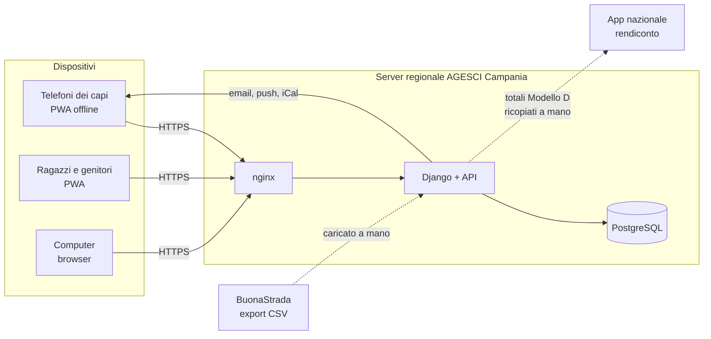

# Quaderno di Caccia (QdC) — Analisi dei requisiti

> **Copia nel repository** del documento di analisi (revisione 21, 29 ottobre 2026), da
> cui provengono i codici `DEC-nn` citati nel codice. L'originale condiviso, con commenti,
> è su claude.ai: <https://claude.ai/artifact/Y8hDa3xkQ1cXVSToLTa7H7>. Una decisione nuova o
> cambiata si aggiorna in entrambi i posti, nello stesso commit/giorno.

Oct 21, 2026 · @Andrea Bruno

## Sintesi

Quaderno di Caccia (QdC) è l'app con cui i capi del Gruppo AGESCI Avellino 1 gestiscono anagrafica, fascicolo personale, Progressione Personale, eventi, presenze, quote e cassa. I ragazzi e i genitori la usano per consultare la propria parte. Si parte da anagrafica e quote, con il reparto come unità pilota; altri gruppi potranno installare la propria copia.

Il documento raccoglie le decisioni prese nell'analisi del 21 ottobre 2026; quelle da DEC-110 in poi sono state prese con il maintainer durante lo sviluppo della fase 1 (28 e 29 ottobre 2026), e nella colonna **Origine** riportano la data e la decisione che precisano. Ogni decisione ha un codice (**DEC-nn**) da citare nello sviluppo, e la colonna **Origine** rimanda alla domanda da cui nasce: le domande sono nel documento "Analisi requisiti — App di Gruppo (Avellino 1)". Le parti marcate *\[da verificare\]* sono inferenze non ancora confermate. Le sigle sono spiegate nel glossario in fondo.

Il nome dell'app coincide con quello del quaderno cartaceo dei ragazzi, che resta: nei testi per le famiglie conviene scrivere "l'app QdC".

## Perimetro

QdC sostituisce quaderni, fogli volanti ed Excel condivisi a mano: oggi la PP si perde, i fascicoli non esistono più da anni e la cassa contanti vive su foglietti (V-01).

| ID | Decisione | Origine |
| --- | --- | --- |
| DEC-01 | Criterio di successo: a fine anno associativo (30 settembre) la cassa è stata usata e ogni ragazzo ha il fascicolo con dati e PP dell'anno. | V-03 |
| DEC-02 | QdC non sostituisce BuonaStrada: ne importa i dati e ne resta subordinata. | V-04, H-5 |
| DEC-03 | Nessuna chat e nessun nuovo canale di comunicazione con i genitori; solo notifiche e, in seguito, una bacheca di soli avvisi. | V-04, N-22 |
| DEC-04 | Il quaderno di caccia cartaceo resta: l'app lo affianca, non lo sostituisce. | V-05 |
| DEC-05 | Nessun caricamento di storico pregresso; sui singoli si inserisce al massimo l'anno di ingresso e dati simili. | V-06, T-05 |
| DEC-06 | Fuori perimetro: rendiconto e bilancio (si fanno sull'app nazionale), pagamenti online, viste per Zona e Regione, integrazione con Plancia, percorso delle specialità di squadriglia, gamification e classifiche. | H-4, F-05, R-09, M-06, E-04, P-08 |
| DEC-07 | Manutenzione affidata alla pattuglia informatica regionale; allo sviluppo contribuiscono anche altri sviluppatori. | V-07, X-06 |
| DEC-08 | Mandato: l'adozione è decisa dalla Co.Ca. | V-02 |

## Fasi di sviluppo

L'ordine segue le priorità della Co.Ca. (Z-01, Z-02); non ci sono date vincolanti (Z-04). Il reparto è l'unità pilota e tutti gli staff sono disponibili a seguire (Z-03). Nel 2025/26 l'AV1 ha reparto femminile, reparto maschile, Clan/Fuoco e Co.Ca., senza branco o cerchio attivi: la PP L/C può arrivare per ultima.

1. **Fondamenta:** account e accesso, ruoli, unità, importazione da BuonaStrada, profili dei genitori e nuclei familiari.
2. **Quote e cassa:** tipi di quota, sconti e agevolazioni, pagamenti e ricevute, prima nota con voci del Modello D.
3. **Eventi e presenze:** eventi a quattro livelli, riunioni ricorrenti, presenze offline, feed di calendario.
4. **Progressione Personale:** prima E/G (pilota, con imprese), poi R/S e L/C; passaggi di branca.
5. **Fascicolo completo:** scheda medica con stampa, note con visibilità, archiviazione, fascicolo dei capi, report per i passaggi.
6. **Dopo:** bacheca avvisi, esperienze collegate agli impegni, lettura dell'estratto conto bancario, testo della Carta di clan in consultazione.

La scheda medica è nella fase 5 per completezza del fascicolo, ma può essere anticipata se serve già per i campi della prima estate.

## Ruoli e permessi

Ogni capo vede tutto di tutti i ragazzi del gruppo; gli altri ruoli vedono solo la propria parte. La Co.Ca. firma una liberatoria privacy che copre questa condivisione (R-01).

| ID | Decisione | Origine |
| --- | --- | --- |
| DEC-09 | **Capo** (tirocinanti e AE compresi): legge tutti i dati di tutti i ragazzi, compresi dati sanitari, PP e note, anche quelle delicate. L'unità è solo un filtro di visualizzazione. Scrive per l'unità di cui è staff. | R-01, R-02, N-14 |
| DEC-10 | **Capigruppo** (diarchia): creano unità e branche e assegnano gli staff; importano da BuonaStrada; riaprono un anno chiuso; revocano i dispositivi persi. Non hanno altri poteri sugli altri capi. | R-02, N-08, N-19, N-21 |
| DEC-11 | **Tesoriere** di gruppo e di unità: ruolo distinto e cumulabile, ricoperto da un capo. In R/S può essere un rover o una scolta, con gli stessi permessi ma senza vedere le agevolazioni. L'ultima parola sul saldo di una cassa spetta al tesoriere o al capo unità. | R-04, N-20, F-10 |
| DEC-12 | **Amministratore tecnico**: gestisce cataloghi, importazioni e account; ruolo separato dai capigruppo. | N-21 |
| DEC-13 | **CSQ**: legge mete, impegni, specialità e brevetti della propria squadriglia; scrive note sui suoi squadriglieri; può proporre qualsiasi convalida, che lo staff conferma. Contatti nella squadriglia: DEC-115. | R-05, A-02, N-23 |
| DEC-14 | **VCSQ**: nessun permesso di base. Il capo unità può abilitarlo; il CSQ può delegarlo per un periodo limitato (es. un'assenza). | R-05 |
| DEC-15 | **Ragazzo**: vede i propri dati, la propria PP e le note condivise con lui; in E/G può inserire le proprie mete e impegni, da convalidare. | P-02, V-05 |
| DEC-16 | **Genitore o tutore**: vede quote dovute e pagate con il dettaglio di sconti e agevolazioni; vede prede, mete, impegni e specialità di L/C, E/G e R/S minorenni; aggiorna la scheda medica; vede le note rese visibili ai genitori. Dai 18 anni decide l'R/S. Chi non esercita la responsabilità genitoriale non ha account. | R-07, N-17, S-04, N-28, G-2 |
| DEC-17 | Sestiglie, pattuglie R/S, Alta Squadriglia e Con.Ca. si registrano solo come appartenenza, senza permessi; capi sestiglia e capi pattuglia sono titoli. Il Consiglio della Rupe non si modella. | R-06, E-07 |
| DEC-18 | La diarchia si modella esplicitamente: due titolari per ruolo, posto vacante possibile. | R-10 |
| DEC-19 | Senza accesso: R/S e novizi in servizio ai dati altrui, adulti non censiti, maestri di specialità esterni, Zona e Regione. | R-03, R-09, PP-G |
| DEC-20 | Un capo che è anche genitore agisce come capo. Chi lascia il servizio perde subito l'accesso; i suoi contributi restano a suo nome. | R-11, R-12 |
| DEC-110 | Lo staff dell'unità (DEC-09) si registra come incarico "Staff di unità", oltre al capo unità, senza limite di persone; i capi restano nella Co.Ca. come appartenenza. | DEC-09, 28/10 |
| DEC-111 | Chi nomina: capo squadriglia e vice tutto lo staff del reparto; capigruppo e tesoriere di gruppo i capigruppo in carica (l'amministratore tecnico solo al primo avvio o se non ce ne sono); tesoriere di unità il capo unità e i capigruppo. | DEC-10, DEC-11, DEC-14, 28/10 |
| DEC-112 | Le squadriglie le creano, chiudono e compongono lo staff del reparto e i capigruppo. Un ragazzo è in una squadriglia alla volta; capo squadriglia e vice ne fanno parte e chiudono l'incarico prima di cambiarla. | DEC-30, 28/10 |
| DEC-113 | I dati sanitari li scrivono, oltre a genitori e maggiorenni (DEC-50), lo staff dell'unità della persona e i capigruppo, per tutte le unità. | DEC-50, DEC-55, 28/10 |
| DEC-114 | Il registro delle modifiche, anche dei dati sanitari, è visibile all'amministratore tecnico, che è sempre un capo o ha la delega dei capigruppo per i dati. | DEC-12, 28/10 |
| DEC-115 | Contatti in squadriglia: ogni squadrigliere vede il solo telefono degli altri; il capo squadriglia anche il telefono dei genitori di tutta la squadriglia; il vice vede come uno squadrigliere. Niente email. Il numero mostrato è il cellulare del ragazzo in BuonaStrada se c'è; altrimenti quello di un genitore o tutore scelto per quel figlio; altrimenti quello scelto per tutti i figli senza cellulare; altrimenti nessuno. Il genitore (o il maggiorenne) può nasconderlo agli squadriglieri, non al capo squadriglia; lo impostano genitore, maggiorenne, staff dell'unità e capigruppo. Copia cifrata sul telefono per le uscite. | DEC-13, 29/10 |

## Account e accesso

Si entra con email e passkey, oppure con Google o Apple; la sessione resta valida 30 giorni anche senza rete.

| ID | Decisione | Origine |
| --- | --- | --- |
| DEC-21 | Registrazione con email personale, attivata da un capo unità o capogruppo oppure tramite link o codice di invito. Nessun account Google Workspace creato dal gruppo. Iscrizione di nuovi soci con codice: DEC-120…DEC-127. | M-07 |
| DEC-22 | Accesso con email e passkey, codice via email come riserva, più accesso con Google e con Apple. | O-07, N-19 |
| DEC-23 | Sessione di 30 giorni sul dispositivo; i capigruppo possono revocare un dispositivo perso. | N-19, O-05 |
| DEC-24 | Sotto i 14 anni il ragazzo ha un account proprio solo con il consenso del genitore. L'app registra chi ha dato il consenso, quando e come è stato verificato che fosse il genitore (art. 2-quinquies del Codice privacy). Dai 14 anni: DEC-117. | R-08, N-18 |
| DEC-25 | ~~Gli inviti ai ragazzi senza email propria passano dall'email dei genitori.~~ *Superata da DEC-116: ogni account ha la sua email.* | Export BuonaStrada |
| DEC-26 | Ai 18 anni l'R/S decide cosa resta visibile ai genitori; il genitore resta collegato alle quote finché l'R/S non lo scollega. Alla Partenza l'account diventa un account da capo. Dettagli: DEC-119. | S-04, N-17, S-05 |
| DEC-116 | Ogni account ha la sua email: un ragazzo non si invita né si iscrive con l'email di un genitore. | DEC-25, 28/10 |
| DEC-117 | Dai 14 anni l'account si apre con l'invito del capo unità o di un capogruppo, senza approvazione del genitore. | DEC-24, 29/10 |
| DEC-118 | Chi si registra da un invito non conferma l'email una seconda volta: l'invito è arrivato a quell'indirizzo. | DEC-21, 29/10 |
| DEC-119 | Ai 18 anni l'R/S sceglie per categoria, uguale per tutti i genitori, cosa vedono: contatti e indirizzo; farmaci, allergie e alimentazione; scheda e attività. Finché non sceglie vedono tutto, senza poter modificare. Email all'R/S e a ciascun genitore un mese prima e il giorno del compleanno; se non ha un account la pagina dell'unità lo segnala ai capi. Il collegamento alle quote arriva con la fase 2. | DEC-26, 29/10 |

**Iscrizione dall'app.** Un nuovo socio può iscriversi dall'app prima di essere in BuonaStrada.

| ID | Decisione | Origine |
| --- | --- | --- |
| DEC-120 | Il nuovo socio usa un codice di iscrizione (anche come link o QR code): per l'unità, valido fino a una data, oppure personale, valido una volta. Lo creano lo staff dell'unità e i capigruppo; per la Co.Ca. solo i capigruppo. | DEC-21, 29/10 |
| DEC-121 | Il genitore iscrive il figlio minorenne (il figlio avrà poi un account con un invito); il maggiorenne si iscrive da sé; in Co.Ca. solo maggiorenni. L'account resta "in attesa" finché la richiesta non è accolta. | 29/10 |
| DEC-122 | La richiesta la accolgono lo staff dell'unità o i capigruppo; per i capi solo i capigruppo. Accolta, il socio ha un codice socio provvisorio: 9 seguito da un progressivo, 10 cifre (es. 9000000001). L'importazione lo ritrova dal codice fiscale e lo sostituisce con il codice vero: su codice socio e dati vince BuonaStrada. | DEC-02, DEC-29, 29/10 |
| DEC-123 | Un capo non ancora in BuonaStrada vede organizzazione e nomi, ma non i dati delicati degli altri soci. | DEC-09, 29/10 |
| DEC-124 | All'iscrizione si chiedono nome, cognome, codice fiscale e data di nascita; il resto entro una scadenza fissata da chi accoglie: sesso, luogo di nascita, indirizzo, comune, provincia, CAP; cellulare ed email propri per il maggiorenne (in qualsiasi unità) e per il minore in clan/fuoco o noviziato; per il minore i genitori, come in BuonaStrada (genitore singolo con affidamento esclusivo oppure entrambi i genitori o tutori), con codice fiscale, cellulare ed email; i consensi (2A, 2B, 2C, riviste) dai moduli firmati. | DEC-30, 29/10 |
| DEC-125 | Promemoria alla famiglia 7 giorni prima della scadenza; scaduto il termine l'iscrizione è sospesa: la famiglia non vede più quel socio finché non completa (un maggiorenne iscritto da sé torna in attesa). Lo staff la vede come sospesa. | 29/10 |
| DEC-126 | I capigruppo caricano i moduli vuoti (informativa, consensi); la famiglia li scarica, li firma a mano e carica le scansioni; un capo dello staff o un capogruppo le verifica e riporta i consensi. Le scansioni si conservano finché il socio resta nel gruppo; le vedono i capi, con il registro degli accessi. | DEC-42, DEC-101, 29/10 |
| DEC-127 | I capigruppo hanno l'elenco delle iscrizioni da inserire in BuonaStrada, esportabile in Excel e PDF, e le segnano come inserite. | DEC-02, 29/10 |

## Anagrafica e importazione da BuonaStrada

BuonaStrada è la fonte di verità dell'anagrafica: QdC importa l'export "Ricerca Soci" (CSV) e non lo sostituisce. Le correzioni fatte nell'app non vengono mai cancellate in silenzio da un'importazione.

| ID | Decisione | Origine |
| --- | --- | --- |
| DEC-27 | L'importazione la fa un capogruppo o l'amministratore tecnico, a inizio anno dopo il censimento e quando serve; prima di applicarla l'app mostra le differenze. | N-08 |
| DEC-28 | Si importano solo i soci con stato R (rinnovo) e S (sospeso, in attesa di rinnovo). Gli ex soci (D) non si importano; se sono già nell'app, si chiude la loro appartenenza. Durante il censimento, quando tutti risultano sospesi, nessuno viene disattivato. | I-1 |
| DEC-29 | La chiave del socio è il codice socio. Il file va letto saltando la riga "sep=", gestendo il BOM, togliendo l'involucro ="..." e ignorando la virgola finale di ogni riga; le date sono gg/mm/aaaa. | Export BuonaStrada |
| DEC-30 | Comanda BuonaStrada: nome, cognome, sesso, nascita, codice fiscale, codice socio, indirizzo, contatti, unità di censimento, consensi, dati dei genitori. Comanda l'app: noviziato, squadriglie, incarichi, scheda medica, PP, quote. | N-07, I-2 |
| DEC-31 | Se un genitore o un capo corregge un dato di BuonaStrada, la correzione vale subito nell'app, segnata "in attesa di BuonaStrada", e arriva ai capigruppo, che la inoltrano alla segreteria regionale. L'importazione successiva mostra le differenze invece di sovrascrivere. Dettagli: DEC-129, DEC-130. | M-04, N-07 |
| DEC-32 | I profili dei genitori si creano dalle colonne RESP.GENITORIALE (tipo "Genitori" o "Unico genitore"; dati con nome, codice fiscale, nascita, email, cellulare). La residenza la completa il genitore. Le righe che non si riescono a leggere vengono segnalate. | I-2, G-1 |
| DEC-33 | Il nucleo familiare si riconosce in automatico: fratelli sono i soci con un genitore con lo stesso codice fiscale. | A-09, I-2 |
| DEC-34 | Noviziato e Clan/Fuoco: la comunità iniziale viene dalla colonna COMUNITA SOCIO; in app il noviziato è un'unità a sé, può mancare, e un capo può registrare il passaggio al clan anche durante l'anno. | S-01, I-6 |
| DEC-35 | Dall'export si leggono anche le unità (tipo, codice, progressivo, ambiente, durata), i dati dei capi (livello di formazione, anno di ingresso in Co.Ca., nomina) e i dati del gruppo per le ricevute (codice fiscale, denominazione, rappresentante legale). Date nel futuro e valori incoerenti vengono segnalati. | A-08, N-29, Export |
| DEC-36 | I reparti paralleli maschile e femminile sono due unità, collegate da una nota. | E-08 |
| DEC-37 | Anno associativo dal 1 ottobre al 30 settembre. L'età si calcola al 30 aprile (data configurabile); i capi possono fare eccezioni. | V-03, T-02 |
| DEC-128 | Il nome dell'unità lo dà il gruppo (non è in BuonaStrada) e può ripetersi: è obbligatorio tranne per la Co.Ca. Il codice unità di BuonaStrada (lettera e progressivo, es. O1; G1 per la Co.Ca.) è univoco. L'unità si mostra sempre come tipo, nome e codice: "Clan/Fuoco Hirpinia (T1)". Le unità create dall'importazione nascono senza nome, segnalate finché il gruppo non lo dà. | DEC-35, 29/10 |
| DEC-129 | Correzioni: contatti e indirizzo li correggono il genitore (suoi e dei figli minorenni), il maggiorenne (i suoi, anche i consensi), lo staff dell'unità e i capigruppo; sesso e luogo di nascita lo staff e i capigruppo; nome, cognome, data di nascita e codice fiscale solo i capigruppo; l'amministratore tecnico corregge tutto. I capigruppo e l'amministratore tecnico le inoltrano alla segreteria e le segnano "inoltrate", oppure le scartano con un motivo (torna il valore di prima). Email riassuntiva ai capigruppo, al massimo una al giorno. La correzione si chiude quando l'importazione la ritrova. | DEC-31, 29/10 |
| DEC-130 | Differenze all'importazione: chi importa indica la data di aggiornamento dei dati di BuonaStrada; per ogni differenza (dati corretti nell'app, unità assegnate nell'app) sceglie quale dato vince; è proposto il più recente, a parità l'app. Se vince BuonaStrada la correzione si chiude come "superata". | DEC-31, DEC-34, 29/10 |
| DEC-131 | Le squadriglie sono maschili o femminili: il sesso si controlla all'inserimento; se manca in BuonaStrada l'inserimento è permesso e la pagina del reparto lo segnala. | 28/10 |
| DEC-132 | Eccezioni alla squadriglia (identità di genere, transizioni): le decide la Co.Ca., le registra un capogruppo con la motivazione; le vedono solo i capi e ogni lettura va nel registro degli accessi; valgono finché la persona resta nel reparto. | DEC-101, 28/10 |
| DEC-133 | La squadriglia è organo di base del reparto: chi esce dal reparto esce dalla squadriglia e dagli incarichi di capo e vice. | DEC-28, 28/10 |

**Consensi importati.** I nomi nell'app sostituiscono le sigle dell'export; la corrispondenza viene dall'informativa AGESCI del 10 novembre 2024.

| Colonna export | Nome nell'app | Contenuto |
| --- | --- | --- |
| CONSENSO 2A | Consenso iscrizione e attività | Trattamento dei dati per iscrizione e attività, compresi i dati sanitari. Obbligatorio. |
| CONSENSO 2B | Consenso foto e video | Uso di foto e riprese per fini istituzionali; firma di entrambi i genitori. In evidenza per i capi. |
| CONSENSO 2C | Consenso comunicazioni commerciali | Promozioni del "Sistema AGESCI"; vale 24 mesi. |
| CONSENSO RIVISTE | Consenso invio riviste | Volontà di ricevere o no a casa la rivista associativa. |

I consensi dati dai genitori cessano ai 18 anni: l'app segnala gli R/S che diventano maggiorenni.

## Fascicolo personale

Il fascicolo accompagna ogni ragazzo per tutta la vita nel gruppo e si archivia due anni dopo l'uscita.

| ID | Decisione | Origine |
| --- | --- | --- |
| DEC-38 | Contenuto: anagrafica, tutori, scheda medica, autorizzazioni, PP, verifiche, presenze (totali per anno), quote, documenti, foto profilo, note di staff. | A-01 |
| DEC-39 | Note di staff: la Co.Ca. le vede sempre; a scelta si aggiungono il ragazzo, i genitori e il CSQ (solo E/G). "Per tutti" significa ragazzo, genitori e CSQ, mai gli altri squadriglieri. L'app evidenzia ciò che è condiviso fuori dalla Co.Ca. | A-02, E-05, N-15, H-2 |
| DEC-40 | Note del CSQ: sempre visibili a staff e Co.Ca.; il CSQ sceglie se mostrarle allo squadrigliere e ai genitori, e lo staff può cambiare la scelta. | A-02, N-16 |
| DEC-41 | Ogni capo vede l'intera PP di qualsiasi ragazzo; per i passaggi l'app prepara un report riassuntivo. | A-03 |
| DEC-42 | File ammessi: foto profilo (storicizzata), foto dei giustificativi di spesa, allegati facoltativi alla PP (solo immagini e PDF, con dimensione massima). Liberatorie e prescrizioni mediche restano su carta: l'app registra solo la data di consegna. | D-03, P-03, N-11, S-1 |
| DEC-43 | Regole sul rapporto con il minore indicate dai genitori (es. separazione): campo riservato alla Co.Ca., in evidenza nella scheda del ragazzo e disponibile offline al campo. | G-2 |
| DEC-44 | Archiviazione due anni dopo l'uscita: esportazione in PDF e archivio compresso sul Drive del gruppo, poi cancellazione dall'app. Restano nome e anni di appartenenza, per riconoscere chi rientra. | A-04, D-07, N-12 |
| DEC-45 | A fine anno i dati si congelano. Un capogruppo può riaprire un anno chiuso, con motivazione, in modo tracciato e per un periodo limitato. | T-03, N-21 |
| DEC-46 | Chi entra a percorso iniziato riceve solo ciò che si riesce a ricostruire, con date parziali. Va previsto un formato di esportazione e importazione del fascicolo tra gruppi che usano QdC. | T-04 |
| DEC-47 | Fascicolo dei capi: anni di servizio, unità e ruoli per anno, formazione. Non è collegato a Catello. Percorso di formazione: DEC-134. | A-08, N-13 |
| DEC-134 | Il percorso di formazione dei capi si inserisce a mano (dal capo o da un capogruppo); da BuonaStrada arriva solo il livello. | DEC-47, 29/10 |

## Scheda medica

La scheda medica riproduce i moduli AGESCI aggiornati "Consenso al trattamento dei dati sanitari" per soci minorenni e maggiorenni; i genitori la aggiornano nell'app e la firmano su carta.

| ID | Decisione | Origine |
| --- | --- | --- |
| DEC-48 | Campi del modulo: numero di tessera sanitaria; reperibilità per emergenze (nome e telefono); vaccinazione antitetanica sì/no; allergie e/o intolleranze con il grado di reazione; profilassi in corso (farmaco, posologia, orari, autonomia nell'assunzione); ulteriori note sanitarie. Nome, nascita e codice fiscale arrivano da BuonaStrada. | A-06, moduli AGESCI |
| DEC-49 | Campi facoltativi in più: gruppo sanguigno, medico curante, altre vaccinazioni. Esigenze alimentari non mediche: DEC-135. | S-3 |
| DEC-50 | La aggiornano i genitori, o l'R/S maggiorenne per sé. | R-07 |
| DEC-51 | Stampa del modulo ufficiale, nella versione per minorenni o per maggiorenni, precompilato. Per i minorenni i firmatari (uno o due, con il ruolo) si prendono dai profili dei genitori. Sotto, una sezione aggiuntiva per i campi facoltativi, con una propria riga di consenso e firma. | O-05, G-1, S-3 bis |
| DEC-52 | Si firma a inizio anno e a ogni modifica; l'app registra la data dell'ultima firma e segnala le schede modificate dopo. | N-10 |
| DEC-53 | La reperibilità per emergenze è annuale, ma il genitore può sostituirla per un singolo campo o uscita; la stampa per quell'evento usa il recapito giusto. | S-2, G-3 |
| DEC-54 | La prescrizione medica resta allegata alla scheda cartacea; nell'app si segna "prescrizione consegnata il...". | S-1 |
| DEC-55 | Al campo non serve l'intera scheda: sui telefoni dei capi vanno offline farmaci (con posologia, orari e autonomia nell'assunzione), allergie e intolleranze (con il grado di reazione), con le protezioni di DEC-97. Questo nucleo si anticipa alla fase 1; la scheda completa, con stampa e firme, resta nella fase 5. Lo compilano nell'app i genitori o l'R/S maggiorenne; i capi possono trascriverlo dalla scheda cartacea firmata. | O-05, 22/10 |
| DEC-135 | Esigenze alimentari non mediche (vegetariano, religiose…) nella scheda, con le stesse regole dei dati sanitari: stesse persone, offline al campo, registro degli accessi. Si scrive cosa non mangia, non il motivo. | DEC-49, 29/10 |

## Progressione Personale

La PP segue il documento "Specifica di dominio e requisiti per lo sviluppo" v1.0, ridotto ai blocchi scelti nel documento "Documento PP — cosa serve nella prima versione". L'app registra e ricorda; il riconoscimento della crescita resta alle persone e alle comunità previste dal metodo.

| ID | Decisione | Origine |
| --- | --- | --- |
| DEC-56 | Il documento PP v1.0 è il riferimento del modello, senza ulteriore rilettura, nei limiti di queste decisioni. | N-01 |
| DEC-57 | Una persona ha un'unica identità per tutta la vita nel gruppo; periodi di branca e di momento, tappa o passo sono distinti dalle appartenenze alle unità. | PP-A |
| DEC-58 | La Promessa è un evento con data; la consegna del distintivo ha una data propria, distinta dall'ingresso nella tappa. | PP-B |
| DEC-59 | Impegni, mete e obiettivi hanno sei stati (bozza, concordato, in corso, da verificare, concluso, interrotto) e conservano le revisioni del testo, in tutte le branche, L/C compresi. | PP-D, P-1 |
| DEC-60 | La convalida è il passaggio da "da verificare" a "concluso", con data; chi convalida è registrato in automatico. Non si registrano colloqui né autovalutazioni. | PP-F, P-05 |
| DEC-61 | In L/C registra il capo; in E/G anche i ragazzi possono inserire mete e impegni; il CSQ propone convalide, lo staff le conferma. | P-02, N-23 |
| DEC-62 | Specialità e brevetti seguono un percorso con carta (testo scritto nell'app), maestro anche esterno senza account e stati da proposto a riconosciuto. | PP-G, P-2 |
| DEC-63 | I cataloghi vengono dal regolamento metodologico: 40 specialità L/C, 65 specialità E/G, 12 specialità di squadriglia, 15 brevetti. Le voci si ritirano, mai si cancellano, e ogni conquista conserva il nome dell'epoca. Le immagini delle specialità E/G si caricano a parte. | M-03, P-4, P-06 |
| DEC-64 | Specialità di squadriglia: si registra se la squadriglia l'ha conquistata e quali specialità e brevetti individuali sono nati da quel percorso, anche se non conquistata. | E-04, N-24 |
| DEC-65 | Già nella prima versione E/G: imprese di reparto, squadriglia e Alta Squadriglia con i posti d'azione; squadriglie per anno, con cambi durante l'anno e incarichi. | E-06, N-25 |
| DEC-66 | L/C: stagione di caccia o di volo come etichetta; prede e voli; appartenenza al Consiglio degli Anziani. | PP-C, L-05 |
| DEC-67 | R/S: Punto della Strada semplice e ripetibile; firma della Carta di clan registrata con la sola data, come evento che apre i passi di competenza; servizio verificato nel Punto della Strada; conclusione con tipo (Partenza, saluto fraterno, interruzione, trasferimento) e data. | PP-J, P-3, S-03, PP-K |
| DEC-68 | Eventi individuali (Piccole Orme, campi di specialità, EPPPI, ROSS): solo partecipazione e quote anticipate; nessun controllo automatico, lo fa BuonaCaccia. | PP-I |
| DEC-69 | I passaggi tra branche li decide la Co.Ca., in blocco per unità; chiudono un periodo e aprono il successivo senza convertire tappe o specialità. | T-01, PP-L |
| DEC-70 | Storico: date parziali (anche solo l'anno), correzioni tracciate, registro delle modifiche; versione per ogni oggetto e protezione dai doppi invii. | PP-O, PP-P, PP-Q |
| DEC-71 | Solo vincoli strutturali e qualche promemoria: nessun avanzamento automatico, nessuna classifica. | PP-R, P-08 |
| DEC-72 | Viste: scheda personale con la storia di tutti gli anni nel gruppo e vista di unità. Per i ragazzi, linguaggio e colore della branca e nomi giungla o bosco dei capi. | PP-T, P-07, N-26, L-06 |
| DEC-73 | I casi di prova del documento PP diventano test automatici. | PP-U |
| DEC-74 | Esclusi: classificazioni educative, collegamento a pagine e articoli del regolamento, esperienze collegate agli impegni (forse in seguito). | PP-M, PP-S, PP-E |

## Eventi e presenze

Gli eventi servono soprattutto a collegare presenze, quote e liberatorie; le presenze si segnano a ogni riunione, anche senza rete.

| ID | Decisione | Origine |
| --- | --- | --- |
| DEC-75 | Eventi a quattro livelli: gruppo (li creano i capigruppo), branca (i capi di quella branca), unità (i capi dell'unità), squadriglia (il CSQ o i capi del reparto). | EV-01 |
| DEC-76 | Eventi esterni: si registrano partecipazione, quote anticipate dal gruppo su BuonaCaccia da recuperare e liberatorie ricevute; i genitori vedono quote e liberatorie mancanti. Gli R/S maggiorenni pagano in autonomia. | EV-02, N-11 |
| DEC-77 | Iscrivere un ragazzo a un evento con quota genera la quota da pagare; l'importo è modificabile per persona, anche a zero. | EV-03 |
| DEC-78 | Presenze: ogni unità ha riunioni ricorrenti (es. sabato 16–18) e il capo segna i presenti, anche offline. Si può stampare un elenco da compilare a mano e riportare dopo. Il dettaglio resta due anni, poi restano i totali per anno. | A-07, EV-04, N-09 |
| DEC-79 | Feed iCal per Google Calendar e Calendario di iPhone; avvisi via email e notifiche push sull'app installata. | EV-05, EV-06, X-05 |

## Quote e cassa

QdC gestisce quote, pagamenti e prima nota; il rendiconto si compila a mano sull'app nazionale, partendo dai totali che QdC prepara nell'ordine del Modello D (vademecum AGESCI "Bilancio di Gruppo 2024–2025").

| ID | Decisione | Origine |
| --- | --- | --- |
| DEC-80 | Tipi di quota: censimento (quota nazionale), quota di gruppo, quota mensile di unità, campi e uscite, eventi esterni. | N-28 |
| DEC-81 | Sconto fratelli: regola automatica, uguale per tutti quelli che hanno le stesse condizioni, attivabile per ogni tipo di quota e mai sulla quota nazionale. Non si modifica a mano sulla singola famiglia. | N-28, B-5 |
| DEC-82 | Agevolazione: la cassa di gruppo copre, in tutto o in parte, qualsiasi quota. Per la parte coperta non si registra nessuna entrata. La decide e la vede la Co.Ca.; la famiglia la vede sulla propria quota; il tesoriere R/S ragazzo no. Nei campi entra nel budget come contributo dalla cassa. | F-04, B-6, N-20 |
| DEC-83 | Nessun pagamento dentro l'app: si registrano i pagamenti fatti in contanti, con bonifico o altro; si può indicare un link di pagamento (es. paypal.me). | F-05 |
| DEC-84 | Ricevute in PDF non fiscali, numerate per anno associativo (es. 2026-27/015), intestate al gruppo e inviate via email al genitore; le emette chi registra il pagamento. | F-06, N-29 |
| DEC-85 | Prima nota per cassa: conto bancario (all'AV1 uno solo, con carte di debito per unità) e cassa contanti per unità. La struttura delle casse si configura per gruppo. | F-01 |
| DEC-86 | Le uscite si registrano con foto del giustificativo, anche offline. I rimborsi ai capi vanno nella voce "Rimborsi spese volontari". | F-03 |
| DEC-87 | Le categorie della prima nota sono le voci del Modello D: la voce scout o, se manca, quella ministeriale; escluse le righe non selezionabili (5x1000, personale). Il catalogo vale per anno di bilancio. | B-1, F-02 |
| DEC-88 | Prelievi, versamenti e passaggi tra casse sono giroconti: cambiano i saldi, ma non sono né entrate né uscite. | B-2 |
| DEC-89 | Le quote anticipate su BuonaCaccia vanno in A.2, sia l'uscita verso BuonaCaccia sia il rimborso dalla famiglia. | B-4 |
| DEC-90 | L'autofinanziamento è un tipo di evento con entrate, uscite e rendiconto propri. | B-3 |
| DEC-91 | Budget dei campi: tra quota pro capite, contributo dalla cassa e budget complessivo, fissati due si calcola il terzo. | F-08 |
| DEC-92 | Chi non ha pagato lo vedono solo la Co.Ca. e la famiglia interessata. | F-09 |
| DEC-93 | Il caricamento dell'estratto conto bancario per abbinare i bonifici arriva in una fase successiva. | N-04 |

## Offline e sincronizzazione

Il caso tipico è la riunione settimanale in una sede con poca rete, non solo il campo estivo: l'offline serve ai capi, perché i ragazzi in attività non usano il telefono.

| ID | Decisione | Origine |
| --- | --- | --- |
| DEC-94 | Scenari: riunione in sede senza rete (ogni settimana); campo fino a 12 giorni, con sincronizzazioni quando i capi raggiungono una zona coperta. Di rado più di due persone modificano lo stesso dato. | H-1, O-01, O-02, O-08, E-09 |
| DEC-95 | Disponibili offline sui telefoni dei capi: elenco e contatti dei ragazzi, farmaci, allergie e intolleranze (non l'intera scheda medica, DEC-55), regole sul rapporto con il minore, PP dell'unità. Registrabili offline: presenze, movimenti di cassa con giustificativo, note, impegni e convalide. | O-01, O-05, EV-04, F-03, 22/10 |
| DEC-96 | Conflitti: su anagrafica, note e testi vince l'ultima modifica; presenze e movimenti di cassa sono registrazioni separate e non entrano mai in conflitto; convalide, riconoscimenti e passaggi vanno in coda e il server scarta i doppioni. | O-03, N-27 |
| DEC-97 | Protezione dei dati sul telefono: dati cifrati, sblocco con PIN o biometria, revoca a distanza da parte dei capigruppo, cancellazione automatica dei dati sensibili dopo il campo. Si realizza subito, nella fase 1, insieme al nucleo sanitario di DEC-55. | O-05, N-19, 22/10 |

## Privacy e sicurezza

Il titolare del trattamento è AGESCI nazionale; i capigruppo sono delegati al trattamento e gli altri capi agiscono su loro delega.

| ID | Decisione | Origine |
| --- | --- | --- |
| DEC-98 | Titolare: AGESCI APS nazionale, come da informativa unificata del 10 novembre 2024. Delegati: i capigruppo; i capi su loro delega. | D-01, I-4 |
| DEC-99 | Non si redige una valutazione d'impatto (DPIA): i capigruppo se ne assumono la responsabilità. | D-02 |
| DEC-100 | Nessuna cifratura dei singoli campi nel database; backup cifrati (copia della macchina virtuale e, per altri gruppi, backup incrementale periodico). | D-04, D-09 |
| DEC-101 | Registro degli accessi ai dati sensibili, consultabile dalla Co.Ca. e, su richiesta, dai genitori e dalle autorità giudiziarie. | D-06 |
| DEC-102 | In ogni fase si realizzano le funzioni per i diritti degli interessati: accesso, rettifica, cancellazione, esportazione del fascicolo. Ne rispondono i capigruppo. Dettagli: DEC-136. | D-08 |
| DEC-103 | Dati ospitati in Unione Europea. | D-05 |
| DEC-136 | La delega dei capigruppo copre l'app. Diritti degli interessati gestiti dai capigruppo, che girano le richieste al nazionale: registro delle richieste con scadenza a un mese; fascicolo completo in file (JSON) e pagina stampabile; cancellazione dei dati che esistono solo nell'app, con anonimizzazione di chi non è più socio né genitore di un socio (restano i periodi nelle unità). | DEC-98, DEC-102, 29/10 |

## Architettura tecnica

Un unico server per gruppo conserva i dati e decide chi vede cosa; telefoni e computer lo usano attraverso la stessa app.

BuonaStrada entra solo con il file caricato a mano, e il rendiconto torna all'app nazionale solo ricopiato a mano (linea tratteggiata): non ci sono collegamenti automatici con i sistemi nazionali.

| ID | Decisione | Origine |
| --- | --- | --- |
| DEC-104 | Server Django (versione 6 o successiva) con database PostgreSQL (17 o successiva), con lo stack standard dei progetti regionali: uv, mise, Docker, tema django-agesci-campania-theme. Codice aperto con licenza MIT. | X-02 |
| DEC-105 | Una PWA per telefoni e computer; per l'AV1 anche un'app negli store, ricavata dallo stesso codice *\[modalità da verificare\]*. | X-01, X-03, H-3 |
| DEC-106 | Il server dell'AV1 gira sull'infrastruttura regionale AGESCI Campania. | X-04 |
| DEC-107 | Un'installazione per gruppo: ogni gruppo ospita la propria ed è responsabile dei propri dati. Per gli altri gruppi c'è un'app generica configurabile e il codice sorgente da personalizzare. | M-01, M-02, H-3 |
| DEC-108 | Notifiche via email e push sull'app installata. | X-05 |
| DEC-109 | Nome: Quaderno di Caccia (QdC). Il gruppo ha codice fiscale e dominio propri, necessari per pubblicare sugli store come organizzazione. | X-07, N-30 |

## Punti ancora da verificare

Nessuno blocca l'inizio dello sviluppo. Quelli chiusi il 29 ottobre 2026 rimandano alla decisione.

- [x] **Delega e diritti degli interessati.** Confermare che la delega dei capigruppo copra anche uno strumento digitale del gruppo, e coordinare le richieste di accesso o cancellazione con l'Ufficio Privacy nazionale, a cui l'informativa le indirizza. (DEC-98, DEC-102) → **DEC-136**
- [x] **Formazione dei capi.** L'export di BuonaStrada riporta solo il livello di formazione: capire da dove prendere il resto del percorso. (DEC-47) → **DEC-134**
- [x] **Esigenze alimentari non mediche** (es. vegetariano): decidere se registrarle e dove, ad esempio nella scheda personale. (DEC-49) → **DEC-135**
- [x] **Contatti per il CSQ.** Nel tentativo di giugno il CSQ vedeva telefono ed email dei suoi squadriglieri: confermare o escludere. (DEC-13) → **DEC-115**
- [x] **Account dai 14 anni.** Confermare la procedura: invito del capo unità, con o senza approvazione del genitore. (DEC-24) → **DEC-117**

## Glossario essenziale

| Termine | Significato |
| --- | --- |
| AV1 | Gruppo AGESCI Avellino 1. |
| BuonaStrada / BuonaCaccia | Gestionale soci nazionale AGESCI / portale AGESCI per le iscrizioni agli eventi. |
| CdA | Consiglio degli Anziani (L/C). |
| Co.Ca. / Con.Ca. | Comunità Capi / Consiglio Capi del reparto (i CSQ). |
| CSQ / VCSQ | Capo Squadriglia / Vice Capo Squadriglia. |
| D-U-N-S | Codice internazionale che identifica un'organizzazione, richiesto da Apple. |
| DPIA | Valutazione d'impatto sulla protezione dei dati. |
| EPPPI / ROSS | Eventi di Progressione Personale a Partecipazione Individuale / Route di Orientamento alle Scelte di Servizio (R/S). |
| Giroconto | Spostamento di denaro tra due casse del gruppo: non è né entrata né uscita. |
| iCal | Formato che mostra gli eventi in Google Calendar o nel Calendario di iPhone. |
| Modello D | Rendiconto di cassa del Terzo Settore, con le voci indicate da AGESCI. |
| Offline | Senza connessione a internet. |
| Passkey | Accesso senza password, con impronta, volto o PIN del telefono. |
| PP | Progressione Personale. |
| Prima nota | Registro cronologico di entrate e uscite di una cassa. |
| PWA | App web che si installa sulla schermata Home e funziona anche senza rete, senza passare dagli store. |
| Push | Notifica che compare sul telefono anche ad app chiusa. |
| Sincronizzazione | Allineamento tra i dati sul telefono e quelli sul server quando torna la rete. |
| Titolare del trattamento | Chi decide come si usano i dati personali e ne risponde per legge. |

## Documenti di riferimento e fonti

**Documenti dell'analisi**

- [Analisi requisiti — App di Gruppo (Avellino 1)](https://claude.ai/artifact/BJ5ca4hjKLe8JGWpdd3a6x): domande e risposte delle due tornate (codici V, R, M, A, P, L, E, S, T, EV, F, O, D, X, Z, H, N).
- [Documento PP — cosa serve nella prima versione](https://claude.ai/artifact/DLTgqQeM8SVxdzfpd5eu6m): scelta dei blocchi PP-A…PP-U.
- Le decisioni prese in conversazione dopo i documenti hanno codici P-1…P-4, S-1…S-3, G-1…G-3, B-1…B-6, I-1…I-6. Quelle del 22 ottobre 2026 sono indicate come «22/10»: consensi 2B (foto e video) e RIVISTE (rivista associativa a casa) confermati; pubblicazione sugli store già sperimentata dal gruppo, quindi non più un punto aperto; nucleo sanitario offline (DEC-55, DEC-95); protezione dei dati sul telefono subito (DEC-97).

**Documenti AGESCI forniti dal gruppo**

- Regolamento metodologico AGESCI 2026 (PDF).
- Specifica di dominio e requisiti per lo sviluppo della Progressione Personale, v1.0, 21 ottobre 2026.
- Consenso al trattamento dei dati sanitari, moduli per socio minorenne e maggiorenne (versione aggiornata).
- Informativa unificata GDPR per i soci minori, revisione del 10 novembre 2024.
- Bilancio di Gruppo 2024–2025, vademecum per la compilazione del Modello D.
- Export "Ricerca Soci" di BuonaStrada, dati di prova anonimizzati (anno 2026 e 2027).

**Fonti esterne**

- [Garante privacy, provvedimento n. 467 dell'11 ottobre 2018 sulle valutazioni d'impatto](https://garanteprivacy.it/garante/doc.jsp?ID=9058979)
- [Agenda Digitale: il consenso digitale del minore dopo il D.Lgs. 101/2018](https://www.agendadigitale.eu/sicurezza/privacy/il-consenso-digitale-del-minore-dopo-il-decreto-gdpr-101-2018/)
- [Apple Developer Program, requisiti di iscrizione](https://developer.apple.com/programs/enroll/)
- [WebKit, Updates to Storage Policy](https://webkit.org/?p=14403)
