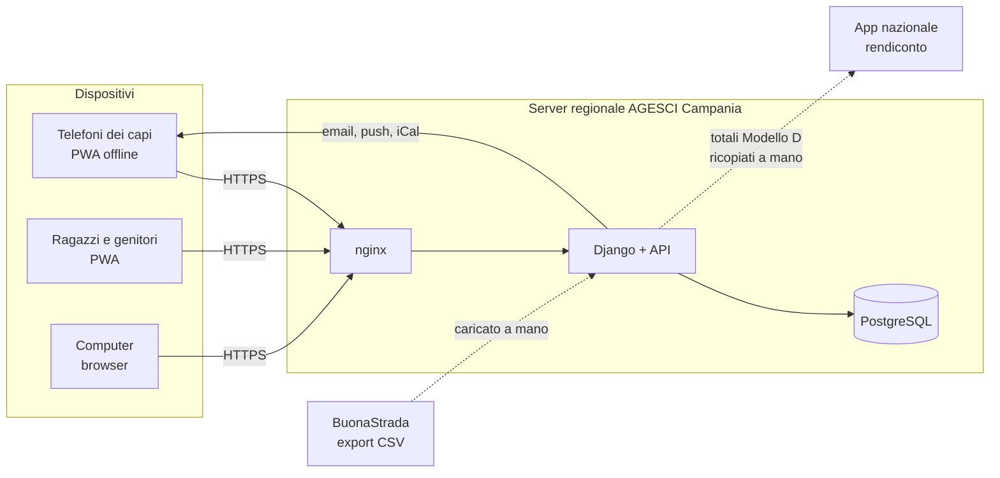

# Quaderno di Caccia (QdC) — Analisi dei requisiti

> **Unica fonte** dell'analisi e dei codici `DEC-nn` citati nel codice: una decisione nuova o
> cambiata si scrive qui. L'originale su claude.ai, con le prime discussioni, è fermo a circa il
> 30 ottobre 2026 e non si aggiorna più: <https://claude.ai/artifact/Y8hDa3xkQ1cXVSToLTa7H7>.

Oct 21, 2026 · @Andrea Bruno

## Sintesi

Quaderno di Caccia (QdC) è l'app con cui i capi del Gruppo AGESCI Avellino 1 gestiscono anagrafica, fascicolo personale, Progressione Personale, eventi, presenze, quote e cassa. I ragazzi e i genitori la usano per consultare la propria parte. Si parte da anagrafica e quote, con il reparto come unità pilota; altri gruppi potranno installare la propria copia.

Il documento raccoglie le decisioni prese nell'analisi del 21 ottobre 2026; quelle da DEC-110 in poi sono state prese con il maintainer durante lo sviluppo delle fasi 1, 2 e 3 (28, 29 e 30 ottobre 2026), e nella colonna **Origine** riportano la data e la decisione che precisano. Ogni decisione ha un codice (**DEC-nn**) da citare nello sviluppo, e la colonna **Origine** rimanda alla domanda da cui nasce: le domande sono nel documento "Analisi requisiti — App di Gruppo (Avellino 1)". Le parti marcate *\[da verificare\]* sono inferenze non ancora confermate. Le sigle sono spiegate nel glossario in fondo.

Il nome dell'app coincide con quello del quaderno cartaceo dei ragazzi, che resta: nei testi per le famiglie conviene scrivere "l'app QdC".

## Perimetro

QdC sostituisce quaderni, fogli volanti ed Excel condivisi a mano: oggi la PP si perde, i fascicoli non esistono più da anni e la cassa contanti vive su foglietti (V-01).

| ID | Decisione | Origine |
| --- | --- | --- |
| DEC-01 | Criterio di successo: a fine anno associativo (30 settembre) la cassa è stata usata e ogni ragazzo ha il fascicolo con dati e PP dell'anno. | V-03 |
| DEC-02 | QdC non sostituisce BuonaStrada: ne importa i dati e ne resta subordinata. | V-04, H-5 |
| DEC-03 | Nessuna chat e nessun nuovo canale di comunicazione con i genitori; solo notifiche e, in seguito, una bacheca di soli avvisi. | V-04, N-22 |
| DEC-04 | Il quaderno di caccia cartaceo resta: l'app lo affianca, non lo sostituisce. | V-05 |
| DEC-05 | Nessun caricamento di storico pregresso; sui singoli si inserisce al massimo l'anno di ingresso e dati simili. | V-06, T-05 |
| DEC-06 | Fuori perimetro: rendiconto e bilancio (si fanno sull'app nazionale), pagamenti online, viste per Zona e Regione, integrazione con Plancia, percorso delle specialità di squadriglia, gamification e classifiche. | H-4, F-05, R-09, M-06, E-04, P-08 |
| DEC-07 | Manutenzione affidata alla pattuglia informatica regionale; allo sviluppo contribuiscono anche altri sviluppatori. | V-07, X-06 |
| DEC-08 | Mandato: l'adozione è decisa dalla Co.Ca. | V-02 |

## Fasi di sviluppo

L'ordine segue le priorità della Co.Ca. (Z-01, Z-02); non ci sono date vincolanti (Z-04). Il reparto è l'unità pilota e tutti gli staff sono disponibili a seguire (Z-03). Nel 2025/26 l'AV1 ha reparto femminile, reparto maschile, Clan/Fuoco e Co.Ca., senza branco o cerchio attivi: la PP L/C può arrivare per ultima.

1. **Fondamenta:** account e accesso, ruoli, unità, importazione da BuonaStrada, profili dei genitori e nuclei familiari.
2. **Quote e cassa:** tipi di quota, sconti e agevolazioni, pagamenti e ricevute, prima nota con voci del Modello D.
3. **Eventi e presenze:** eventi a quattro livelli, riunioni ricorrenti, presenze offline, feed di calendario.
4. **Progressione Personale:** prima E/G (pilota, con imprese), poi R/S e L/C; passaggi di branca.
5. **Fascicolo completo:** scheda medica con stampa, note con visibilità, archiviazione, fascicolo dei capi, report per i passaggi.
6. **Dopo:** bacheca avvisi, esperienze collegate agli impegni, lettura dell'estratto conto bancario, testo della Carta di clan in consultazione.

La scheda medica è nella fase 5 per completezza del fascicolo, ma può essere anticipata se serve già per i campi della prima estate.

## Ruoli e permessi

Ogni capo vede tutto di tutti i ragazzi del gruppo; gli altri ruoli vedono solo la propria parte. La Co.Ca. firma una liberatoria privacy che copre questa condivisione (R-01).

| ID | Decisione | Origine |
| --- | --- | --- |
| DEC-09 | **Capo** (tirocinanti e AE compresi): legge tutti i dati di tutti i ragazzi, compresi dati sanitari, PP e note, anche quelle delicate. L'unità è solo un filtro di visualizzazione. Scrive per l'unità di cui è staff. | R-01, R-02, N-14 |
| DEC-10 | **Capigruppo** (diarchia): creano unità e branche e assegnano gli staff; importano da BuonaStrada; riaprono un anno chiuso; revocano i dispositivi persi. Non hanno altri poteri sugli altri capi. | R-02, N-08, N-19, N-21 |
| DEC-11 | **Tesoriere** di gruppo e di unità: ruolo distinto e cumulabile, ricoperto da un capo. In R/S può essere un rover o una scolta, con gli stessi permessi ma senza vedere le agevolazioni. L'ultima parola sul saldo di una cassa spetta al tesoriere o al capo unità. | R-04, N-20, F-10 |
| DEC-12 | **Amministratore tecnico**: gestisce cataloghi, importazioni e account; ruolo separato dai capigruppo, che si può cumulare con gli altri. Come si nomina: DEC-166. | N-21 |
| DEC-13 | **CSQ**: legge mete, impegni, specialità e brevetti della propria squadriglia; scrive note sui suoi squadriglieri; può proporre qualsiasi convalida, che lo staff conferma. Contatti nella squadriglia: DEC-115. | R-05, A-02, N-23 |
| DEC-14 | **VCSQ**: nessun permesso di base. Il capo unità può abilitarlo; il CSQ può delegarlo per un periodo limitato (es. un'assenza). | R-05 |
| DEC-15 | **Ragazzo**: vede i propri dati, la propria PP e le note condivise con lui; in E/G può inserire le proprie mete e impegni, da convalidare. | P-02, V-05 |
| DEC-16 | **Genitore o tutore**: vede quote dovute e pagate con il dettaglio di sconti e agevolazioni; vede prede, mete, impegni e specialità di L/C, E/G e R/S minorenni; aggiorna la scheda medica; vede le note rese visibili ai genitori. Dai 18 anni decide l'R/S. Chi non esercita la responsabilità genitoriale non ha account. | R-07, N-17, S-04, N-28, G-2 |
| DEC-17 | Sestiglie, pattuglie R/S, Alta Squadriglia e Con.Ca. si registrano solo come appartenenza, senza permessi; capi sestiglia e capi pattuglia sono titoli. Il Consiglio della Rupe non si modella. | R-06, E-07 |
| DEC-18 | La diarchia si modella esplicitamente: due titolari per ruolo, posto vacante possibile. | R-10 |
| DEC-19 | Senza accesso: R/S e novizi in servizio ai dati altrui, adulti non censiti, maestri di specialità esterni, Zona e Regione. | R-03, R-09, PP-G |
| DEC-20 | Un capo che è anche genitore agisce come capo. Chi lascia il servizio perde subito l'accesso; i suoi contributi restano a suo nome. | R-11, R-12 |
| DEC-110 | Lo staff dell'unità (DEC-09) si registra come incarico "Staff di unità", oltre al capo unità, senza limite di persone; i capi restano nella Co.Ca. come appartenenza. | DEC-09, 28/10 |
| DEC-111 | Chi nomina: capo squadriglia e vice tutto lo staff del reparto; capigruppo e tesoriere di gruppo i capigruppo in carica (l'amministratore tecnico solo al primo avvio o se non ce ne sono); tesoriere di unità il capo unità e i capigruppo. "A disposizione" e amministratore tecnico: DEC-165, DEC-166. | DEC-10, DEC-11, DEC-14, 28/10 |
| DEC-112 | Le squadriglie le creano, chiudono e compongono lo staff del reparto e i capigruppo. Un ragazzo è in una squadriglia alla volta; capo squadriglia e vice ne fanno parte e chiudono l'incarico prima di cambiarla. | DEC-30, 28/10 |
| DEC-113 | I dati sanitari li scrivono, oltre a genitori e maggiorenni (DEC-50), lo staff dell'unità della persona e i capigruppo, per tutte le unità. | DEC-50, DEC-55, 28/10 |
| DEC-114 | Il registro delle modifiche, anche dei dati sanitari, è visibile all'amministratore tecnico, che è sempre un capo o ha la delega dei capigruppo per i dati. | DEC-12, 28/10 |
| DEC-115 | Contatti in squadriglia: ogni squadrigliere vede il solo telefono degli altri; il capo squadriglia anche il telefono dei genitori di tutta la squadriglia; il vice vede come uno squadrigliere. Niente email. Il numero mostrato è il cellulare del ragazzo in BuonaStrada se c'è; altrimenti quello di un genitore o tutore scelto per quel figlio; altrimenti quello scelto per tutti i figli senza cellulare; altrimenti nessuno. Il genitore (o il maggiorenne) può nasconderlo agli squadriglieri, non al capo squadriglia; lo impostano genitore, maggiorenne, staff dell'unità e capigruppo. Copia cifrata sul telefono per le uscite. | DEC-13, 29/10 |
| DEC-165 | Gli incarichi sono di due tipi. **Di servizio**: capo unità, staff di unità e **a disposizione**, per i capi della Co.Ca. che al momento non fanno servizio in un'unità. **Aggiuntivi**: capogruppo, tesoriere di gruppo, tesoriere di unità, amministratore tecnico. Gli aggiuntivi si sommano tra loro e al servizio (lo stesso capo può essere capo unità, capogruppo, tesoriere e amministratore). Un capo può servire in più unità; "a disposizione" esclude il servizio in un'unità e finisce da sé quando il capo viene assegnato a un'unità. Lo nominano i capigruppo, che vedono l'elenco dei capi senza alcun servizio da sistemare. | DEC-09, DEC-10, DEC-110, 30/10 |
| DEC-166 | L'amministratore tecnico (DEC-12) è un incarico aggiuntivo: il primo si crea all'installazione, poi lo nominano i capigruppo, sempre tra i capi (DEC-114). L'incarico dà i poteri dell'amministratore dentro l'app e l'accesso all'amministrazione del server, finché dura. | DEC-12, DEC-111, DEC-114, 30/10 |
| DEC-167 | **Usare l'app al posto di un altro**, per aiutarlo a compilare o vedere un problema come lo vede lui. Possono farlo i capigruppo e gli amministratori tecnici con chiunque abbia un account, lo staff di un'unità con i suoi ragazzi e i loro genitori (mai con altri capi); sempre e solo capi censiti in BuonaStrada, così non vedono nulla in più di quanto vede un capo (DEC-09, DEC-12). Serve un motivo; dura al massimo 30 minuti; una barra lo ricorda sempre, con "Torna a te". Si fa tutto quello che fa la persona, tranne cambiare il suo account (password, email, accessi, dispositivi) e le sue scelte personali (consensi, email da ricevere, cosa vedono i genitori, richieste per i diritti). Nulla si salva sul telefono. Lo storico delle modifiche e il registro degli accessi (DEC-101) riportano chi ha agito davvero, "al posto di" chi. La persona vede nel suo account chi ha usato l'app al suo posto, quando e perché; la Co.Ca. vede l'elenco completo. | DEC-09, DEC-12, DEC-101, 30/10 |
| DEC-347 | **Incarichi definiti dal gruppo**: i capigruppo possono definire nuovi incarichi («incarico» e «ruolo» sono la stessa cosa: un solo elenco), con nome, gruppo o unità, di servizio o aggiuntivo, educativo o no. Solo loro li definiscono e li assegnano, e solo a capi. Non danno nessun permesso (come DEC-321). | Issue #23, 05/11 |
| DEC-348 | **Incarichi di servizio definiti dal gruppo** (DEC-347, DEC-165): uno di gruppo funziona come un servizio di supporto (DEC-293): esclude il servizio in un'unità e gli altri supporti e si chiude da solo quando il capo viene assegnato a un'unità. Uno di unità conta come lo staff per i servizi: esclude i supporti e li chiude quando viene assegnato, ma senza i permessi dello staff. In entrambi i casi il capo non è più «senza servizio». | DEC-347, issue #23, 05/11 |
| DEC-349 | **Educativo negli incarichi definiti dal gruppo** (DEC-347): si sceglie solo per quelli nuovi; gli incarichi esistenti restano come da DEC-318 e nella scheda si vedono in sola lettura. Serve solo per il filtro del PDF dell'organigramma: il fascicolo del capo elenca tutti gli incarichi come ora. | DEC-347, DEC-318, issue #23, 05/11 |

## Account e accesso

Si entra con email e passkey, oppure con Google o Apple; la sessione resta valida 30 giorni anche senza rete.

| ID | Decisione | Origine |
| --- | --- | --- |
| DEC-21 | Registrazione con email personale, attivata da un capo unità o capogruppo oppure tramite link o codice di invito. Nessun account Google Workspace creato dal gruppo. Iscrizione di nuovi soci con codice: DEC-120…DEC-127. | M-07 |
| DEC-22 | Accesso con email e passkey, codice via email come riserva, più accesso con Google e con Apple. | O-07, N-19 |
| DEC-23 | Sessione di 30 giorni sul dispositivo; i capigruppo possono revocare un dispositivo perso. | N-19, O-05 |
| DEC-24 | Sotto i 14 anni il ragazzo ha un account proprio solo con il consenso del genitore. L'app registra chi ha dato il consenso, quando e come è stato verificato che fosse il genitore (art. 2-quinquies del Codice privacy). Dai 14 anni: DEC-117. | R-08, N-18 |
| DEC-25 | ~~Gli inviti ai ragazzi senza email propria passano dall'email dei genitori.~~ *Superata da DEC-116: ogni account ha la sua email.* | Export BuonaStrada |
| DEC-26 | Ai 18 anni l'R/S decide cosa resta visibile ai genitori; il genitore resta collegato alle quote finché l'R/S non lo scollega. Alla Partenza l'account diventa un account da capo. Dettagli: DEC-119. | S-04, N-17, S-05 |
| DEC-116 | Ogni account ha la sua email: un ragazzo non si invita né si iscrive con l'email di un genitore. | DEC-25, 28/10 |
| DEC-117 | Dai 14 anni l'account si apre con l'invito del capo unità o di un capogruppo, senza approvazione del genitore. | DEC-24, 29/10 |
| DEC-118 | Chi si registra da un invito non conferma l'email una seconda volta: l'invito è arrivato a quell'indirizzo. | DEC-21, 29/10 |
| DEC-119 | Ai 18 anni l'R/S sceglie per categoria, uguale per tutti i genitori, cosa vedono: contatti e indirizzo; farmaci, allergie e alimentazione; scheda e attività. Finché non sceglie vedono tutto, senza poter modificare. Email all'R/S e a ciascun genitore un mese prima e il giorno del compleanno; se non ha un account la pagina dell'unità lo segnala ai capi. Il collegamento alle quote arriva con la fase 2. | DEC-26, 29/10 |

**Iscrizione dall'app.** Un nuovo socio può iscriversi dall'app prima di essere in BuonaStrada.

| ID | Decisione | Origine |
| --- | --- | --- |
| DEC-120 | Il nuovo socio usa un codice di iscrizione (anche come link o QR code): per l'unità, valido fino a una data, oppure personale, valido una volta. Lo creano lo staff dell'unità e i capigruppo; per la Co.Ca. solo i capigruppo. | DEC-21, 29/10 |
| DEC-121 | Il genitore iscrive il figlio minorenne (il figlio avrà poi un account con un invito); il maggiorenne si iscrive da sé; in Co.Ca. solo maggiorenni. L'account resta "in attesa" finché la richiesta non è accolta. | 29/10 |
| DEC-122 | La richiesta la accolgono lo staff dell'unità o i capigruppo; per i capi solo i capigruppo. Accolta, il socio ha un codice socio provvisorio: 9 seguito da un progressivo, 10 cifre (es. 9000000001). L'importazione lo ritrova dal codice fiscale e lo sostituisce con il codice vero: su codice socio e dati vince BuonaStrada. | DEC-02, DEC-29, 29/10 |
| DEC-123 | Un capo non ancora in BuonaStrada vede organizzazione e nomi, ma non i dati delicati degli altri soci. | DEC-09, 29/10 |
| DEC-124 | All'iscrizione si chiedono nome, cognome, codice fiscale e data di nascita; il resto entro una scadenza fissata da chi accoglie: sesso, luogo di nascita, indirizzo, comune, provincia, CAP; cellulare ed email propri per il maggiorenne (in qualsiasi unità) e per il minore in clan/fuoco o noviziato; per il minore i genitori, come in BuonaStrada (genitore singolo con affidamento esclusivo oppure entrambi i genitori o tutori), con codice fiscale, cellulare ed email; i consensi (2A, 2B, 2C, riviste) dai moduli firmati. | DEC-30, 29/10 |
| DEC-125 | Promemoria alla famiglia 7 giorni prima della scadenza; scaduto il termine l'iscrizione è sospesa: la famiglia non vede più quel socio finché non completa (un maggiorenne iscritto da sé torna in attesa). Lo staff la vede come sospesa. | 29/10 |
| DEC-126 | I capigruppo caricano i moduli vuoti (informativa, consensi); la famiglia li scarica, li firma a mano e carica le scansioni; un capo dello staff o un capogruppo le verifica e riporta i consensi. Le scansioni si conservano finché il socio resta nel gruppo; le vedono i capi, con il registro degli accessi. | DEC-42, DEC-101, 29/10 |
| DEC-127 | I capigruppo hanno l'elenco delle iscrizioni da inserire in BuonaStrada, esportabile in Excel e PDF, e le segnano come inserite. | DEC-02, 29/10 |

## Anagrafica e importazione da BuonaStrada

BuonaStrada è la fonte di verità dell'anagrafica: QdC importa l'export "Ricerca Soci" (CSV) e non lo sostituisce. Le correzioni fatte nell'app non vengono mai cancellate in silenzio da un'importazione.

| ID | Decisione | Origine |
| --- | --- | --- |
| DEC-27 | L'importazione la fa un capogruppo o l'amministratore tecnico, a inizio anno dopo il censimento e quando serve; prima di applicarla l'app mostra le differenze. | N-08 |
| DEC-28 | Si importano solo i soci con stato R (rinnovo) e S (sospeso, in attesa di rinnovo). Gli ex soci (D) non si importano; se sono già nell'app, si chiude la loro appartenenza. Durante il censimento, quando tutti risultano sospesi, nessuno viene disattivato. | I-1 |
| DEC-29 | La chiave del socio è il codice socio. Il file va letto saltando la riga "sep=", gestendo il BOM, togliendo l'involucro ="..." e ignorando la virgola finale di ogni riga; le date sono gg/mm/aaaa. | Export BuonaStrada |
| DEC-30 | Comanda BuonaStrada: nome, cognome, sesso, nascita, codice fiscale, codice socio, indirizzo, contatti, unità di censimento, consensi, dati dei genitori. Comanda l'app: noviziato, squadriglie, incarichi, scheda medica, PP, quote. | N-07, I-2 |
| DEC-31 | Se un genitore o un capo corregge un dato di BuonaStrada, la correzione vale subito nell'app, segnata "in attesa di BuonaStrada", e arriva ai capigruppo, che la inoltrano alla segreteria regionale. L'importazione successiva mostra le differenze invece di sovrascrivere. Dettagli: DEC-129, DEC-130. | M-04, N-07 |
| DEC-32 | I profili dei genitori si creano dalle colonne RESP.GENITORIALE (tipo "Genitori" o "Unico genitore"; dati con nome, codice fiscale, nascita, email, cellulare). La residenza la completa il genitore. Le righe che non si riescono a leggere vengono segnalate. | I-2, G-1 |
| DEC-33 | Il nucleo familiare si riconosce in automatico: fratelli sono i soci con un genitore con lo stesso codice fiscale. | A-09, I-2 |
| DEC-34 | Noviziato e Clan/Fuoco: la comunità iniziale viene dalla colonna COMUNITA SOCIO; in app il noviziato è un'unità a sé, può mancare, e un capo può registrare il passaggio al clan anche durante l'anno. | S-01, I-6 |
| DEC-35 | Dall'export si leggono anche le unità (tipo, codice, progressivo, ambiente, durata), i dati dei capi (livello di formazione, anno di ingresso in Co.Ca., nomina) e i dati del gruppo per le ricevute (codice fiscale, denominazione, rappresentante legale). Date nel futuro e valori incoerenti vengono segnalati. | A-08, N-29, Export |
| DEC-36 | I reparti paralleli maschile e femminile sono due unità, collegate da una nota. | E-08 |
| DEC-37 | Anno associativo dal 1 ottobre al 30 settembre. L'età si calcola al 30 aprile (data configurabile); i capi possono fare eccezioni. | V-03, T-02 |
| DEC-128 | Il nome dell'unità lo dà il gruppo (non è in BuonaStrada) e può ripetersi: è obbligatorio tranne per la Co.Ca. Il codice unità di BuonaStrada (lettera e progressivo, es. O1; G1 per la Co.Ca.) è univoco. L'unità si mostra sempre come tipo, nome e codice: "Clan/Fuoco Hirpinia (T1)". Le unità create dall'importazione nascono senza nome, segnalate finché il gruppo non lo dà. | DEC-35, 29/10 |
| DEC-129 | Correzioni: contatti e indirizzo li correggono il genitore (suoi e dei figli minorenni), il maggiorenne (i suoi, anche i consensi), lo staff dell'unità e i capigruppo; sesso e luogo di nascita lo staff e i capigruppo; nome, cognome, data di nascita e codice fiscale solo i capigruppo; l'amministratore tecnico corregge tutto. I capigruppo e l'amministratore tecnico le inoltrano alla segreteria e le segnano "inoltrate", oppure le scartano con un motivo (torna il valore di prima). Email riassuntiva ai capigruppo, al massimo una al giorno. La correzione si chiude quando l'importazione la ritrova. | DEC-31, 29/10 |
| DEC-130 | Differenze all'importazione: chi importa indica la data di aggiornamento dei dati di BuonaStrada; per ogni differenza (dati corretti nell'app, unità assegnate nell'app) sceglie quale dato vince; è proposto il più recente, a parità l'app. Se vince BuonaStrada la correzione si chiude come "superata". | DEC-31, DEC-34, 29/10 |
| DEC-131 | Le squadriglie sono maschili o femminili: il sesso si controlla all'inserimento; se manca in BuonaStrada l'inserimento è permesso e la pagina del reparto lo segnala. | 28/10 |
| DEC-132 | Eccezioni alla squadriglia (identità di genere, transizioni): le decide la Co.Ca., le registra un capogruppo con la motivazione; le vedono solo i capi e ogni lettura va nel registro degli accessi; valgono finché la persona resta nel reparto. | DEC-101, 28/10 |
| DEC-133 | La squadriglia è organo di base del reparto: chi esce dal reparto esce dalla squadriglia e dagli incarichi di capo e vice. | DEC-28, 28/10 |
| DEC-350 | **Animali di squadriglia**: un elenco unico per il gruppo, che parte da 93 animali già pronti (generali e nautici) con nome, plurale, colori con i significati e richiamo. Lo modificano lo staff di un reparto e i capigruppo; lo vedono ragazzi e staff dei reparti e i capigruppo. Le immagini stanno nel repository, senza indicare l'autore. | Issue #22, 05/11 |
| DEC-351 | **Nome della squadriglia dall'animale** (DEC-112): alla creazione si sceglie l'animale e non si scrive il nome, che è il suo plurale («Pantere»). Le squadriglie esistenti si collegano da sole se il nome coincide col singolare o col plurale; le altre restano com'erano e la pagina del reparto chiede di scegliere. I nautici si possono scegliere in tutti i reparti, raggruppati a parte. | DEC-350, issue #22, 05/11 |
| DEC-352 | **Modificare e togliere un animale**: le modifiche valgono ovunque e il nome delle squadriglie segue il plurale. Un animale usato, anche da una squadriglia chiusa, non si cancella. Ogni animale si può disattivare senza cancellarlo: non si offre più, lo storico resta leggibile. | DEC-350, issue #22, 05/11 |
| DEC-353 | **Cosa si mostra**: accanto al nome della squadriglia solo l'immagine, a chiunque veda già quel nome, con un solo colore per tutti, quello del tema. Nell'elenco nome, plurale, generale o nautico, colori (anche disegnati) con i significati e richiamo; la pagina della squadriglia mostra anche i suoi colori. Nome inglese e note sulle fonti non si mostrano. Offline restano solo le immagini degli animali usati dalle squadriglie dei reparti; l'elenco completo è solo online. | DEC-350, issue #22, 05/11 |
| DEC-354 | **Immagine di un animale nuovo**: SVG, PNG o JPEG. Gli SVG si ripuliscono sul server tenendo solo gli elementi di disegno, PNG e JPEG si ricodificano. Il file si mostra come immagine, mai dentro la pagina, e si serve con regole che impediscono gli script. | DEC-350, issue #22, 05/11 |

**Consensi importati.** I nomi nell'app sostituiscono le sigle dell'export; la corrispondenza viene dall'informativa AGESCI del 10 novembre 2024.

| Colonna export | Nome nell'app | Contenuto |
| --- | --- | --- |
| CONSENSO 2A | Consenso iscrizione e attività | Trattamento dei dati per iscrizione e attività, compresi i dati sanitari. Obbligatorio. |
| CONSENSO 2B | Consenso foto e video | Uso di foto e riprese per fini istituzionali; firma di entrambi i genitori. In evidenza per i capi. |
| CONSENSO 2C | Consenso comunicazioni commerciali | Promozioni del "Sistema AGESCI"; vale 24 mesi. |
| CONSENSO RIVISTE | Consenso invio riviste | Volontà di ricevere o no a casa la rivista associativa. |

I consensi dati dai genitori cessano ai 18 anni: l'app segnala gli R/S che diventano maggiorenni.

## Fascicolo personale

Il fascicolo accompagna ogni ragazzo per tutta la vita nel gruppo e si archivia due anni dopo l'uscita.

| ID | Decisione | Origine |
| --- | --- | --- |
| DEC-38 | Contenuto: anagrafica, tutori, scheda medica, autorizzazioni, PP, verifiche, presenze (totali per anno), quote, documenti, foto profilo, note di staff. | A-01 |
| DEC-39 | Note di staff: la Co.Ca. le vede sempre; a scelta si aggiungono il ragazzo, i genitori e il CSQ (solo E/G). "Per tutti" significa ragazzo, genitori e CSQ, mai gli altri squadriglieri. L'app evidenzia ciò che è condiviso fuori dalla Co.Ca. | A-02, E-05, N-15, H-2 |
| DEC-40 | Note del CSQ: sempre visibili a staff e Co.Ca.; il CSQ sceglie se mostrarle allo squadrigliere e ai genitori, e lo staff può cambiare la scelta. | A-02, N-16 |
| DEC-41 | Ogni capo vede l'intera PP di qualsiasi ragazzo; per i passaggi l'app prepara un report riassuntivo. | A-03 |
| DEC-42 | File ammessi: foto profilo (storicizzata), foto dei giustificativi di spesa, allegati facoltativi alla PP (solo immagini e PDF, con dimensione massima). Liberatorie e prescrizioni mediche restano su carta: l'app registra solo la data di consegna. Liberatorie degli eventi su BuonaCaccia: DEC-160. | D-03, P-03, N-11, S-1 |
| DEC-43 | Regole sul rapporto con il minore indicate dai genitori (es. separazione): campo riservato alla Co.Ca., in evidenza nella scheda del ragazzo e disponibile offline al campo. | G-2 |
| DEC-44 | Archiviazione due anni dopo l'uscita: esportazione in PDF e archivio compresso sul Drive del gruppo, poi cancellazione dall'app. Restano nome e anni di appartenenza, per riconoscere chi rientra. | A-04, D-07, N-12 |
| DEC-45 | A fine anno i dati si congelano. Un capogruppo può riaprire un anno chiuso, con motivazione, in modo tracciato e per un periodo limitato. | T-03, N-21 |
| DEC-46 | Chi entra a percorso iniziato riceve solo ciò che si riesce a ricostruire, con date parziali. Va previsto un formato di esportazione e importazione del fascicolo tra gruppi che usano QdC. | T-04 |
| DEC-47 | Fascicolo dei capi: anni di servizio, unità e ruoli per anno, formazione. Non è collegato a Catello. Percorso di formazione: DEC-134. | A-08, N-13 |
| DEC-134 | Il percorso di formazione dei capi si inserisce a mano (dal capo o da un capogruppo); da BuonaStrada arriva solo il livello. | DEC-47, 29/10 |
| DEC-335 | **Progetto del capo**: sta nel fascicolo del capo e lo legge chi legge il fascicolo (DEC-206). Lo scrive solo il capo: i capigruppo non lo modificano. Si inserisce come testo con l'editor (preferito) o come PDF. Versioni con la data, non legate all'anno scout: l'ultima è in vigore, le altre restano consultabili. Solo online. Il testo non entra nel registro delle modifiche, dove restano chi ha modificato e quando (come DEC-329). Dal testo si scarica un PDF su foglio semplice, senza carta intestata, perché è un documento personale. Il PDF caricato si legge dentro la pagina con pdf.js [da verificare sui telefoni] e si può scaricare. | issue #17, DEC-206, 04/11 |

## Scheda medica

La scheda medica riproduce i moduli AGESCI aggiornati "Consenso al trattamento dei dati sanitari" per soci minorenni e maggiorenni; i genitori la aggiornano nell'app e la firmano su carta.

| ID | Decisione | Origine |
| --- | --- | --- |
| DEC-48 | Campi del modulo: numero di tessera sanitaria; reperibilità per emergenze (nome e telefono); vaccinazione antitetanica sì/no; allergie e/o intolleranze con il grado di reazione; profilassi in corso (farmaco, posologia, orari, autonomia nell'assunzione); ulteriori note sanitarie. Nome, nascita e codice fiscale arrivano da BuonaStrada. | A-06, moduli AGESCI |
| DEC-49 | Campi facoltativi in più: gruppo sanguigno, medico curante, altre vaccinazioni. Esigenze alimentari non mediche: DEC-135. | S-3 |
| DEC-50 | La aggiornano i genitori, o l'R/S maggiorenne per sé. | R-07 |
| DEC-51 | Stampa del modulo ufficiale, nella versione per minorenni o per maggiorenni, precompilato. Per i minorenni i firmatari (uno o due, con il ruolo) si prendono dai profili dei genitori. Sotto, una sezione aggiuntiva per i campi facoltativi, con una propria riga di consenso e firma. | O-05, G-1, S-3 bis |
| DEC-52 | Si firma a inizio anno e a ogni modifica; l'app registra la data dell'ultima firma e segnala le schede modificate dopo. | N-10 |
| DEC-53 | La reperibilità per emergenze è annuale, ma il genitore può sostituirla per un singolo campo o uscita; la stampa per quell'evento usa il recapito giusto. | S-2, G-3 |
| DEC-54 | La prescrizione medica resta allegata alla scheda cartacea; nell'app si segna "prescrizione consegnata il...". | S-1 |
| DEC-55 | Al campo non serve l'intera scheda: sui telefoni dei capi vanno offline farmaci (con posologia, orari e autonomia nell'assunzione), allergie e intolleranze (con il grado di reazione), con le protezioni di DEC-97. Questo nucleo si anticipa alla fase 1; la scheda completa, con stampa e firme, resta nella fase 5. Lo compilano nell'app i genitori o l'R/S maggiorenne; i capi possono trascriverlo dalla scheda cartacea firmata. | O-05, 22/10 |
| DEC-135 | Esigenze alimentari non mediche (vegetariano, religiose…) nella scheda, con le stesse regole dei dati sanitari: stesse persone, offline al campo, registro degli accessi. Si scrive cosa non mangia, non il motivo. | DEC-49, 29/10 |

## Progressione Personale

La PP segue il documento "Specifica di dominio e requisiti per lo sviluppo" v1.0, ridotto ai blocchi scelti nel documento "Documento PP — cosa serve nella prima versione". L'app registra e ricorda; il riconoscimento della crescita resta alle persone e alle comunità previste dal metodo.

| ID | Decisione | Origine |
| --- | --- | --- |
| DEC-56 | Il documento PP v1.0 è il riferimento del modello, senza ulteriore rilettura, nei limiti di queste decisioni. | N-01 |
| DEC-57 | Una persona ha un'unica identità per tutta la vita nel gruppo; periodi di branca e di momento, tappa o passo sono distinti dalle appartenenze alle unità. | PP-A |
| DEC-58 | La Promessa è un evento con data; la consegna del distintivo ha una data propria, distinta dall'ingresso nella tappa. | PP-B |
| DEC-59 | Impegni, mete e obiettivi hanno sei stati (bozza, concordato, in corso, da verificare, concluso, interrotto) e conservano le revisioni del testo, in tutte le branche, L/C compresi. | PP-D, P-1 |
| DEC-60 | La convalida è il passaggio da "da verificare" a "concluso", con data; chi convalida è registrato in automatico. Non si registrano colloqui né autovalutazioni. Sede della verifica: DEC-172. | PP-F, P-05 |
| DEC-61 | In L/C registra il capo; in E/G anche i ragazzi possono inserire mete e impegni; il CSQ propone convalide, lo staff le conferma. | P-02, N-23 |
| DEC-62 | Specialità e brevetti seguono un percorso con carta (testo scritto nell'app), maestro anche esterno senza account e stati da proposto a riconosciuto. | PP-G, P-2 |
| DEC-63 | I cataloghi vengono dal regolamento metodologico: 40 specialità L/C, 65 specialità E/G, 12 specialità di squadriglia, 15 brevetti. Le voci si ritirano, mai si cancellano, e ogni conquista conserva il nome dell'epoca. Le immagini delle specialità E/G si caricano a parte. | M-03, P-4, P-06 |
| DEC-64 | Specialità di squadriglia: si registra se la squadriglia l'ha conquistata e quali specialità e brevetti individuali sono nati da quel percorso, anche se non conquistata. | E-04, N-24 |
| DEC-65 | Già nella prima versione E/G: imprese di reparto, squadriglia e Alta Squadriglia con i posti d'azione; squadriglie per anno, con cambi durante l'anno e incarichi. | E-06, N-25 |
| DEC-66 | L/C: stagione di caccia o di volo come etichetta; prede e voli; appartenenza al Consiglio degli Anziani. | PP-C, L-05 |
| DEC-67 | R/S: Punto della Strada semplice e ripetibile; firma della Carta di clan registrata con la sola data, come evento che apre i passi di competenza; servizio verificato nel Punto della Strada; conclusione con tipo (Partenza, saluto fraterno, interruzione, trasferimento) e data. | PP-J, P-3, S-03, PP-K |
| DEC-68 | Eventi individuali (Piccole Orme, campi di specialità, EPPPI, ROSS): solo partecipazione e quote anticipate; nessun controllo automatico, lo fa BuonaCaccia. | PP-I |
| DEC-69 | I passaggi tra branche li decide la Co.Ca., in blocco per unità; chiudono un periodo e aprono il successivo senza convertire tappe o specialità. Come si registrano: DEC-174…DEC-177. | T-01, PP-L |
| DEC-70 | Storico: date parziali (anche solo l'anno), correzioni tracciate, registro delle modifiche; versione per ogni oggetto e protezione dai doppi invii. | PP-O, PP-P, PP-Q |
| DEC-71 | Solo vincoli strutturali e qualche promemoria: nessun avanzamento automatico, nessuna classifica. | PP-R, P-08 |
| DEC-72 | Viste: scheda personale con la storia di tutti gli anni nel gruppo e vista di unità. Per i ragazzi, linguaggio e colore della branca e nomi giungla o bosco dei capi. | PP-T, P-07, N-26, L-06 |
| DEC-73 | I casi di prova del documento PP diventano test automatici. | PP-U |
| DEC-74 | Esclusi: classificazioni educative, collegamento a pagine e articoli del regolamento, esperienze collegate agli impegni (forse in seguito). | PP-M, PP-S, PP-E |
| DEC-171 | In E/G il sentiero e la tappa li registra lo staff, non si aprono da soli con l'ingresso in reparto: l'apertura parte dalla Scoperta. Chi entra più grande, dopo Scoperta e Promessa, si colloca nella tappa adeguata con una motivazione, senza inventare le tappe intermedie. | DEC-57, PP-A, 30/10 |
| DEC-172 | La convalida registra anche la sede della verifica: Consiglio della Legge, Consiglio di squadriglia, Alta Squadriglia o altro (da descrivere). Tappe, specialità e brevetti si riconoscono nel Consiglio della Legge. | DEC-60, PP-F, 30/10 |
| DEC-173 | Una meta può essere riservata (le mete "particolarmente delicate"): la vedono il ragazzo, i genitori e i capi, non il capo squadriglia né le viste di squadriglia. Le note con visibilità complete restano alla fase 5 (fatte: DEC-197…DEC-199). | DEC-13, DEC-39, PP-N, 30/10 |
| DEC-174 | Il passaggio deciso dalla Co.Ca. lo prepara e lo esegue nell'app lo staff dell'unità di partenza o un capogruppo, con la data della decisione della Co.Ca. | DEC-69, 30/10 |
| DEC-175 | Eseguire il passaggio sposta i ragazzi nella nuova unità come unità assegnata nell'app: all'importazione da BuonaStrada vale DEC-130. Uscire dal reparto chiude squadriglia e incarichi di squadriglia. | DEC-34, DEC-130, 30/10 |
| DEC-176 | Il passaggio apre il percorso della nuova branca con la sua prima fase (Scoperta del sentiero E/G, passi di scoperta R/S) dalla data del passaggio: è una decisione registrata, non un'apertura automatica (DEC-171). Promessa e distintivi li registra il nuovo staff. | DEC-69, DEC-171, 30/10 |
| DEC-177 | Il passaggio si prepara per l'unità (chi passa, unità di arrivo, data, sintesi per i nuovi capi di ciascuno; cerimonia con data propria se diversa), si può modificare o annullare con un motivo, e si esegue dalla sua data, dopo una conferma: chiusura e apertura avvengono insieme, tutte o nessuna. Un passaggio eseguito per errore si rettifica: DEC-178. | DEC-69, PP-L, 30/10 |
| DEC-178 | Un passaggio eseguito per errore si rettifica, con un motivo che resta nella storia, da chi può eseguirlo: si annulla per uno o più ragazzi (torna il percorso di prima con la sua tappa, l'unità, la squadriglia e gli incarichi di squadriglia; il nuovo percorso si toglie) oppure se ne corregge la data. Non si può se il nuovo staff ha già registrato qualcosa nel nuovo percorso (l'app dice cosa) o se dopo il passaggio è stata applicata un'importazione da BuonaStrada: si corregge prima lì. | DEC-174, DEC-177, PP-L, 30/10 |
| DEC-179 | In R/S obiettivi e impegni li propone anche il rover o la scolta, come in E/G: restano bozze finché lo staff non li concorda, e la verifica la può chiedere lui o lei. Obiettivi R/S e mete E/G sono lo stesso oggetto, chiamato secondo la branca. | DEC-15, DEC-61, DEC-67, PP, 30/10 |
| DEC-180 | La parte riservata del Punto della Strada (situazioni affrontate con i capi e l'assistente ecclesiastico) la vedono solo il rover o la scolta e i capi, non i genitori, anche se minorenne; la sintesi segue le regole di sempre. Resta fuori dallo storico delle modifiche. | DEC-16, DEC-26, DEC-67, PP V15, 30/10 |
| DEC-181 | La conclusione del percorso R/S (Partenza, saluto fraterno, interruzione, trasferimento) chiude solo il periodo nella Progressione; l'appartenenza al clan la chiude BuonaStrada all'importazione. | DEC-02, DEC-67, 30/10 |
| DEC-182 | Il Consiglio degli Anziani è un incarico nell'unità L/C, con date: lo assegna lo staff del branco o del cerchio a un suo lupetto o coccinella; finisce quando il bambino lascia l'unità. | DEC-66, 30/10 |
| DEC-183 | In L/C lo staff riconosce il momento (lupo della legge, coccinella del prato…) dopo almeno una preda o un volo conquistato in quel momento; la storia di chi c'era già si registra anche senza, dichiarandolo. Il distintivo si consegna dopo il riconoscimento. Prede e voli si riferiscono alla stagione di caccia o di volo dell'unità (in programma, aperta con il lancio, chiusa, annullata prima del lancio); la chiusura non conquista nulla e mostra cosa resta da rileggere. | DEC-66, PP V04, V05, 30/10 |
| DEC-184 | Le Piccole Orme si riconoscono da un segno sull'evento BuonaCaccia; iscrivendo un bambino l'app avvisa, senza bloccare, se le ha già fatte, se non è nel momento della responsabilità o se l'evento dura meno di tre giorni. La partecipazione compare nella pista. | DEC-68, PP V11, 30/10 |
| DEC-185 | Nomi di momenti, prede e voli: giungla nel branco, bosco nel cerchio, secondo l'ambientazione dell'unità (DEC-225), uguali per bambini e bambine; nomi generici finché l'ambientazione non è nota. Corretta il 30/10: non dipendono dal sesso del bambino. | DEC-66, DEC-72, 30/10 |
| DEC-186 | La Progressione la scrive solo lo staff dell'unità della persona: i capigruppo la leggono ma non la scrivono nelle unità dove non fanno servizio (i passaggi restano anche a loro, DEC-174). Specialità e brevetti li apre solo lo staff. | DEC-09, DEC-113, 30/10 |
| DEC-187 | Imprese: il capo squadriglia crea e modifica le imprese della sua squadriglia, ne assegna i posti d'azione ai suoi squadriglieri e ne registra la verifica. Le imprese di reparto e di Alta Squadriglia le crea lo staff, che ne nomina il Consiglio d'impresa tra i ragazzi del reparto: i suoi membri assegnano i posti d'azione e ne registrano la verifica finché l'impresa non è finita. Il collegamento di un posto a un impegno lo fa lo staff. CSQ e Consiglio vedono solo le imprese che guidano. | DEC-13, DEC-65, 30/10 |
| DEC-188 | Nel Punto della Strada il rover o la scolta scrive una propria rilettura, che leggono lui o lei e i capi (come la parte riservata, DEC-180); lo staff non la scrive. | DEC-67, DEC-180, PP §11.2, 30/10 |
| DEC-189 | Chi rientra in clan dopo un'interruzione o un trasferimento riceve un nuovo periodo R/S dalla data del rientro (con la sua Scoperta); quello concluso resta nella storia. Dopo una Partenza il percorso R/S non si riapre. | DEC-67, DEC-181, 30/10 |
| DEC-190 | La conquista di una specialità o di un brevetto si registra con la sua data, non con quella del giorno in cui si scrive. Una stagione L/C che dura meno di due o più di cinque mesi è segnalata, senza bloccare. | DEC-62, DEC-183, PP V04, 30/10 |
| DEC-191 | In ogni unità i ragazzi vedono sempre i nomi di tutti gli altri ragazzi dell'unità e, in reparto, la loro squadriglia: non sono dati riservati (contatti e il resto della scheda seguono DEC-13). | DEC-13, 30/10 |
| DEC-192 | Ogni stampa (moduli da firmare, ricevute) porta l'intestazione del gruppo: denominazione, codice fiscale, sede, telefoni, email e PEC, sito, iscrizione al RUNTS, logo. La compilano i capigruppo nell'app. | DEC-51, DEC-84, 30/10 |
| DEC-193 | La data dell'ultima firma della scheda sanitaria e quella di consegna della prescrizione le segnano lo staff dell'unità e i capigruppo, che ricevono la carta. | DEC-52, DEC-54, 30/10 |
| DEC-194 | Riga di consenso della sezione dei dati facoltativi: «Acconsento/acconsentiamo al trattamento dei dati facoltativi sopra indicati, utili in caso di emergenza, alle stesse condizioni dell'informativa AGESCI.» | DEC-49, DEC-51, 30/10 |
| DEC-195 | Le schede sanitarie dei partecipanti a un evento, con la reperibilità indicata per quell'evento, le stampano in un unico PDF i capi che gestiscono l'evento (mai il capo squadriglia); ogni stampa resta nel registro degli accessi. | DEC-53, DEC-101, 30/10 |
| DEC-196 | All'archiviazione (DEC-44) l'archivio compresso si carica da solo sul Drive del gruppo, con un account Google autorizzato una volta. Come: DEC-212. | DEC-44, 30/10 |
| DEC-197 | Le note di staff le scrivono lo staff dell'unità del ragazzo e i capigruppo per tutte le unità; gli altri capi le leggono. Il capo squadriglia scrive note sugli altri membri della sua squadriglia, non su di sé. | DEC-13, DEC-39, DEC-40, DEC-113, 30/10 |
| DEC-198 | Una nota la modifica e la cancella solo chi l'ha scritta (vince l'ultima modifica; lo storico delle modifiche la conserva). Lo staff può cambiare a chi è mostrata una nota del capo squadriglia, non il testo. | DEC-40, DEC-96, 30/10 |
| DEC-199 | Le regole sul rapporto con il minore le trascrivono dal modulo firmato lo staff dell'unità e i capigruppo; le leggono solo i capi, anche offline al campo, mai i genitori né il ragazzo; ogni lettura e ogni scarico sul telefono resta nel registro degli accessi. | DEC-43, DEC-95, DEC-101, 30/10 |
| DEC-200 | Le liberatorie degli eventi le conserva BuonaCaccia: l'app tiene i file solo lo stretto indispensabile. Appena la segreteria decide, si cancella il file firmato (validato o rigettato); il modulo da firmare si cancella quando è validato e resta dopo un rigetto, per firmarlo di nuovo. Restano date ed esito. | DEC-42, DEC-160, 30/10 |
| DEC-201 | La foto profilo la caricano i genitori, il maggiorenne o lo staff dell'unità; la vedono i capi, l'interessato e i genitori, mai gli altri ragazzi. Serve a riconoscere i ragazzi: una copia piccola va offline sui telefoni dei capi al campo. Le foto precedenti restano, visibili ai capi. | DEC-42, DEC-95, 30/10 |
| DEC-202 | Gli allegati alla Progressione (immagini e PDF, al massimo 10 MB) vanno su impegni, mete e obiettivi, specialità e brevetti; li caricano lo staff e il ragazzo, li vede chi vede la voce, li toglie chi li ha caricati o lo staff. | DEC-42, 30/10 |
| DEC-203 | Il fascicolo del ragazzo è una pagina per anno associativo, stampabile in PDF, con le sezioni di DEC-38; ciascuno vede solo le sezioni che può vedere. «Autorizzazioni» raccoglie i consensi di BuonaStrada, la firma della scheda sanitaria e lo stato delle liberatorie (date ed esito, senza file). | DEC-38, 30/10 |
| DEC-204 | Il report per i passaggi è un PDF per ragazzo con il percorso nella branca, la sintesi per i nuovi capi e le presenze di quegli anni; non contiene note né regole sul rapporto con il minore. Lo leggono i capi. | DEC-41, PP §11.2, 30/10 |
| DEC-205 | La foto profilo si ritaglia sul telefono, in un riquadro intorno alla persona: si carica solo quel riquadro, così le altre persone di una foto di gruppo non escono dal telefono. | DEC-201, 30/10 |
| DEC-206 | Il fascicolo di un capo (anni di servizio con unità e ruoli, dati di BuonaStrada su livello di formazione, ingresso in Co.Ca. e nomina, formazione) lo vede il capo stesso e tutta la Co.Ca. | DEC-47, 30/10 |
| DEC-207 | Gli anni di servizio da quando c'è l'app si ricavano dagli incarichi; quelli precedenti li aggiungono a mano, anno per anno, il capo o un capogruppo, e restano segnati come ricostruiti. | DEC-46, DEC-47, 30/10 |
| DEC-208 | Ogni voce di formazione inserita a mano ha tipo (come i campi BuonaCaccia: CFT, CFM, CFA, CCG, modulo formativo, altro con descrizione), data anche solo con l'anno, luogo e note; i campi di formazione segnati come eventi BuonaCaccia compaiono da soli (quelli futuri come «in programma»); il livello resta quello di BuonaStrada. | DEC-134, DEC-164, DEC-170, 30/10 |
| DEC-209 | Un anno associativo lo chiude un capogruppo, quando rendiconto e verifiche sono fatti (mai quello in corso); da allora presenze, Progressione, quote, pagamenti e prima nota con date di quell'anno non si modificano. La Progressione continua: i percorsi aperti proseguono nel nuovo anno, salvo i passaggi; le quote non pagate passano al nuovo anno come pendenza (DEC-216). Dal 1° novembre l'app ricorda ai capigruppo l'anno appena finito ancora aperto. | DEC-45, 30/10 |
| DEC-210 | Un anno chiuso lo riapre un capogruppo, con un motivo, fino a un giorno che sceglie (al massimo 30 giorni); poi si richiude da solo, o prima a mano. Chiusure e riaperture restano nello storico. | DEC-45, 30/10 |
| DEC-211 | L'archiviazione di chi è uscito da più di due anni (e non è genitore di un socio) la conferma un capogruppo, una persona alla volta: l'app prepara uno ZIP con il fascicolo completo (JSON), un PDF per ogni anno nel gruppo, servizio e formazione dei capi, foto, allegati e moduli; lo carica sul Drive, verifica che il file sia identico e solo allora cancella. Restano nome e anni nelle unità. Si archiviano anche quote, pagamenti e presenze (i bilanci sono nell'app di bilancio AGESCI); i movimenti di cassa restano, senza il collegamento alla persona, perché i saldi degli anni passati non cambino. | DEC-44, DEC-102, 30/10 |
| DEC-212 | Il Drive del gruppo è un Drive condiviso di Google Workspace; l'app vi accede con un account di servizio, configurato una volta da chi installa (chiave e cartella), senza autorizzazioni dal browser. | DEC-196, 30/10 |
| DEC-213 | Esportazione verso un altro gruppo che usa QdC: la fa un capogruppo, su richiesta, in un file; contiene la Progressione Personale (senza mete riservate né parti riservate del Punto della Strada), le note non riservate (quelle condivise con il ragazzo o i genitori, confermato) e, per un capo, anni di servizio e formazione. Non contiene presenze, scheda sanitaria, regole sul rapporto con il minore né foto. Lo importa un capogruppo dell'altro gruppo: la persona si riconosce dal codice fiscale (l'anagrafica la porta BuonaStrada), i dati restano segnati con il gruppo di provenienza, un percorso aperto continua se nel nuovo gruppo non ce n'è già uno. | DEC-46, 30/10 |
| DEC-214 | Con l'archiviazione dell'ultimo figlio vanno anche i genitori che non hanno altri figli nel gruppo (né ancora da archiviare) e non sono stati soci loro stessi: i loro dati entrano nello stesso archivio e poi si cancellano del tutto; resta solo un record anonimo per il registro degli accessi. | DEC-44, DEC-136, 30/10 |
| DEC-215 | L'archivio contiene anche il fascicolo nel formato di scambio tra gruppi, reimportabile: se la persona rientra, anche anni dopo e anche come capo, un capogruppo carica lo ZIP dell'archivio; tornano Progressione, note non riservate, servizio e formazione dei capi, e il record con nome e anni rimasto nell'app si riunisce alla persona riportata da BuonaStrada (riconosciuta dal codice fiscale). | DEC-44, DEC-46, DEC-213, 30/10 |
| DEC-216 | Le quote non pagate di un anno passano agli anni seguenti come pendenza: la famiglia e chi registra i pagamenti le vedono insieme alle quote dell'anno, segnate come dell'anno precedente, e si pagano con data dell'anno nuovo. L'importo resta quello dell'anno in cui sono nate. Passano subito, anche prima della chiusura dell'anno; in un anno chiuso un'agevolazione si registra ancora sulle quote non pagate, mai su quelle già saldate. | DEC-82, DEC-209, 30/10 |
| DEC-217 | All'archiviazione l'app conserva un'impronta cifrata del codice fiscale (da cui non si risale al codice), calcolata con una chiave dedicata che chi installa genera una volta, conserva con i backup e non cambia mai. All'importazione da BuonaStrada chi rientra viene riconosciuto e riunito al record con nome e anni; il resto dello storico torna caricando lo ZIP dell'archivio (DEC-215). Senza la chiave l'archiviazione non è disponibile. | DEC-44, DEC-215, 30/10 |
| DEC-218 | Bacheca: gli avvisi li pubblicano lo staff per la sua unità e i capigruppo per il gruppo o per qualsiasi unità; quelli per la Comunità capi qualsiasi capo; li modificano o tolgono chi li ha pubblicati e i capigruppo. Un avviso è per le famiglie e i ragazzi di un'unità o del gruppo, oppure solo per i genitori o solo per i ragazzi, oppure per la Comunità capi. Nessuna risposta né conferma di lettura. | DEC-03, 30/10 |
| DEC-219 | Chi pubblica un avviso sceglie se mandarlo anche per email; è un tipo di email facoltativa, che chi la riceve può disattivare. Un avviso resta in bacheca fino al giorno scelto; scaduto, lo vedono solo i capi come archivio. | DEC-03, DEC-157, 30/10 |
| DEC-220 | Un avviso può avere allegati PDF o immagini (al massimo 10 MB), visibili a chi vede l'avviso. La bacheca è solo online. | DEC-03, 30/10 |
| DEC-221 | Estratto conto: lo caricano e ne confermano le righe il tesoriere di gruppo e i capigruppo, dal file «Lista movimenti» della banca. Il file non si conserva; le righe già caricate non si ripetono; se saldo iniziale più movimenti non dà il saldo finale il file è rifiutato. L'estratto è la fonte dei movimenti del conto: ogni riga, confermata, diventa o si collega a un movimento di prima nota; le righe prima del saldo iniziale del conto non si caricano. Il saldo finale della banca si confronta con quello della prima nota. | DEC-93, DEC-150, DEC-154, 30/10 |
| DEC-222 | Per un bonifico ricevuto l'app propone le famiglie con quote aperte (nomi del socio o del genitore nel testo della banca, codice socio, importo uguale a una quota o a tutte le quote aperte della famiglia); il tesoriere conferma, anche dividendo su più quote. Alla conferma nasce il pagamento con ricevuta, con la data della banca. Un pagamento o un movimento già registrato a mano (stesso importo, data vicina) si collega invece di registrarlo di nuovo. | DEC-83, DEC-152, 30/10 |
| DEC-223 | Per le uscite l'app propone la voce «Oneri e servizi bancari» per canoni, commissioni e costi; il tesoriere sceglie voce e unità delle altre. Un movimento collegato e poi stornato rimette la riga tra quelle da confermare. | DEC-87, DEC-153, 30/10 |
| DEC-224 | I capigruppo associano a ogni unità le ultime quattro cifre della sua carta di debito; l'app le cerca nel testo della banca e propone l'unità. Un prelievo con la carta diventa un giroconto verso la cassa contanti di quell'unità. | DEC-85, DEC-88, 30/10 |
| DEC-225 | Branco o cerchio non dipende dalla composizione ma dall'ambientazione: giungla (lupetti, branco) o bosco (coccinelle, cerchio), per unità maschili, femminili o miste. L'ambientazione si prende dall'importazione (AMBIENTE UNITA) la prima volta che c'è, poi resta quella del gruppo e si cambia solo nell'app; finché manca la pagina dell'unità lo segnala. Non c'è legame tra ambientazione e sesso: branchi e cerchi possono essere maschili, femminili o misti. I nomi di momenti, prede e voli seguono solo l'ambientazione dell'unità; finché manca sono generici. | DEC-66, DEC-185, 30/10 |
| DEC-226 | Il testo delle righe dell'estratto conto (chi ha pagato, causale) è un documento contabile del gruppo: resta anche quando una persona viene archiviata o i suoi dati cancellati. Lo vedono solo il tesoriere di gruppo e i capigruppo; non va nei log né nello storico delle modifiche. | DEC-102, DEC-221, 30/10 |
| DEC-227 | La Carta di clan si carica come PDF, una per ogni clan/fuoco, in versioni: rover e scolte del clan caricano una proposta; lo staff del clan e i capigruppo la mettono in vigore da un giorno (mai nel futuro), o caricano direttamente una versione in vigore. Una proposta la toglie chi l'ha caricata o lo staff; una versione in vigore resta. | DEC-67, PP §17.7, 30/10 |
| DEC-228 | Le versioni in vigore le leggono rover e scolte (quella del loro clan), i novizi (quelle di tutti i clan del gruppo, sempre), i loro genitori (per i maggiorenni secondo le loro scelte) e tutti i capi; le proposte solo il clan e lo staff. Solo online. | DEC-26, DEC-67, 30/10 |
| DEC-229 | Ogni firma della Carta si collega da sola alla versione in vigore nel clan il giorno della firma; le firme registrate prima che ci fosse una versione si collegano quando la prima entra in vigore. Una revisione successiva non cambia le firme già fatte; correggere la data di una firma la ricollega alla versione di quel giorno. | DEC-67, PP §17.7, 30/10 |
| DEC-230 | Documentazione in due documenti separati: manuale d'uso per l'Avellino 1 e guida di installazione per i gruppi che adottano QdC; il manuale d'uso ha la precedenza. Analisi in `docs/analisi/manuali.md`. | fase 8, 30/10 |
| DEC-231 | Entrambi su Read the Docs da `docs/` nel repository (Sphinx con pagine Markdown, come il tema AGESCI Campania), una versione per ogni release; niente wiki di GitHub. | fase 8, 30/10 |
| DEC-232 | Il manuale d'uso è anche un unico PDF allegato a ogni release, con indice per profilo; la guida di installazione solo online. | fase 8, 30/10 |
| DEC-233 | Il manuale d'uso è diviso in sezioni complete per profilo (genitore; ragazzo L/C, E/G, capo squadriglia, R/S; capo e staff di unità; capogruppo, tesorieri, amministratore tecnico): ognuna si legge da sola; tutti vedono tutto, ma ogni funzione dice chi la può usare. | fase 8, 30/10 |
| DEC-234 | Gli indirizzi della piattaforma nel manuale sono riferiti a qdc.avellino1.it. | fase 8, 30/10 |
| DEC-235 | Gli screenshot vengono dall'ambiente di sviluppo con i dati di prova, prodotti da uno script automatico che entra come ogni profilo; mai dati veri. | fase 8, 30/10 |
| DEC-236 | Il manuale ha un tono informale e dà del «tu»; gli esempi usano le persone di prova. | fase 8, 30/10 |
| DEC-237 | La parte «ragazzo» del manuale copre tutte le branche che possono avere un account: L/C (sotto i 14 anni con il consenso del genitore), E/G con il capo squadriglia, R/S. Chi può entrare nell'app ha il suo manuale. | DEC-24, DEC-117, fase 8, 30/10 |
| DEC-238 | Il manuale è una guida passo passo: ogni funzione con i passi da fare, nell'ordine, e le immagini dei passi. | fase 8, 30/10 |
| DEC-239 | Screenshot in due formati: telefono, dentro una cornice che lo fa sembrare un telefono, e computer. | DEC-235, fase 8, 30/10 |
| DEC-240 | La passkey per entrare si crea e si rimuove dalla pagina Dispositivi, dopo aver confermato chi sei (password o un'altra passkey). È un modo in più per entrare, non un secondo fattore: chi ha una passkey entra ancora con il solo codice via email o con la sola password; il secondo fattore lo chiede solo un'app di autenticazione. | DEC-22, 30/10 |

## Eventi e presenze

Gli eventi servono soprattutto a collegare presenze, quote e liberatorie; le presenze si segnano a ogni riunione, anche senza rete.

| ID | Decisione | Origine |
| --- | --- | --- |
| DEC-75 | Eventi a quattro livelli: gruppo (li creano i capigruppo), branca (i capi di quella branca), unità (i capi dell'unità), squadriglia (il CSQ o i capi del reparto). Partecipanti: DEC-137; squadriglie e consigli: DEC-139, DEC-140. | EV-01 |
| DEC-76 | Eventi esterni: si registrano partecipazione, quote anticipate dal gruppo su BuonaCaccia da recuperare e liberatorie ricevute; i genitori vedono quote e liberatorie mancanti. Gli R/S maggiorenni pagano in autonomia. Eventi su BuonaCaccia: DEC-144. | EV-02, N-11 |
| DEC-77 | Iscrivere un ragazzo a un evento con quota genera la quota da pagare; l'importo è modificabile per persona, anche a zero. Rate: DEC-141. | EV-03 |
| DEC-78 | Presenze: ogni unità ha riunioni ricorrenti (es. sabato 16–18) e il capo segna i presenti, anche offline. Si può stampare un elenco da compilare a mano e riportare dopo. Il dettaglio resta due anni, poi restano i totali per anno. Dettagli: DEC-138. | A-07, EV-04, N-09 |
| DEC-79 | Feed iCal per Google Calendar e Calendario di iPhone; avvisi via email e notifiche push sull'app installata. Dettagli: DEC-142, DEC-143. | EV-05, EV-06, X-05 |
| DEC-137 | Partecipanti: di default tutti i soci delle unità coinvolte (per un evento di gruppo, tutto il gruppo). La famiglia (o il maggiorenne) comunica che il socio non partecipa. Lo staff (la Co.Ca. per gli eventi di gruppo) può non invitare un socio, con un motivo (di solito il patto di corresponsabilità); la famiglia vede l'esclusione e il motivo. | DEC-75, 29/10 |
| DEC-138 | Presenze: presente, assente o giustificato, segnate solo dai capi, anche offline, alle riunioni ricorrenti e a ogni altro evento; per i campi la presenza all'evento, non giorno per giorno. Le presenze delle riunioni di squadriglia le segna il capo squadriglia (e lo staff). | DEC-78, 29/10 |
| DEC-139 | Eventi di squadriglia: il capo squadriglia crea tutti gli eventi della sua squadriglia tranne la missione; le riunioni le inserisce anche un membro della squadriglia delegato dal capo squadriglia (solo per inserirle). Lo staff del reparto crea missione e attività per una squadriglia; la missione ha note per tutti e note di dettaglio per i genitori, che leggono genitori e capi, non i ragazzi. | DEC-75, 29/10 |
| DEC-140 | Consiglio Capi, Con.Ca.Vi. e Alta Squadriglia sono eventi creati dallo staff per uno o più reparti del gruppo (anche tutti; basta lo staff di uno di essi): invitano i capi squadriglia, capi e vice, o l'Alta Squadriglia, che lo staff sceglie anno per anno. | DEC-75, 29/10 |
| DEC-141 | Le quote degli eventi (campi, uscite, eventi esterni) le fissano i capi dell'evento, anche a rate (es. per campo estivo e Vacanze di Branco/Cerchio due acconti a date fisse più il saldo prima della partenza): ogni rata è una quota con la sua scadenza, e arrivano tutte subito ai partecipanti. Lo sconto famiglia, se c'è, va sul saldo. Se il socio non partecipa più, le rate non pagate si tolgono; quelle già pagate, anche in parte, restano e decide lo staff. | DEC-77, DEC-80, DEC-81, 29/10 |
| DEC-142 | Email di nuovo evento, modifiche e annullamenti; le riunioni ricorrenti non si annunciano una per una. Promemoria delle quote 7 giorni prima della scadenza, una volta per quota. Le notifiche push arrivano in una fase successiva. Chi riceve le email facoltative: DEC-157. | DEC-79, DEC-108, 29/10 |
| DEC-143 | Calendario: un link personale segreto per ogni utente, rigenerabile, con solo titolo, date e luogo degli eventi suoi e dei figli. Il calendario di un capo (capogruppo compreso) ha tre viste: solo la sua unità; Co.Ca. e la sua unità; tutto il gruppo. Gli eventi dei figli ci sono sempre. | DEC-79, 29/10 |
| DEC-144 | Eventi su BuonaCaccia: l'iscrizione dei minorenni la gestisce lo staff dell'unità, i maggiorenni si iscrivono da soli; la parte dello staff della scheda resta nel fascicolo e la vedono solo i capi; la liberatoria serve solo per gli eventi esterni (da inviare / inviata). Come caricare la liberatoria personalizzata che BuonaCaccia produce per ogni iscritto è da approfondire dopo la fase 3. Dettagli: DEC-158…DEC-164. | DEC-68, DEC-76, DEC-89, 29/10 |

**Eventi su BuonaCaccia.** Tutti gli eventi organizzati da livelli diversi dal gruppo passano da BuonaCaccia: Piccole Orme, campetti di specialità, campetti per capi squadriglia, campi di competenza, EPPPI, campi di formazione capi e altri eventi per capi e ragazzi. QdC non può interagire con BuonaCaccia: sulla piattaforma agiscono solo i capi (per i minorenni) e i maggiorenni in prima persona. Per un minorenne, dopo l'iscrizione su BuonaCaccia lo staff riceve per email una liberatoria parzialmente compilata e un link per gestire l'iscrizione; entro 9 giorni deve caricare la liberatoria firmata dai genitori (che la segreteria regionale, o nazionale, può rigettare), compilare in una sola volta la scheda dell'evento (risposte del partecipante, presentazione dello staff, spesso una foto JPG di al massimo 1 MB) e pagare la quota con PayPal da un link che vedono solo i capi. Fino a 7 giorni prima dell'evento l'iscrizione si cancella senza perdere la quota. QdC fa da quaderno di lavoro dello staff: tiene le scadenze e raccoglie dalle famiglie ciò che serve.

| ID | Decisione | Origine |
| --- | --- | --- |
| DEC-158 | Ogni evento su BuonaCaccia (una specifica Piccola Orma, un campetto, un EPPPI…) è un evento esterno con partecipanti singoli. L'iscrizione di un minorenne la registra lo staff della sua unità (DEC-144): data dell'iscrizione su BuonaCaccia, stato (ammesso o in lista d'attesa), scadenza a 9 giorni per liberatoria, scheda e pagamento, limite per cancellare senza perdere la quota a 7 giorni dall'inizio. Promemoria allo staff prima di ogni scadenza. Se due soci del gruppo partecipano allo stesso evento, nell'app è un evento solo. | DEC-76, DEC-144, 30/10 |
| DEC-159 | Il link di gestione dell'iscrizione (nella prima email di BuonaCaccia) si conserva nell'iscrizione: lo vedono solo i capi che la gestiscono (staff dell'unità del partecipante e capigruppo), mai famiglie e ragazzi, perché con quel link un'iscrizione si cancella senza poterla ripristinare né sapere chi l'ha fatto. | DEC-144, 30/10 |
| DEC-160 | Liberatoria, in due modi a scelta dello staff, per facilitare l'adozione: (a) lo staff carica nell'app il PDF ricevuto da BuonaCaccia, la famiglia lo scarica, lo completa, lo firma e lo rimanda dall'app; (b) lo staff segna solo che la liberatoria è arrivata, e il PDF passa per altri canali. In entrambi i casi c'è una scadenza, fissata dallo staff o, di default, 2 giorni prima della scadenza dell'iscrizione (il settimo giorno), con promemoria alla famiglia. Lo staff segna quando la carica su BuonaCaccia e se la segreteria la valida o la rigetta, con il motivo. Supera DEC-42 per queste liberatorie. | DEC-42, DEC-76, DEC-144, 30/10 |
| DEC-161 | Scheda dell'evento: lo staff costruisce nell'app un modulo con le domande al partecipante (scelta singola, scelta multipla, risposta breve, risposta lunga, sì/no, foto). Le schede si salvano e si riusano negli anni: si modificano le domande cambiate e si salva una nuova versione. Il partecipante risponde dall'app: il ragazzo con il suo account o, se non ce l'ha, dall'app del genitore (chi risponde: DEC-169). Lo staff scrive la presentazione del partecipante e ha un riepilogo di risposte e presentazione da ricopiare su BuonaCaccia in una volta. Risposte e foto restano nel fascicolo e le vedono partecipante, famiglia e capi; la presentazione la vedono solo i capi (DEC-144). | DEC-144, 30/10 |
| DEC-162 | Foto, solo se l'evento la chiede: la famiglia o il ragazzo carica una foto qualsiasi, oppure si usa la foto profilo se c'è (DEC-42); l'app la prepara in JPG di al massimo 1 MB, pronta da caricare su BuonaCaccia. | DEC-42, 30/10 |
| DEC-163 | Quota: chi gestisce l'iscrizione ne indica l'importo all'iscrizione, anche in lista d'attesa, e l'app crea una quota per la famiglia, che si paga come le altre, con ricevuta, senza sconto famiglia. Il pagamento a BuonaCaccia, con PayPal o anticipato dalla cassa di gruppo, è un'uscita in A.2 (DEC-89). Se l'iscrizione si cancella dopo il limite dei 7 giorni la quota resta dovuta; se si cancella prima, o il ragazzo non viene ammesso, la toglie lo staff. Scadenza: DEC-169. | DEC-81, DEC-89, 30/10 |
| DEC-164 | Maggiorenni (R/S e capi) si iscrivono da soli su BuonaCaccia: nell'app il maggiorenne o lo staff segna solo la partecipazione (calendario e fascicolo). Per i campi di formazione capi si registra anche la quota, che paga il capo: a fine anno associativo i capigruppo hanno per la Zona l'elenco degli eventi formativi (data, località, tipo di campo, quota versata), su cui la Zona calcola da sé il suo contributo. | DEC-47, DEC-134, 30/10 |
| DEC-168 | Email degli eventi su BuonaCaccia: arrivano sempre, perché riguardano scadenze di un'iscrizione già fatta (non sono tra quelle facoltative di DEC-157). Alla famiglia (genitori e ragazzo con il suo account) appena lo staff registra l'iscrizione, con cosa serve e le scadenze, poi quando c'è la liberatoria da firmare o se la segreteria la rigetta. I promemoria partono 2 giorni prima e il giorno stesso di ogni scadenza: alla famiglia per liberatoria e risposte alla scheda; a tutto lo staff dell'unità del ragazzo (ai capigruppo se l'unità non ha staff) per la scadenza dei 9 giorni e per l'ultimo giorno utile a cancellare senza perdere la quota. | DEC-157, DEC-158, DEC-160, 30/10 |
| DEC-169 | Liberatoria firmata e risposte alla scheda le mandano il ragazzo con il suo account e i genitori, sempre (non solo se il ragazzo non ha l'account); risposte e foto può scriverle anche chi gestisce l'iscrizione, ad esempio ricopiandole da un foglio. Una liberatoria già caricata su BuonaCaccia non si sostituisce, se non dopo un rigetto. La quota per la famiglia ha la scadenza che fissa lo staff, ma non è stringente: è un recupero di quanto anticipato, l'app la mostra come non pagata e non manda il promemoria delle quote. | DEC-160, DEC-161, DEC-163, 30/10 |
| DEC-170 | Tipi di campo di formazione capi per l'elenco della Zona (DEC-164): CFT (Campo di Formazione Tirocinanti), CFM (Campo di Formazione Metodologica), CFA (Campo di Formazione Associativa), CCG (Campo per Capigruppo), Modulo formativo (con il titolo), Altro (da specificare). | DEC-164, 30/10 |
| DEC-334 | **«Tutti i miei eventi»**: per un capo è la nuova vista predefinita del calendario, accanto alle tre di DEC-143: gli eventi a cui è invitato, quelli dei figli, quelli delle unità che serve con le loro squadriglie, assistente ecclesiastico di unità e unità collegate compresi (DEC-279, DEC-281), e quelli della Co.Ca. Gli eventi di gruppo solo se è invitato: gli altri restano in «Tutto il gruppo». Alla prima apertura dopo l'aggiornamento il capo passa alla nuova vista, poi il browser ricorda di nuovo la scelta (DEC-286). Anche le viste già esistenti contano assistenti e unità collegate. Chi non è capo resta com'è, senza selettore: vede solo gli eventi a cui è invitato lui o i figli. I link già attivi per abbonarsi restano validi. | issue #16, DEC-143, DEC-286, 04/11 |

## Verbali delle riunioni

Richiesti con la issue #13 e decisi con il maintainer il 4 novembre 2026. Le riunioni sono quelle di DEC-310; le votazioni restano fuori dall'app.

| ID | Decisione | Origine |
| --- | --- | --- |
| DEC-321 | **Incarichi di squadriglia**: cassiere, cicala, cronista, guardiano dell'angolo, guardiano dello stile, guardiano del tempo, infermiere, liturgista, magazziniere, aiuto magazziniere, mercurio. Un incarico può avere più persone e una persona può averne più di uno; possono cambiare durante l'anno. Li assegnano il capo squadriglia e lo staff del reparto; un capogruppo solo se è in quello staff; il vice capo squadriglia no, perché l'abilitazione di DEC-14 non è costruita (confermato il 04/11). Li vedono la squadriglia, i genitori dei suoi membri e i capi. Non danno permessi: anche l'infermiere è solo un ruolo e non vede nessun dato in più. Un incarico è legato alla squadriglia: si chiude da solo quando il ragazzo la lascia, anche cambiandola, e lasciando il reparto (DEC-175). Capo e vice restano da chiudere a mano prima di spostarli. | issue #13, DEC-13, DEC-14, 04/11 |
| DEC-322 | **Quali riunioni hanno un verbale**: Co.Ca., squadriglia, Alta Squadriglia, Consiglio Capi, Con.Ca.Vi., riunioni dei genitori (DEC-325) e assemblea dei soci (DEC-326). Non il Consiglio degli Anziani né le riunioni ordinarie di unità. L'assemblea deve avere il verbale; Co.Ca. e riunioni dei genitori lo prevedono, salvo indicare, anche dopo la riunione, che non c'è; per gli altri tipi è facoltativo. Il testo si scrive con l'editor (senza immagini, che vanno tra gli allegati), si legge nell'app e si esporta in PDF su carta intestata. Solo online: nessuna lettura o scrittura offline. | issue #13, DEC-310, 04/11 |
| DEC-323 | **Chi legge il verbale definitivo**: Co.Ca. solo i capi; squadriglia i membri, i loro genitori e i capi; Alta Squadriglia, Consiglio Capi e Con.Ca.Vi. gli invitati e i capi; riunioni dei genitori e assemblea gli invitati e i capi, compresi i genitori di maggiorenni invitati all'assemblea. | issue #13, 04/11 |
| DEC-324 | **Chi scrive**: per ogni riunione chi ne ha il potere indica una persona tra gli invitati o un capo, e può sempre scrivere e correggere: il capo squadriglia e lo staff per la squadriglia, lo staff per Alta Squadriglia, Consiglio Capi e Con.Ca.Vi., i capigruppo per Co.Ca. e assemblea, i capigruppo e, se la riunione è di una sola unità, anche il suo staff per le riunioni dei genitori. Il cronista è proposto per primo, ma l'incarico da solo non dà il permesso. Il permesso della persona indicata vale per quel verbale e finisce quando diventa definitivo. **Stati**: in bozza lo vedono chi scrive, chi l'ha indicato e i capi; definitivo lo leggono gli aventi diritto, con il PDF. Lo rende definitivo e lo riapre, con un motivo che resta nel registro, chi può indicare chi scrive; con l'anno chiuso (DEC-209) si riapre solo riaprendo l'anno. Nessuna approvazione alla riunione successiva. **Firme nel PDF**: presidente e segretari per l'assemblea, chi ha scritto per Co.Ca. e riunioni dei genitori; nessuna per le riunioni con i ragazzi, che sono informali. | issue #13, 04/11 |
| DEC-325 | **Riunioni dei genitori**: di gruppo o di una o più unità, mai di una squadriglia; le creano i capigruppo per il gruppo e lo staff per l'unità. Sono invitati i genitori e i tutori dei soci, entrambi se ci sono, e lo staff (per il gruppo tutta la Co.Ca.); non i figli. Per un figlio maggiorenne partecipano i genitori, salvo che scelga di partecipare lui al loro posto. Le presenze le segna lo staff per ogni genitore (per il gruppo qualunque capo) e non contano su quelle dei figli. Nessuna assenza da comunicare. Se ne crea una alla volta, mai una serie, perché ognuna ha la sua convocazione (DEC-327). | issue #13, DEC-26, 04/11 |
| DEC-326 | **Assemblea dei soci**: un tipo di riunione del gruppo, convocata dai capigruppo. Invitati con diritto di voto: i capi, i rover e le scolte maggiorenni, i genitori e i tutori dei minorenni. Invitati senza diritto di voto: i genitori di maggiorenni senza figli minorenni, a titolo informativo. Il voto si conta per socio: ogni minorenne vale un voto, espresso da uno solo dei suoi genitori, che scelgono tra loro; un genitore socio vota anche per sé. Votazioni, deleghe e numero legale restano fuori dall'app: al massimo si scrivono nel verbale. Presidente uno, socio maggiorenne o genitore; segretari uno o più; si scelgono tra i presenti segnati. Le presenze le segnano i capigruppo o una persona da loro indicata. Il PDF elenca i presenti con accanto chi ha diritto di voto: la qualità (socio, genitore) e sì o no, senza nominare i figli, perché lo leggono tutti gli invitati. Per rendere definitivo il verbale servono presidente e almeno un segretario, ancora segnati tra i presenti. La persona indicata per le presenze può essere chiunque tra gli invitati e per questo vede l'elenco. Il maggiorenne «al posto dei genitori» (DEC-325) non vale qui. Una alla volta, con la sua convocazione (DEC-327). | issue #13, 04/11 |
| DEC-327 | **Email di riunioni dei genitori e assemblea**: oltre all'annullamento e allo spostamento (DEC-310), alla convocazione e quando si aggiungono allegati, con i file allegati fino a una certa dimensione (oltre, titolo e link all'app). Gli allegati restano sempre nell'app. **Come**: prima si aggiungono i documenti, poi chi gestisce la riunione invia la convocazione, una volta sola; un documento aggiunto dopo parte da solo. In un'email al massimo 5 MB di file, soglia da verificare col server di posta. Sono email sempre inviate, anche con le email ai genitori spente nelle impostazioni (confermato il 04/11); i documenti li leggono gli invitati e i capi, anche senza verbale definitivo. | issue #13, DEC-310, 04/11 |
| DEC-328 | **Conservazione**: i verbali restano senza scadenza. Quando il verbale dell'assemblea o della Co.Ca. diventa definitivo, l'elenco dei presenti (all'assemblea con il diritto di voto) si copia nel verbale, perché le presenze dopo due anni diventano totali annui (DEC-78). Per assemblea e Co.Ca. nomi e presenti restano per 5 anni (obbligo del Terzo Settore, indicato dal maintainer), anche se la persona chiede la cancellazione o viene archiviata; dopo, e subito per gli altri tipi, il nome scelto dall'elenco si toglie. Il testo libero non cambia da solo: la cancellazione segnala i verbali con quel nome e decide il capogruppo. | issue #13, DEC-78, DEC-102, DEC-211, 04/11 |
| DEC-329 | **Riservatezza dei verbali**: il testo non entra mai nel registro delle modifiche (lo leggerebbe l'amministratore tecnico), dove restano chi ha modificato, quando e i motivi di riapertura. Letture e PDF scaricati dei verbali di Co.Ca. finiscono nel registro degli accessi (DEC-101); per gli altri tipi no. | issue #13, DEC-101, DEC-114, 04/11 |
| DEC-330 | **Allegati del verbale**: PDF, immagini, Word, Excel, PowerPoint, audio e video, con le regole di lettura del verbale e fuori dal suo PDF. Stanno sul Drive del gruppo (DEC-212), in una cartella «Verbali» separata dagli archivi, con una sottocartella per anno associativo: al massimo 2 GB per file, senza limite per verbale, con il tipo controllato al caricamento. Si aprono sempre attraverso l'app, mai con link diretti; chi gestisce il Drive può comunque vederli, e la guida di installazione lo dice. Un allegato tolto sparisce da Drive; con il verbale definitivo va prima riaperto. Su richiesta uno ZIP con verbale e allegati; oltre 2 GB l'app avvisa e si scarica un file per volta. Senza Drive configurato gli allegati stanno sul server, fino a 20 MB. | issue #13, DEC-212, 04/11 |
| DEC-331 | **Promemoria del verbale**: 7 giorni dopo la riunione e poi ogni 7 giorni, alla persona indicata e a chi può indicarla (per l'assemblea, ai capigruppo). Per Co.Ca. e riunioni dei genitori al massimo 3 volte, finché il verbale non è definitivo o si indica che non c'è. Per l'assemblea senza limite finché non è definitivo, l'indicazione «non c'è verbale» non esiste e ai capigruppo resta segnalato «verbale mancante» nella pagina delle riunioni. Nessun promemoria per una riunione annullata, né per gli altri tipi. Sono email sempre inviate, non facoltative (DEC-157). | issue #13, DEC-157, 04/11 |
| DEC-336 | **Modelli AGESCI dell'assemblea e della Co.Ca.**: convocazione dell'assemblea, verbale dell'assemblea, verbale di approvazione del bilancio, verbale della Co.Ca. su Capi Gruppo, rappresentante legale e sede legale. I testi sono fissi nel codice: cambiarli è un nuovo sviluppo. L'app chiede come dati tutto ciò che serve a compilarli, mostra l'anteprima e non si può correggere il testo a mano; solo le parti libere, come le varie ed eventuali, si scrivono. Con un dato mancante il verbale non può diventare definitivo e l'app dice cosa manca; quando diventa definitivo i dati si copiano nel verbale. Solo PDF, sulla carta intestata del gruppo già nell'app (DEC-192), che non cambia: i modelli hanno ancora quella vecchia. Ogni nuova assemblea usa sempre il modello (cambia DEC-322 per l'assemblea); i verbali già scritti restano come sono. | issue #20, DEC-192, DEC-322, 04/11 |
| DEC-337 | **Convocazione dell'assemblea**: l'ordine del giorno si sceglie tra i punti del modello (Regolamento, elezione, bilancio, quota, varie ed eventuali). La prima convocazione serve a non avere problemi col quorum e compare solo nella convocazione, non nel calendario: di base il giorno della riunione alle 00:00, modificabili giorno e ora. La seconda è all'orario della riunione; se la prima è in un altro giorno il testo lo dice. Si scelgono separatamente l'anno del bilancio, proposto l'ultimo chiuso, e l'anno di elezione e quota. Il bilancio chiuso al 30/09 di un anno si approva entro il 31/12 dello stesso anno (indicato dal maintainer). Il PDF è un documento della convocazione: parte e resta nell'app come in DEC-327. | issue #20, DEC-327, 04/11 |
| DEC-338 | **Dati del verbale dell'assemblea**: luogo con presso, via, numero, CAP, città e provincia; ore effettive di apertura e chiusura; presidente e segretari come in DEC-326, con il testo adattato al loro numero; scrutatori scelti tra i presenti; per ogni delibera favorevoli e contrari oppure «unanimità», senza numeri (cambia DEC-326, che lasciava fuori le votazioni); risultato di bilancio inserito a mano, perché quello nell'app è solo una bozza e il vero viene da un'app dell'associazione senza collegamento con questa; quota di gruppo, totale delle quote, modalità e termini. Membri della Co.Ca. e numero dei presenti vengono dall'app. | issue #20, DEC-326, 04/11 |
| DEC-339 | **Verbali collegati**: una riunione può avere più verbali, uno per modello, ognuno con stato e PDF propri (cambia DEC-322, un verbale per riunione). Con il bilancio all'ordine del giorno, una casella produce anche il verbale separato del bilancio, con gli stessi dati dell'assemblea. Il verbale della Co.Ca. si produce solo quando serve: Capi Gruppo, rappresentante legale e sede sono tre parti facoltative, almeno una, e nel verbale c'è solo ciò che è cambiato. Il rappresentante si sceglie tra i Capi Gruppo. Dati personali dalla scheda: se manca qualcosa, l'app lo segnala. Lo leggono tutti i capi (DEC-323, DEC-329). Rendendolo definitivo nulla cambia da solo: né incarichi, né rappresentante legale, né sede del gruppo. Riguarda solo l'Agenzia delle Entrate e questo verbale è l'unica cosa in app sul tema. | issue #20, DEC-322, DEC-323, 04/11 |
| DEC-340 | **Firme e testi dei modelli**: nei verbali fatti da un modello valgono le sue firme (Co.Ca.: presenti e Capi Gruppo; bilancio: presidente, segretario e conformità dei Capi Gruppo); negli altri resta DEC-324. Correzioni approvate ai testi: bilancio nella convocazione «20aa-1/20aa, chiuso al 30/09/20aa»; «20aa/20ab» invece di «aaaa/aaab»; punto e virgola dopo «chiuso al 30/09/20aa»; «definizione in merito»; città di residenza o della sede invece di «città di nascita»; «nato/a a»; «ai sensi degli artt. 26 e 30»; «Lì»; «art. 6 del Regolamento». | issue #20, DEC-324, 04/11 |
| DEC-362 | **Ordine del giorno delle riunioni**: le riunioni di Co.Ca. e dei genitori hanno un ordine del giorno, scritto con l'editor di testo come nota alla riunione. Si scrive nel modulo di creazione quando la riunione è singola, anche di Co.Ca.; quando fa parte di una serie, sulla singola riunione. [da verificare: lo scrive chi gestisce la riunione, lo legge chi vede la riunione] | DEC-310, DEC-325, issue #26, 05/11 |
| DEC-363 | **Ordine del giorno nel verbale**: il testo del verbale ha un segnaposto che riporta l'ordine del giorno della riunione; c'è di default in ogni nuovo verbale di Co.Ca. e dei genitori e si può togliere. Quando il verbale diventa definitivo il testo dell'ordine del giorno vi si copia, così una modifica successiva non cambia il documento. I verbali già iniziati restano come sono. L'assemblea non lo usa: il suo verbale segue il modello (DEC-336). | DEC-322, DEC-362, issue #26, 05/11 |
| DEC-364 | **Ordine del giorno nella convocazione**: l'email di convocazione delle riunioni dei genitori e dell'assemblea lo riporta, se c'è; senza, parte come prima. Se cambia dopo l'invio non parte una nuova email: la versione aggiornata si legge nell'app. Nell'assemblea i punti restano solo quelli del modello (cambia DEC-337): all'inizio sono tutti spuntati e si tolgono quelli che non servono; i testi restano fissi (DEC-336). | DEC-327, DEC-336, DEC-337, issue #26, 05/11 |
| DEC-365 | **Riservatezza dell'ordine del giorno**: come il testo del verbale (DEC-322, DEC-329): fuori dal registro delle modifiche, dove restano chi lo ha modificato e quando, e fuori dalla copia offline; senza rete si vede la riunione con la nota che l'ordine del giorno richiede la connessione. Le letture non vanno nel registro degli accessi, anche per la Co.Ca. | DEC-101, DEC-322, DEC-329, issue #26, 05/11 |

## Quote e cassa

QdC gestisce quote, pagamenti e prima nota; il rendiconto si compila a mano sull'app nazionale, partendo dai totali che QdC prepara nell'ordine del Modello D (vademecum AGESCI "Bilancio di Gruppo 2024–2025").

| ID | Decisione | Origine |
| --- | --- | --- |
| DEC-80 | Tipi di quota: censimento (quota nazionale), quota di gruppo, quota mensile di unità, campi e uscite, eventi esterni. Dettagli: DEC-145; quote degli eventi: DEC-141. | N-28 |
| DEC-81 | Sconto fratelli: regola automatica, uguale per tutti quelli che hanno le stesse condizioni, attivabile per ogni tipo di quota e mai sulla quota nazionale. Non si modifica a mano sulla singola famiglia. Dettagli: DEC-146. | N-28, B-5 |
| DEC-82 | Agevolazione: la cassa di gruppo copre, in tutto o in parte, qualsiasi quota. Per la parte coperta non si registra nessuna entrata. La decide e la vede la Co.Ca.; la famiglia la vede sulla propria quota; il tesoriere R/S ragazzo no. Nei campi entra nel budget come contributo dalla cassa. Chi la registra: DEC-147. | F-04, B-6, N-20 |
| DEC-83 | Nessun pagamento dentro l'app: si registrano i pagamenti fatti in contanti, con bonifico o altro; si può indicare un link di pagamento (es. paypal.me). Chi registra e chi annulla: DEC-148. | F-05 |
| DEC-84 | Ricevute in PDF non fiscali, numerate per anno associativo (es. 2026-27/015), intestate al gruppo e inviate via email al genitore; le emette chi registra il pagamento. | F-06, N-29 |
| DEC-85 | Prima nota per cassa: conto bancario (all'AV1 uno solo, con carte di debito per unità) e cassa contanti per unità. La struttura delle casse si configura per gruppo. Dettagli: DEC-150…DEC-155. | F-01 |
| DEC-86 | Le uscite si registrano con foto del giustificativo, anche offline. I rimborsi ai capi vanno nella voce "Rimborsi spese volontari". | F-03 |
| DEC-87 | Le categorie della prima nota sono le voci del Modello D: la voce scout o, se manca, quella ministeriale; escluse le righe non selezionabili (5x1000, personale). Il catalogo vale per anno di bilancio. | B-1, F-02 |
| DEC-88 | Prelievi, versamenti e passaggi tra casse sono giroconti: cambiano i saldi, ma non sono né entrate né uscite. | B-2 |
| DEC-89 | Le quote anticipate su BuonaCaccia vanno in A.2, sia l'uscita verso BuonaCaccia sia il rimborso dalla famiglia. | B-4 |
| DEC-90 | L'autofinanziamento è un tipo di evento con entrate, uscite e rendiconto propri. | B-3 |
| DEC-91 | Budget dei campi: tra quota pro capite, contributo dalla cassa e budget complessivo, fissati due si calcola il terzo. Contributo dello staff: DEC-156. | F-08 |
| DEC-92 | Chi non ha pagato lo vedono solo la Co.Ca. e la famiglia interessata. | F-09 |
| DEC-93 | Il caricamento dell'estratto conto bancario per abbinare i bonifici arriva in una fase successiva. | N-04 |
| DEC-145 | Le quote le fissa solo il gruppo (capigruppo e tesoriere di gruppo), per tutti i tipi, anche la mensile di unità. Per ogni tipo si sceglie a chi si applica: tutti i soci, solo i ragazzi, solo i capi, le unità indicate. La quota mensile è una quota per ogni mese scelto, con un giorno di scadenza; chi entra a metà anno paga dai mesi successivi. | DEC-80, 29/10 |
| DEC-146 | Sconto famiglia: importo fisso in euro per tipo di quota, tolto alla quota di ogni socio quando il nucleo familiare ha almeno due soci. Il nucleo comprende fratelli, genitore socio e figli soci, coniugi soci (anche senza figli soci, indicati a mano). Mai sulla quota nazionale. | DEC-33, DEC-81, 29/10 |
| DEC-147 | Le agevolazioni le registrano i capigruppo e il tesoriere di gruppo (capo); la famiglia vede l'importo, la nota resta alla Co.Ca. | DEC-82, 29/10 |
| DEC-148 | I pagamenti li registrano tesoriere di gruppo, capigruppo, tesoriere di unità, capo unità e staff dell'unità del socio. Un pagamento si ripartisce su più quote della stessa famiglia, anche in parte (acconti), con una ricevuta per pagamento. Un pagamento sbagliato non si modifica: si annulla, e il numero di ricevuta resta, segnato annullato. Lo annullano i capigruppo e il tesoriere di gruppo, e chi l'ha registrato finché una cassa in cui è entrato non viene verificata. | DEC-83, DEC-84, 29/10 |
| DEC-149 | Un capo non ancora in BuonaStrada non vede le quote degli altri. | DEC-92, DEC-123, 29/10 |
| DEC-150 | Casse: un solo conto bancario del gruppo, in cui ogni movimento indica l'unità (anche quelli con la carta di unità), e una cassa contanti per unità. Le configurano i capigruppo e il tesoriere di gruppo. | DEC-85, 29/10 |
| DEC-151 | Prima nota: registrano tesoriere di gruppo e capigruppo su tutte le casse, tesoriere di unità e capo unità per la loro unità. La Co.Ca. vede tutto, anche il rendiconto; il tesoriere R/S ragazzo solo i movimenti della sua unità, non il saldo del conto bancario. | DEC-11, DEC-85, 29/10 |
| DEC-152 | Gli incassi delle quote entrano da soli in prima nota: i contanti nella cassa dell'unità del socio, il resto nel conto (chi registra può scegliere); voce A.1 per censimento e quota di gruppo, A.2 per la mensile. Annullare il pagamento storna i movimenti. I pagamenti registrati prima di configurare le casse si riportano in prima nota, con la loro data, con un pulsante nella sezione Casse. | DEC-83, DEC-87, 29/10 |
| DEC-153 | Un movimento non si modifica: si storna con un motivo e si registra di nuovo. | DEC-96, 29/10 |
| DEC-154 | Ogni cassa ha un saldo iniziale, poi le verifiche di cassa del tesoriere o del capo unità; il conto del gruppo lo verificano capigruppo e tesoriere di gruppo. Una differenza diventa una rettifica motivata, che resta fuori dai totali del Modello D (mostrata a parte) e non si storna. | DEC-11, 29/10 |
| DEC-155 | Rimborsi ai capi: il capo registra la spesa anticipata, con la foto; diventa un'uscita (Rimborsi spese volontari) quando il tesoriere la rimborsa. La foto del giustificativo è facoltativa: le uscite senza restano segnalate e la foto si può aggiungere dopo. | DEC-86, 29/10 |
| DEC-156 | Autofinanziamento e budget dei campi si realizzano con gli eventi (fase 3). Nel budget del campo lo staff presente (tutto lo staff delle unità coinvolte) ha un contributo pro capite proprio, anche zero, che conta solo nel budget: i capi non ricevono una quota nell'app. | DEC-90, DEC-91, 29/10 |

## Offline e sincronizzazione

Il caso tipico è la riunione settimanale in una sede con poca rete, non solo il campo estivo: l'offline serve ai capi, perché i ragazzi in attività non usano il telefono.

| ID | Decisione | Origine |
| --- | --- | --- |
| DEC-94 | Scenari: riunione in sede senza rete (ogni settimana); campo fino a 12 giorni, con sincronizzazioni quando i capi raggiungono una zona coperta. Di rado più di due persone modificano lo stesso dato. | H-1, O-01, O-02, O-08, E-09 |
| DEC-95 | Disponibili offline sui telefoni dei capi: elenco e contatti dei ragazzi, farmaci, allergie e intolleranze (non l'intera scheda medica, DEC-55), regole sul rapporto con il minore, PP dell'unità. Registrabili offline: presenze, movimenti di cassa con giustificativo, note, impegni e convalide. | O-01, O-05, EV-04, F-03, 22/10 |
| DEC-96 | Conflitti: su anagrafica, note e testi vince l'ultima modifica; presenze e movimenti di cassa sono registrazioni separate e non entrano mai in conflitto; convalide, riconoscimenti e passaggi vanno in coda e il server scarta i doppioni. | O-03, N-27 |
| DEC-97 | Protezione dei dati sul telefono: dati cifrati, sblocco con PIN o biometria, revoca a distanza da parte dei capigruppo, cancellazione automatica dei dati sensibili dopo il campo. Si realizza subito, nella fase 1, insieme al nucleo sanitario di DEC-55. | O-05, N-19, 22/10 |

## Privacy e sicurezza

Il titolare del trattamento è AGESCI nazionale; i capigruppo sono delegati al trattamento e gli altri capi agiscono su loro delega.

| ID | Decisione | Origine |
| --- | --- | --- |
| DEC-98 | Titolare: AGESCI APS nazionale, come da informativa unificata del 10 novembre 2024. Delegati: i capigruppo; i capi su loro delega. Email facoltative: DEC-157. | D-01, I-4 |
| DEC-99 | Non si redige una valutazione d'impatto (DPIA): i capigruppo se ne assumono la responsabilità. | D-02 |
| DEC-100 | Nessuna cifratura dei singoli campi nel database; backup cifrati (copia della macchina virtuale e, per altri gruppi, backup incrementale periodico). | D-04, D-09 |
| DEC-101 | Registro degli accessi ai dati sensibili, consultabile dalla Co.Ca. e, su richiesta, dai genitori e dalle autorità giudiziarie. | D-06 |
| DEC-102 | In ogni fase si realizzano le funzioni per i diritti degli interessati: accesso, rettifica, cancellazione, esportazione del fascicolo. Ne rispondono i capigruppo. Dettagli: DEC-136. | D-08 |
| DEC-103 | Dati ospitati in Unione Europea. | D-05 |
| DEC-136 | La delega dei capigruppo copre l'app. Diritti degli interessati gestiti dai capigruppo, che girano le richieste al nazionale: registro delle richieste con scadenza a un mese; fascicolo completo in file (JSON) e pagina stampabile; cancellazione dei dati che esistono solo nell'app, con anonimizzazione di chi non è più socio né genitore di un socio (restano i periodi nelle unità). | DEC-98, DEC-102, 29/10 |
| DEC-157 | Ognuno sceglie se ricevere le email di eventi, i promemoria delle quote, gli avvisi dei 18 anni e (i capi) i riepiloghi: è il diritto di opposizione alle comunicazioni basate sul legittimo interesse del gruppo (GDPR art. 21); verificato dal maintainer il 30/10. Arrivano sempre codici di accesso, inviti, avvisi di sicurezza, email dell'iscrizione dall'app, ricevute ed email degli eventi su BuonaCaccia (DEC-168). | DEC-79, DEC-98, 29/10 |

## Navigazione, impostazioni ed email

Decise con il maintainer il 31/10/2026, dopo un giro di prova con i dati del manuale e prima di continuarlo: i capitoli già scritti si aggiornano con la nuova navigazione.

| ID | Decisione | Origine |
| --- | --- | --- |
| DEC-241 | Un menu laterale, come quello di Catello Hirpinia e del tema AGESCI Campania: da computer sempre visibile e riducibile alle sole icone, da telefono si apre con un pulsante. Voci con un'icona, raggruppate sotto un titolo con la sua icona; i gruppi sono chiusi all'inizio e si aprono uno alla volta (aprirne uno chiude gli altri), e quello della pagina mostrata si apre da solo; in fondo l'avatar di chi è collegato, che apre il menu del profilo. Ogni voce compare solo a chi la può usare e un gruppo senza voci sparisce del tutto; la homepage mostra gli stessi gruppi, con i contatori. Il menu nasconde, non protegge: chi vede cosa lo decide sempre il server (DEC-09). | 31/10 |
| DEC-242 | Gruppi del menu: **Home**; **Bacheca**; **La mia famiglia** (i genitori: la scheda e la progressione di ogni figlio); **Il mio gruppo** (Persone, Unità, Incarichi di gruppo, Richieste di iscrizione, Modulistica, Richieste privacy); **Attività** (Eventi, con gli eventi su BuonaCaccia e la formazione dei capi come sezioni, Al campo, La mia squadriglia); **Progressione personale** (per i capi una voce per ogni unità in cui fanno servizio: progressione dell'unità, imprese, passaggi, Carta di clan); **Gestione economica** (Quote, Prima nota, Estratto conto); **BuonaStrada** (Importa da BuonaStrada, Iscrizioni da inserire in BuonaStrada, Correzioni da inoltrare); **Amministrazione** (Impostazioni, Mailpit, Pannello di amministrazione). Nel menu del profilo: Il mio profilo, Privacy, Password e sicurezza, Le mie quote, Le mie spese, La mia iscrizione (solo mentre è in corso), Modifiche da inviare, Impersona, Blocca l'app, Esci. | DEC-241, 31/10 |
| DEC-243 | Il gruppo della progressione prende il nome della branca di chi entra: «La mia Pista» (L/C nel branco, ambientazione giungla), «Il mio Sentiero» (L/C nel cerchio, ambientazione bosco, ed E/G), «La mia Strada» (R/S, noviziato compreso); in L/C il nome segue l'ambientazione dell'unità come la specifica PP («pista del lupetto o sentiero della coccinella», DEC-225), finché manca resta «La mia Pista»; i capi vedono «Progressione personale» in qualunque branca facciano servizio. | DEC-225, DEC-242, 31/10 |
| DEC-244 | Ogni pagina ha il percorso di navigazione (breadcrumb) dalla Home, con i nomi veri (della persona, dell'unità, dell'evento); la Home è l'icona di una tenda. | DEC-241, 31/10 |
| DEC-245 | I nomi per il titolo sono separati da quelli ufficiali per i documenti, ed entrambi si cambiano nelle Impostazioni: nome del sito (di base «Quaderno di Caccia») e sua sigla («QdC»), nome del gruppo (di base «AGESCI» e la denominazione di BuonaStrada) e sua sigla (es. «AV1»); la denominazione, la denominazione sociale e gli altri dati dell'intestazione restano quelli delle stampe. L'app installata sul telefono si chiama sempre Quaderno di Caccia. | DEC-109, DEC-192, 31/10 |
| DEC-246 | Il titolo completo (barra in alto) e il titolo breve (scheda del browser) si scrivono con i segnaposto [Nome sito], [Sigla sito], [Gruppo], [Sigla gruppo], [Anno] e [Pagina corrente]; di base «[Nome sito] - [Gruppo]» e «[Sigla sito] - [Sigla gruppo]». Un segnaposto sconosciuto non si salva; una sigla vuota lascia il posto al nome. | DEC-245, 31/10 |
| DEC-247 | In fondo a ogni pagina c'è sempre la riga «Sviluppato da Andrea Bruno (con il link a bruand81.it) e distribuito con licenza MIT»; sopra si può aggiungere una riga, con gli stessi segnaposto del titolo. | DEC-104, 31/10 |
| DEC-248 | Le Impostazioni le cambiano i capigruppo e l'amministratore tecnico, in una sola pagina: nomi e titoli, piè di pagina, intestazione delle stampe e link di pagamento (prima erano tra le quote), modelli delle email. La modalità di prova delle email solo l'amministratore tecnico. | DEC-83, DEC-192, 31/10 |
| DEC-249 | Modalità di prova delle email, come in Plancia: l'amministratore tecnico la accende e da quel momento le email non partono ma restano in Mailpit, che legge solo lui, attraverso il server. È sempre possibile in sviluppo; su un server solo se chi lo installa l'ha permesso, perché in Mailpit finiscono codici di accesso e inviti, che fanno entrare come chiunque. Mentre è accesa, tutti i collegati e la pagina di accesso vedono un avviso che le email non vengono consegnate, senza il link a Mailpit. | DEC-12, DEC-167, 31/10 |
| DEC-250 | Le email della piattaforma (accesso, inviti, iscrizioni, quote, eventi, bacheca, BuonaCaccia, avvisi dei 18 anni, riepiloghi) hanno un modello che capigruppo e amministratore tecnico possono personalizzare: oggetto e testo, scritto con un editor di testo formattato. La versione solo testo si ricava da sola da quella formattata. Ogni modello ha i suoi segnaposto; quelli indispensabili (il link, il codice, le informazioni da mandare) devono esserci, altrimenti il modello non si salva. Si può sempre tornare al modello di base. L'editor ha anche tabelle e immagini (PNG o JPEG caricate nell'app, che viaggiano dentro l'email); un piè di pagina comune, formattato e con immagini, con la sua versione solo testo ricavata o scritta a mano, si aggiunge a tutte le email tranne quelle in cui lo si toglie dal modello (scelte del 31/10). Un modello personalizzato non segue i miglioramenti futuri del modello di base: se un aggiornamento rende indispensabile un segnaposto che il modello salvato non ha, si avvisa chi l'ha personalizzato (nelle Impostazioni e con un'email a capigruppo e amministratore tecnico) e, finché non lo corregge, quell'email parte con il testo di base, perché l'informazione arrivi comunque *\[da verificare: l'invio con il testo di base\]*. | DEC-108, DEC-157, 31/10 |
| DEC-251 | Nuovi nomi: «Richieste privacy» (prima «Richieste degli interessati»), «Impersona» («Usa l'app al posto di un altro»), «Password e sicurezza» (la pagina dei dispositivi). «Privacy» sostituisce «Le mie email» e raccoglie le scelte sulle email (DEC-157) e, per chi è maggiorenne, cosa vedono i genitori (DEC-26). | DEC-26, DEC-102, DEC-157, DEC-167, 31/10 |
| DEC-252 | I dati ufficiali del gruppo che si correggono nelle Impostazioni (denominazione sociale, codice fiscale) li prende l'importazione da BuonaStrada solo finché nell'app sono vuoti: una correzione fatta nell'app non viene più riscritta. | DEC-31, DEC-245, 31/10 |
| DEC-253 | La sezione «Pagamenti» delle Impostazioni (capigruppo e tesoriere di gruppo) dice alle famiglie come si paga: contanti ai capi, carte (di credito o di debito) ai capi, bonifico (IBAN del gruppo, controllato, intestazione del conto, banca e BIC/SWIFT facoltativi) e PayPal (link paypal.me, vuoto di base). Il pulsante PayPal porta già l'importo da pagare, quota aggiuntiva compresa, per ogni quota e per il totale: il link è sempre l'indirizzo scritto dal gruppo più l'importo (es. …/paypalme/nome/50.50), qualunque sia il formato, così un cambio di indirizzo di PayPal si segue cambiando solo il link. Ogni modo si abilita a parte e nelle quote compare, con la sua icona, solo se abilitato. Per PayPal si può chiedere una quota aggiuntiva per i costi: fissa, in percentuale o a fasce di importo (es. fino a 10 € 0,25 €, fino a 50 € 0,50 €…, più una quota «oltre» per gli importi sopra la fascia più alta); la famiglia vede quanto pagare in tutto. Restano fuori, come in DEC-83, i pagamenti dentro l'app. (la registrazione in prima nota: DEC-254) | DEC-83, DEC-248, 31/10 |
| DEC-254 | Un pagamento PayPal entra in una cassa «PayPal» della prima nota (un conto a parte, creato da solo la prima volta che si abilita PayPal nei Pagamenti; il trasferimento in banca è un giroconto) come due entrate: la quota, con la sua ricevuta, e la quota aggiuntiva pagata dalla famiglia, con la voce «Quota PayPal», sotto la riga D.1 «Da rapporti bancari» del Modello D, così si ritrovano facilmente quando si scrive il bilancio sull'app nazionale. Se chi verifica il pagamento (DEC-255) scrive anche quanto PayPal ha accreditato davvero, la differenza diventa un'uscita con la voce «Trattenuta PayPal», sotto la riga A.2 dove vanno gli oneri bancari; se non lo scrive, la differenza si sistema nel bilancio: la prima nota dell'app non fa fede per il bilancio. | DEC-87, DEC-152, DEC-253, 31/10 |
| DEC-255 | La famiglia segnala un pagamento fatto fuori dall'app: con PayPal (dopo il pulsante, tornata nell'app conferma «ho pagato») o con bonifico. La quota resta «in verifica»; la famiglia può caricare la ricevuta (PDF o immagine) anche dopo e annullare la segnalazione finché non è verificata. La verifica la fa chi può registrare un pagamento di quel socio (DEC-148), dalla ricevuta o dall'estratto conto PayPal o della banca, e lo vede da un contatore, senza email: conferma (nasce il pagamento con la sua ricevuta, in prima nota come DEC-254) o rifiuta con un motivo, che la famiglia riceve. La ricevuta caricata dalla famiglia si cancella alla verifica, come le liberatorie (DEC-200). | DEC-83, DEC-148, DEC-200, DEC-254, 31/10 |
| DEC-341 | **Download, chi carica e chi vede**: nuova voce con documenti PDF, Word, Excel e PowerPoint, con titolo e descrizione obbligatori, fino a 20 MB, sul server. Li caricano tutti i capi, anche per un'unità non loro, tranne quelli con codice provvisorio, mai i ragazzi; li modificano ed eliminano chi ha caricato e i capigruppo. Destinatari: Co.Ca., unità scelte (con i loro ragazzi e genitori se indicati), tutti i genitori; mai gli esterni. Tutti i capi vedono tutti i documenti. I genitori di un maggiorenne secondo la scelta del figlio (DEC-26). Solo online. | issue #19, DEC-26, 04/11 |
| DEC-342 | **Download, durata e aggiornamenti**: visibile per un anno associativo (quello in corso o il successivo), fino a una data, o finché non viene eliminato. Alla scadenza il documento si cancella subito, anche dal server; se serve, si ricarica. Il file sostituito si cancella e il documento mostra «aggiornato» per 7 giorni, solo se cambia il file. Chi carica può scegliere di avvisare i destinatari: email facoltativa che il lettore può rifiutare (la stessa scelta degli avvisi della bacheca), e notifica push quando ci sarà. | issue #19, DEC-157, 04/11 |
| DEC-343 | **Progetto Educativo di Gruppo**: lo caricano i capigruppo, preferibilmente PDF oppure testo con l'editor, fino a 20 MB, sul server. Una versione nuova è in vigore da subito e riporta la data di approvazione della Co.Ca. (proposta oggi) e la durata indicativa. Si può eliminare o sostituire una versione caricata per sbaglio, con traccia nel registro; eliminata l'ultima torna in vigore la precedente. Soci e genitori vedono tutto lo storico da Download; chi carica può avvisarli come in DEC-342. L'etichetta «in redazione» la vedono tutti, esterni compresi. | issue #18, 04/11 |
| DEC-344 | **Pagina pubblica del PEG**: gli esterni vedono solo la versione in vigore, senza account, all'indirizzo `/peg`, collegato dalla pagina di accesso e aperto ai motori di ricerca. Al caricamento un avviso ricorda che il documento è pubblico. | issue #18, 04/11 |
| DEC-346 | **Avviso prima della cancellazione di un documento** (DEC-342): una volta, una settimana prima dell'ultimo giorno, a chi lo ha caricato o, se non è più un capo, ai capigruppo, con email sempre inviata e notifica. Cambiando l'ultimo giorno si riparte; gli altri cambiamenti non contano. La cancellazione alla scadenza resta. | issue #19, DEC-342, 04/11 |
| DEC-345 | **Notifiche push** (realizza DEC-79, DEC-108, DEC-142): Web Push standard, senza servizi esterni, sui dispositivi dove la persona le attiva; le chiavi le genera da sola ogni installazione e non c'è nulla da configurare; su iPhone solo con l'app sulla schermata Home. Riguardano riunioni ed eventi, quote e BuonaCaccia, Bacheca, Download e PEG quando chi pubblica sceglie di avvisare, e gli avvisi per i capi (promemoria dei verbali, riepiloghi). Per ogni tipo di avviso la persona sceglie email, push o entrambe, con una scelta unica per tutti i suoi dispositivi; le email sempre inviate (DEC-157, DEC-276) non si possono spegnere. Il permesso del sistema si chiede dopo un tocco: un invito che si può chiudere nell'app installata e un pulsante nelle preferenze. Non serve la protezione del dispositivo; la registrazione finisce con l'uscita dall'account, la revoca del dispositivo o quando entra un altro account. Il testo dice il tipo e il titolo («Riunione annullata: Consiglio Capi»), mai nomi di persone, importi o dati sanitari. | issue #21, DEC-79, DEC-108, DEC-142, DEC-157, 04/11 |

## Lista d'attesa

Decisa con il maintainer il 31/10/2026: chi vuole entrare nel gruppo si mette in lista, i capi chiamano a inizio anno bilanciando età e sessi nelle unità, non l'ordine di arrivo.

| ID | Decisione | Origine |
| --- | --- | --- |
| DEC-256 | Ci si mette in lista dal sito o dalla PWA, senza account: il genitore per il figlio minorenne, il maggiorenne da sé. Si scrivono nome, cognome, sesso, data e luogo di nascita del ragazzo; nome, cognome, telefono ed email del genitore (del maggiorenne i suoi); l'indirizzo di residenza. Nessuna unità: dipende dall'età. Si entra in lista subito. Il modulo ha un testo breve (a cosa servono i dati, chi li vede, quando si cancellano), il link alla privacy policy dell'app e una spunta obbligatoria. Si può mettere in lista un ragazzo di qualsiasi età. | 31/10 |
| DEC-257 | All'iscrizione arriva un'email di conferma con un link personale per modificare i dati o uscire dalla lista, e con l'anno associativo da cui il ragazzo potrà essere contattato (quando avrà l'età minima di un'unità del gruppo). Il link si richiede di nuovo scrivendo l'email: la risposta è sempre la stessa, così non si scopre chi è in lista. Non si vede mai la posizione in lista; chi è in lista non ha nessun altro accesso all'app. | DEC-256, 31/10 |
| DEC-258 | Un capo dello staff o un capogruppo può mettere in lista un ragazzo direttamente; la famiglia riceve la stessa email di conferma. | DEC-256, 31/10 |
| DEC-259 | La lista la vedono tutti i capi (la Co.Ca. decide gli ingressi; non i capi non ancora in BuonaStrada, DEC-123), divisa per età: quanti anni il ragazzo ha nell'anno associativo in corso e nel successivo (al 30 aprile, DEC-37), con branca e unità consigliate secondo le età delle unità e la loro composizione (maschile, femminile, mista). L'ordine di arrivo si vede ma non vincola. Due iscrizioni con stesso nome, cognome e data di nascita si segnalano come possibile doppione. | DEC-09, DEC-37, 31/10 |
| DEC-260 | Ogni unità ha un'età minima e una massima, di base quelle della branca (L/C 8–11, E/G 12–16, R/S 16–20 anni) e modificabili dallo staff dell'unità e dai capigruppo. Sono indicazioni: un ragazzo all'ultimo anno di un'unità si può iscrivere a quella successiva, uno all'età minima a quella precedente. | DEC-259, 31/10 |
| DEC-261 | Lo staff dell'unità e i capigruppo segnano un ragazzo come contattato, per quale unità e quando, o di nuovo da contattare. Se si iscrive scelgono l'unità (anche diversa da quella consigliata): il genitore, o il maggiorenne, riceve il link personale per i dati dell'iscrizione (un codice personale, DEC-120) con i dati della lista già compilati, e l'iscrizione prosegue come quelle dall'app (DEC-121…DEC-127: i dati di BuonaStrada di DEC-124, i moduli firmati, la scheda sanitaria). | DEC-120, DEC-124, 31/10 |
| DEC-262 | Due anni dopo l'inserimento, contati però dal giorno in cui il ragazzo ha l'età minima di un'unità del gruppo, chi non è stato contattato riceve un'email per confermare l'interesse; senza risposta in 30 giorni (con un promemoria a metà) esce dalla lista e riceve un'email che lo dice. Se conferma, la domanda torna dopo altri due anni. | DEC-257, 31/10 |
| DEC-263 | Chi esce dalla lista (iscritto, rinuncia, cancellato da sé o dai capi, senza conferma dopo i due anni) non lascia dati: si cancellano subito, anche dallo storico delle modifiche; resta solo un conteggio anonimo per anno. | DEC-102, 31/10 |
| DEC-264 | Cambia DEC-124: alla richiesta di iscrizione con codice si chiedono subito anche il sesso del ragazzo e, per un minore, chi ha la responsabilità genitoriale, come in BuonaStrada (entrambi i genitori, un solo genitore o un tutore), ciascuno con nome, cognome, codice fiscale, telefono ed email. Il resto (luogo di nascita, residenza…) si completa dopo l'accoglienza, come prima. Dalla lista d'attesa i dati arrivano già compilati. | DEC-124, DEC-261, 31/10 |
| DEC-265 | Dove si scrive un codice fiscale, un pulsante «Calcola» lo propone da nome, cognome, sesso, data e comune di nascita con le regole standard; chi lo inserisce lo controlla sui documenti (gli omonimi possono averne uno diverso). I comuni vengono dall'elenco ISTAT; per i nati all'estero o in un comune soppresso si scrive a mano finché non c'è anche l'elenco ISTAT degli stati esteri. La richiesta di iscrizione chiede anche il comune di nascita del ragazzo, facoltativo, che all'accoglienza va nella scheda. | DEC-264, 31/10 |
| DEC-266 | Privacy policy e termini e condizioni sono pagine pubbliche dell'app, con un testo di base precompilato (titolare AGESCI nazionale e capigruppo delegati, DEC-98; dati in UE, DEC-103; diritti, DEC-102; cookie solo tecnici) che capigruppo e amministratore tecnico modificano con l'editor nelle Impostazioni, con i segnaposto del titolo e potendo tornare al testo di base; si pubblicano e si linkano (piè di pagina, iscrizione, lista d'attesa), senza un'accettazione registrata. Il banner dei cookie è solo informativo (l'app usa solo cookie tecnici e dati cifrati sul telefono): «Ho capito» si ricorda nel browser, unica eccezione alla regola di non salvare nulla in chiaro, e il banner ricompare quando la privacy policy cambia. | DEC-98, DEC-102, DEC-103, DEC-248, 31/10 |
| DEC-267 | Integra DEC-139: la delega a inserire le riunioni di squadriglia la dà il capo squadriglia e anche lo staff del reparto, dalla pagina dell'unità; il delegato è un membro della squadriglia e inserisce solo le riunioni. | DEC-139, 31/10 |
| DEC-268 | Manutenzione: l'amministratore tecnico, nelle Impostazioni, mette l'app in manutenzione con un messaggio di avviso. Finché dura entra solo l'amministratore tecnico: chi è già dentro viene fermato subito e vede il messaggio (i dati sul telefono e le modifiche in coda restano, e partono quando la manutenzione finisce), chi prova ad accedere viene rifiutato; si fermano anche le pagine pubbliche (richiesta di iscrizione, lista d'attesa, calendario), tranne la pagina di accesso, privacy policy e termini. | DEC-12, DEC-166, 01/11 |
| DEC-269 | Sblocco degli accessi: l'amministratore tecnico, nelle Impostazioni, vede i blocchi in corso per troppi tentativi di accesso sbagliati, per account (email) e per indirizzo, con quanti tentativi e fino a quando, e toglie il singolo blocco. | DEC-21, DEC-12, 01/11 |
| DEC-270 | Le pagine di errore (pagina inesistente, accesso negato, richiesta non valida, errore del server, server che non risponde) hanno l'aspetto dell'app e dicono in parole semplici cosa è successo e cosa fare, senza dettagli tecnici: nella PWA, nelle pagine servite da Django fuori dalle API e, quando il server non risponde, nella pagina mostrata dal container dell'app e dal reverse proxy sul server. | DEC-72, 01/11 |
| DEC-271 | **Storico da BuonaStrada**, solo per chi c'è ancora: un'esportazione con più anni porta nell'app solo i soci attivi nell'ultimo anno del file; per loro gli anni passati diventano periodi chiusi nelle unità (anno di ingresso nel gruppo, percorso nelle unità, anni in Co.Ca.). Gli ex soci restano fuori (DEC-28); le righe di altri gruppi non si importano. Negli anni passati conta come socio chi ha stato N, R o I; S e D sono anni fuori dal gruppo (confermato dal maintainer il 02/11). I ruoli dei capi negli anni passati si aggiungono a mano (DEC-207): BuonaStrada non li esporta. Per lo storico di un singolo socio si prepara un file apposito. Supera in parte DEC-05. | DEC-05, DEC-28, DEC-207, 02/11 |
| DEC-272 | Lo stato I di BuonaStrada («rinnovo con trasferimento») è l'ingresso nel gruppo di un socio già censito in un altro gruppo: è attivo come un rinnovo (R). Se l'importazione lo crea, gli aggiunge una nota di staff «Iscritto da altro gruppo»; se è già nell'app, lo stato non cambia nulla, come per un socio nuovo. Lo storico dell'altro gruppo non si importa da questi file. | DEC-28, DEC-46, 02/11 |
| DEC-273 | Le unità che compaiono solo negli anni passati di un'importazione nascono disattivate: servono per lo storico. Un'unità si cancella solo se disattivata e vuota, cioè senza nessuno nemmeno nello storico e senza nient'altro collegato (creata per errore); un'unità con nello storico solo persone archiviate si archivia (DEC-275). | DEC-128, DEC-271, 02/11 |
| DEC-274 | Chi si è appena disiscritto (attivo nell'anno prima dell'ultimo di un'esportazione con più anni, assente nell'ultimo) entra nell'app come **sospeso**, con i periodi nelle unità tutti chiusi e i genitori: capita che torni l'anno dopo, e così viene riconosciuto. Non fa parte di nessuna unità; dopo due anni l'archiviazione lo propone come gli altri usciti (DEC-44). Chi è uscito prima resta fuori (DEC-28). | DEC-28, DEC-44, DEC-271, 02/11 |
| DEC-275 | **Archiviazione delle unità**: un capogruppo archivia un'unità disattivata quando tutte le persone del suo storico sono archiviate; la pagina Fine anno e archivio la propone accanto alle persone da archiviare. L'unità archiviata sparisce dagli elenchi (anche da quello delle unità chiuse) e resta solo tra le unità archiviate; i periodi delle persone archiviate restano collegati, quindi nome e anni restano (DEC-44). È solo un cambio di stato, senza file sul Drive: non contiene dati personali e non libera spazio. Torna da sola disattivata quando rientra un archiviato che c'era stato (importazione da BuonaStrada o ZIP dell'archivio); un capogruppo la può anche ripristinare a mano. | DEC-44, DEC-215, DEC-217, DEC-273, 02/11 |
| DEC-276 | **Chi riceve le email**, per partire un po' alla volta: nelle Impostazioni tre interruttori, Capi, Genitori e Ragazzi, spenti all'inizio; li cambiano i capigruppo e l'amministratore tecnico. A chi appartiene a un gruppo spento l'email non va: è scartata, non tenuta da parte (all'accensione non partono promemoria vecchi), e l'app ne tiene solo il conteggio. Chi è in più gruppi (un capo che è anche genitore) la riceve se almeno uno è acceso; chi non è nell'anagrafica la riceve sempre. Partono sempre, a chiunque: quello che la persona chiede da sé (codice di accesso, nuova password, conferma dell'indirizzo, avvisi sull'account), gli inviti, le email dell'iscrizione dall'app e della lista d'attesa. | DEC-157, DEC-248, DEC-249, 02/11 |
| DEC-277 | **Invio delle email dalle Impostazioni**: l'amministratore tecnico imposta il server SMTP (server, porta, sicurezza STARTTLS o SSL, utente, password, mittente) e manda un'email di prova a sé. La password si salva cifrata con una chiave del server e non si rilegge più; se il server SMTP non è impostato vale quello del file di configurazione. Copre Google Workspace e Gmail (password per le app o relay SMTP) e Microsoft 365 finché accetta utente e password; l'invio con OAuth per Microsoft 365 (Graph) è sospeso finché non si sente AGESCI, che amministra la posta istituzionale. | DEC-248, DEC-249, 02/11 |
| DEC-278 | **Invio con Gmail senza password**: in alternativa all'SMTP, l'amministratore tecnico collega una casella Google (Workspace o @gmail.com) accedendo una volta con Google dalle Impostazioni; l'app manda con l'API di Gmail usando solo il permesso di inviare, con il client OAuth che il gruppo crea in Google Cloud (ID e segreto inseriti nelle Impostazioni). Segreto e token si salvano cifrati come la password SMTP (DEC-277); si scollega in ogni momento. La guida di installazione spiega il client OAuth e il relay SMTP di Google (senza password, con l'IP del server autorizzato). | DEC-277, 02/11 |
| DEC-279 | **Unità collegate**: il collegamento tra due unità (DEC-36) vale per ogni tipo di unità, anche per le unità monosessuali parallele, ed è reciproco: collegare A a B collega anche B ad A, e toglierlo da una parte lo toglie anche dall'altra; la nota è la stessa. Le unità si collegano solo a coppie: per collegare un'unità già collegata si toglie prima, esplicitamente, il collegamento che ha. Si propongono e si collegano solo unità attive e non ancora collegate. Per i permessi lo staff delle due unità è sempre uno solo: chi è staff o capo unità di una lo è anche dell'altra (Progressione Personale, dati sanitari, squadriglie, eventi e presenze, iscrizioni, impersonazione…). Restano di ogni unità la cassa e il tesoriere di unità. L'ambientazione si sceglie solo per il Branco/Cerchio: su BuonaStrada i branchi e i cerchi sono tutti Branco/Cerchio (DEC-225 resta com'è). | DEC-36, DEC-09, DEC-225, 02/11 |
| DEC-280 | In un reparto maschile o femminile le squadriglie sono solo del sesso del reparto: non se ne crea una dell'altro sesso e non se ne cambia una in quel senso. Una dell'altro sesso rimasta da prima è segnalata sulla pagina dell'unità, perché lo staff la corregga o la chiuda. Nei reparti misti si sceglie come prima. Le eccezioni per singoli ragazzi (DEC-131…DEC-133) restano come sono. | DEC-112, DEC-36, 02/11 |
| DEC-281 | **Assistenti ecclesiastici**: due incarichi nuovi. L'**Assistente ecclesiastico di gruppo** è un incarico di gruppo, lo nominano i capigruppo, e ha i poteri di un capogruppo in ogni controllo (anche chiusura dell'anno, diritti degli interessati, impersonazione, nomine). L'**Assistente ecclesiastico di unità** è un incarico di servizio in un'unità, lo nominano il capo unità e i capigruppo, e vale come lo staff dell'unità. Entrambi spettano a un capo; BuonaStrada non esporta gli incarichi, quindi si inseriscono nell'app. Le email dirette ai capigruppo (riepiloghi, promemoria) restano ai capigruppo. | DEC-09, DEC-10, DEC-165, 02/11 |
| DEC-282 | **Un genitore che diventa capo**: un capogruppo, dalla scheda del genitore, gli manda per email un link personale di iscrizione in Comunità capi (valido 30 giorni come quello della lista d'attesa, DEC-261), con già compilati i dati che l'app ha di lui: nome, cognome, data e comune di nascita, sesso, codice fiscale, indirizzo, cellulare, email. Il link vale solo per quel codice fiscale. La richiesta prosegue come le altre (DEC-120…DEC-127); accolta, il genitore entra in Comunità capi con la sua stessa scheda e resta genitore dei figli. Non vale per chi è già in Comunità capi né per chi non ha un'email. | DEC-120…DEC-127, DEC-261, 02/11 |
| DEC-283 | **Banner per installare l'app**: su ogni browser che può installare la PWA (Chrome, Edge e Samsung Internet con il loro pulsante «Installa»; iPhone e iPad con le istruzioni di Condividi → Aggiungi alla schermata Home; Safari sul Mac con Archivio → Aggiungi al Dock; Firefox su Android con il menu → Installa) compare un banner, prima e dopo l'accesso. Non compare quando l'app è già aperta dalla sua icona. Si può chiudere: la chiusura si ricorda nel browser (solo la data, come il banner dei cookie, DEC-266) e dopo `QDC_BANNER_INSTALLAZIONE_GIORNI` giorni (di base 14, in `.env`) il banner può ricomparire. | DEC-105, DEC-266, 02/11 |
| DEC-284 | **Elenco degli incarichi in PDF**, su carta intestata del gruppo (DEC-192), solo per i capigruppo. Si scelgono i tipi di incarico da includere e il raggruppamento: **per unità** (chi è a disposizione va in Co.Ca.; la Co.Ca. contiene solo i capigruppo e gli assistenti ecclesiastici di gruppo senza incarichi in un'unità, più i capi a disposizione; accanto al nome gli incarichi aggiuntivi, se il loro tipo è tra quelli scelti) oppure **per incarico**. Per ogni capo: codice socio, nome, cognome, livello di formazione capi; nessun contatto. Di base gli incarichi in corso oggi; scelto un anno associativo passato, quelli attivi alla sua fine (30 settembre). Il livello di formazione è sempre quello di oggi: l'app non ne tiene la storia. Precisato il 03/11: per unità ogni incarico sta nella sua sezione (quelli di unità nell'unità, quelli di gruppo in Co.Ca.); un capo compare in ogni sezione in cui ha un incarico scelto, anche più volte, con accanto al nome solo gli incarichi di quella sezione; chi non ha incarichi di servizio compare anche in Co.Ca. con «Servizio di supporto al gruppo» (DEC-293). | DEC-165, DEC-192, DEC-281, 02/11 |
| DEC-285 | **Home a gruppi richiudibili**: ogni gruppo di voci della Home si apre e si chiude dal suo titolo; al più uno è aperto, e aprirne uno chiude gli altri. Bacheca e Calendario restano sempre visibili. L'app ricorda nel browser quale gruppo era aperto (solo il nome del gruppo, nessun dato personale); la prima volta sono tutti chiusi. Un gruppo chiuso mostra sul titolo il totale dei contatori delle sue voci. | DEC-241, 02/11 |
| DEC-286 | **Calendario**: una pagina, accanto alla Bacheca nella Home e nel menu tra gli eventi, con gli eventi propri e dei figli, a scelta come mese o come elenco dei prossimi; un capo sceglie fra le tre viste di DEC-143. Si scarica il file del calendario (tutti gli eventi della vista) o di un singolo evento, anche dalla sua pagina; il link personale per abbonarsi (DEC-143) sta in questa pagina. Il browser ricorda la scelta mese o elenco e la vista. Per ora solo online. | DEC-79, DEC-143, 02/11 |
| DEC-287 | **Percorso scout** nella scheda di ogni socio attivo: i periodi da ragazzo e da capo, uno per riga con unità e anni, e l'anno di ingresso nel gruppo. Lo vedono i capi, la persona stessa e i genitori di un minore. Gli anni in altri gruppi presenti nell'esportazione si importano come testo (gruppo e unità), senza creare unità di altri gruppi: supera la parte di DEC-271 che non importava le righe di altri gruppi. Il percorso si completa a mano (il capo per sé, i capigruppo per tutti), con periodi segnati come ricostruiti; anche gli anni di servizio ricostruiti (DEC-207) indicano il gruppo, testo libero, vuoto per il nostro. Il percorso va con il fascicolo trasferito (DEC-213): per chi lo riceve gli anni nel gruppo di provenienza diventano anni in un altro gruppo, e si saltano i periodi che ha già (stesso gruppo, anni e ruolo) e quelli nel suo stesso gruppo; al rientro dall'archivio (DEC-215) tornano solo gli anni in altri gruppi e quelli ricostruiti (03/11). | DEC-206, DEC-207, DEC-213, DEC-271, 02/11 |
| DEC-288 | **Cassa comune di due unità collegate** (DEC-279): i capi unità di una delle due o i capigruppo uniscono le casse; da allora c'è una sola cassa contanti, con i saldi delle due sommati da quel giorno, i tesorieri di ciascuna unità valgono per tutte e due, i movimenti sono della coppia e il rendiconto le mostra insieme. Le stesse persone le dividono di nuovo solo all'inizio di un anno associativo, prima di ogni movimento di quell'anno. | DEC-85, DEC-150…DEC-155, DEC-279, 02/11 |
| DEC-289 | **Scheda sanitaria del gruppo** al posto del modulo AGESCI (supera DEC-48 e DEC-51 per il contenuto): genitori con cellulare (dalla loro scheda) e fisso o lavoro (nuovo, nella scheda del genitore, vale per tutti i figli); contatto di fiducia (è la reperibilità di DEC-53, sostituibile per un evento); medico con nome e telefono; quattro domande di anamnesi sì/no con dettaglio (patologie rilevanti; interventi o traumi recenti; disturbi del sonno; occhiali, lenti o apparecchi ortodontici mobili); allergie in cinque categorie (farmaci, alimentari, intolleranze alimentari, punture d'insetto, ambientali), ognuna con sì/no e le sue voci con sostanza, gravità, reazione e cosa fare; farmaco salvavita sì/no; regimi alimentari (DEC-135); terapie in corso; data dell'ultimo richiamo antitetanico; autorizzazione ai farmaci da banco sì/no. Restano in «Altre informazioni» tessera sanitaria, gruppo sanguigno, altre vaccinazioni e note. Per i maggiorenni la stessa scheda senza la parte dei genitori, firmata dall'interessato. L'app la stampa compilata su carta intestata; i testi della dichiarazione e del consenso li modificano i capigruppo nelle Impostazioni, con il testo del modello come base. | DEC-48…DEC-53, DEC-135, DEC-192, 02/11 |
| DEC-290 | **Allegati della scheda sanitaria** (tessera sanitaria o codice fiscale, documento d'identità del ragazzo e del genitore che firma) e **scheda firmata**: si caricano nell'app; un capo che può modificare la scheda (DEC-113) li verifica e li salva sul Drive del gruppo, se configurato, o li scarica; quando conferma, il server li cancella e resta solo «verificato il … da …» per ogni documento, con la data della firma. Ogni lettura nel registro degli accessi (DEC-101). | DEC-52, DEC-101, DEC-113, DEC-193, DEC-196, 02/11 |
| DEC-291 | Offline sui telefoni dei capi, con farmaci, allergie e intolleranze (DEC-55, DEC-95), vanno anche il farmaco salvavita sì/no e l'autorizzazione ai farmaci da banco. | DEC-55, DEC-95, 02/11 |
| DEC-292 | **Servizio di sistema e aggiornamento**: uno script installa, con sudo, un servizio di sistema (systemd) che avvia l'app al boot e si gestisce con `systemctl` (start, stop, restart, status), con Docker o con Podman (lo script capisce quale c'è) e l'utente che gestisce l'app. L'aggiornamento è un comando manuale con la versione (senza, l'ultimo tag): mette l'app in manutenzione, fa il backup, avvisa se cambiano le impostazioni di esempio, passa alla versione, ricostruisce, riavvia il servizio, controlla che l'app risponda e toglie la manutenzione. Se l'app non risponde rimette da solo la versione di prima e, se il database è già cambiato, dice di ripristinarlo dal backup appena fatto. Guida di installazione e capitolo dell'amministratore tecnico spiegano entrambi. | DEC-268, 03/11 |
| DEC-293 | **Servizi di supporto** al posto di «a disposizione» (cambia DEC-165): il **servizio di supporto al gruppo** e il **servizio di supporto all'azione educativa** sono incarichi di servizio della Comunità capi, per i capi che non fanno servizio in un'unità; nell'app non danno poteri diversi da quelli degli altri capi. Uno solo per capo; escludono il servizio in un'unità e finiscono da sé quando il capo viene assegnato a un'unità; li nominano i capigruppo. «A disposizione» non si assegna più: gli incarichi già registrati e gli anni di servizio ricostruiti restano per lo storico, e chi lo ha ancora in corso passa a uno dei due servizi quando un capogruppo lo sceglie. Nell'elenco degli incarichi per unità, un capo con soli incarichi aggiuntivi (per esempio tesoriere) compare in Co.Ca. con «Servizio di supporto al gruppo», senza che l'incarico sia registrato. | DEC-165, DEC-284, 03/11 |
| DEC-294 | **Logo dell'installazione**: un'installazione nuova non ha riferimenti all'Avellino 1. Le icone dell'app (favicon, icona del telefono, icone della PWA) e il logo nella barra in alto e nelle pagine di errore sono di base il logo AGESCI (`resources/AGESCI.svg`); chi installa può mettere il logo del gruppo in `resources/` e indicarlo in `.env` (`QDC_LOGO`), e le icone si ricavano da quello quando si costruisce l'app. La guida di installazione ha il logo AGESCI e come autore Andrea Bruno; il manuale d'uso resta dell'Avellino 1, con il suo logo anche nelle schermate. Gli esempi nei testi dell'app non nominano l'Avellino 1. Il logo della carta intestata resta quello caricato dai capigruppo (DEC-192). | DEC-192, DEC-283, 03/11 |
| DEC-295 | **Una sola passkey per dispositivo** (cambia DEC-97): lo sblocco con impronta o volto usa la passkey di accesso del dispositivo, registrata sul server, e non più una passkey di sblocco a parte, che compariva anche fra le passkey per entrare senza farlo entrare. Il segreto che sblocca i dati (estensione PRF) resta sul dispositivo e non va mai al server; lo sblocco funziona senza rete. Attivare l'impronta crea quella passkey, con il nome del dispositivo (chi ha una password la conferma prima, come vuole allauth); rimuoverla dall'account spegne l'impronta su quel dispositivo e chiede al gestore delle password di toglierla. Se il browser crea la passkey ma non dà il segreto (Chrome installato come app sul Mac), la passkey resta per entrare, i dati si sbloccano con il PIN e sul Mac l'app suggerisce Safari con «Aggiungi al Dock». La vecchia passkey di sblocco continua a funzionare finché la passkey di accesso non la sostituisce, poi viene tolta dal gestore; all'accesso, una passkey che il server non conosce ha un messaggio che spiega cosa fare. | DEC-22, DEC-97, DEC-240, 03/11 |
| DEC-296 | **Professione da BuonaStrada**: si importa per tutti i soci che l'hanno (la colonna PROFESSIONE, un elenco fisso di BuonaStrada); la vedono la persona stessa e tutta la Co.Ca., nella scheda della persona; si corregge come gli altri dati di BuonaStrada (DEC-31), scegliendo tra i valori di BuonaStrada, solo da chi la vede. Solo un presbitero (professione che contiene «presbitero» o «sacerdote») può essere nominato assistente ecclesiastico di gruppo o di unità (DEC-281): la nomina si rifiuta, e nell'elenco dei capi da nominare compaiono solo loro. Non si importano la nazionalità (in BuonaStrada è un codice numerico, manca la tabella) né gli incarichi associativi (colonne vuote nell'esportazione «Ricerca Soci»). | DEC-31, DEC-129, DEC-281, 03/11 |
| DEC-297 | **Foto nell'avatar**: se la persona collegata all'account ha una foto del profilo (DEC-201), il menu laterale la mostra al posto delle iniziali accanto al nome; senza rete, o se non si carica, le iniziali. La foto non resta sul dispositivo (come per la scheda). | DEC-42, DEC-201, DEC-241, 03/11 |
| DEC-298 | **Campi di Bootstrap 6 (tema 3.0.0a3)** (cambia DEC-97 sul PIN): il **PIN è di 6 cifre esatte**, scelto e inserito in sei caselle; lo sblocco parte da solo alla sesta cifra, senza premere «Sblocca», e restano i 5 tentativi. Chi ha già un PIN più lungo lo inserisce una volta nel campo di prima («Il tuo PIN è più lungo?») e subito dopo sceglie un PIN nuovo di 6 cifre, senza perdere i dati sul dispositivo. Il codice via email (8 caratteri tra lettere e cifre, come oggi) e quello dell'app di autenticazione (6 cifre) si scrivono nelle caselle e si confermano da soli appena completi; per il secondo fattore resta il codice di recupero. Ogni password si può mostrare in chiaro con un pulsante; quelle nuove mostrano quanto sono robuste (a decidere resta il server, almeno 8 caratteri). Si usano anche gli altri componenti nuovi: avatar con foto o iniziali (menu, scheda, elenchi di persone, squadriglia e staff), sezioni apribili della Home e delle altre pagine, il simbolo dell'euro dentro i campi importo, i passi in fila (tappe, momenti o passi della Progressione; prevista, lanciata e chiusa per una stagione L/C; i passi della richiesta di iscrizione vista dalla famiglia: inviata, accolta, completata, in BuonaStrada) e i chip per una scelta fra poche voci (a chi va un avviso della bacheca, l'unità nell'elenco delle persone). | DEC-21, DEC-97, DEC-241, DEC-285, 03/11 |
| DEC-299 | **Organigramma**: la pagina «Incarichi di gruppo» (capigruppo, tesorieri, amministratori, servizi di supporto, fine anno) si chiama «Organigramma», nel menu, nel titolo e nel manuale; il contenuto non cambia. | DEC-165, DEC-241, 03/11 |
| DEC-300 | **Modelli delle email in una pagina a parte**: nelle Impostazioni resta un link a «Modelli delle email», una pagina con l'elenco; ogni modello si apre come prima, e si torna all'elenco dei modelli. | DEC-250, 03/11 |
| DEC-301 | **Pulsanti accanto ai numeri di telefono**: ovunque l'app mostra un numero, accanto ci sono i pulsanti per chiamare, scrivere su WhatsApp (con il prefisso +39 quando il numero non ne ha uno) e mandare un SMS. Ognuno sceglie quali vedere nella pagina delle proprie preferenze (con le email, DEC-157), salvata con l'account e uguale su tutti i suoi dispositivi; di base chiama e WhatsApp. | DEC-13, DEC-157, 03/11 |
| DEC-302 | **Numeri nella rubrica**: i capi (dall'elenco dei soci e dei genitori e dalla pagina dell'unità) e il capo squadriglia (da «La mia squadriglia») scelgono una o più persone e scaricano un file di contatti (vCard) che il telefono propone di salvare in rubrica. Solo con la rete, solo i numeri che la persona già vede nell'app, e nel file solo nome e numeri; il file resta sul telefono fuori dalla protezione col PIN (DEC-97). Lo scaricamento non va nel registro degli accessi. | DEC-13, DEC-97, DEC-101, 03/11 |
| DEC-303 | **Progressione per unità**: chi serve in più unità trova, nella Home, una scheda per unità con il nome e il codice dell'unità e dentro i link alla progressione dell'unità, alle imprese (reparto), alla Carta di clan (clan) e ai passaggi; nel menu laterale l'unità è un titoletto con le sue voci sotto. Così con due unità parallele (due reparti) si vede subito di quale unità è ogni voce. | DEC-241, DEC-243, 03/11 |
| DEC-304 | **Invita nel gruppo**: chiunque usi l'app (genitori, ragazzi, capi) trova nel menu e nella Home «Invita nel gruppo», con il link alla lista d'attesa (DEC-256) da condividere con il pulsante del telefono o da copiare, il QR code da far inquadrare o da scaricare come immagine, e un volantino A4 in PDF con l'intestazione del gruppo, un testo, il QR e il link. Il link è uguale per tutti e non dice chi l'ha condiviso. Il QR si disegna sul telefono e funziona anche senza rete; il volantino si scarica con la rete. Il testo del volantino ha una base con il nome del gruppo, che i capigruppo cambiano nelle Impostazioni (segnaposto [Gruppo] e [Sigla gruppo]) e riportano alla base. In fondo alla pagina pubblica della lista d'attesa c'è lo stesso pulsante per condividerla. | DEC-256, DEC-268, 03/11 |
| DEC-305 | **Immagini e HTML nell'editor di testo** (modelli e piè di pagina delle email, privacy policy e termini): un'immagine si ridimensiona trascinandone l'angolo o, selezionata, con Piccola, Media, Grande e Originale; nelle email non supera mai la larghezza del messaggio. Testo e immagini si allineano a sinistra, al centro o a destra. Un pulsante «HTML» passa dal testo al codice e ritorno, per chi può già modificare quel testo; il server tiene solo gli elementi permessi (quelli di DEC-250 più l'allineamento) e l'editor avvisa quando qualcosa è stato tolto. | DEC-250, DEC-266, 03/11 |
| DEC-306 | **Tipi di incarico nel PDF dell'organigramma** (DEC-284) scelti da un menu a tendina con più scelte invece che da caselle di spunta. L'assegnazione degli incarichi a un capo resta com'è. | DEC-284, 03/11 |
| DEC-307 | **Un genitore che diventa capo, in due passi** (sostituisce il link di DEC-282, che si toglie): **1.** un capogruppo, dalla scheda del genitore, lo porta in Comunità capi con i dati che l'app ha già e un codice socio provvisorio (DEC-120): è un capo in attesa, non vede dati sensibili e resta genitore dei figli; **2.** se non ha ancora un account gli si manda l'invito, se ce l'ha vede subito la parte da capo. I dati da capo mancanti li completa lui o arrivano da BuonaStrada. Il passaggio si annulla finché il codice è provvisorio, anche dopo l'invito: torna solo genitore e gli incarichi dati nel frattempo si chiudono. Non vale per chi è già in Comunità capi. | DEC-120, DEC-282, 03/11 |
| DEC-308 | **Inviti a più persone insieme**: nell'elenco delle persone un filtro «senza account» e la selezione di più persone per mandare a tutte l'invito. Solo genitori e maggiorenni (capi e ragazzi) con un'email, senza account e senza un invito ancora valido; chi non si può invitare è saltato e l'app dice perché (anche chi non è genitore e non ha la data di nascita, perché non si sa se è maggiorenne; confermato il 04/11). Lo fa chi oggi può invitare quelle persone, controllato per ognuna. Le email partono un po' alla volta (DEC-311). | DEC-21, DEC-116, 03/11 |
| DEC-309 | **Link personale per un minorenne**: per un ragazzo dai 14 anni (DEC-117) senza account, lo staff dell'unità, i capigruppo e il capo squadriglia (per i suoi squadriglieri) generano un link personale da mandare per qualsiasi canale (WhatsApp, a voce…). Il link contiene il codice socio e un segreto casuale, scade dopo 30 giorni, vale una volta, e generarne uno nuovo annulla il precedente. Chi lo apre conferma la data di nascita del ragazzo, poi inserisce la sua email (che deve essere sua, DEC-116, e si conferma) e crea l'account. Quando l'account è attivo i genitori ricevono un'email. | DEC-21, DEC-116, DEC-117, DEC-13, 03/11 |
| DEC-310 | **Riunioni, separate dagli eventi**: non hanno quote. Si creano come serie (per esempio ogni sabato 16:30–18:30 dal 1° ottobre al 31 maggio) o singole; di una serie si annulla o si sposta una singola riunione. Uniforme sì o no per la serie, cambiabile sulla singola riunione; sulla singola riunione delle informazioni scritte con l'editor di testo. Tipi e chi le crea: di unità, Comunità capi compresa (lo staff dell'unità, per la Co.Ca. i capigruppo); di squadriglia (il capo squadriglia e lo staff del reparto); di Alta Squadriglia, Consiglio Capi, Con.Ca.Vi. e Consiglio degli Anziani (lo staff dell'unità, anche insieme a un'unità collegata, DEC-279). Le riunioni hanno le presenze come prima (DEC-78), vanno nel calendario e nel feed iCal; le vedono gli invitati e i genitori dei minorenni invitati. Un'email parte solo quando una singola riunione è annullata o spostata (tipo facoltativo, DEC-157). Le riunioni ricorrenti e gli eventi «Riunione» già creati diventano riunioni con le loro presenze; la missione di squadriglia resta un evento. **Località**: il gruppo ha un elenco di località (sedi, basi: nome, indirizzo, link alla mappa facoltativo) gestito dai capigruppo e usato da riunioni ed eventi; una località nuova scritta creando una riunione entra subito nell'elenco, e i capigruppo la correggono o la tolgono; scrivere il nome di una località che c'è già riusa quella. Due unità si riuniscono insieme solo se sono collegate; le serie già create risultano «con l'uniforme» (scelte confermate il 04/11). | DEC-75, DEC-78, DEC-79, DEC-137, 03/11 |
| DEC-311 | **Email un po' alla volta**: le email a molte persone (inviti in blocco, avvisi, promemoria) vanno in una coda smaltita ogni minuto: blocchi di 20, poi 2 minuti di pausa, al massimo 400 al giorno (oltre, aspettano il giorno dopo). L'amministratore tecnico cambia i tre valori nelle Impostazioni e vede quante email sono in attesa. Partono subito, fuori dalla coda, le email che la persona chiede per sé (codice di accesso, nuova password, conferma dell'indirizzo, avvisi sull'account). | DEC-276, DEC-277, 03/11 |
| DEC-312 | **Turni di squadriglia e di sestiglia**: lo staff (anche insieme a un'unità collegata) definisce i turni (per esempio pulizia, preghiera) e li assegna a rotazione alle squadriglie del reparto o alle sestiglie del branco/cerchio, ogni settimana o ogni mese. Le sestiglie sono solo gruppi di bambini per i turni, composti dallo staff, senza capo sestiglia. Con la rotazione settimanale il turno scala a ogni riunione dell'unità tenuta (le annullate non contano); con quella mensile cambia alla prima riunione del mese. Lo staff può cambiare a mano l'assegnazione di una singola riunione, e dopo la rotazione riprende dall'ordine previsto. Ragazzi e genitori vedono, sulla riunione in calendario, il turno della propria squadriglia o sestiglia per quella riunione e le successive. Con la rotazione mensile un mese senza riunioni non conta; il turno si vede nell'app, non nel feed iCal (scelte confermate il 04/11). | DEC-112, DEC-310, 03/11 |
| DEC-313 | **Account della piattaforma**: l'amministratore tecnico ha l'elenco di tutti gli account (email, persona collegata, creazione e ultimo accesso, metodi di accesso, dispositivi, blocco per troppi tentativi), senza i dati della scheda. Può sbloccare i tentativi, disattivare e riattivare, cambiare l'email, revocare i dispositivi, togliere passkey e secondo fattore, cancellare l'account. Cancellare toglie solo l'accesso: la persona e i suoi dati restano (per quelli c'è DEC-102). Ogni azione chiede un motivo e resta nel registro delle modifiche; l'interessato riceve un'email quando cambiano l'email o i metodi di accesso o l'account è cancellato. Pagina e azioni non si usano mentre si usa l'app al posto di un altro (DEC-167). L'amministratore tecnico non disattiva né cancella il proprio account; un account che ha segnalato pagamenti non si cancella, si disattiva (scelte confermate il 04/11). | DEC-102, DEC-167, DEC-23, 03/11 |
| DEC-314 | **Dall'avatar alla scheda**: cliccando sull'avatar accanto a un nome (solo sull'avatar, per non aprire schede per errore) si apre la scheda della persona o del genitore, se chi guarda ha il permesso di vederla; altrimenti l'avatar non è cliccabile. Lo decide il server, che ricontrolla all'apertura. | DEC-09…DEC-20, 03/11 |
| DEC-315 | **Elenco degli incarichi in PDF** (DEC-284): per un capo con codice socio provvisorio (DEC-120) al posto del codice c'è «NUOVO CENSITO». | DEC-284, DEC-120, 03/11 |
| DEC-316 | **Organigramma con gli staff delle unità**: dopo gli incarichi di Comunità capi, una sezione per ogni unità attiva (L/C, E/G, R/S, nell'ordine del PDF di DEC-284) con capo unità, staff e assistente ecclesiastico. Solo da guardare: si nominano dalla pagina dell'unità. | DEC-09, DEC-284, 04/11 |
| DEC-317 | **Elenco degli incarichi in PDF** (DEC-284): cognome e nome in maiuscolo, come BuonaStrada; nell'app restano come sono salvati. Unità e incarichi non cambiano. | DEC-284, 04/11 |
| DEC-318 | **Incarichi da includere** nel PDF (DEC-306): oltre a «Tutti» e «Nessuno», «Educativi» e «Non educativi». Non educativi: tesoriere di gruppo, tesoriere di unità, amministratore tecnico; educativi tutti gli altri, i due servizi di supporto e «a disposizione» compresi. | DEC-306, DEC-293, 04/11 |
| DEC-319 | **Ordine nel PDF degli incarichi** (DEC-284): in ogni unità prima i capi unità, in Comunità capi prima i capigruppo, tra loro per convenzione le donne prima degli uomini; poi gli altri per cognome. Raggruppando per incarico, tra i capi unità e i capigruppo le donne prima nella stessa unità. | DEC-284, 04/11 |
| DEC-332 | **Schermata di avvio**: una pagina a righe con un'etichetta, come la copertina di un quaderno, con il logo, il nome dell'app e quello del gruppo (scelta tra cinque esempi, 04/11). L'iPhone e l'iPad mostrano un'immagine fatta per ogni misura di schermo, Android per un istante la sua (sfondo bianco, icona, nome) e tutti la stessa pagina finché l'app non è pronta. Logo e nome del gruppo si fissano quando si costruisce l'app (`QDC_LOGO`, `QDC_NOME_AVVIO`). | issue #14, 04/11 |
| DEC-333 | **Durata minima della schermata di avvio** (DEC-332): solo nell'app installata la pagina di avvio resta visibile per una durata minima dall'apertura, anche se l'app è già pronta; nel browser sparisce appena l'app è pronta. La durata si configura in `.env` (`QDC_DURATA_AVVIO`, in secondi, 2 se non indicata) e si fissa quando si costruisce l'app. L'immagine che iOS mostra per prima resta gestita dal sistema. | issue #15, 04/11 |
| DEC-320 | **File nell'app installata su iPhone**: iOS apre un link a un file a tutto schermo dentro l'app, senza modo di tornare indietro, condividerlo o salvarlo. Con l'app installata su iPhone il file si scarica, resta in memoria e si apre una finestra con «Condividi o salva» (il foglio di condivisione di iOS) e «Chiudi». Vale per tutti i file dell'app. Android, computer e browser restano con i link di sempre. | issue #12, 04/11 |
| DEC-355 | **Criteri di ammissione dell'anno**: ogni anno associativo la Co.Ca. delibera requisiti e criteri di ammissione. I capigruppo li compilano nell'app partendo dal testo del modello, modificabile con l'editor di testo, e l'app ne fa un PDF sulla carta intestata, con il riferimento al verbale. Un solo documento, per le famiglie e per la Zona: la lettera alla Zona e il suo invio restano fuori dall'app. Nel modello nessuna esclusione per disabilità, stato di salute o diagnosi: la Co.Ca. valuta caso per caso e motiva l'esito (Codice del Terzo settore, art. 21). | Issue #25, 05/11 |
| DEC-356 | **Versioni dei criteri**: se il testo cambia durante l'anno si indica da quando vale la nuova versione; le altre versioni di quell'anno restano visibili, ognuna con la data fino a cui è valida. | DEC-355, issue #25, 05/11 |
| DEC-357 | **Chi vede i criteri**: tutti, con tutte le versioni dell'anno: nell'app in Download; senza account, dalla pagina della lista d'attesa (DEC-256). Se per l'anno in corso non ci sono ancora, si mostra l'ultimo documento, dicendo che è dell'anno precedente, che è solo una traccia e che il nuovo verrà caricato a breve; se non ce n'è nessuno, il collegamento non compare. | DEC-355, issue #25, 05/11 |
| DEC-358 | **Numero massimo di soci giovani per unità**: si inserisce nei criteri dell'anno. Quando si approva una richiesta, un avviso dice quanti soci ha l'unità rispetto al massimo, senza bloccare: la decisione resta della Co.Ca. La lista d'attesa lo mostra ai capi accanto alle unità consigliate. | DEC-355, DEC-259, issue #25, 05/11 |
| DEC-359 | **Sessanta giorni per decidere**: lo Statuto chiede di motivare e comunicare il rigetto entro sessanta giorni, contati dalla data della richiesta (maintainer). L'elenco delle richieste in attesa mostra i giorni rimasti; un'email avvisa chi decide circa dieci giorni prima della scadenza. | DEC-355, issue #25, 05/11 |
| DEC-360 | **Ricerca degli indirizzi delle località**: scrivendo l'indirizzo di una località (DEC-310) l'app propone i risultati con il servizio pubblico Photon, basato su OpenStreetMap, gratuito e senza chiave; non si usano le API di Google Maps, che chiedono una chiave per ogni installazione e limitano la conservazione degli indirizzi. Le richieste passano dal server, solo per chi può creare riunioni o gestire le località e con un limite di frequenza; l'indirizzo del servizio è configurabile, per poter usare un Photon proprio. Si può sempre scrivere a mano: se il servizio non risponde, o senza rete, spariscono solo le proposte. L'indirizzo scelto si salva nella località, con la dicitura «© OpenStreetMap» accanto ai risultati. Si cercano sedi e basi, mai l'indirizzo di una persona; la privacy policy cita il servizio. Una località senza link alla mappa lo prende dall'indirizzo, come ricerca su Google Maps. Condizioni di Photon verificate il 05/11: uso permesso se ragionevole, altrimenti limitato o bloccato, nessuna garanzia. [da verificare: risultati su località reali del gruppo] | DEC-310, issue #27, 05/11 |
| DEC-361 | **Azienda nel file di contatti**: il file della rubrica (cambia DEC-302, che prevedeva solo nome e numeri) riporta anche, nel campo Azienda, il nome del gruppo seguito da chi è la persona: per un capo «Capo», per un ragazzo la sua unità con tipo e nome senza codice, o con il codice se il nome manca, per un genitore «Genitore», per un socio senza unità attiva «Socio». Chi ha più ruoli risulta prima capo, poi ragazzo, poi genitore. Il nome è quello del gruppo nelle impostazioni. Il maintainer accetta che l'informazione resti nella rubrica del telefono, fuori dalla protezione col PIN, anche per i minorenni. | DEC-302, issue #28, 05/11 |
| DEC-366 | **Numero civico delle località**: la località ha un campo per il numero civico, separato dall'indirizzo e facoltativo. Scegliere una proposta (DEC-360) riempie l'indirizzo e non cancella il civico scritto, a meno che la proposta non ne abbia uno suo. Il civico si mostra subito dopo la via, anche nella ricerca sulla mappa. Le località già salvate restano come sono, con il civico vuoto. | DEC-360, issue #29, 05/11 |
| DEC-367 | **Nome facoltativo delle località**: oltre al nome che la identifica nell'elenco (per esempio «Sede») una località può avere un nome proprio, che non dipende dall'indirizzo (per esempio il nome di una parrocchia). Se c'è, lo vede chi riceve o apre la riunione al posto dell'identificativo: pagina della riunione, email, calendario, e lo propone il campo «presso» della convocazione dell'assemblea. L'identificativo resta nell'elenco e nella scelta della località. Il nome di una proposta (DEC-360) riempie questo campo, se è vuoto, non l'identificativo. | DEC-310, DEC-360, issue #29, 05/11 |
| DEC-368 | **Regolamento nella convocazione dell'assemblea**: il punto del Regolamento parte non spuntato, perché si tratta solo se ci sono modifiche; gli altri quattro punti del modello restano spuntati (cambia DEC-364). Le assemblee con dati già salvati restano come sono. | DEC-337, DEC-364, issue #30, 05/11 |
| DEC-369 | **Segnaposto [Release]**: nel titolo e nella riga del piè di pagina si può scrivere [Release], che mostra la versione dell'app aperta sul dispositivo nella forma dei tag delle release (v1.18.1), utile quando si segnala un errore: su un telefono non ancora aggiornato è il numero vecchio, anche se il server è più avanti. È facoltativo, come gli altri segnaposto, e chi lo usa nel piè di pagina lo mostra anche prima dell'accesso. Non vale nelle pagine di privacy e termini. | DEC-246, DEC-247, issue #32, 06/11 |
| DEC-370 | **Pagina fuori schermo su iPhone e foto dello scontrino**: dopo la tastiera o la fotocamera iOS può lasciare l'area visibile spostata, e barra e breadcrumb finivano fuori schermo finché non si riavviava l'app. La cornice dell'app segue l'area che il telefono mostra davvero, tranne mentre si scrive in un campo, quando è iOS a spostare la pagina per mostrarlo, e quando la pagina è ingrandita con due dita. In Le mie spese, dopo la registrazione, il campo della foto si svuota: prima mostrava ancora il file, e la spesa successiva poteva partire senza scontrino. | Issue #34, 06/11 |
| DEC-371 | **Manuale d'uso non personalizzato**: oltre al manuale di Avellino 1, un manuale d'uso solo online, senza PDF, senza gli indirizzi e il logo del gruppo nel testo e nel sito (per esempio su qdc-manuale.readthedocs.io). Le schermate sono le stesse del manuale di Avellino 1, con il suo logo, per non moltiplicare i tempi di generazione: chi non lo accetta personalizza il manuale da solo. | DEC-230, DEC-294, issue #35, 06/11 |
| DEC-372 | **Segnaposto dei verbali**: oltre a [Ordine del giorno], nei verbali con testo scritto a mano si possono usare [Data] (giorno di inizio della riunione), [Ora di inizio], [Ora di fine], [Denominazione gruppo] (la denominazione sociale, o la breve se è vuota), [Codice fiscale gruppo], [Partita IVA gruppo], [Indirizzo completo] (denominazione della località, o il nome dell'elenco se è vuota, poi via e civico), [Indirizzo] (senza il nome) e [Luogo] (solo la città, ricavata dal testo dell'indirizzo). In una riunione senza località salvata i due indirizzi mostrano il luogo così come è scritto. Funzionano come [Ordine del giorno]: chi scrive vede il segnaposto, chi legge la bozza vede il valore, e quando il verbale diventa definitivo il valore si copia nel testo. Un dato mancante fa sparire il segnaposto; se la città non si riconosce il punto resta vuoto e chi scrive riceve un avviso. I testi generati dai modelli non cambiano. Si inseriscono anche con pulsanti sopra il testo. | DEC-363, DEC-336, DEC-367, issue #36, 06/11 |
| DEC-373 | **Anteprima del verbale**: un tasto apre una finestra con il testo come risulterà, compreso quello non ancora salvato, con i segnaposto sostituiti e l'indicazione dei dati mancanti. | DEC-372, issue #36, 06/11 |
| DEC-374 | **Partita IVA del gruppo**: nuovo dato del gruppo, facoltativo, modificato dai capigruppo insieme agli altri dati ufficiali; l'importazione da BuonaStrada non la tocca. | DEC-192, DEC-252, issue #36, 06/11 |
| DEC-375 | **File nell'app installata su un Mac**: il foglio di condivisione resta solo per l'app installata su iPhone e iPad, dove serve (issue #12). Nell'app installata dal Safari del Mac i file si scaricano con il link normale, come nel browser, perché quel foglio non offre un modo per salvarli. | Issue #12, issue #37, 06/11 |
| DEC-376 | **Nome del PDF di un verbale**: il titolo della riunione, un trattino e la data della riunione nel formato GGMMAAAA (per esempio «Comunità capi-22112026.pdf»). I verbali separati hanno un nome fisso al posto del titolo: verbale_legale_rappresentante per la nomina del legale rappresentante e il cambio di sede legale, verbale_bilancio per l'approvazione del bilancio. Il titolo resta con spazi e accenti, senza i caratteri che non possono stare nel nome di un file. Lo ZIP con gli allegati non cambia. | DEC-322, issue #38, 06/11 |
| DEC-377 | **Notifica di prova**: gli amministratori tecnici possono mandare una notifica di prova a se stessi, con un pulsante vicino all'email di prova nelle impostazioni del server di posta. Parte subito, senza passare dalla coda, e arriva a tutti i dispositivi attivi del proprio account, qualunque siano le categorie scelte nelle preferenze. A schermo si vede l'esito per ogni dispositivo: accettata dal servizio di notifiche oppure il codice di errore. Un dispositivo che il servizio non riconosce più (404 o 410) viene tolto, come in ogni invio. | DEC-345, issue #39, 06/11 |
| DEC-378 | **Ordine delle unità** (cambia DEC-284, DEC-316): ovunque compaiano, le unità sono in ordine di branca, prima L/C, poi E/G, poi R/S e per ultima la Comunità capi; dentro la branca per nome e, a parità di nome, per codice. Un'unità senza nome si ordina usando il codice al posto del nome, quindi insieme alle altre e non in un blocco a parte. Vale anche per il PDF degli incarichi e per l'Organigramma, che finora ordinavano per codice dentro la branca; solo nel PDF per unità la Comunità capi resta la prima sezione. | Issue #42, 07/11 |
| DEC-379 | **Spese da rimborsare** (estende DEC-86): voce diretta in Gestione economica, con il contatore delle spese ancora da rimborsare; la voce compare solo a chi può rimborsare e il contatore conta solo le spese che quella persona può rimborsare; la scheda in Prima nota resta. Per ogni nuova spesa email e notifica arrivano solo a chi può davvero rimborsarla, con la stessa regola che permette il rimborso: non a un tesoriere R/S ragazzo, che vede solo le proprie spese (DEC-11), né a un capo con il codice provvisorio (DEC-123). Per una spesa di un'unità si avvisa il suo tesoriere che può agire e, se non c'è, il capo unità; se non può agire nessuno dei due, e per una spesa del gruppo, i tesorieri di gruppo e, se non ce ne sono, i capigruppo. L'avviso è un'email sempre inviata più una notifica; come ogni notifica non contiene nomi né importi (DEC-345). | DEC-86, DEC-345, issue #43, 07/11 |
| DEC-380 | **Versione del server e pulsante Aggiorna** (estende DEC-369): un nuovo segnaposto per il piè di pagina, [Release server], mostra la versione installata sul server. Quando la versione dell'app aperta sul dispositivo è inferiore, nel piè di pagina compare a tutti il pulsante «Aggiorna», anche prima dell'accesso e anche se il gruppo non usa il segnaposto. L'aggiornamento parte solo dal tocco della persona, mai da solo. | DEC-369, issue #44, 07/11 |
| DEC-381 | **Progressione delle altre unità**: in Progressione personale i capi hanno la voce «Altre unità», che apre l'elenco delle unità del gruppo in cui non servono; ognuna porta alle stesse schede delle proprie unità, in sola lettura. I permessi non cambiano: ogni capo vede già la progressione di tutti (DEC-09, DEC-41) e scrive solo lo staff; un capo con il codice provvisorio non vede nulla (DEC-123). | DEC-09, DEC-41, DEC-303, issue #45, 07/11 |
| DEC-382 | **Pagine dei gruppi di funzioni** (estende DEC-244): ogni gruppo del menu e della Home ha una pagina con solo le sue funzioni, a cui rimanda il percorso di navigazione, che finora mostrava il gruppo senza link. | DEC-241, DEC-244, issue #46, 07/11 |
| DEC-383 | **Disposizione del menu** (cambia DEC-304): Il mio gruppo contiene, in quest'ordine, Organigramma, Unità, Genitori, Soci, Richieste di iscrizione, Lista d'attesa, Formazione capi. Modulistica e Richieste privacy passano ad Amministrazione. Animali di squadriglia passa ad Amministrazione per tutti quelli che lo vedono (DEC-350), quindi anche per i ragazzi del reparto. Invita nel gruppo passa al menu del profilo, sempre per tutti: genitori e ragazzi non hanno più il gruppo Il mio gruppo. | DEC-241, DEC-304, DEC-350, issue #46, 07/11 |
| DEC-384 | **Incarichi di unità dall'Organigramma** (cambia DEC-316): nella sezione degli staff i capigruppo assegnano e modificano capo unità, staff e assistente ecclesiastico; per gli altri resta da guardare. Ai soli capigruppo una segnalazione indica chi è capo unità o staff in più unità: due unità collegate valgono una (DEC-279) e l'assistente ecclesiastico non conta. Servire più unità resta permesso (DEC-165): è una segnalazione, non un blocco. | DEC-165, DEC-279, DEC-316, issue #47, 07/11 |
| DEC-385 | **Avvisi solo a chi può agire**: un'email o una notifica che chiede di fare qualcosa arriva solo a chi può davvero farlo, controllato con la stessa regola che lo permette. Non riguarda gli avvisi solo informativi, come Bacheca ed eventi. La regola vale per ogni avviso, nuovo o esistente: richieste di iscrizione, correzioni, verbali, documenti in scadenza, fine anno, scadenze BuonaCaccia (se nello staff non può agire nessuno, ai capigruppo) e modelli di email da correggere non arrivano a chi ha l'account disattivato, non ha un account o, dove la regola lo esclude, ha ancora il codice provvisorio (DEC-123). Il promemoria delle quote di un maggiorenne arriva ai genitori solo finché vedono le sue quote (DEC-26), come nella pagina delle quote. Le email alle famiglie restano anche ai genitori senza account: possono agire lo stesso, pagando di persona o consegnando i moduli ai capi. | DEC-379, 07/11 |
| DEC-386 | **Spese anticipate e tesoriere R/S ragazzo** (eccezione a DEC-11): le spese anticipate dai capi e i loro giustificativi restano fra capi. Un tesoriere R/S ragazzo non le vede e non le rimborsa: nella sua unità lo fa il capo unità o il gruppo. | DEC-11, DEC-86, DEC-151, DEC-379, 07/11 |
| DEC-387 | **Pagina Informazioni**: una brevissima descrizione dell'app e i dati tecnici utili a capire un problema. Si apre dal piè di pagina, anche prima dell'accesso, e dal menu del profilo. Voci: Versione dell'app, Versione del server, Modalità (app installata o nel browser), Browser, Dispositivo, Lingua e ora, Connessione, Aggiornamento, Protezione dati, Sblocco con impronta o volto, Notifiche, Modifiche in sospeso, Profilo (solo il tipo, dopo l'accesso), Dettagli del browser. Si apre anche con l'app bloccata, perché non legge dati protetti. Un pulsante copia tutto con un tocco. Per segnalare ci sono due strade, per chiunque: «Scrivi al gruppo» apre un'email all'indirizzo del gruppo con i dati già inseriti, in privato, per chi non ha GitHub (le issue anonime non esistono: serve un account), e i capi la riportano in una issue se serve; un link apre una nuova issue su GitHub, all'indirizzo che ogni gruppo può impostare, di base quello del progetto, e accanto un avviso ricorda che la segnalazione è pubblica e non deve contenere nomi o altri dati personali. Il testo copiato non contiene mai nome, email, codice socio, identificativo del dispositivo, indirizzo IP o dati dei soci. | DEC-369, DEC-380, issue #49, 07/11 |
| DEC-388 | **Passkey sincronizzate** (cambia DEC-295): una passkey salvata nel portachiavi di Apple o nel gestore di Google vale per tutti i dispositivi di quell'account, quindi «una passkey per dispositivo» non sempre si può rispettare. Quando si crea una passkey su un dispositivo che ne ha già una dell'account, l'app non mostra un errore: chiede subito impronta o volto e usa quella anche per sbloccare i dati qui, con il segreto che resta sul dispositivo. Se il browser non dà il segreto, i dati si sbloccano con il PIN, come in DEC-295. Se i dati del dispositivo non sono protetti, dice che la passkey c'è già e fa già entrare. Chi rimuove una passkey è avvisato che può smettere di funzionare anche sugli altri suoi dispositivi. Ogni passkey si può rinominare: il nome cambia nell'app, nel gestore delle password del telefono resta quello di quando è stata creata. | DEC-97, DEC-295, issue #50, 07/11 |
| DEC-389 | **Link all'evento su BuonaCaccia**: ogni evento su BuonaCaccia può avere il link alla sua pagina, facoltativo e solo https. Lo scrive chi gestisce l'evento e lo vede chi vede l'evento, anche gli iscritti e le famiglie. Per lo stato di un'iscrizione non serve un link nuovo: è il link di gestione, che resta facoltativo e riservato a chi gestisce l'iscrizione (DEC-159). «Registra un'iscrizione» compare solo a chi può registrare almeno un ragazzo: lo staff di un'unità e i capigruppo. | DEC-158, DEC-159, issue #51, 07/11 |
| DEC-390 | **Nuovo evento su BuonaCaccia dagli Eventi**: nella pagina Eventi, di fianco a «Nuovo evento», un pulsante porta alla ricerca degli eventi su BuonaCaccia, perché ogni evento lì è nell'app una volta sola. Lo vede chi può aggiungerne uno (DEC-164). Nel menu e nel percorso di navigazione, Eventi su BuonaCaccia sta sotto Eventi. | DEC-158, DEC-164, issue #52, 07/11 |
| DEC-391 | **Orari e modifica degli eventi su BuonaCaccia**: di un evento su BuonaCaccia il giorno di inizio e di fine sono obbligatori, l'ora di ciascuno è facoltativa: dove manca si mostra il solo giorno, e un evento senza ora di fine resta in corso per tutto il suo ultimo giorno. Nel calendario del telefono un evento senza ore è di un giorno intero. Gli eventi già inseriti con le 00:00 passano a «senza ora». Dalla pagina dell'evento lo modificano i capigruppo, chi lo ha creato e chi gestisce un partecipante; quando cambiano date, orari o luogo gli invitati sono avvisati, come per gli altri eventi. | DEC-158, issue #54, 07/11 |
| DEC-392 | **Data dei passi di un'iscrizione su BuonaCaccia** (cambia il «oggi» di DEC-158): liberatoria arrivata, liberatoria caricata, scheda compilata e pagamento su BuonaCaccia si segnano con la loro data reale, di base quella di oggi, mai nel futuro, e chi gestisce l'iscrizione può correggerla dopo. | DEC-158, DEC-159, issue #55, 07/11 |
| DEC-393 | **Socio e Ragazzo/a nei testi**: in tutto quello che si legge, moduli, pagine, messaggi, email e manuale, al singolare e al plurale, «ragazzo» e «ragazzi» cambiano. Si scrive «socio» dove si parla di una persona iscritta al gruppo senza distinguerla dai capi; «Ragazzo/a» dove non è ancora socio, come nella lista d'attesa e nella domanda di iscrizione; «ragazzi/e» dove va distinta dai capi, come in «Solo i ragazzi/e». Restano il segnaposto [Ragazzo] delle email, già nei modelli salvati dai gruppi, e i nomi nel codice. | DEC-72, issue #56, 07/11 |
| DEC-394 | **Pagamento su BuonaCaccia senza quota** (cambia DEC-163): se la quota per la famiglia è vuota, 0 o tolta, il pagamento su BuonaCaccia non risulta mancante e non ha promemoria; si può comunque segnare, per quando paga il gruppo. Accanto alla data di ogni passo, oltre a correggerla (DEC-392), si può toglierla: nessun dato già inserito viene pulito da solo. Segnare il pagamento non crea movimenti: l'uscita in prima nota la registra chi ha pagato (DEC-89), e la pagina lo dice chiaramente. | DEC-89, DEC-163, DEC-392, issue #57, 07/11 |
| DEC-395 | **Scelta di una persona con ricerca**: ovunque si sceglie una persona da un elenco, al posto del menu a tendina c'è un campo in cui si scrive e la lista si restringe per nome o cognome; si accetta solo una persona dell'elenco, anche da tastiera. Accanto al nome compare l'unità (per un capo, la Comunità capi), per distinguere gli omonimi; nessun altro dato. Con pochi nomi la lista compare intera appena si tocca il campo. | issue #58, 07/11 |
| DEC-396 | **Più iscrizioni su BuonaCaccia insieme** (estende DEC-158): si scelgono più persone con il campo con ricerca (DEC-395), anche di unità diverse tra quelle che chi registra gestisce, e un solo modulo vale per tutte: giorno dell'iscrizione, stato, liberatoria e scadenza, quota e scadenza. I dati diversi si correggono dopo nella scheda di ciascuno; il link di gestione si aggiunge lì, perché è diverso per ognuno. Si registrano tutte o nessuna; chi è già iscritto all'evento viene segnalato per nome; ogni famiglia riceve la sua email. | DEC-158, DEC-159, DEC-395, issue #59, 07/11 |
| DEC-397 | **Ricerca mentre si scrive**: nella ricerca di un evento su BuonaCaccia, in Impersona e negli account dell'amministratore tecnico i risultati compaiono mentre si scrive, dopo due lettere e una breve pausa, senza il pulsante Cerca. Un evento trovato resta un link alla sua pagina; **Non c'è: aggiungilo** compare appena si è scritto qualcosa. Specialità e brevetti, nella Progressione, si scelgono con il campo con ricerca di DEC-395, reso generico per qualsiasi elenco. Persone, Al campo, Animali di squadriglia, indirizzi e comuni lo fanno già; località e voci del Modello D restano menu perché corti. | DEC-158, DEC-167, DEC-395, issue #60, 07/11 |
| DEC-398 | **Tipi di evento su BuonaCaccia e vincoli di iscrizione** (estende DEC-158, DEC-164, DEC-170, DEC-184): al posto delle spunte Piccole Orme e formazione capi l'evento ha un tipo, scelto da un elenco del gruppo riempito all'inizio con i 64 tipi del menu Categoria di BuonaCaccia (L/C, E/G, R/S, Formazione Capi, Speciale, ciascuno con il suo codice). Tutti i capi, qualunque sia il loro incarico, aggiungono, cambiano e tolgono i tipi, nella parte Amministrazione del menu, accanto agli Animali di squadriglia; un tipo già usato da un evento si disattiva invece di sparire. Si propongono solo i tipi delle branche che il gruppo ha (senza unità L/C niente Piccole Orme). Le Piccole Orme e i campi di formazione capi sono tipi: avvisi delle Piccole Orme, elenco per la Zona e formazione nel fascicolo del capo restano. Il tipo è sempre obbligatorio; «Altro» non ha vincoli, non si toglie e resta attivo. Gli eventi già inseriti prendono «Altro», da cambiare a mano, tranne quelli il cui tipo è certo dalle vecchie spunte (Piccole Orme, CFT, CFA, CCG); gli altri campi di formazione capi (CFM senza branca, moduli, altro) prendono «Altro formazione capi», aggiunto perché BuonaCaccia non ha un «altro» per la formazione, e restano nell'elenco per la Zona con la loro descrizione (precisato dal maintainer il 07/11; «Altro formazione capi» [da verificare]). Vincoli: branche (L/C, E/G, R/S, Co.Ca.), età minima e massima in anni compiuti alla data di inizio, livello minimo di formazione capi (quello di BuonaStrada), massimo di iscritti per unità (le unità collegate contano ciascuna per sé) e per gruppo. Il tipo ha i vincoli di base, copiati sull'evento quando lo si crea e lì modificabili. Chi non rispetta branche, età o livello non è proposto e il server rifiuta l'iscrizione con il motivo; chi non ha un livello in BuonaStrada è proposto con un avviso. I due massimi danno solo un avviso. | DEC-158, DEC-164, DEC-170, DEC-184, issue #61, 07/11 |
| DEC-399 | **Livello di formazione di un capo con codice provvisorio**: chi entra in Co.Ca. dall'app ed ha ancora il codice socio provvisorio è per definizione un tirocinante, livello 1, finché BuonaStrada non ne porta uno. Vale nel fascicolo del capo, nell'elenco degli incarichi (DEC-284) e nel vincolo sul livello minimo degli eventi su BuonaCaccia (DEC-398). | DEC-123, DEC-206, DEC-284, DEC-398, issue #62, 07/11 |
| DEC-400 | **Capo con codice provvisorio abilitato come censito** (eccezione a DEC-123): quando l'iscrizione è completa fuori dall'app ma il codice socio di BuonaStrada non è ancora arrivato, un capogruppo o un assistente ecclesiastico di gruppo lo abilita con un pulsante, con conferma e senza altro da scrivere; da lì ha i permessi di un capo censito. La scheda mostra da quando e da chi; il registro delle modifiche lo conserva; si può togliere. Quando l'importazione porta il codice vero l'abilitazione non serve più. L'elenco degli incarichi scrive «NUOVO CENSITO» finché il codice resta provvisorio. | DEC-123, DEC-125, issue #63, 07/11 |
| DEC-401 | **Riunioni di staff e di staff congiunti** (nuovo tipo di DEC-310): lo staff di un'unità, oppure gli staff di due o più unità scelte liberamente, anche non collegate (cambia DEC-310, che riunisce insieme solo unità collegate). Invitati solo i capi degli staff coinvolti (capo unità, staff, assistente ecclesiastico di unità). Le crea un capo di uno di quegli staff o un capogruppo; un capogruppo che non è in quegli staff non è invitato ma la vede. Le vedono solo gli invitati e i capigruppo, mai ragazzi e genitori. Ordine del giorno (DEC-362) e verbale facoltativi, come per il Consiglio Capi: il verbale lo leggono gli invitati e i capigruppo, lo scrive una persona indicata tra gli invitati (DEC-322…DEC-324). Serie o singole e presenze come le altre riunioni. | DEC-310, DEC-322, DEC-362, issue #65, 10/11 |
| DEC-402 | **Riunioni online o miste**: le riunioni di Co.Ca., di staff (DEC-401) e dei genitori (DEC-325) possono essere in presenza, online o miste. Online e mista hanno il link della piattaforma (Meet o altra); online non ha località, mista ha località e link. Modo e link si scelgono per la serie e si cambiano sulla singola riunione, come l'uniforme. Il link si vede nella pagina della riunione, nel feed iCal e nelle email della riunione (convocazione, annullamento, spostamento). L'assemblea dei soci resta solo in presenza, perché i modelli AGESCI chiedono il luogo (DEC-336). Le presenze si segnano come sempre. | DEC-310, DEC-325, DEC-336, issue #65, 10/11 |
| DEC-403 | **Squadriglie archiviate** (DEC-112, DEC-351): una squadriglia non si chiude più, si archivia, e solo quando è vuota. L'archiviazione è definitiva: non si riattiva e resta solo per memoria. Si può aprire una squadriglia nuova con lo stesso animale e lo stesso nome, ma è un'altra squadriglia, senza la storia della prima. Le archiviate hanno una pagina apposta, visibile a chi vede l'unità, raggiungibile solo da un link nella pagina dell'unità (non dal menu né dalla home), con nome, animale e periodo di attività; restano anche nella storia dove già compaiono (fascicolo, imprese, specialità di squadriglia). Una squadriglia con l'animale non si rinomina: per cambiare animale se ne apre una nuova, vi si spostano i membri e si archivia la vecchia. Resta la scelta dell'animale per le squadriglie che non lo hanno ancora (DEC-351). Le squadriglie oggi chiuse diventano archiviate. | DEC-112, DEC-351, issue #68, 14/11 |
| DEC-404 | **Dalla progressione all'unità e pulsante «Indietro»**: nella progressione personale il nome dell'unità porta alla pagina dell'unità, solo a chi ha il permesso di vederla (lo decide il server, che ricontrolla all'apertura, come in DEC-314). Tutte le pagine di dettaglio (unità, persona, evento, progressione e simili) hanno un pulsante «Indietro» che riporta alla pagina precedente dell'app; se la pagina è stata aperta da fuori (link, notifica, indirizzo scritto) porta alla pagina principale della sua sezione. | DEC-314, DEC-381, issue #70, 14/11 |
| DEC-405 | **Unità collegate in una pagina sola** (DEC-279): la pagina di ciascuna delle due unità collegate mostra anche le squadriglie (o le sestiglie) dell'altra, ognuna col nome della sua unità, e da lì lo staff comune gestisce tutto: composizione, capi squadriglia e turni (DEC-312). Le unità «parallele» della issue sono le stesse unità collegate: nessun nuovo tipo di collegamento. | DEC-279, DEC-312, issue #71, 14/11 |
| DEC-406 | **Turni del gruppo tra le unità**: oltre ai turni di squadriglia e di sestiglia (DEC-312) ci sono turni che girano tra le unità, per esempio la pulizia dei locali comuni della sede. Li definiscono e li cambiano i capigruppo e ogni capo della Co.Ca.: le unità coinvolte, il loro ordine, da quando si parte e il periodo della rotazione, scelto fra settimana, mese e trimestre; il turno passa da solo all'unità successiva. Si può cambiare a mano l'unità di un singolo periodo, e dopo la rotazione riprende dall'ordine previsto. Li vedono tutti nelle unità coinvolte (capi, ragazzi e genitori), in calendario sulle riunioni dell'unità di turno, nell'app e non nel feed iCal (scelte confermate il 14/11). La settimana conta dal giorno di inizio; il mese e il trimestre dal giorno di inizio per il primo periodo, poi dal primo del mese. Cambiare le unità, il loro ordine, il periodo o il giorno di inizio toglie i cambi fatti a mano. La Comunità capi non è tra le unità del turno; un capo con codice provvisorio (DEC-120) non li definisce (confermato il 14/11). | DEC-312, issue #71, 14/11 |

## Architettura tecnica

Un unico server per gruppo conserva i dati e decide chi vede cosa; telefoni e computer lo usano attraverso la stessa app.

BuonaStrada entra solo con il file caricato a mano, e il rendiconto torna all'app nazionale solo ricopiato a mano (linea tratteggiata): non ci sono collegamenti automatici con i sistemi nazionali.

| ID | Decisione | Origine |
| --- | --- | --- |
| DEC-104 | Server Django (versione 6 o successiva) con database PostgreSQL (17 o successiva), con lo stack standard dei progetti regionali: uv, mise, Docker, tema django-agesci-campania-theme. Codice aperto con licenza MIT. | X-02 |
| DEC-105 | Una PWA per telefoni e computer; per l'AV1 anche un'app negli store, ricavata dallo stesso codice *\[modalità da verificare\]*. | X-01, X-03, H-3 |
| DEC-106 | Il server dell'AV1 gira sull'infrastruttura regionale AGESCI Campania. | X-04 |
| DEC-107 | Un'installazione per gruppo: ogni gruppo ospita la propria ed è responsabile dei propri dati. Per gli altri gruppi c'è un'app generica configurabile e il codice sorgente da personalizzare. | M-01, M-02, H-3 |
| DEC-108 | Notifiche via email e push sull'app installata. | X-05 |
| DEC-109 | Nome: Quaderno di Caccia (QdC). Il gruppo ha codice fiscale e dominio propri, necessari per pubblicare sugli store come organizzazione. | X-07, N-30 |

## Punti ancora da verificare

Nessuno blocca l'inizio dello sviluppo. Quelli chiusi il 29 ottobre 2026 rimandano alla decisione.

- [x] **Delega e diritti degli interessati.** Confermare che la delega dei capigruppo copra anche uno strumento digitale del gruppo, e coordinare le richieste di accesso o cancellazione con l'Ufficio Privacy nazionale, a cui l'informativa le indirizza. (DEC-98, DEC-102) → **DEC-136**
- [x] **Formazione dei capi.** L'export di BuonaStrada riporta solo il livello di formazione: capire da dove prendere il resto del percorso. (DEC-47) → **DEC-134**
- [x] **Esigenze alimentari non mediche** (es. vegetariano): decidere se registrarle e dove, ad esempio nella scheda personale. (DEC-49) → **DEC-135**
- [x] **Contatti per il CSQ.** Nel tentativo di giugno il CSQ vedeva telefono ed email dei suoi squadriglieri: confermare o escludere. (DEC-13) → **DEC-115**
- [x] **Account dai 14 anni.** Confermare la procedura: invito del capo unità, con o senza approvazione del genitore. (DEC-24) → **DEC-117**
- [x] **Liberatorie di BuonaCaccia.** BuonaCaccia produce una liberatoria personalizzata per ogni iscritto: capire come caricarla nell'app (il maintainer ha un'idea). Da approfondire dopo la fase 3. (DEC-76, DEC-144) → **DEC-158…DEC-164**
- [x] **Email facoltative.** Confermare con l'Ufficio Privacy nazionale quali email si possono rifiutare. (DEC-157) → **confermata DEC-157, 30/10**
- [x] **Amministratore nominato nell'app e amministrazione del server.** Decidere se chi i capigruppo nominano amministratore tecnico debba avere anche l'accesso all'amministrazione del server (pieno accesso al database), oggi riservato a chi installa. (DEC-166) → **sì, DEC-166**

## Glossario essenziale

| Termine | Significato |
| --- | --- |
| A disposizione | Capo della Co.Ca. che al momento non fa servizio in un'unità. |
| AV1 | Gruppo AGESCI Avellino 1. |
| BuonaStrada / BuonaCaccia | Gestionale soci nazionale AGESCI / portale AGESCI per le iscrizioni agli eventi. |
| CdA | Consiglio degli Anziani (L/C). |
| Co.Ca. / Con.Ca. | Comunità Capi / Consiglio Capi del reparto (i CSQ). |
| CSQ / VCSQ | Capo Squadriglia / Vice Capo Squadriglia. |
| D-U-N-S | Codice internazionale che identifica un'organizzazione, richiesto da Apple. |
| DPIA | Valutazione d'impatto sulla protezione dei dati. |
| EPPPI / ROSS | Eventi di Progressione Personale a Partecipazione Individuale / Route di Orientamento alle Scelte di Servizio (R/S). |
| Giroconto | Spostamento di denaro tra due casse del gruppo: non è né entrata né uscita. |
| iCal | Formato che mostra gli eventi in Google Calendar o nel Calendario di iPhone. |
| Liberatoria | Modulo con cui i genitori autorizzano la partecipazione di un minorenne a un evento; per gli eventi su BuonaCaccia la valida la segreteria regionale o nazionale. |
| Modello D | Rendiconto di cassa del Terzo Settore, con le voci indicate da AGESCI. |
| Offline | Senza connessione a internet. |
| Passkey | Accesso senza password, con impronta, volto o PIN del telefono. |
| PP | Progressione Personale. |
| Prima nota | Registro cronologico di entrate e uscite di una cassa. |
| PWA | App web che si installa sulla schermata Home e funziona anche senza rete, senza passare dagli store. |
| Push | Notifica che compare sul telefono anche ad app chiusa. |
| Sincronizzazione | Allineamento tra i dati sul telefono e quelli sul server quando torna la rete. |
| Titolare del trattamento | Chi decide come si usano i dati personali e ne risponde per legge. |

## Documenti di riferimento e fonti

**Documenti dell'analisi**

- [Analisi requisiti — App di Gruppo (Avellino 1)](https://claude.ai/artifact/BJ5ca4hjKLe8JGWpdd3a6x): domande e risposte delle due tornate (codici V, R, M, A, P, L, E, S, T, EV, F, O, D, X, Z, H, N).
- [Documento PP — cosa serve nella prima versione](https://claude.ai/artifact/DLTgqQeM8SVxdzfpd5eu6m): scelta dei blocchi PP-A…PP-U.
- Le decisioni prese in conversazione dopo i documenti hanno codici P-1…P-4, S-1…S-3, G-1…G-3, B-1…B-6, I-1…I-6. Quelle del 22 ottobre 2026 sono indicate come «22/10»: consensi 2B (foto e video) e RIVISTE (rivista associativa a casa) confermati; pubblicazione sugli store già sperimentata dal gruppo, quindi non più un punto aperto; nucleo sanitario offline (DEC-55, DEC-95); protezione dei dati sul telefono subito (DEC-97).

**Documenti AGESCI forniti dal gruppo**

- Regolamento metodologico AGESCI 2026 (PDF).
- Specifica di dominio e requisiti per lo sviluppo della Progressione Personale, v1.0, 21 ottobre 2026.
- Consenso al trattamento dei dati sanitari, moduli per socio minorenne e maggiorenne (versione aggiornata).
- Informativa unificata GDPR per i soci minori, revisione del 10 novembre 2024.
- Bilancio di Gruppo 2024–2025, vademecum per la compilazione del Modello D.
- Export "Ricerca Soci" di BuonaStrada, dati di prova anonimizzati (anno 2026 e 2027).

**Fonti esterne**

- [Garante privacy, provvedimento n. 467 dell'11 ottobre 2018 sulle valutazioni d'impatto](https://garanteprivacy.it/garante/doc.jsp?ID=9058979)
- [Agenda Digitale: il consenso digitale del minore dopo il D.Lgs. 101/2018](https://www.agendadigitale.eu/sicurezza/privacy/il-consenso-digitale-del-minore-dopo-il-decreto-gdpr-101-2018/)
- [Apple Developer Program, requisiti di iscrizione](https://developer.apple.com/programs/enroll/)
- [WebKit, Updates to Storage Policy](https://webkit.org/?p=14403)
