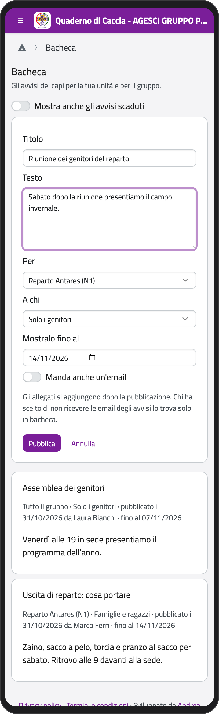
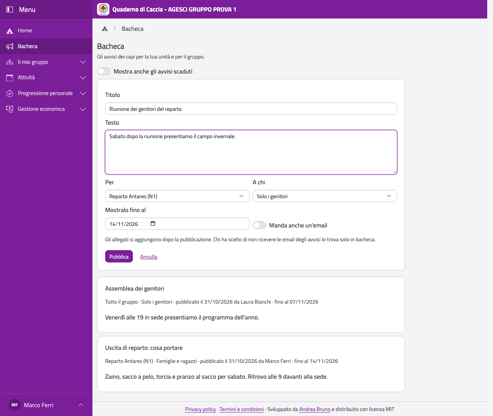

# Bacheca

Nella Home tocca **Bacheca**. Come capo vedi tutti gli avvisi; con **Mostra anche gli avvisi
scaduti** vedi anche quelli vecchi.

## Pubblicare un avviso

Lo staff pubblica per la sua unità; ogni capo per la Comunità capi; i capigruppo per tutto il
gruppo.

1. Tocca **Nuovo avviso**.
2. Scrivi **Titolo** e **Testo**.
3. In **Per** scegli la tua unità (o **Tutto il gruppo**, per un avviso alla Comunità capi).
4. In **A chi** scegli: **Famiglie e ragazzi**, **Solo i genitori**, **Solo i ragazzi** o
   **Comunità capi**.
5. In **Mostralo fino al** scegli quando scade (di base tra due settimane).
6. Se vuoi, accendi **Manda anche un'email**: arriva a chi non ha disattivato le email degli
   avvisi.
7. Tocca **Pubblica**.

:::{container} schermate
{.telefono width="30%"}
{.computer width="65%"}
:::

Dopo la pubblicazione puoi aggiungere un allegato (**Aggiungi un allegato**: un PDF o
un'immagine, al massimo 10 MB), per esempio il programma del campo.

Un avviso lo cambiano (**Modifica**) o lo tolgono (**Togli**) chi l'ha scritto e i
capigruppo. Cambiarlo non manda una nuova email: se serve, pubblica un avviso nuovo.
