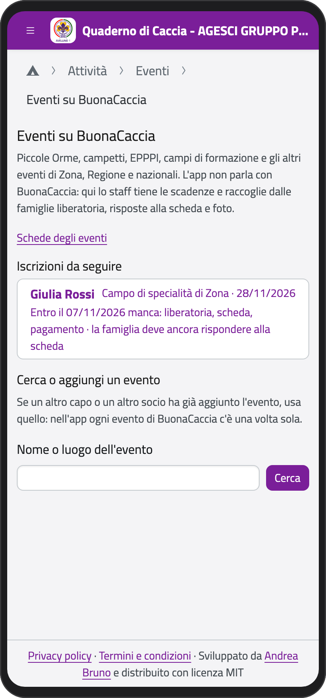
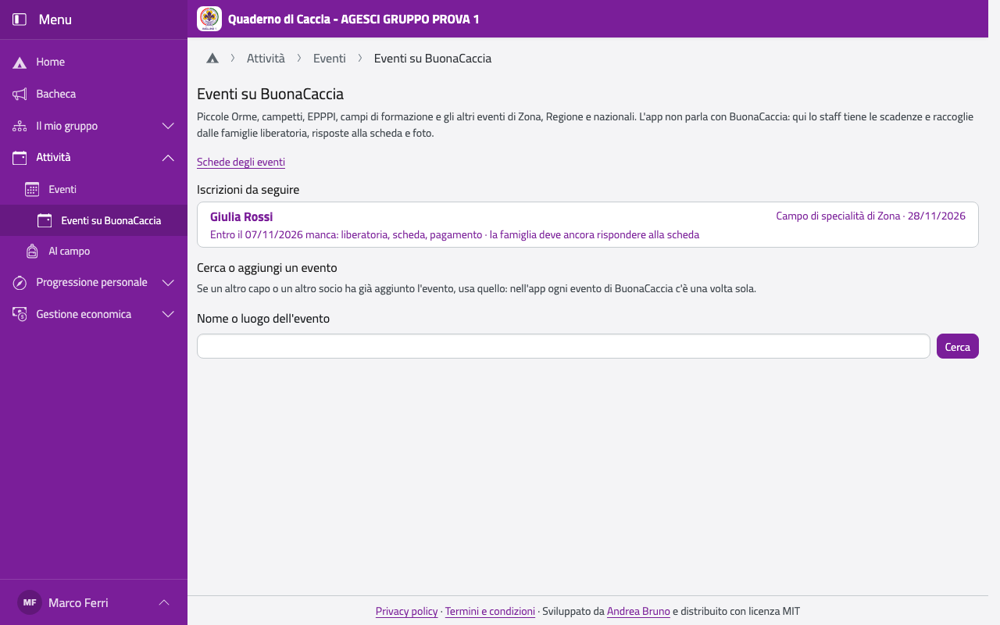
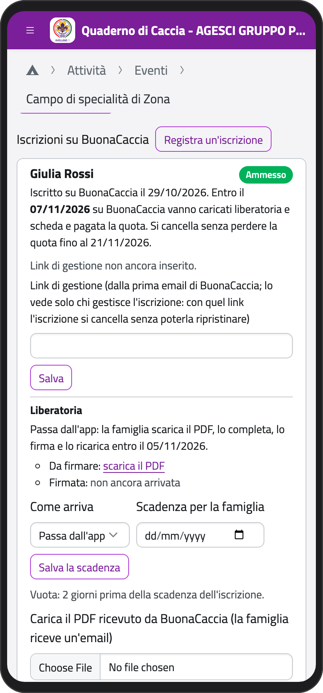
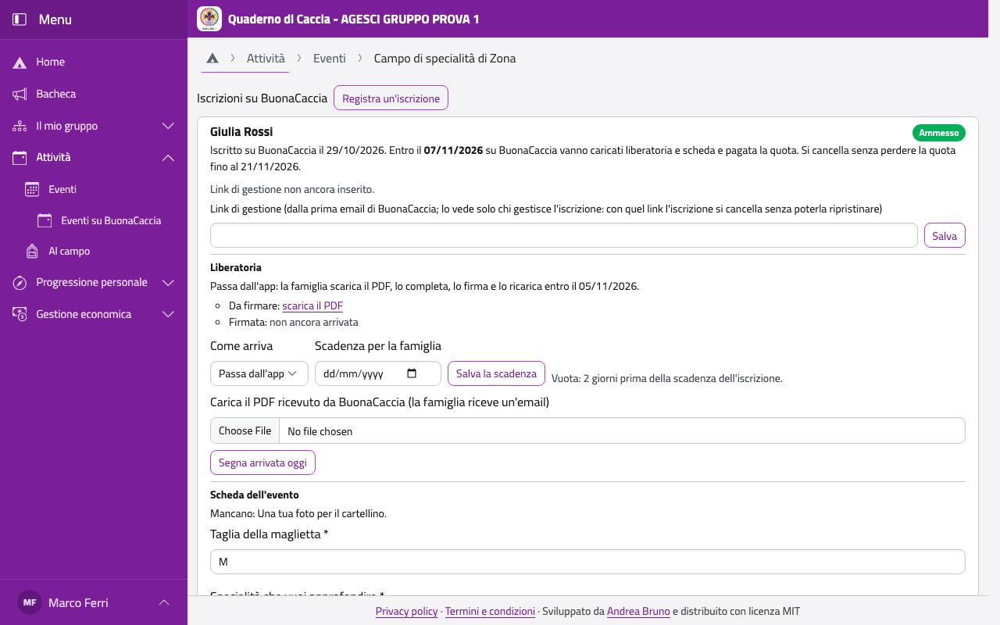

# Eventi su BuonaCaccia

Per gli eventi della Zona, della Regione o nazionali (campi di specialità e di competenza,
Piccole Orme, eventi per rover e scolte) l'iscrizione si fa su **BuonaCaccia**. L'app non
parla con BuonaCaccia: serve a tenere le scadenze e a raccogliere dalle famiglie liberatoria,
risposte alla scheda e foto.

Nella Home, in **Attività**, tocca **Eventi su BuonaCaccia**. In **Iscrizioni da seguire**
vedi le iscrizioni dei tuoi ragazzi, la scadenza più vicina per prima, con quello che manca.

:::{container} schermate
{.telefono width="30%"}
{.computer width="65%"}
:::

## Le scadenze

Quando iscrivi un ragazzo su BuonaCaccia:

- entro **9 giorni** dall'iscrizione vanno caricati liberatoria e scheda e pagata la quota;
- fino a **7 giorni** prima dell'evento lo puoi cancellare senza perdere la quota;
- la famiglia deve darti la liberatoria **2 giorni** prima della scadenza (o quando decidi tu).

L'app manda i promemoria allo staff dell'unità e alla famiglia due giorni prima e il giorno
stesso.

## Aggiungere l'evento

Ogni evento di BuonaCaccia è nell'app una volta sola: prima cercalo.

1. In **Cerca o aggiungi un evento** scrivi il nome o il luogo e tocca **Cerca**.
2. Se non c'è, tocca **Non c'è: aggiungilo**, scrivi nome (come su BuonaCaccia), date e
   località. Spunta **Piccole Orme** se lo è (l'app avvisa se un bambino le ha già fatte) o
   **Campo di formazione capi**.
3. Tocca **Aggiungi l'evento**.

## La scheda dell'evento

BuonaCaccia fa delle domande sul partecipante. Nell'app le prepari una volta (**Schede degli
eventi**: **Nuova scheda**, una domanda alla volta, di tipo scelta, risposta breve o lunga,
sì/no, foto) e le riusi negli anni. Nella pagina dell'evento, in **Scheda dell'evento**,
tocca **Scegli la scheda**: la famiglia risponde dall'app.

## Registrare un'iscrizione

Dopo aver iscritto il ragazzo su BuonaCaccia:

1. Nella pagina dell'evento, in **Iscrizioni su BuonaCaccia**, tocca **Registra
   un'iscrizione**.
2. Scegli unità e ragazzo, il giorno dell'iscrizione e lo stato (**Ammesso** o **In lista
   d'attesa**).
3. Incolla il **Link di gestione** dalla prima email di BuonaCaccia (lo vedono solo i capi
   che gestiscono l'iscrizione: con quel link si cancella).
4. Scegli se la liberatoria **passa dall'app** o arriva in altro modo, e la quota per la
   famiglia.
5. Tocca **Registra**: la famiglia riceve subito un'email con quello che serve.

:::{container} schermate
{.telefono width="30%"}
{.computer width="65%"}
:::

## Seguire l'iscrizione

Ogni iscrizione ha i suoi passi, da segnare man mano:

- **Liberatoria**: carica il PDF ricevuto da BuonaCaccia (la famiglia riceve un'email);
  quando la famiglia lo ricarica firmato, tocca **Segna caricata su BuonaCaccia oggi** dopo
  averlo caricato lì, poi **Validata dalla segreteria** o **Rigettata…** con il motivo (la
  famiglia riceve un'email e ne firma una nuova).
- **Scheda dell'evento**: quando la famiglia ha risposto, apri **Riepilogo da ricopiare su
  BuonaCaccia**: ogni risposta ha **Copia**, la foto è già pronta (JPG, al massimo 1 MB).
  Poi tocca **Segna compilata su BuonaCaccia oggi**. Puoi scrivere anche una
  **Presentazione dello staff**, che vedono solo i capi.
- **Quota**: quando hai pagato BuonaCaccia tocca **Segna pagata su BuonaCaccia oggi** (e
  registra l'uscita in prima nota). La quota della famiglia la trovi qui e nelle sue quote.

Per chiudere un'iscrizione cancellata su BuonaCaccia o non ammessa, scegli in **Chiudi
l'iscrizione** e conferma.

:::{note}
I maggiorenni (rover, scolte e capi) si iscrivono da soli su BuonaCaccia: nell'app toccano
**Partecipo anch'io**, e per un campo di formazione scrivono la quota versata.
:::
