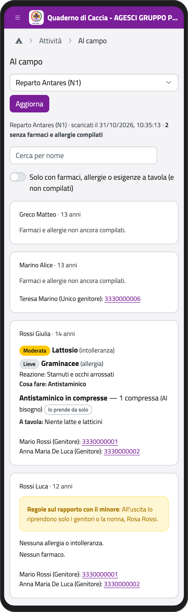
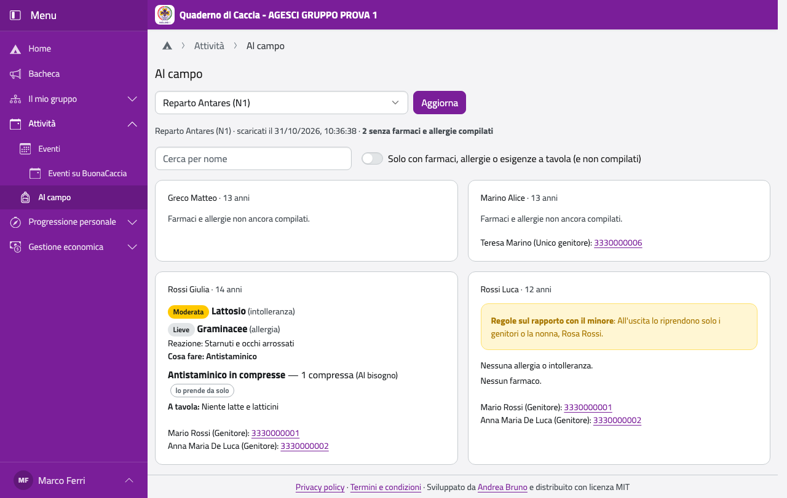
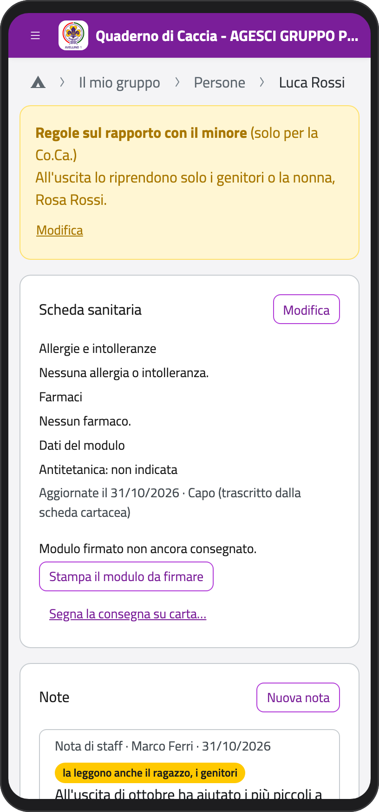
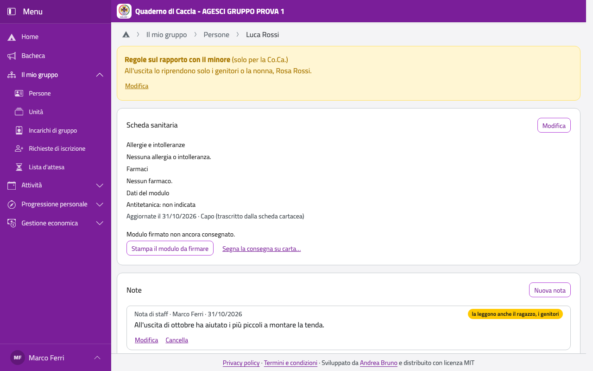

# Al campo

La pagina **Al campo** ha, per ogni ragazzo e capo di un'unità, quello che serve fuori
sede: i contatti dei genitori, farmaci, allergie e intolleranze, cosa non mangia, e le
regole sul rapporto con il minore. Funziona anche senza rete, se l'hai scaricata prima.

## Prima di partire

1. Con la rete, controlla che il telefono abbia la protezione con il PIN (vedi [Accesso e
   uso senza rete](accesso)).
2. Nella Home, in **Attività**, tocca **Al campo**.
3. In **Scegli l'unità** scegli l'unità e tocca **Scarica sul telefono**. Ripeti per ogni
   unità che ti serve (per esempio a un campo di gruppo).

Sotto vedi quando li hai scaricati e quanti ragazzi non hanno ancora compilato farmaci e
allergie. Prima di partire, tocca **Aggiorna** per avere l'ultima versione.

:::{container} schermate
{.telefono width="30%"}
{.computer width="65%"}
:::

## Al campo

Apri **Al campo** e scegli l'unità: anche senza rete vedi la copia scaricata. Per ogni
persona trovi:

- le **allergie** e **intolleranze**, le gravi per prime (il riquadro ha il bordo rosso),
  con cosa succede e cosa fare;
- i **farmaci**, con quanto e quando, e se lo prende da solo o glielo dà un capo;
- **A tavola**: cosa non mangia, per motivi non medici;
- i **contatti**: il suo cellulare e quelli dei genitori; tocca il numero per chiamare.

Con **Cerca per nome** trovi una persona; con l'interruttore **Solo con farmaci, allergie o
esigenze a tavola** vedi solo chi ne ha (e chi non ha ancora compilato).

:::{note}
Nella copia per il campo ci sono solo i dati essenziali: non il numero della tessera
sanitaria, il gruppo sanguigno, il medico curante. Ogni volta che scarichi i dati resta
scritto nel registro degli accessi.
:::

## Le regole sul rapporto con il minore

Sono le indicazioni che i genitori scrivono sul modulo firmato per un minore: per esempio
chi può venire a riprenderlo all'uscita, a chi non dare informazioni, o quello che ha deciso
un giudice dopo una separazione. Al campo compaiono in un riquadro giallo sulla scheda del
ragazzo.

- Le leggono **solo i capi** della Comunità capi, mai i genitori né il ragazzo.
- Le scrivono lo staff dell'unità del ragazzo e i capigruppo, ricopiandole dal modulo.
- Valgono finché i genitori non danno nuove indicazioni scritte.

Per scriverle o cambiarle, apri la scheda del ragazzo (vedi [Persone](persone)): sopra la
scheda sanitaria tocca **Regole sul rapporto con il minore indicate dai genitori…** (o
**Modifica**), ricopia il testo del modulo e tocca **Salva**. Se non ce ne sono più, svuota
il testo e salva. Si fa solo con la rete.

:::{container} schermate
{.telefono width="30%"}
{.computer width="65%"}
:::

:::{warning}
Ogni lettura e ogni modifica delle regole resta nel registro degli accessi.
:::
