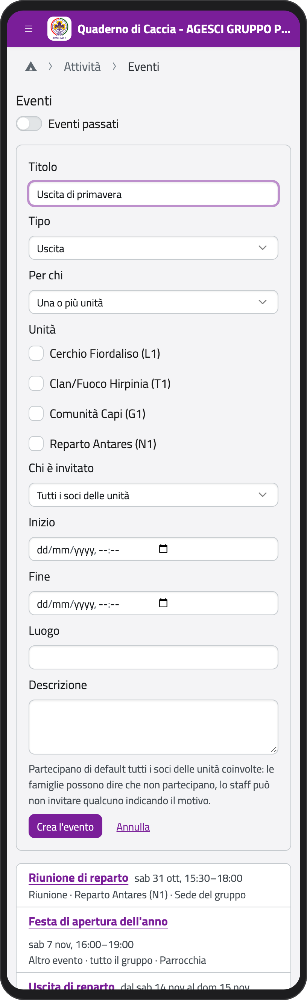
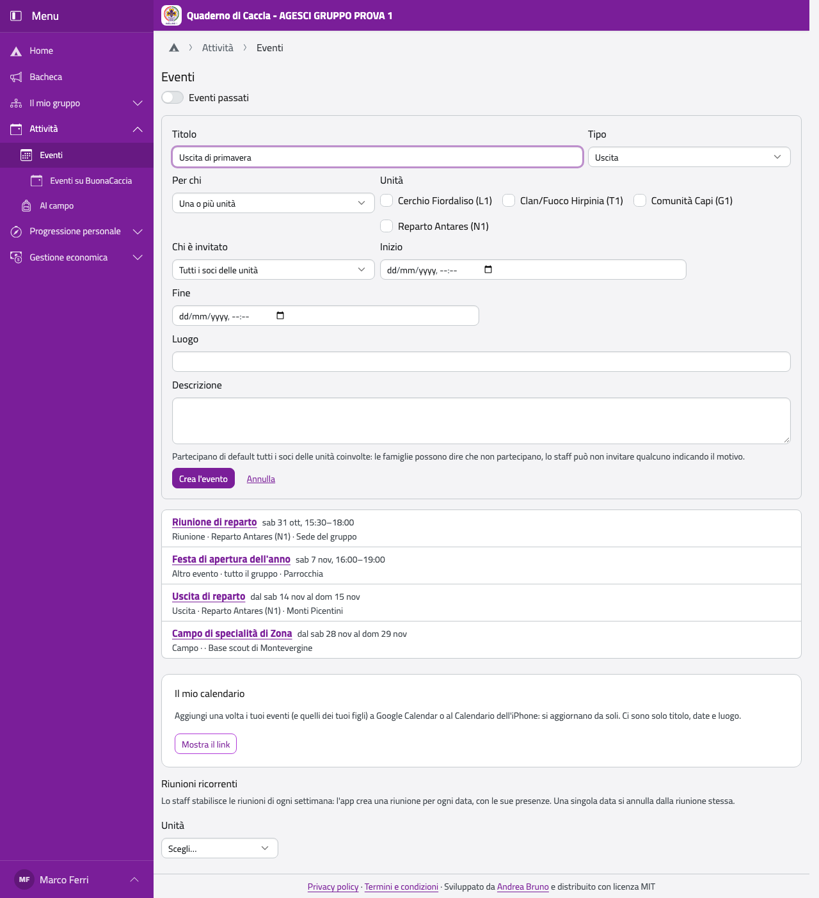
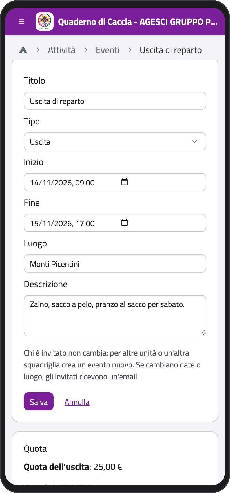
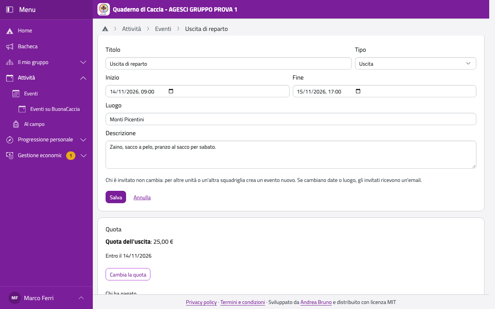
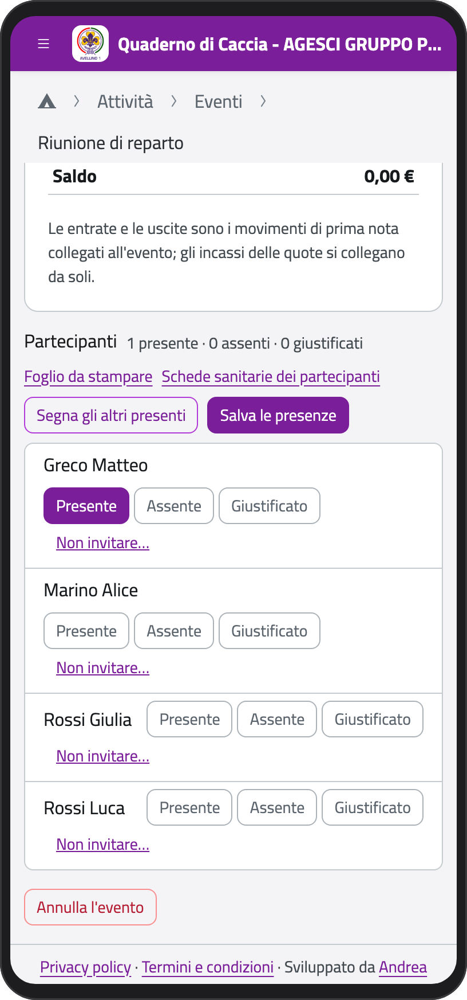
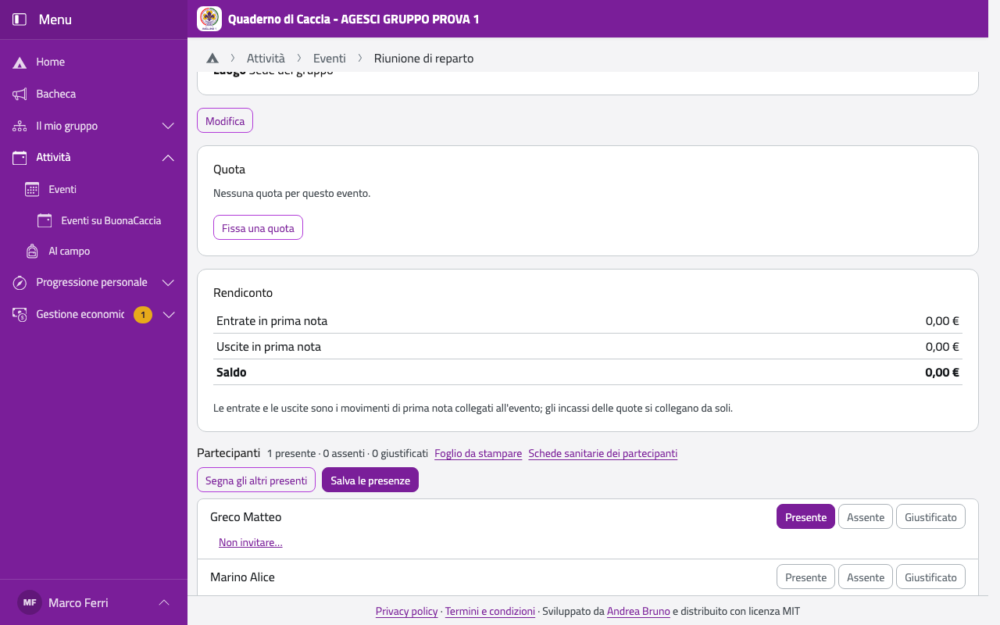
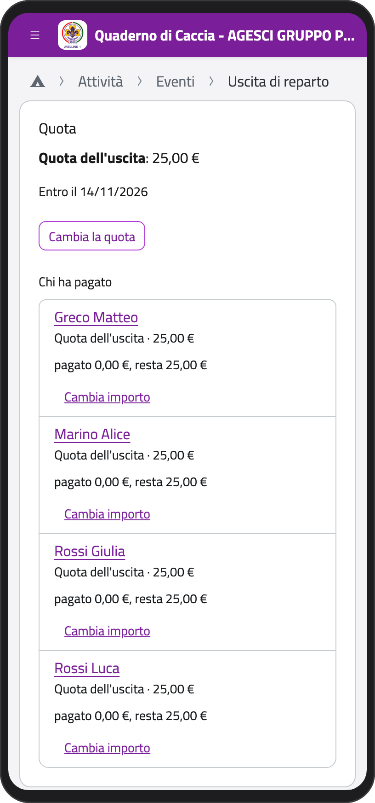
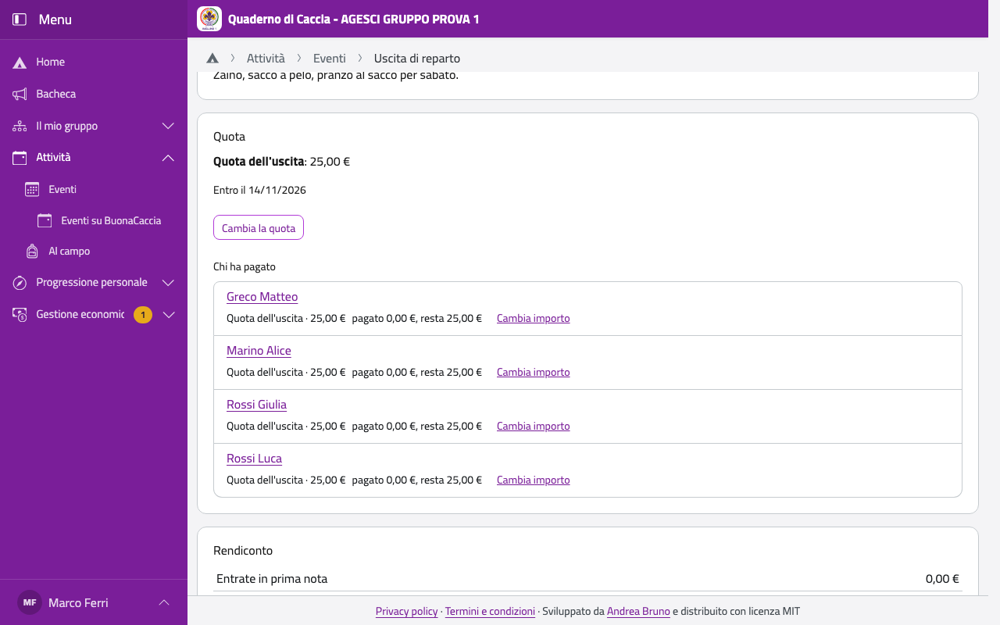

# Eventi e presenze

Nella Home, in **Attività**, tocca **Eventi**. I capi vedono tutti gli eventi del gruppo.

## Creare un evento

1. Tocca **Nuovo evento**.
2. Scrivi il **Titolo** e scegli il **Tipo** (riunione, uscita, campo, autofinanziamento…).
3. In **Per chi** scegli:
   - **Una o più unità**: spunta le unità e, in **Chi è invitato**, tutti i soci oppure, per i
     reparti, Consiglio Capi, Con.Ca.Vi. o Alta Squadriglia;
   - **Una branca**, per un evento di tutta la branca;
   - **Una squadriglia**, per un evento di squadriglia (anche la **Missione di squadriglia**,
     con le **Note per i genitori**, che non leggono i ragazzi).
4. Scegli **Inizio** e **Fine**, scrivi **Luogo** e **Descrizione**.
5. Tocca **Crea l'evento**.

Puoi creare eventi per le unità in cui fai servizio; un evento di tutto il gruppo lo creano
i capigruppo. Sono invitati tutti i soci delle unità scelte; chi entra dopo nell'unità viene
aggiunto da solo.

:::{container} schermate
{.telefono width="30%"}
{.computer width="65%"}
:::

Alle famiglie degli invitati arriva un'email quando crei l'evento, quando cambiano date,
orari o luogo e se lo annulli (non per le singole riunioni ricorrenti).

## Modificare un evento

Nella pagina dell'evento tocca **Modifica**: puoi cambiare titolo, tipo, date, luogo e
descrizione (e, per una missione, le note per i genitori). Tocca **Salva**. Se cambiano date
o luogo, gli invitati ricevono un'email. Chi è invitato invece non cambia: per altre unità o
un'altra squadriglia, annulla l'evento e creane uno nuovo.

:::{container} schermate
{.telefono width="30%"}
{.computer width="65%"}
:::

## Le riunioni di ogni settimana

In fondo alla pagina **Eventi**, in **Riunioni ricorrenti**:

1. Scegli l'**Unità** e tocca **Aggiungi riunioni ricorrenti**.
2. Scegli il giorno (**Ogni**), l'orario (**Dalle**, **Alle**), il periodo (**Dal**, **Al**)
   e il **Luogo**.
3. Tocca **Crea le riunioni**: l'app crea una riunione per ogni settimana, ognuna con le sue
   presenze.

Una singola riunione si annulla dalla sua pagina; **Togli le prossime** toglie tutte le
riunioni future di una serie.

## Annullare un evento

Nella pagina dell'evento tocca **Annulla l'evento**, scrivi il motivo (le famiglie lo
leggono) e conferma.

## Chi partecipa

Nella pagina dell'evento, il riquadro **Partecipanti** mostra tutti gli invitati. Chi la
famiglia ha detto che non viene ha **Non partecipa**. Se un ragazzo non deve partecipare,
tocca **Non invitare…** e scrivi il motivo (la famiglia lo legge); **Invita di nuovo** lo
riporta tra gli invitati.

## Segnare le presenze

Anche senza rete:

1. Nella pagina dell'evento, in **Partecipanti**, tocca **Presente**, **Assente** o
   **Giustificato** accanto a ogni nome. **Segna gli altri presenti** riempie quelli ancora
   vuoti (chi ha detto che non viene diventa giustificato).
2. Tocca **Salva le presenze**. Senza rete restano sul telefono e partono quando torna.

:::{container} schermate
{.telefono width="30%"}
{.computer width="65%"}
:::

Se preferisci la carta, tocca **Foglio da stampare**: segni una X e poi riporti le presenze
nell'app. Le presenze le segnano lo staff delle unità coinvolte e, per le riunioni di
squadriglia, il capo squadriglia. Il dettaglio resta per due anni; poi restano i totali di
ogni anno.

## La quota di un evento

Nel riquadro **Quota** tocca **Fissa una quota**:

1. Scrivi il **Nome** (per esempio «Campo estivo») e, se c'è, lo **Sconto famiglia sul
   saldo**.
2. Per ogni rata scrivi nome, **Importo** e **Entro il**; **Aggiungi una rata** per
   dividerla (acconto e saldo).
3. Tocca **Salva la quota**.

La quota arriva a tutti i partecipanti; chi non partecipa non la paga. In **Chi ha pagato**
vedi a che punto è ognuno e con **Cambia importo** la correggi per una persona (anche fino a
zero).

:::{container} schermate
{.telefono width="30%"}
{.computer width="65%"}
:::

Sotto c'è il **Rendiconto**: entrate e uscite dell'evento registrate in prima nota, le quote
incassate e le agevolazioni. Per un campo puoi fissare il **budget**: scegli due valori tra
quota pro capite, contributo dalla cassa e budget complessivo, e l'app calcola il terzo.
