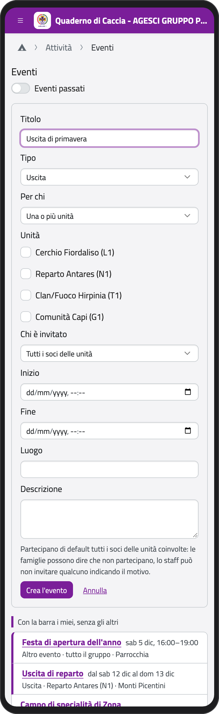
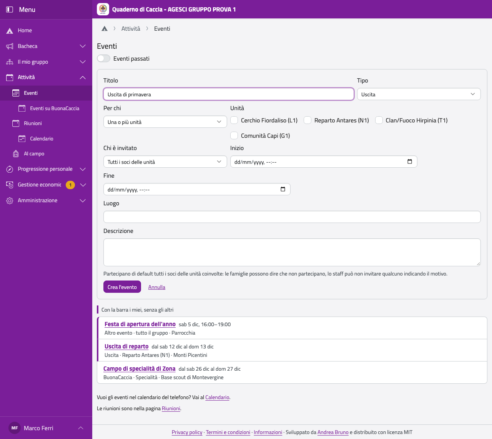
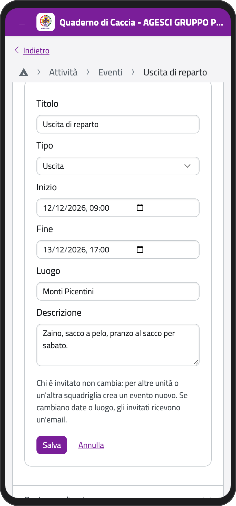
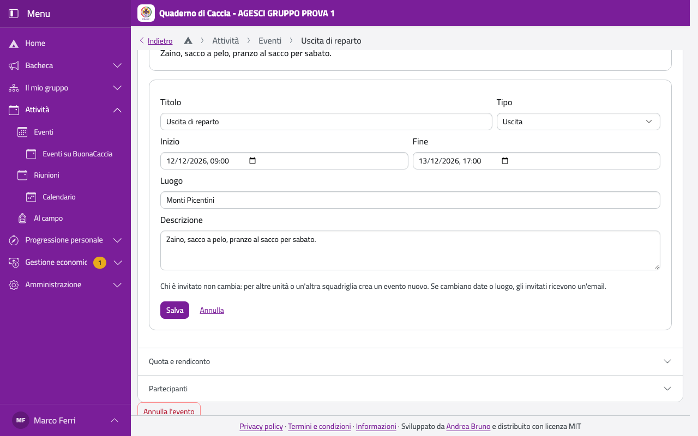
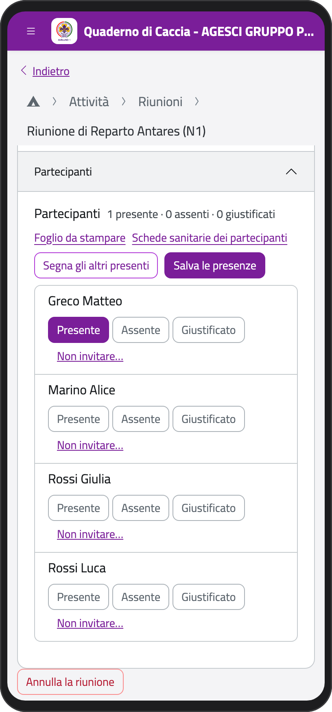
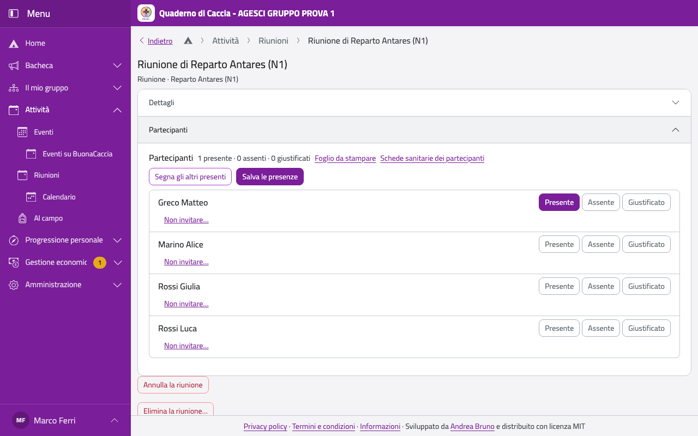
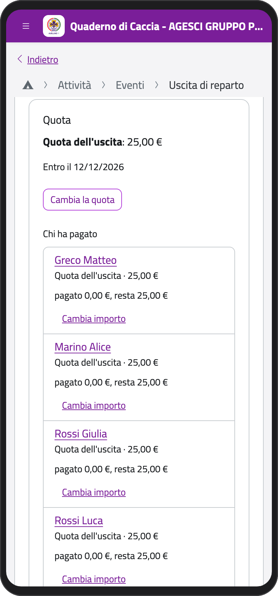
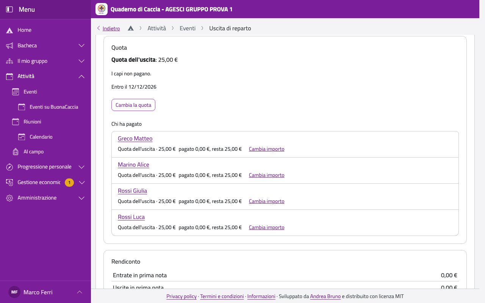

# Eventi e presenze

Nella Home, in **Attività**, tocca **Eventi**. I capi vedono tutti gli eventi del gruppo. Le
riunioni hanno una pagina loro: vedi [Riunioni](riunioni).

## Creare un evento

1. Tocca **Nuovo evento**.
2. Scrivi il **Titolo** e scegli il **Tipo** (uscita, campo, autofinanziamento…).
3. In **Per chi** scegli:
   - **Una o più unità**: spunta le unità e, in **Chi è invitato**, tutti i soci oppure, per i
     reparti, Consiglio Capi, Con.Ca.Vi. o Alta Squadriglia;
   - **Una branca**, per un evento di tutta la branca;
   - **Una squadriglia**, per un evento di squadriglia (anche la **Missione di squadriglia**,
     con le **Note per i genitori**, che non leggono i ragazzi/e).
4. Scegli **Inizio** e **Fine**, scrivi **Luogo** e **Descrizione**.
5. Tocca **Crea l'evento**.

Puoi creare eventi per le unità in cui fai servizio; un evento di tutto il gruppo lo creano
i capigruppo. Sono invitati tutti i soci delle unità scelte, e gli invitati di eventi e riunioni
ancora da fare seguono sempre chi è nell'unità: chi entra viene aggiunto da solo, chi esce viene
tolto (a meno che abbia già presenze), chi hai escluso tu resta escluso. Una sua quota dell'evento non
ancora pagata si annulla da sola («Non è più nell'unità»); se ha già pagato, anche in parte, resta
invitato e decidi tu (rimborso o partecipazione). Con un passaggio
preparato, dal giorno dopo la sua data il ragazzo/a esce dagli inviti dell'unità di partenza ed
entra in quelli dell'unità di arrivo, anche prima che il passaggio sia eseguito.

:::{container} schermate
{.telefono width="30%"}
{.computer width="65%"}
:::

Alle famiglie degli invitati arriva un'email quando crei l'evento, quando cambiano date,
orari o luogo e se lo annulli.

## Modificare un evento

Nella pagina dell'evento tocca **Modifica**: puoi cambiare titolo, tipo, date, luogo e
descrizione (e, per una missione, le note per i genitori). Tocca **Salva**. Se cambiano date
o luogo, gli invitati ricevono un'email. Chi è invitato invece non cambia: per altre unità o
un'altra squadriglia, annulla l'evento e creane uno nuovo.

:::{container} schermate
{.telefono width="30%"}
{.computer width="65%"}
:::

## Annullare un evento

Nella pagina dell'evento tocca **Annulla l'evento**, scrivi il motivo (le famiglie lo
leggono) e conferma.

## Chi partecipa

Nella pagina dell'evento, il riquadro **Partecipanti** mostra tutti gli invitati. Chi la
famiglia ha detto che non viene ha **Non partecipa**. Se un ragazzo/a non deve partecipare,
tocca **Non invitare…** e scrivi il motivo (la famiglia lo legge); **Invita di nuovo** lo
riporta tra gli invitati.

## Segnare le presenze

Anche senza rete:

1. Nella pagina dell'evento, in **Partecipanti**, tocca **Presente**, **Assente** o
   **Giustificato** accanto a ogni nome. **Segna gli altri presenti** riempie quelli ancora
   vuoti (chi ha detto che non viene diventa giustificato).
2. Tocca **Salva le presenze**. Senza rete restano sul telefono e partono quando torna.

:::{container} schermate
{.telefono width="30%"}
{.computer width="65%"}
:::

Se preferisci la carta, tocca **Foglio da stampare**: segni una X e poi riporti le presenze
nell'app. Le presenze le segnano lo staff delle unità coinvolte e, per le riunioni di
squadriglia, il capo squadriglia. Il dettaglio resta per due anni; poi restano i totali di
ogni anno.

## La quota di un evento

Nel riquadro **Quota** tocca **Fissa una quota**:

1. Scrivi il **Nome** (per esempio «Campo estivo») e, se c'è, lo **Sconto famiglia sul
   saldo**.
2. Per ogni rata scrivi nome, **Importo** e **Entro il**; **Aggiungi una rata** per
   dividerla (acconto e saldo).
3. Se i capi pagano qualcosa, scrivilo in **Quota per i capi**: di solito resta vuota.
4. Tocca **Salva la quota**.

La quota arriva a tutti i partecipanti; chi non partecipa non la paga. I **capi** (chi è nella
Comunità capi il primo giorno dell'evento) pagano solo la quota per i capi, in una volta con il
saldo e senza sconto famiglia; se è vuota non pagano niente. Se avevi emesso per errore le quote
anche ai capi, apri **Cambia la quota** e salvala con la quota per i capi vuota: le loro quote
non ancora pagate si annullano. In **Chi ha pagato**
vedi a che punto è ognuno e con **Cambia importo** la correggi per una persona (anche fino a
zero).

:::{container} schermate
{.telefono width="30%"}
{.computer width="65%"}
:::

Sotto c'è il **Rendiconto**: entrate e uscite dell'evento registrate in prima nota, le quote
incassate e le agevolazioni. Per un campo puoi fissare il **budget**: scegli due valori tra
quota pro capite, contributo dalla cassa e budget complessivo, e l'app calcola il terzo.
