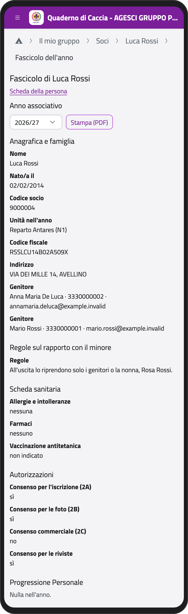
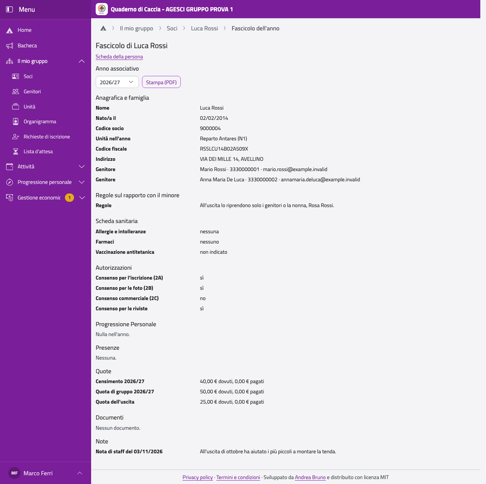
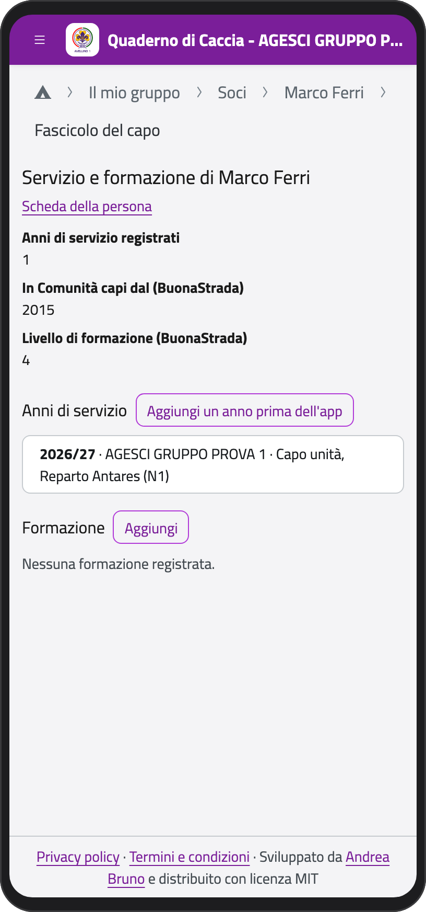
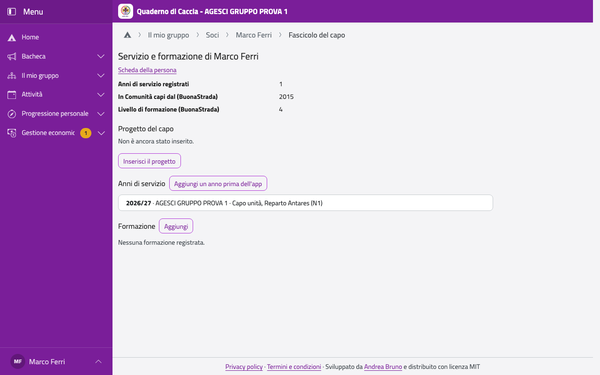

# Fascicoli

## Il fascicolo dell'anno di un ragazzo/a

Nella scheda del ragazzo/a tocca **Fascicolo dell'anno**: in una pagina c'è tutto il suo anno
scout. Scegli l'anno in **Anno associativo**; con **Stampa (PDF)** lo scarichi.

Le parti sono: anagrafica e famiglia, regole sul rapporto con il minore (solo per i capi),
scheda sanitaria, autorizzazioni (i consensi e le liberatorie degli eventi su BuonaCaccia),
Progressione Personale, presenze, quote, documenti (i moduli firmati dell'iscrizione, solo
per i capi) e note.

:::{container} schermate
{.telefono width="30%"}
{.computer width="65%"}
:::

:::{note}
Il fascicolo si apre solo con la rete: legge dati sanitari e note, e ogni lettura resta nel
registro degli accessi.
:::

## Il report per il passaggio

Quando prepari un passaggio (vedi [Passaggi](passaggi)), accanto a ogni ragazzo/a c'è il
**report (PDF)** per i nuovi capi: il passaggio con la sintesi, il percorso nella branca e le
presenze. Non contiene note né regole sul rapporto con il minore.

## Il tuo fascicolo: servizio e formazione

Nella tua scheda (**Il mio profilo**) tocca **Servizio e formazione**. Lo legge tutta la
Comunità capi; lo modifichi tu (o un capogruppo).

- **Anni di servizio**: si riempiono da soli con i tuoi incarichi nell'app; ogni anno dice
  di quale gruppo era. Gli anni in Comunità capi di un altro gruppo arrivano da BuonaStrada,
  quando l'esportazione li ha. Per gli anni di prima, tocca **Aggiungi un anno prima
  dell'app**: l'anno (quello in cui finisce: 2014/15 è 2015), il ruolo, l'unità e, se non
  era il nostro, il gruppo.
- **Formazione**: tocca **Aggiungi** per un campo (CFT, CFM, CFA, campo per capigruppo), un
  modulo formativo o altro, con quando e dove. I campi di formazione capi registrati come
  eventi su BuonaCaccia compaiono da soli.

In alto vedi anche i dati di BuonaStrada: da quando sei in Comunità capi, il livello di
formazione, la nomina a capo. Finché hai il codice socio provvisorio il livello è 1, da
tirocinante.

:::{container} schermate
{.telefono width="30%"}
{.computer width="65%"}
:::

## Il progetto del capo

Nel tuo fascicolo di capo, alla voce **Progetto del capo**, inserisci il tuo progetto. Lo vedi tu e lo vede
tutta la Comunità capi; lo scrivi solo tu, nemmeno i capigruppo possono cambiarlo. Serve la rete.

1. Tocca **Inserisci il progetto** e scegli **Scrivo il testo** (è il modo preferito) oppure **Carico un PDF**,
   al massimo 20 MB.
2. Tocca **Salva**.

Quando lo aggiorni, tocca **Nuova versione**: quella di prima resta consultabile e l'ultima è **In vigore**.
Con **Leggi** lo apri nella pagina, con **Scarica il PDF** ne hai una copia: dal testo l'app fa un PDF su foglio
semplice, senza carta intestata, perché è un documento personale.
