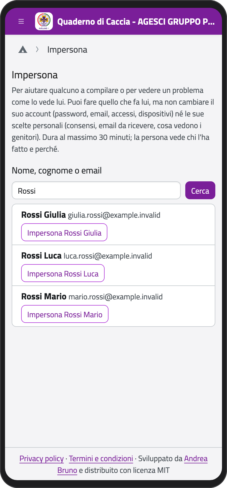
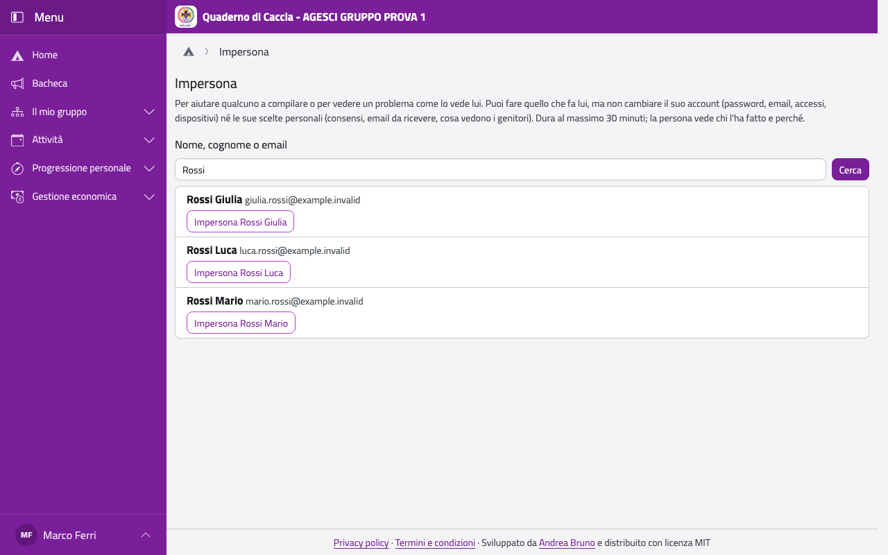

# Usare l'app al posto di un ragazzo o di un genitore

A volte serve vedere l'app come la vede qualcun altro: per aiutare un genitore a compilare la
scheda sanitaria, o per capire un problema che ti racconta. Puoi usare l'app al posto dei
ragazzi della tua unità e dei loro genitori, mai di un capo.

1. Nel menu del profilo tocca **Impersona** (o, nella scheda della persona, **Impersona
   …**).
2. Cerca la persona per nome o email e tocca **Impersona …**.
3. Scrivi **perché**: la persona lo leggerà.
4. Tocca **Inizia**.

:::{container} schermate
{.telefono width="30%"}
{.computer width="65%"}
:::

Finché dura, in alto c'è scritto al posto di chi stai usando l'app e fino a che ora (al
massimo 30 minuti). Tocca **Torna a te** per finire.

:::{warning}
Quello che fai resta registrato a tuo nome. Non puoi cambiare l'account della persona
(password, email, accessi, dispositivi) né le sue scelte personali (consensi, email da
ricevere, cosa vedono i genitori), e l'app non salva niente sul telefono.
:::

La persona vede, in **Password e sicurezza**, chi ha usato l'app al suo posto, quando e
perché. La Comunità capi trova l'elenco completo nella pagina **Impersona**.
