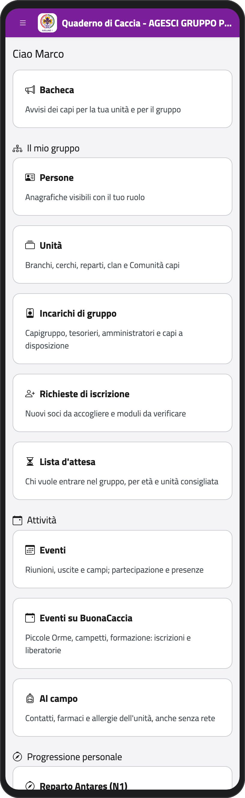
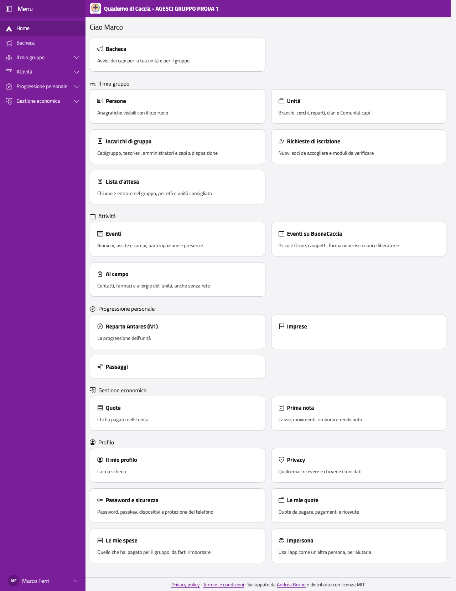

# Capo e staff di unità

## Chi sei, cosa puoi fare

Sei un capo della Comunità capi e fai servizio in un'unità (branco o cerchio, reparto,
clan o fuoco), come capo unità o nello staff. Nel Quaderno di Caccia:

- vedi tutte le persone del gruppo, con i contatti e i dati sanitari;
- gestisci la tua unità: squadriglie, codici di iscrizione, lista d'attesa;
- scrivi la Progressione Personale, le note e le regole sul rapporto con i minori dei
  ragazzi della tua unità;
- organizzi gli eventi e segni le presenze, anche senza rete;
- al campo hai con te farmaci, allergie e contatti di tutti.

:::{note}
Alcune cose le fanno solo i capigruppo: creare o rinominare un'unità, nominare lo staff,
registrare le eccezioni sulle squadriglie, inoltrare le correzioni a BuonaStrada. Il capo
unità, oltre allo staff, invita le persone nell'app e nomina il tesoriere dell'unità.
:::

Quando entri, la Home ti mostra i gruppi di funzioni: **Il mio gruppo** (Persone, Unità,
Richieste di iscrizione, Lista d'attesa), **Attività** (Eventi, Al campo),
**Progressione personale** (le unità in cui fai servizio) e il tuo **Profilo**. Le stesse
voci sono nel menu (vedi [Come ci si muove](../introduzione.md#come-ci-si-muove)).

:::{container} schermate
{.telefono width="30%"}
{.computer width="65%"}
:::

Se sei anche genitore, i tuoi figli sono in **La mia famiglia**, come nella [parte dei
genitori](../genitore/index).

```{toctree}
:maxdepth: 1

accesso
unita
persone
iscrizioni
campo
sanitaria
note
eventi
buonacaccia
progressione
passaggi
```
