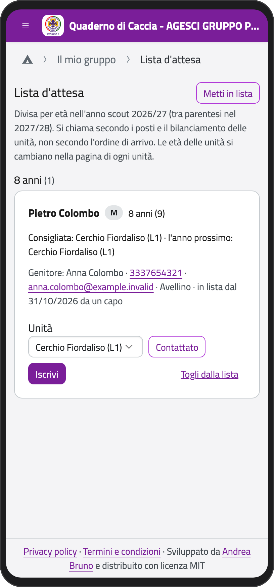
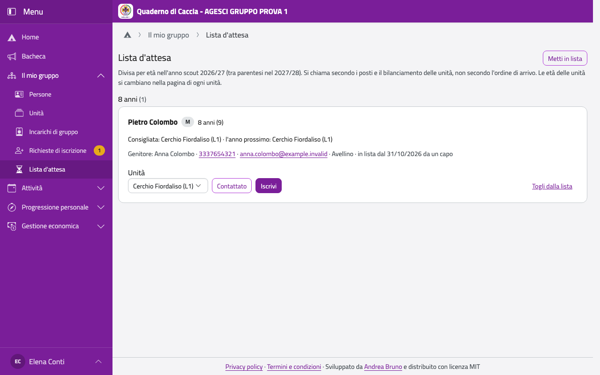
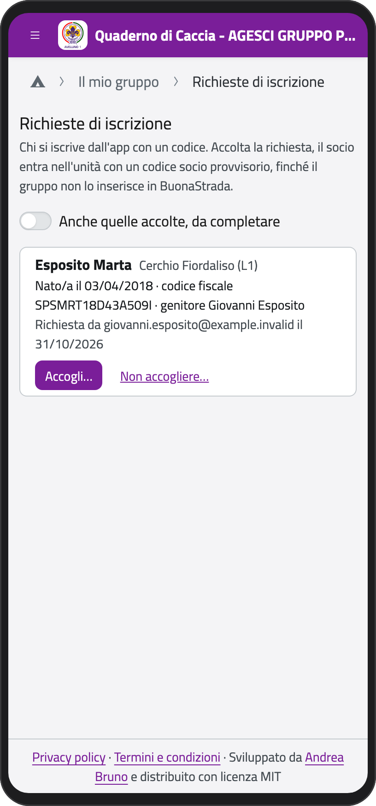
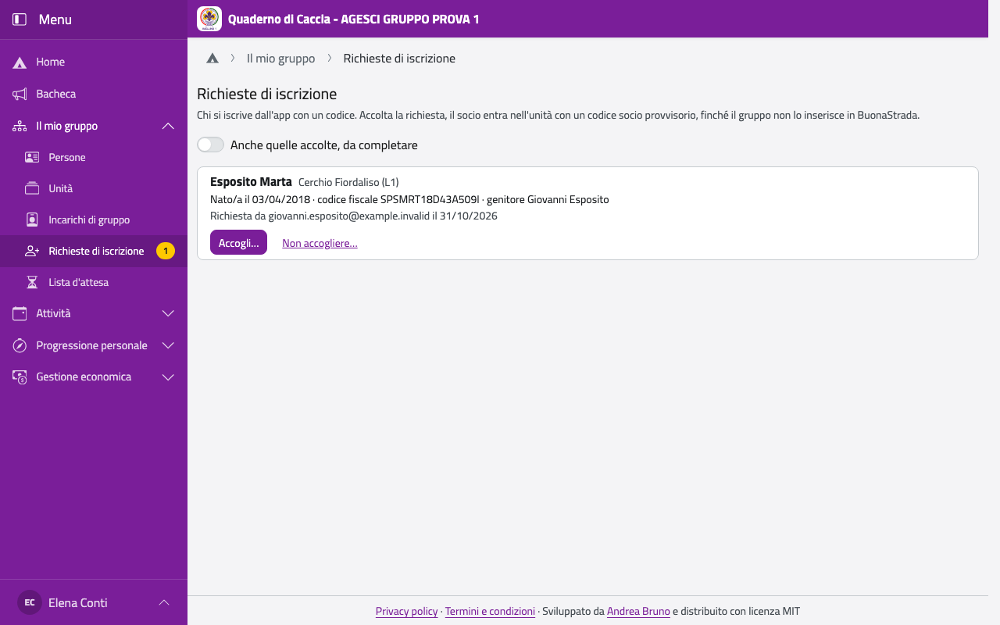

# Nuovi ragazzi: lista d'attesa e iscrizioni

Chi vuole entrare nel gruppo passa di solito dalla **lista d'attesa**; quando c'è posto, la
famiglia riceve un link per l'**iscrizione**, che lo staff dell'unità accoglie.

## La lista d'attesa

Nella Home, in **Il mio gruppo**, tocca **Lista d'attesa**. La vedono tutti i capi.

I ragazzi sono divisi per età nell'anno scout in corso (tra parentesi l'età dell'anno
prossimo). Per ognuno vedi l'unità **Consigliata**, scelta dalle età e dalla composizione
delle unità, chi contattare e da quando è in lista. **Possibile doppione** segnala due
iscrizioni con stesso nome e data di nascita.

:::{note}
Si chiama secondo i posti e l'equilibrio delle unità, non secondo l'ordine di arrivo.
Le età delle unità si cambiano nella pagina dell'unità (vedi [La tua unità](unita)).
:::

:::{container} schermate
{.telefono width="30%"}
{.computer width="65%"}
:::

Per un ragazzo, scegli l'**Unità** (vedi solo quelle in cui fai servizio) e poi:

- **Contattato**, quando hai sentito la famiglia; **Di nuovo da contattare** per
  annullarlo;
- **Iscrivi**, quando c'è posto: la famiglia riceve per email un link personale, valido 30
  giorni, con i dati della lista già scritti, e il ragazzo esce dalla lista. Poi la
  richiesta arriva in **Richieste di iscrizione** (sotto);
- **Togli dalla lista**: i dati si cancellano.

Se una famiglia ti chiede di entrare in lista di persona, tocca **Metti in lista** e compila
il modulo come farebbe lei: riceve la stessa email di conferma.

## I codici di iscrizione

Per far iscrivere qualcuno direttamente (per esempio un ragazzo che arriva da un altro
gruppo) crea un codice nella pagina della tua unità, in **Codici di iscrizione**:

1. Tocca **Nuovo codice**.
2. Scegli il **Tipo**: **Per l'unità** (più persone, fino alla scadenza) o **Personale** (una
   sola iscrizione).
3. Scegli fino a quando vale e tocca **Crea**.

Dai alla famiglia il codice, il link (**copia il link**) o il **QR code**. Con
**disattiva** lo fermi prima della scadenza.

## Accogliere una richiesta

Nella Home, in **Il mio gruppo**, tocca **Richieste di iscrizione**: il numero accanto dice
quante ne aspettano una decisione.

:::{container} schermate
{.telefono width="30%"}
{.computer width="65%"}
:::

1. Controlla i dati e tocca **Accogli…**.
2. Scegli entro quando la famiglia deve completare dati e moduli (di base 30 giorni) e tocca
   **Accogli**.

Il ragazzo entra subito nell'unità con un codice socio provvisorio, e la famiglia riceve
un'email per completare. Se non la accogli, tocca **Non accogliere…** e scrivi il motivo: lo
legge chi ha fatto la richiesta.

Con l'interruttore **Anche quelle accolte, da completare** vedi a che punto sono: sotto ogni
richiesta c'è cosa manca. Una settimana prima della scadenza la famiglia riceve un
promemoria; se la scadenza passa senza che abbia completato, l'iscrizione si sospende.

## Verificare i moduli firmati

Quando la famiglia ha caricato i moduli firmati, li trovi nella richiesta, in **Moduli
firmati**:

1. Apri ogni modulo e controllalo.
2. Spunta i consensi firmati (iscrizione, foto, commerciale, riviste).
3. Tocca **Moduli verificati**.

Quando tutto è completo, i capigruppo inseriscono il ragazzo in BuonaStrada, che gli dà il
codice socio definitivo.
