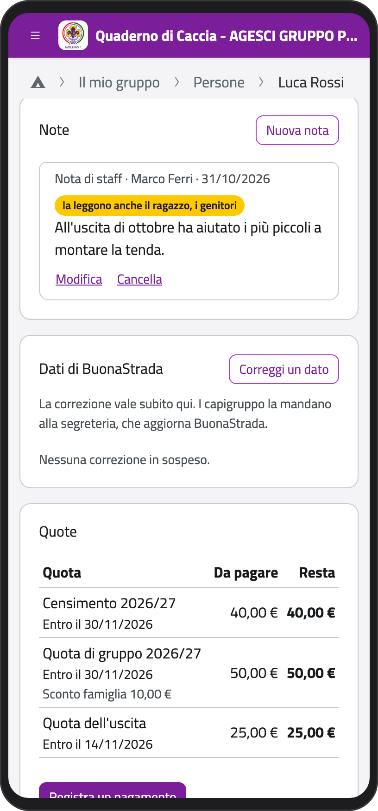
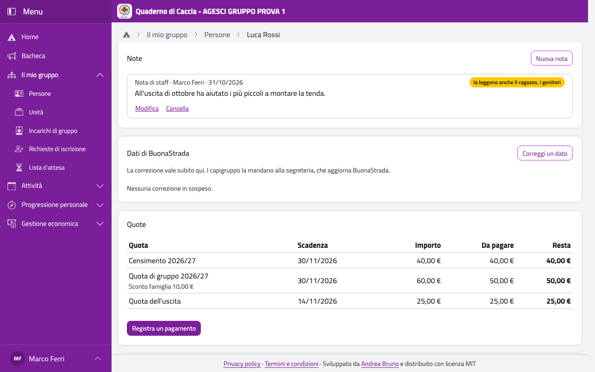

# Note

Nella scheda di un ragazzo, il riquadro **Note** raccoglie quello che lo staff vuole
ricordare: come è andata un'uscita, un progresso, una difficoltà.

## Scrivere una nota

Le note le scrivono lo staff dell'unità del ragazzo e i capigruppo.

1. Nel riquadro **Note** tocca **Nuova nota** e scrivi.
2. La nota la legge sempre la Comunità capi. Se vuoi, spunta chi altro la può leggere:
   **il ragazzo o la ragazza**, **i genitori** e, in reparto, **il capo squadriglia** (mai
   gli altri squadriglieri).
3. Tocca **Salva**. Funziona anche senza rete.

:::{container} schermate
{.telefono width="30%"}
{.computer width="65%"}
:::

Ogni nota mostra chi l'ha scritta, quando e chi la legge: «solo la Co.Ca.», oppure in
giallo chi altro la legge.

## Cambiarla o cancellarla

Solo chi ha scritto una nota la può cambiare (**Modifica**) o cancellare (**Cancella**). Le
note del capo squadriglia le leggi, e puoi decidere se mostrarle anche al ragazzo o ai
genitori con **Cambia chi la legge**, senza cambiarne il testo.
