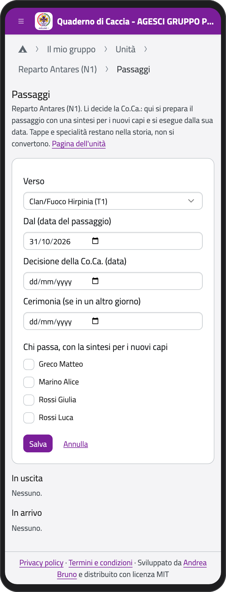
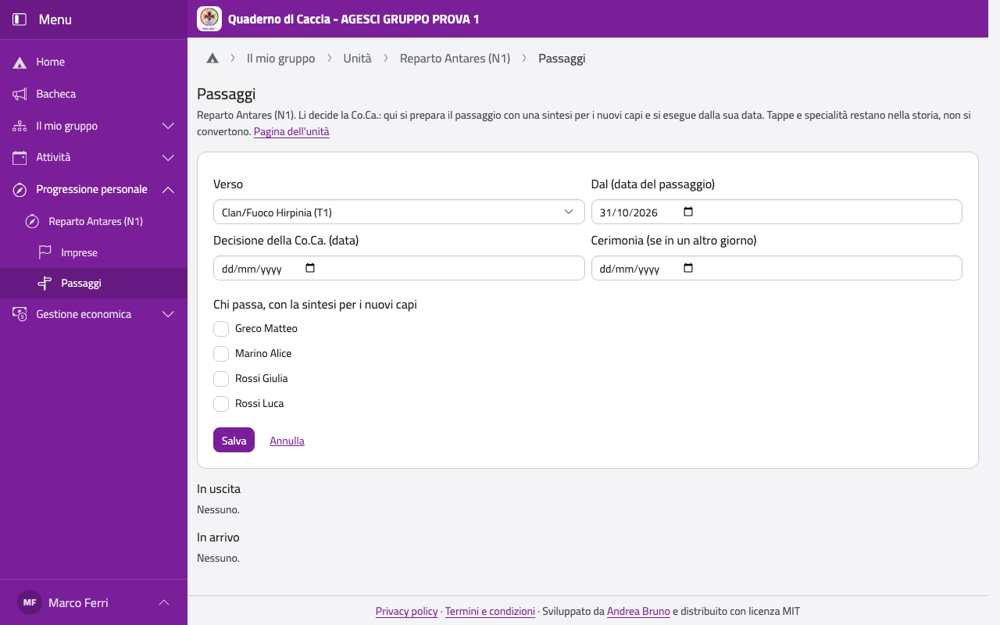

# Passaggi

I passaggi da una branca all'altra li decide la Comunità capi. Nell'app lo staff dell'unità
che i ragazzi lasciano li prepara, con una sintesi per i nuovi capi, e li esegue dalla loro
data. Tappe e specialità restano nella storia del ragazzo: non si convertono.

Nella pagina dell'unità tocca **Passaggi**.

## Preparare un passaggio

1. Tocca **Prepara un passaggio**.
2. Scegli **Verso** (l'unità della branca successiva), **Dal** (la data del passaggio), la data
   della **Decisione della Co.Ca.** e, se è un altro giorno, quella della **Cerimonia**.
3. Spunta chi passa e, per ognuno, scrivi la **sintesi per i nuovi capi**: esperienze,
   competenze, interessi, quello che serve a chi lo accoglie.
4. Tocca **Salva**.

:::{container} schermate
{.telefono width="30%"}
{.computer width="65%"}
:::

Finché è **Preparato** lo puoi cambiare (**Modifica**) o annullare (**Annulla…**, con il
motivo). Per ogni ragazzo c'è anche il **report** in PDF.

## Eseguirlo

Dal giorno del passaggio tocca **Esegui…**: l'app ti mostra chi passa e dove, e che si
chiude il percorso nella branca di oggi e se ne apre uno nuovo; cambiano unità, squadriglia
e incarichi di squadriglia. Tocca **Confermo, esegui**. La sintesi compare nella pagina del
ragazzo nella nuova branca.

## Se hai sbagliato

- **Annulla l'esecuzione…** (sotto «Eseguito per errore?»): scegli per chi e scrivi perché; i
  ragazzi tornano dov'erano, con il loro percorso.
- **Correggi la data…**: scrivi la data giusta e perché; periodi e unità si spostano al
  giorno giusto.

Non si può più fare se il nuovo staff ha già scritto qualcosa nel nuovo percorso, o se nel
frattempo è stata fatta un'importazione da BuonaStrada: prima va corretto lì.
