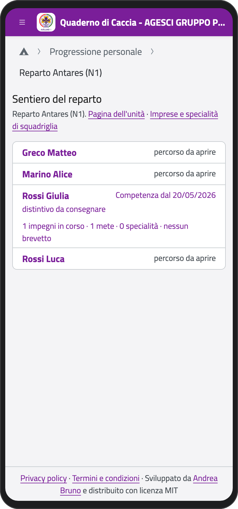
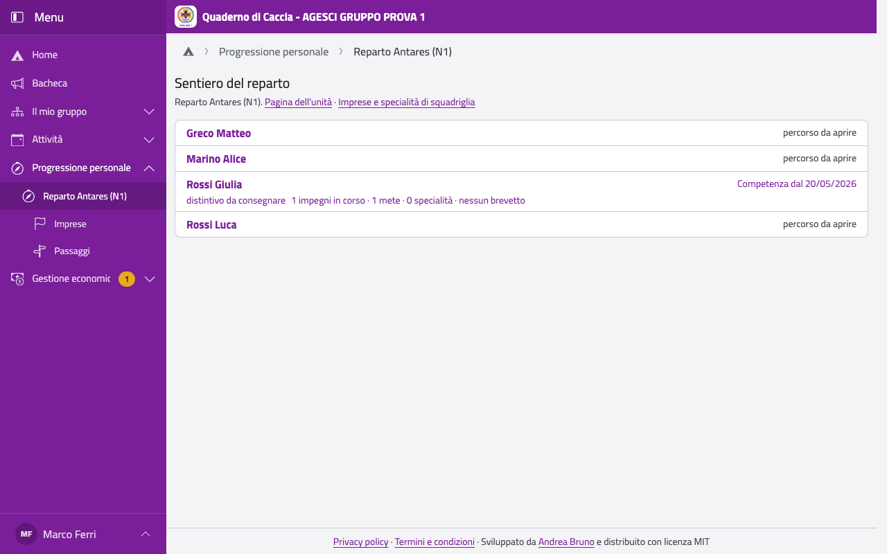
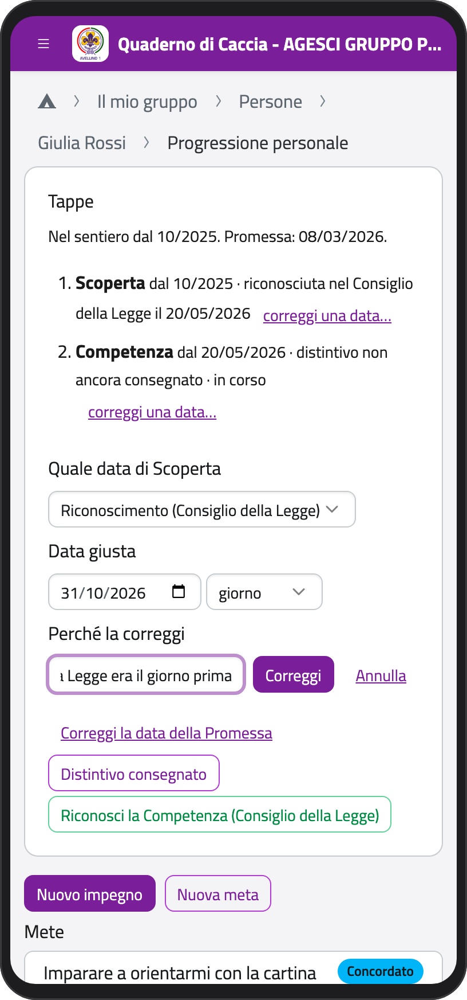
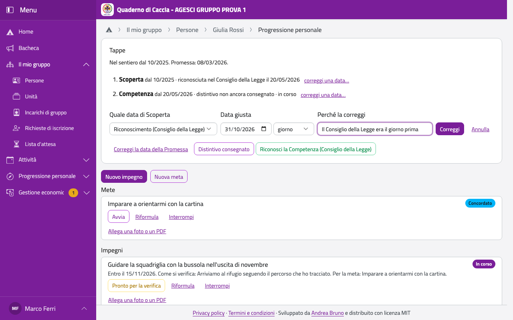
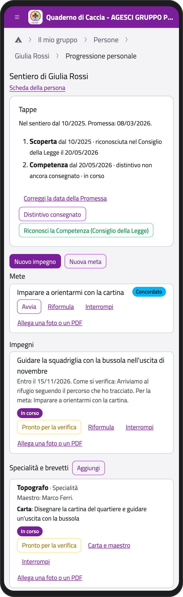
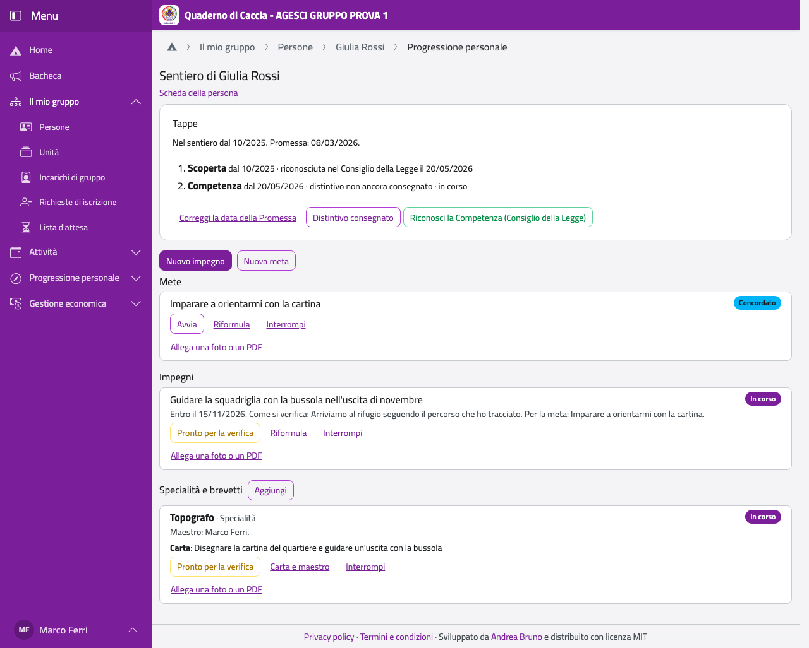
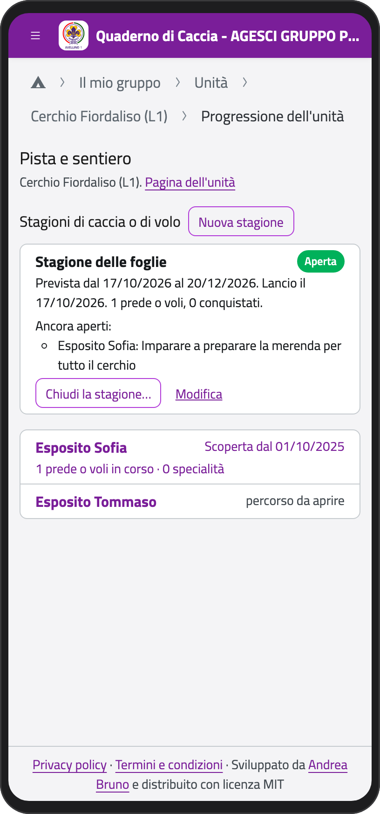
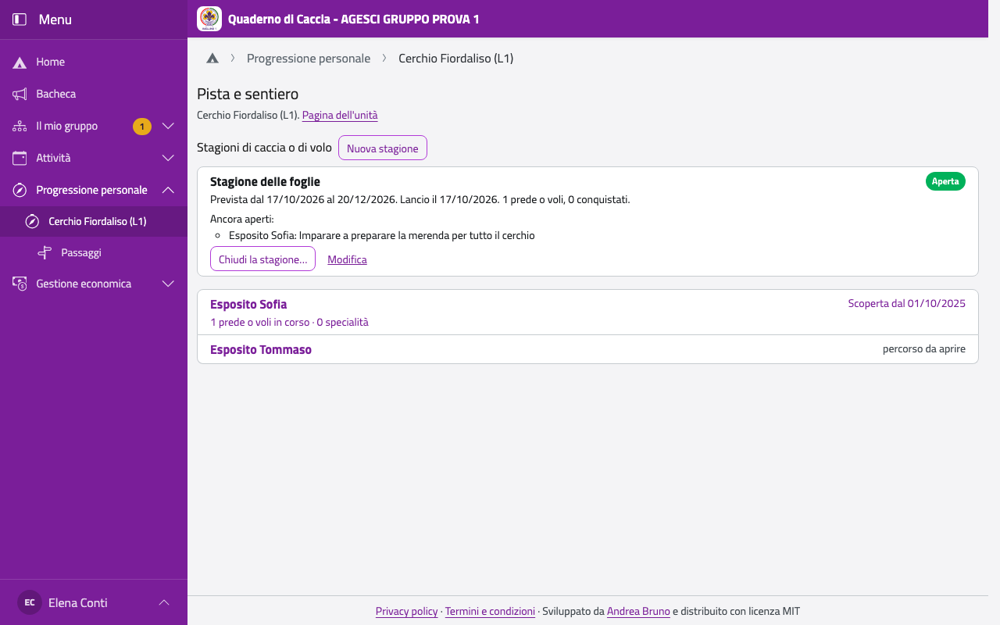
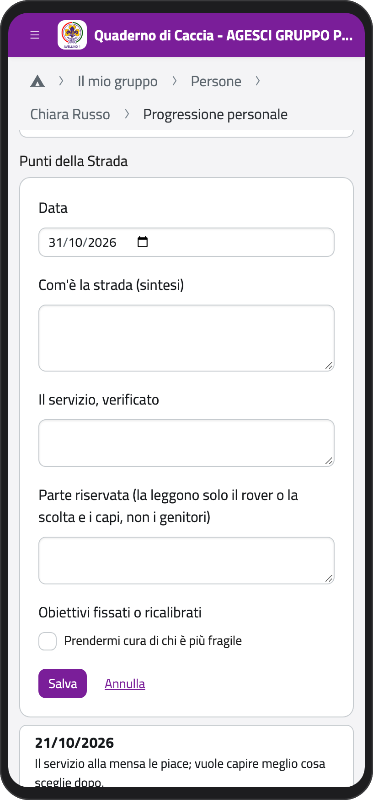
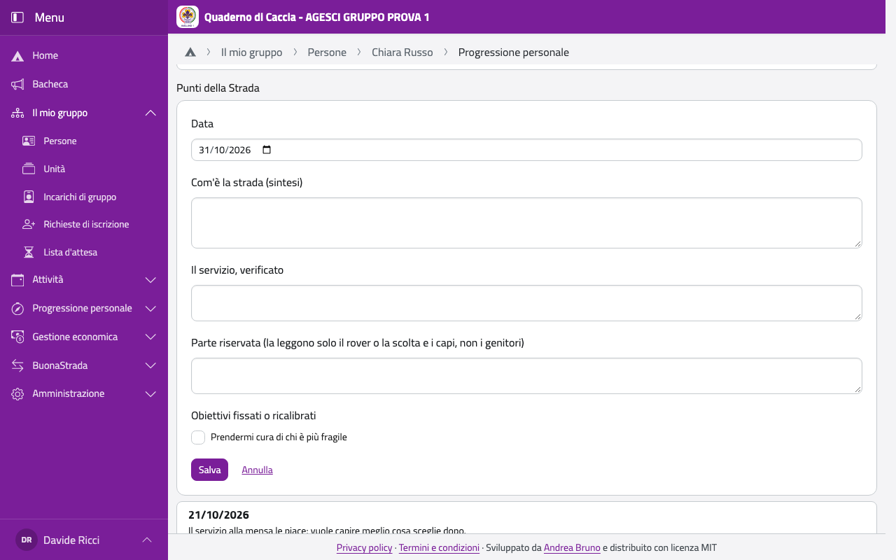

# Progressione Personale

La Progressione dei ragazzi della tua unità la scrive lo staff dell'unità: tappe o momenti,
Promessa, verifiche, specialità. Tutti i capi la leggono.

## La pagina dell'unità

Nella Home, in **Progressione personale**, tocca la tua unità. Vedi tutti i ragazzi, in
ordine di cognome, con la tappa (o il momento, o il passo) in cui sono e cosa c'è da fare:
**Promessa da registrare**, **distintivo da consegnare**, quante cose sono **da verificare**
e **da concordare**. Tocca un nome per aprire la sua pagina.

:::{container} schermate
{.telefono width="30%"}
{.computer width="65%"}
:::

La pagina si legge anche senza rete, se l'hai aperta prima. Senza rete puoi anche aggiungere
impegni (o prede e voli) e fare i passi di impegni, mete, specialità e brevetti; il resto si
fa con la rete.

## Cose comuni a tutte le branche

**Aprire il percorso.** Per chi entra nell'unità tocca **Apri il percorso** e scrivi quando
è entrato (per chi c'era già basta l'anno). Inizia la Scoperta.

**Le date.** Ogni data si può scrivere come giorno, solo mese o solo anno, quando non la sai
precisa (per esempio per ricostruire la storia di chi c'era già).

**La Promessa.** Tocca **Registra la Promessa** e scrivi la data. Se hai sbagliato, **Correggi
la data della Promessa** chiede il motivo, che resta nella storia.

**Correggere una data.** Se hai sbagliato una data di una tappa (o di un momento, o di un
passo), accanto a essa tocca **correggi una data…**: scegli quale (inizio, riconoscimento,
consegna del distintivo), scrivi la data giusta e perché la correggi, e tocca **Correggi**. Se
correggi il riconoscimento, correggi anche l'inizio della tappa dopo, che di solito è lo
stesso giorno.

:::{container} schermate
{.telefono width="30%"}
{.computer width="65%"}
:::

**Impegni e mete** (obiettivi in clan, prede o voli in branco e cerchio). Il ragazzo li può
proporre: restano **Bozza** finché non li concordate. Lo staff li porta avanti:

| Quando è… | tocca | e diventa |
| --- | --- | --- |
| Bozza | **Concorda** (un impegno deve avere un «entro il») | Concordato |
| Concordato | **Avvia** | In corso |
| In corso | **Pronto per la verifica** (anche il ragazzo o il capo squadriglia) | Da verificare |
| Da verificare | **Convalida…**: il giorno e dove (Consiglio della Legge, di squadriglia…) | Concluso |
| Da verificare | **Non ancora: prosegue** | In corso |

**Interrompi** chiude un impegno con un motivo; **Riformula** ne cambia il testo (la versione
di prima resta).

**Allegati.** Con **Allega una foto o un PDF** tu o il ragazzo aggiungete qualcosa a un
impegno, una meta, una specialità.

## Esploratori e guide

:::{container} schermate
{.telefono width="30%"}
{.computer width="65%"}
:::

- **Riconosci la tappa (Consiglio della Legge)**: scrivi il giorno del Consiglio; dallo
  stesso giorno inizia la tappa successiva.
- **Distintivo consegnato**: segna il giorno della consegna.
- **Entrato più grande: colloca in un'altra tappa**: per chi entra in reparto più grande,
  dopo la Promessa, con la motivazione.
- **Mete**: il ragazzo può segnarne una come **riservata**: la vedono lui, i genitori e i
  capi, mai il capo squadriglia.
- **Specialità e brevetti**: tocca **Aggiungi**, scegli dal catalogo, scrivi la carta (anche
  dopo) e il maestro (anche un adulto esterno). Quando è pronto, **Conquistata (Consiglio
  della Legge)** con il giorno della conquista; poi **Distintivo consegnato**. Per ricostruire
  la storia spunta **Già conquistata in passato**.
- **Imprese**: dalla pagina dell'unità, **Imprese e specialità di squadriglia**. Crei imprese
  di reparto, di squadriglia o di Alta Squadriglia, nomini il **Consiglio d'impresa**, assegni
  e verifichi i **posti d'azione**. L'impresa di squadriglia la guida il capo squadriglia. Lì
  ci sono anche le **specialità di squadriglia**, che conquista la squadriglia (non danno una
  specialità personale ai membri).

## Lupetti e coccinelle

I nomi seguono l'ambientazione dell'unità: giungla per il branco, bosco per il cerchio.

| Momento | Branco: cammino e traguardo | Cerchio: cammino e traguardo |
| --- | --- | --- |
| Scoperta | In caccia con Baloo, lupo della legge | In volo nel prato, coccinella del prato |
| Competenza | In caccia con Bagheera, lupo della rupe | In volo nel bosco, coccinella del bosco |
| Responsabilità | In caccia con Akela, lupo anziano | In volo sulla montagna, coccinella della montagna |

- **Stagioni**: nella pagina della Progressione dell'unità, in **Stagioni di caccia o di
  volo**, tocca **Nuova stagione** (nome, inizio e fine previsti, di solito tre o quattro
  mesi), poi **Lancio…** il giorno del lancio e **Chiudi la stagione…** alla fine. Una
  stagione aperta alla volta; chiuderla non fa conquistare niente.
- **Prede e voli**: legati a una stagione, si portano avanti come gli impegni.
- **Riconosci** il momento: serve almeno una preda o un volo conquistato in quel momento
  (per chi c'era già, spunta che le prede di allora non sono registrate). Il distintivo si
  consegna dopo il riconoscimento.
- **Specialità L/C**: **Aggiungi**, poi **Conquistata**.
- Il **Consiglio degli Anziani** si nomina dalla pagina dell'unità, in **Staff e incarichi**.
- Le **Piccole Orme** compaiono da sole dalle iscrizioni agli eventi su BuonaCaccia.

:::{container} schermate
{.telefono width="30%"}
{.computer width="65%"}
:::

## Rover e scolte

- **Firma della Carta di clan**: segna il giorno; da lì iniziano i passi di competenza, e la
  firma resta legata alla versione della Carta in vigore quel giorno.
- **Inizia il confronto sulla Partenza**: durante la Competenza, iniziano i passi di
  responsabilità.
- **Punto della Strada**: tocca **Nuovo Punto della Strada** e scrivi com'è la strada, il
  servizio verificato, gli obiettivi fissati o cambiati e, se serve, la **parte riservata**:
  la leggono solo il rover o la scolta e i capi, mai i genitori. Il rover o la scolta può
  aggiungere la sua rilettura. Si fa solo con la rete.
- **Concludi il percorso…**: Partenza, saluto fraterno, interruzione o trasferimento, con la
  data. Non succede mai da solo; dopo la Partenza il percorso non si riapre.
- **Carta di clan**: dalla pagina dell'unità, **Carta di clan**. Carichi una nuova versione in
  PDF (con **In vigore dal**, o vuoto per lasciarla come proposta) e metti in vigore le
  proposte di rover e scolte con **Metti in vigore**. Una versione in vigore non si toglie:
  se ne carica una nuova.

:::{container} schermate
{.telefono width="30%"}
{.computer width="65%"}
:::
