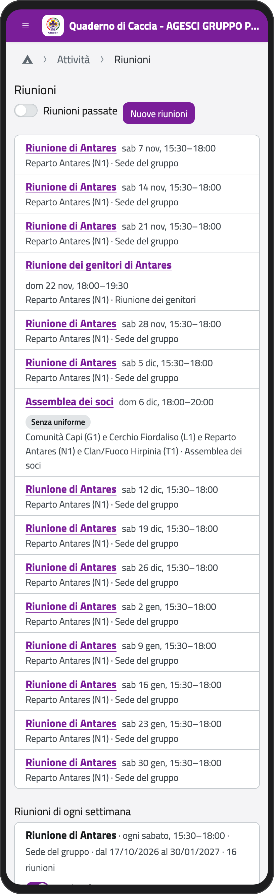
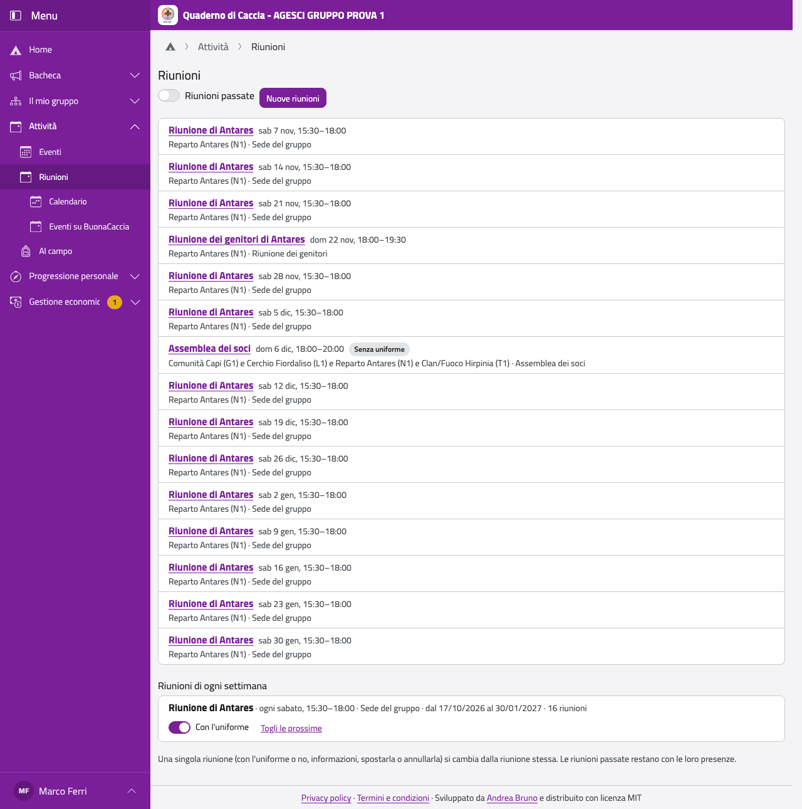
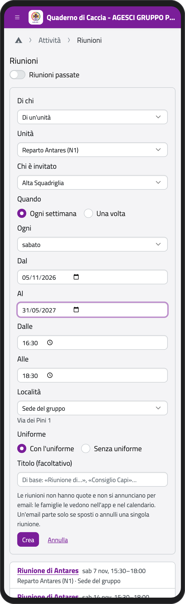
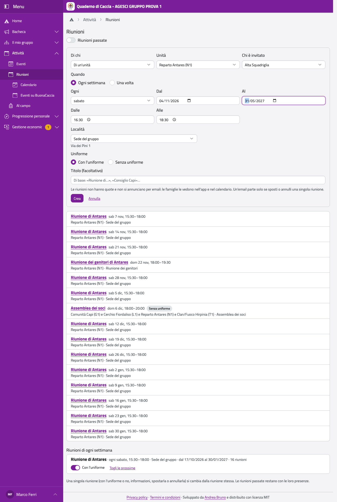
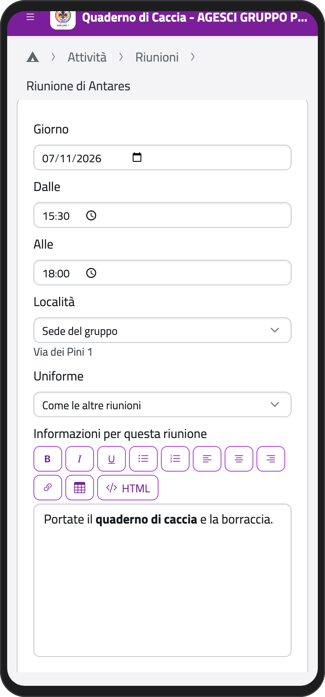
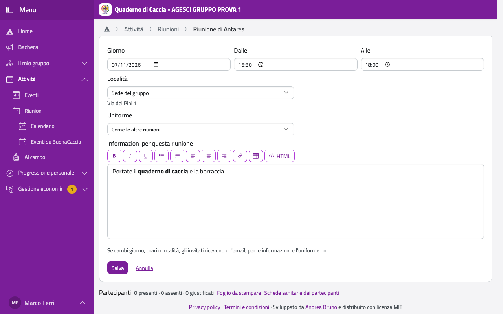
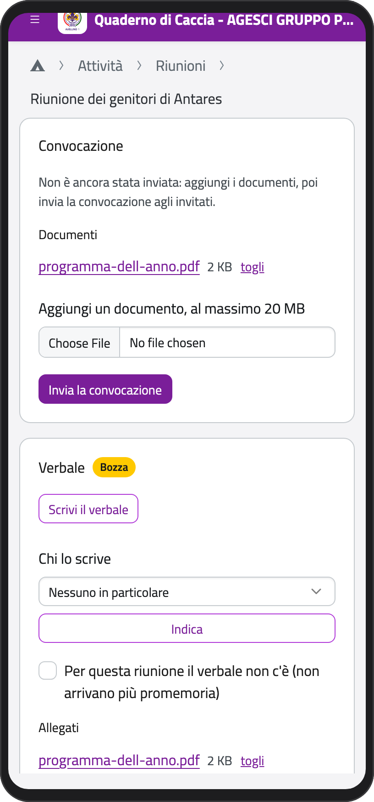
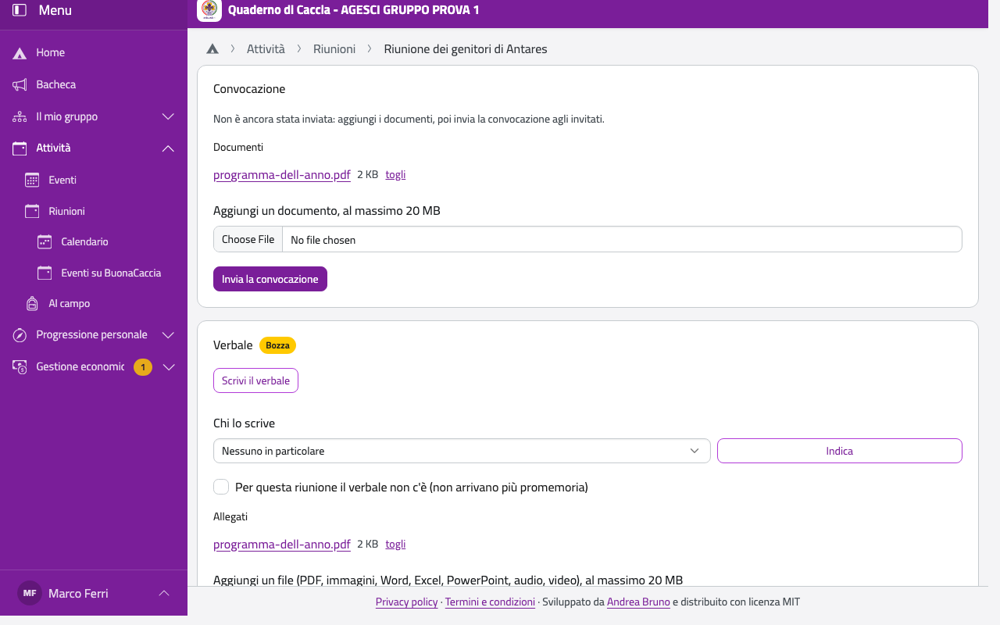
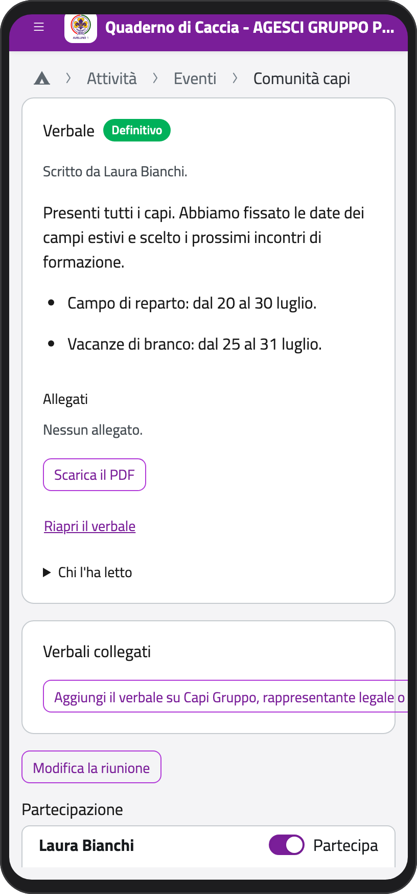
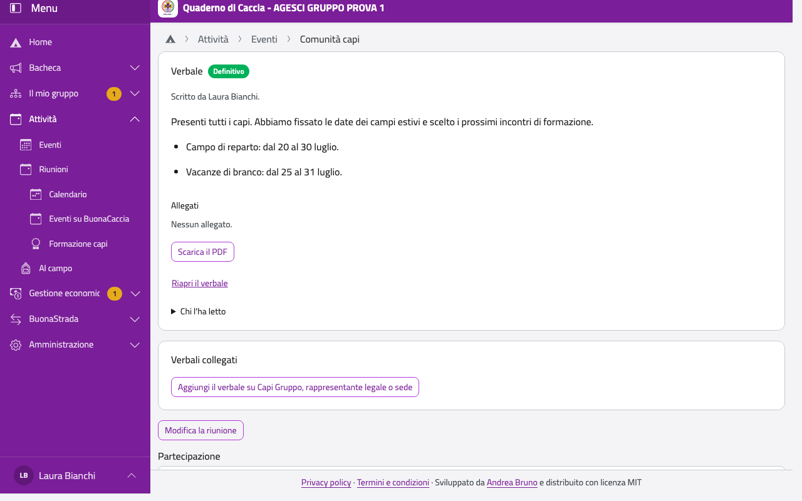

# Riunioni

Le riunioni non sono eventi: hanno una pagina loro e non hanno mai una quota. Nella Home, in
**Attività**, tocca **Riunioni**: vedi le prossime riunioni, con **Riunioni passate** quelle già
fatte. Le riunioni sono anche nel calendario, e le famiglie le vedono nell'app.

Nel **Calendario** la voce **Tutti i miei eventi**, già scelta all'apertura, mostra quelli a cui
sei invitato, quelli delle tue unità e quelli della Comunità capi. Gli altri eventi di gruppo sono
in **Tutto il gruppo**.

:::{container} schermate
{.telefono width="30%"}
{.computer width="65%"}
:::

## Creare le riunioni

1. Tocca **Nuove riunioni**.
2. In **Di chi** scegli **Di un'unità** (anche la Comunità capi) o **Di una squadriglia**.
3. Per un'unità scegli l'**Unità** e **Chi è invitato**: tutta l'unità oppure, per un reparto,
   l'Alta Squadriglia, il Consiglio Capi o il Con.Ca.Vi., per un branco o un cerchio il
   Consiglio degli Anziani. Se l'unità è collegata a un'altra, puoi spuntare **Insieme a…**.
4. In **Quando** scegli **Ogni settimana** (il giorno, **Dal** e **Al**: per esempio ogni sabato
   dal 1° ottobre al 31 maggio) oppure **Una volta** (il **Giorno**), poi **Dalle** e **Alle**.
5. Scegli la **Località** tra quelle del gruppo, oppure **Nuova località…** e scrivine nome e
   indirizzo: entra nell'elenco del gruppo.
6. Scegli **Con l'uniforme** o **Senza uniforme**. Il **Titolo** è facoltativo.
7. Per una sola riunione della Comunità capi puoi scrivere subito l'**Ordine del giorno**. Se è una
   riunione di ogni settimana, lo scrivi poi sulla singola riunione.
8. Tocca **Crea**.

:::{container} schermate
{.telefono width="30%"}
{.computer width="65%"}
:::

Le riunioni dell'unità le crea lo staff, quelle della Comunità capi i capigruppo, quelle di
squadriglia il capo squadriglia (o chi ha delegato) e lo staff del reparto. Le riunioni non si
annunciano per email: le famiglie ricevono un'email solo quando sposti o annulli una singola
riunione.

## Le riunioni di ogni settimana

In fondo alla pagina, **Riunioni di ogni settimana** elenca le serie. L'interruttore **Con
l'uniforme** cambia tutte le riunioni della serie che non hanno una scelta loro; **Togli le
prossime** annulla tutte le riunioni future della serie (quelle passate restano, con le loro
presenze).

## Una singola riunione

Tocca una riunione: vedi giorno, orari, località (con l'indirizzo), uniforme e le informazioni
dello staff. Con **Modifica la riunione** puoi spostarla (giorno, orari), cambiare la località,
dire se è con l'uniforme (**Come le altre riunioni** segue la serie) e scrivere le
**Informazioni per questa riunione** con l'editor di testo (cosa portare, cosa si fa). Tocca
**Salva**. Se la sposti, gli invitati ricevono un'email; per le informazioni e l'uniforme no.

:::{container} schermate
{.telefono width="30%"}
{.computer width="65%"}
:::

Per annullare una riunione tocca **Annulla la riunione** e scrivi il motivo: le famiglie lo
leggono nell'email. Le presenze si segnano come per gli eventi (vedi [Segnare le
presenze](eventi.md#segnare-le-presenze)).

## Le riunioni dei genitori

Le creano lo staff, per la sua unità, e i capigruppo, anche per più unità o per tutto il gruppo.

1. In **Nuove riunioni**, in **Di chi**, scegli **Dei genitori**, poi le unità o **Tutto il gruppo**,
   il giorno e gli orari. Si crea una riunione alla volta.
2. Apri la riunione. Nel riquadro **Convocazione** aggiungi i documenti, per esempio il programma.
3. Tocca **Invia la convocazione**: l'email parte per tutti gli invitati con i documenti allegati,
   una volta sola. I documenti troppo grandi per un'email restano da aprire nell'app, e nell'email
   ci sono il nome e il link.

Un documento aggiunto dopo arriva da solo per email agli invitati. Se sposti o annulli la riunione,
gli invitati ricevono l'email come per le altre riunioni.

Sono invitati i genitori e i tutori dei ragazzi, entrambi se ci sono, e lo staff (per il gruppo tutta
la Comunità capi); i ragazzi no. Per un rover o una scolta maggiorenne sono invitati i genitori, salvo
che abbia scelto di andare lui al loro posto. Nessuno deve comunicare se viene: le presenze le segna
lo staff, per ogni genitore, e non contano su quelle dei figli.

:::{container} schermate
{.telefono width="30%"}
{.computer width="65%"}
:::

L'[assemblea dei soci](../gruppo/assemblea) la convocano i capigruppo.

## L'ordine del giorno

Le riunioni della Comunità capi e dei genitori hanno un **Ordine del giorno**, nel suo riquadro nella
pagina della riunione: lo scrive chi gestisce la riunione e lo legge chi la vede (per la Comunità capi
solo i capi). Tocca **Scrivilo** o **Modifica**. Serve la rete: non resta salvato sul telefono.

Nell'email di convocazione ai genitori c'è l'ordine del giorno scritto fino a quel momento. Se lo cambi
dopo, non parte un'altra email: la versione aggiornata si legge nell'app.

## Il verbale

Alcune riunioni hanno un verbale: Comunità capi, riunioni dei genitori, squadriglia, Alta Squadriglia,
Consiglio Capi e Con.Ca.Vi. Lo trovi nella pagina della riunione, nel riquadro **Verbale**. Serve la rete: il
verbale non resta salvato sul telefono.

| Riunione | Chi decide chi lo scrive (e può sempre scriverlo) | Chi lo legge quando è definitivo |
| --- | --- | --- |
| Comunità capi | i capigruppo | i capi |
| Riunione dei genitori | i capigruppo e, se è di una sola unità, il suo staff | gli invitati e i capi |
| Squadriglia | il capo squadriglia e lo staff del reparto | la squadriglia, i suoi genitori, i capi |
| Alta Squadriglia, Consiglio Capi, Con.Ca.Vi. | lo staff | gli invitati e i capi |

1. Per affidarlo a qualcuno, in **Chi lo scrive** scegli una persona tra gli invitati o i capi e
   tocca **Indica**. Può scrivere solo il verbale di questa riunione.
2. Tocca **Scrivi il verbale**, scrivi il testo con l'editor e tocca **Salva la bozza**. La bozza la
   vedono chi la scrive, chi l'ha indicato e i capi.
3. Se vuoi, aggiungi dei file in **Allegati**: PDF, immagini, Word, Excel, PowerPoint, audio e video.
   Le immagini vanno qui, non nel testo.
4. Quando è finito, chi ha indicato chi scrive tocca **Rendi definitivo**. Da quel momento lo leggono
   tutti quelli che ne hanno diritto e si scarica il **PDF** su carta intestata; con **Scarica lo ZIP
   con gli allegati** hai tutto insieme.

Per correggerlo tocca **Riapri il verbale** e scrivi il motivo, che resta registrato. Con l'anno
associativo chiuso va prima riaperto l'anno.

I verbali di Comunità capi e delle riunioni dei genitori hanno in fondo lo spazio per la firma. Se non
sono definitivi, una settimana dopo la riunione arriva un promemoria a chi può indicare chi scrive e
alla persona indicata, poi ogni settimana, al massimo tre volte. Se per quella riunione il verbale non
c'è, spunta **Per questa riunione il verbale non c'è**.

Di quello di Comunità capi resta registrata ogni lettura: i capigruppo la vedono in **Chi l'ha letto**.

Quando cambiano i capi gruppo, il rappresentante legale o la sede, i capigruppo compilano anche il
[verbale collegato](../gruppo/assemblea.md#il-verbale-su-capi-gruppo-rappresentante-legale-e-sede).

:::{container} schermate
{.telefono width="30%"}
{.computer width="65%"}
:::

## Le località

I capigruppo trovano le località del gruppo in **Impostazioni › Località**: le correggono
(nome, indirizzo, link alla mappa), ne aggiungono e tolgono quelle che non servono più. Una
località tolta resta scritta sulle riunioni che l'avevano.
