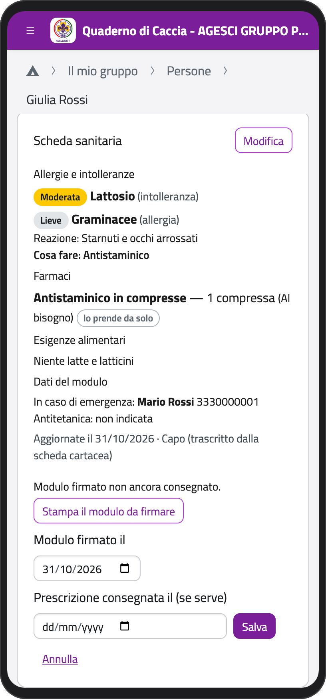
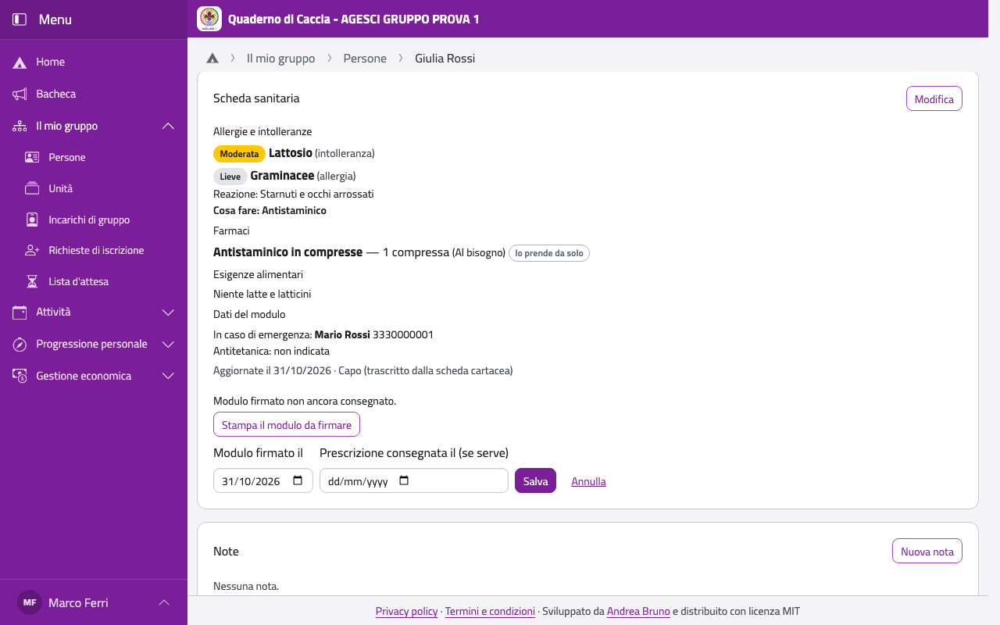

# Scheda sanitaria

La scheda sanitaria di un minore la compilano i genitori; quella di un maggiorenne la
compila lui. I capi la **leggono** tutti; lo staff dell'unità del ragazzo e i capigruppo la
possono anche **ricopiare** dal modulo di carta, per una famiglia che non usa l'app.

## Ricopiarla dal modulo

1. Apri la scheda del ragazzo (vedi [Persone](persone)).
2. Nel riquadro **Scheda sanitaria** tocca **Compila** (o **Modifica**).
3. Compila come farebbe un genitore: dati del modulo, allergie e intolleranze, farmaci,
   esigenze alimentari, dati facoltativi (i campi sono spiegati in [Scheda
   sanitaria](../genitore/sanitaria) della parte genitori).
4. Tocca **Salva**. Funziona anche senza rete: parte quando torna.

## Il modulo firmato

La scheda va anche firmata su carta dai genitori (o dal ragazzo maggiorenne).

1. Nel riquadro sotto la scheda sanitaria tocca **Stampa il modulo da firmare**: è il modulo
   AGESCI già compilato.
2. Quando la famiglia te lo riconsegna firmato, tocca **Segna la consegna su carta…**.
3. In **Modulo firmato il** metti il giorno della firma e, se il ragazzo prende farmaci, in
   **Prescrizione consegnata il** il giorno in cui hai avuto la prescrizione del medico.
4. Tocca **Salva**.

Se dopo la firma qualcuno cambia la scheda, compare l'avviso «La scheda è cambiata dopo
l'ultima firma»: stampa il modulo e fallo firmare di nuovo.

:::{container} schermate
{.telefono width="30%"}
{.computer width="65%"}
:::

## Le schede di tutti i partecipanti a un evento

Prima di un campo o di un'uscita, apri l'evento e, nel riquadro **Partecipanti**, tocca
**Schede sanitarie dei partecipanti**: stampa i moduli di tutti gli invitati, ognuno con il
recapito per le emergenze di quell'evento, se la famiglia ne ha indicato uno.

:::{note}
Ogni stampa resta scritta nel registro degli accessi ai dati sanitari.
:::
