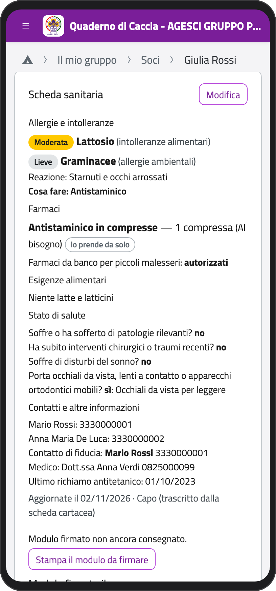
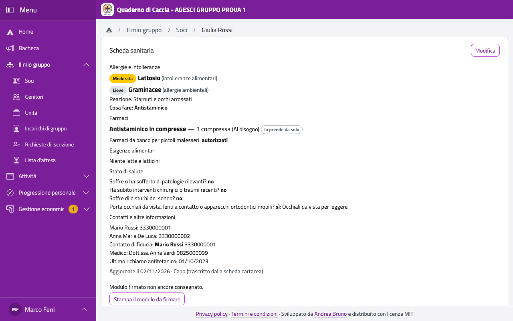

# Scheda sanitaria

La scheda sanitaria di un minore la compilano i genitori; quella di un maggiorenne la
compila lui. I capi la **leggono** tutti; lo staff dell'unità del ragazzo e i capigruppo la
possono anche **ricopiare** dal modulo di carta, per una famiglia che non usa l'app.

## Ricopiarla dal modulo

1. Apri la scheda del ragazzo (vedi [Soci e genitori](persone)).
2. Nel riquadro **Scheda sanitaria** tocca **Compila** (o **Modifica**).
3. Compila come farebbe un genitore: contatti, stato di salute, allergie e intolleranze,
   terapie, esigenze alimentari, antitetanica e farmaci da banco, altre informazioni (le
   parti sono spiegate in [Scheda sanitaria](../genitore/sanitaria) della parte genitori).
4. Tocca **Salva**. Funziona anche senza rete: parte quando torna.

## Il modulo firmato

La scheda va anche firmata su carta dai genitori (o dal ragazzo maggiorenne).

1. Nel riquadro sotto la scheda sanitaria tocca **Stampa il modulo da firmare**: è la scheda
   del gruppo già compilata, su carta intestata.
2. Quando la famiglia te la riconsegna firmata su carta, tocca **Segna la consegna su
   carta…**.
3. In **Modulo firmato il** metti il giorno della firma e, se il ragazzo prende farmaci, in
   **Prescrizione consegnata il** il giorno in cui hai avuto la prescrizione del medico.
4. Tocca **Salva**.

Se dopo la firma qualcuno cambia la scheda, compare l'avviso «La scheda è cambiata dopo
l'ultima firma»: stampa il modulo e fallo firmare di nuovo.

## Verificare i documenti caricati

La famiglia (o il ragazzo maggiorenne) può caricare nell'app la scheda firmata e i
documenti da allegare: tessera sanitaria o codice fiscale, documento d'identità del ragazzo
e del genitore che firma. Li verifica lo staff dell'unità o un capogruppo, e restano
sull'app solo finché non sono verificati.

1. Nel riquadro **Scheda sanitaria**, in **Documenti da allegare**, tocca **Scarica** e
   controlla il documento.
2. Per la scheda firmata scrivi in **Firmata il** il giorno della firma: diventa la data
   dell'ultima firma della scheda.
3. Tocca **Salva sul Drive del gruppo** (se il Drive è collegato) oppure, dopo averlo
   salvato tu, **L'ho salvato sul mio computer**.

Da quel momento il file è cancellato dall'app: resta solo «verificato il … da …» e dove è
stato salvato. Se un documento non va bene, tocca **Togli** e chiedi alla famiglia di
caricarlo di nuovo.

:::{container} schermate
{.telefono width="30%"}
{.computer width="65%"}
:::

## Le schede di tutti i partecipanti a un evento

Prima di un campo o di un'uscita, apri l'evento e, nel riquadro **Partecipanti**, tocca
**Schede sanitarie dei partecipanti**: stampa i moduli di tutti gli invitati, ognuno con il
recapito per le emergenze di quell'evento, se la famiglia ne ha indicato uno.

:::{note}
Ogni stampa resta scritta nel registro degli accessi ai dati sanitari.
:::
