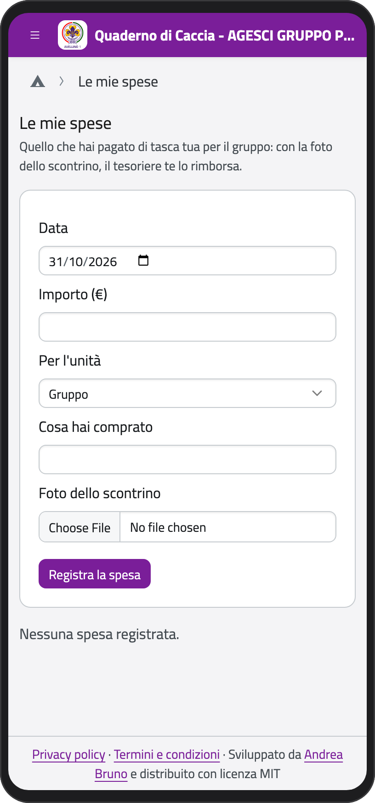
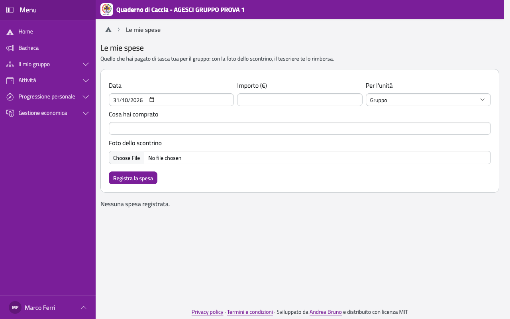

# Le mie spese

Se paghi qualcosa di tasca tua per il gruppo (la spesa per il campo, il materiale), registrala
qui: il tesoriere te la rimborsa.

1. Nel menu del profilo, sotto il tuo nome, tocca **Le mie spese**.
2. Scrivi la **Data**, l'**Importo** e **Cosa hai comprato**, e scegli **Per l'unità** (o
   **Gruppo**).
3. In **Foto dello scontrino** fai una foto dello scontrino (o scegli un PDF).
4. Tocca **Registra la spesa**.

Funziona anche senza rete: la spesa resta sul telefono, con la foto, e arriva al tesoriere
appena torna la rete.

:::{container} schermate
{.telefono width="30%"}
{.computer width="65%"}
:::

Sotto vedi le tue spese: **Da rimborsare**, **Rimborsata il …** o **Respinta**, con il motivo.
I rimborsi li registrano il tesoriere del gruppo, i capigruppo e, per la sua unità, il capo
unità.
