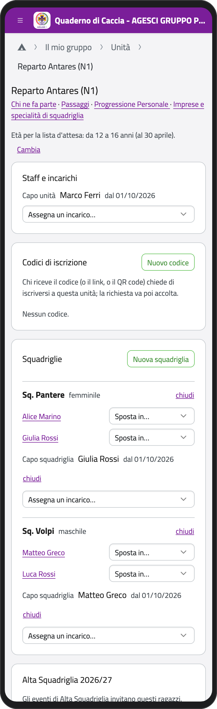
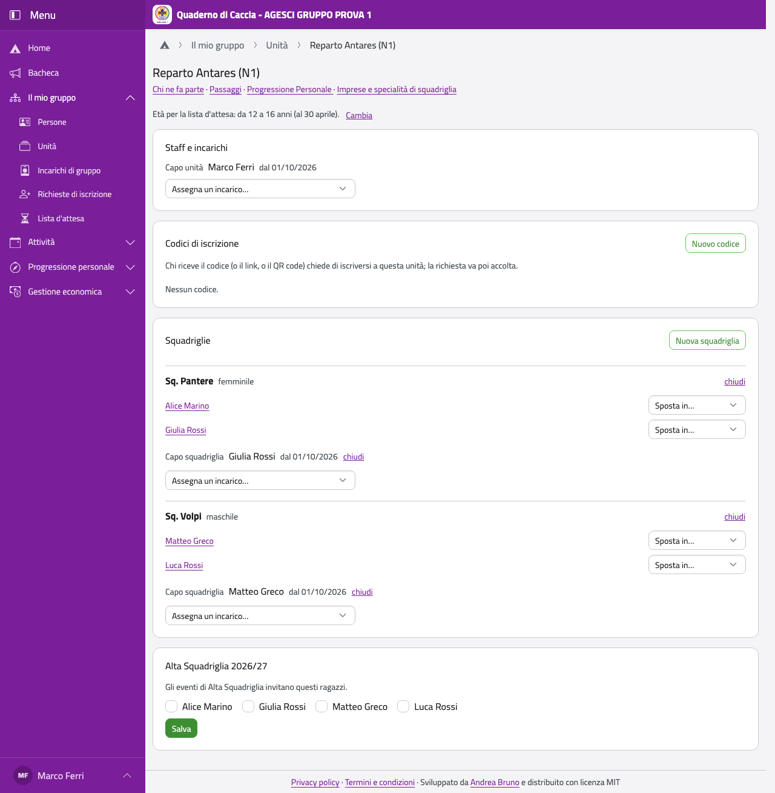
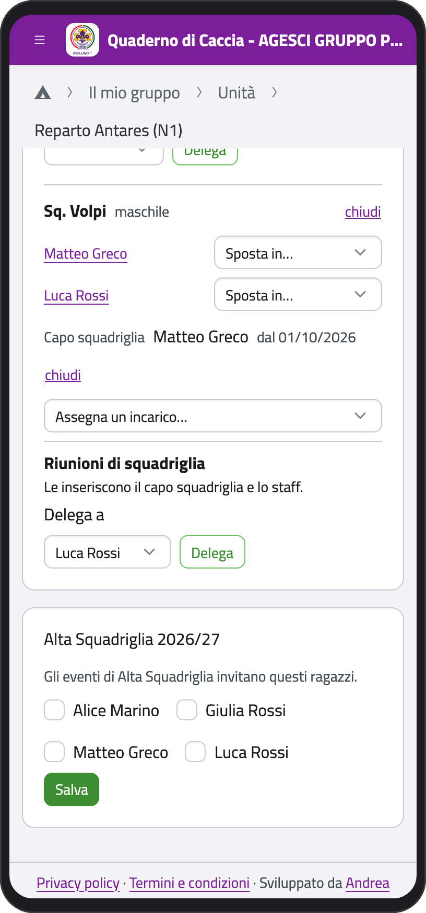
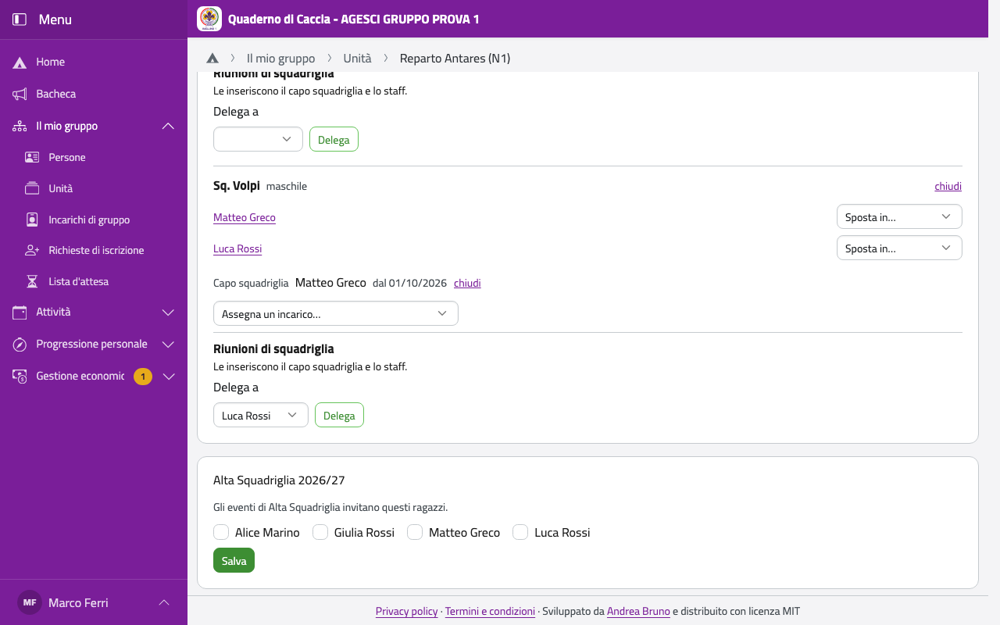

# La tua unità

Nella Home, in **Il mio gruppo**, tocca **Unità** e poi la tua unità.

In alto trovi i collegamenti a **Chi ne fa parte**, **Passaggi**, **Progressione
Personale** e, a seconda dell'unità, **Carta di clan** o **Imprese e specialità di
squadriglia**. Il riquadro **Da controllare** segnala cosa manca: per esempio un ragazzo che
compie 18 anni senza account (invitalo, così sceglie cosa vedono i genitori), o qualcuno in
una squadriglia dell'altro sesso senza un'eccezione.

:::{container} schermate
{.telefono width="30%"}
{.computer width="65%"}
:::

## Staff e incarichi

In **Staff e incarichi** vedi chi fa servizio nell'unità e da quando. Lo staff e il capo
unità li nominano i capigruppo. Tu puoi nominare:

- il **tesoriere dell'unità**, se sei capo unità (in clan può essere anche un rover o una
  scolta);
- in branco e cerchio, il **Consiglio degli Anziani**;
- in reparto, **capo** e **vice capo squadriglia** (sotto, nelle squadriglie).

Scegli il ruolo in **Assegna un incarico…**, poi la persona in **Chi**, e tocca
**Assegna**. Per chiudere un incarico tocca **chiudi** e conferma con **Sì**.

## Le squadriglie (reparto)

Le squadriglie le compongono lo staff del reparto e i capigruppo.

- **Nuova squadriglia**: scrivi il nome, scegli **Femminile** o **Maschile** e tocca
  **Crea**.
- Per spostare un ragazzo, accanto al suo nome scegli **Sposta in…** e la squadriglia (o
  **Nessuna squadriglia**): vale da oggi. Chi non è in nessuna squadriglia è in **Senza
  squadriglia**, con **Metti in…**.
- Prima di spostare un capo o vice capo squadriglia, chiudi il suo incarico.
- Per chiudere una squadriglia tocca **chiudi** (e **riapri** per riaprirla).
- **Riunioni di squadriglia**: le inseriscono il capo squadriglia e lo staff. Puoi delegare
  un membro della squadriglia a inserirle anche lui (solo a inserirle, non a segnare le
  presenze): scegli chi in **Delega a** e tocca **Delega**; **Togli la delega** la toglie.
  Lo può fare anche il capo squadriglia, dalla sua pagina.

:::{container} schermate
{.telefono width="30%"}
{.computer width="65%"}
:::

:::{note}
Le squadriglie sono maschili o femminili. Un ragazzo può entrare in una squadriglia
dell'altro sesso solo con un'eccezione decisa dalla Comunità capi e registrata da un
capogruppo nella sua scheda («Eccezioni sulla squadriglia»): tu la vedi, ma non la puoi
registrare. Ogni lettura delle eccezioni resta nel registro degli accessi.
:::

In reparto c'è anche **Alta Squadriglia**: spunta i ragazzi che ne fanno parte e tocca
**Salva**; gli eventi di Alta Squadriglia invitano loro.

## Età per la lista d'attesa

Ogni unità ha un'età minima e una massima (al 30 aprile), che la lista d'attesa usa per
consigliare l'unità giusta. Di base sono quelle della branca: lupetti e coccinelle da 8 a 11
anni, esploratori e guide da 12 a 16, rover e scolte da 16 a 20. Per cambiarle tocca
**Cambia**, scrivi **Da** e **A** e tocca **Salva**. Sono un'indicazione, non un limite.
