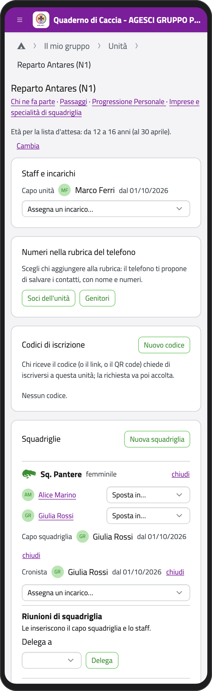
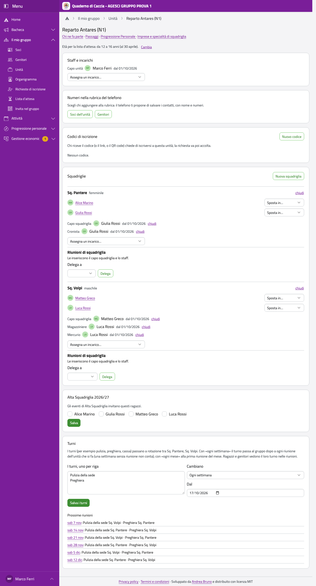
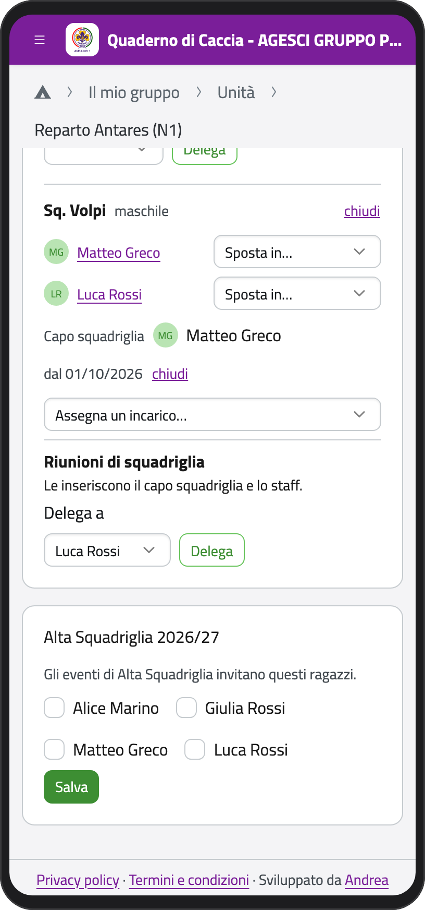
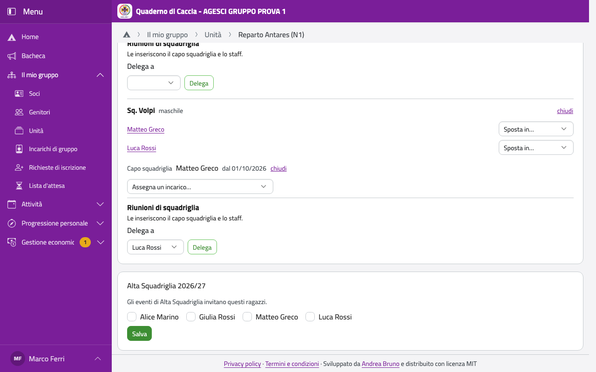
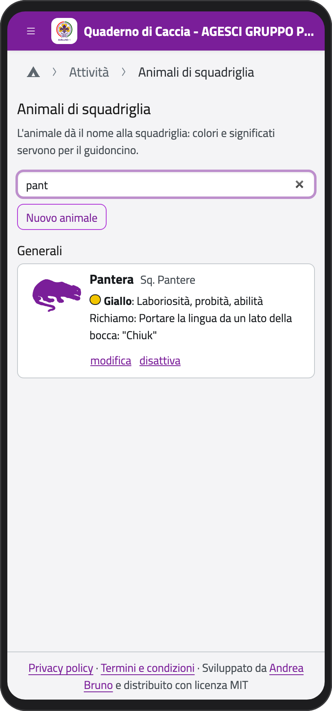
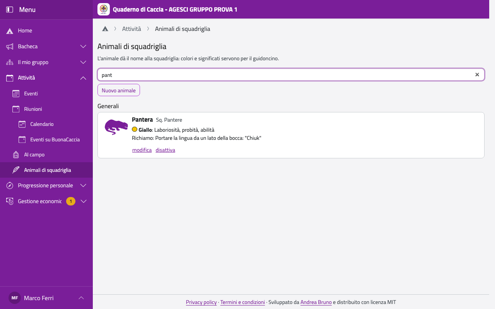
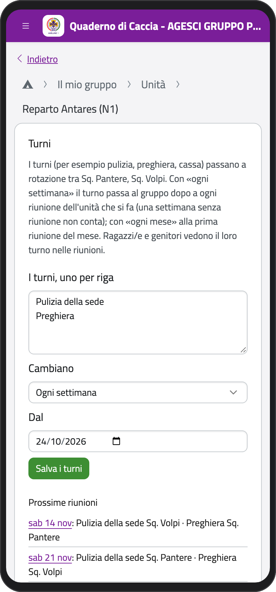
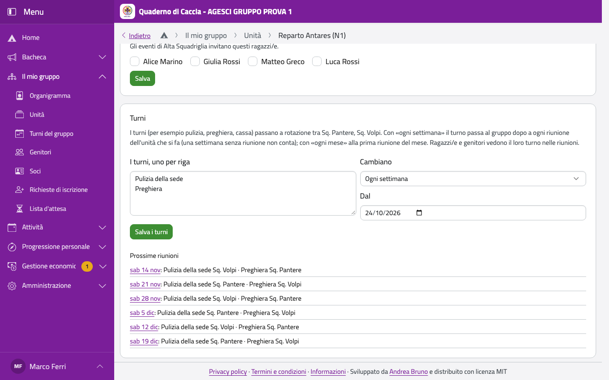

# La tua unità

Nella Home, in **Il mio gruppo**, tocca **Unità** e poi la tua unità.

In alto trovi i collegamenti a **Chi ne fa parte**, **Passaggi**, **Progressione
Personale** e, a seconda dell'unità, **Carta di clan** o **Imprese e specialità di
squadriglia**. Il riquadro **Da controllare** segnala cosa manca: per esempio un ragazzo/a che
compie 18 anni senza account (invitalo, così sceglie cosa vedono i genitori), o qualcuno in
una squadriglia dell'altro sesso senza un'eccezione.

Se la tua unità è **collegata** a un'altra (per esempio il reparto parallelo), accanto agli
altri collegamenti c'è **Collegata a** con il suo nome. Lo staff delle due unità conta come
uno solo: nell'altra unità puoi fare tutto quello che fai nella tua (progressione, dati
sanitari, squadriglie, eventi e presenze), tranne la cassa, che resta di ogni unità.
Le gestisci tutte e due da una pagina sola: in quella di ciascuna trovi anche le squadriglie
dell'altro reparto, con il suo nome accanto, o le sestiglie e i turni dell'altro branco o cerchio.
Un ragazzo/a si sposta solo tra le squadriglie del suo reparto; per una squadriglia nuova scegli
prima in quale reparto.

:::{container} schermate
{.telefono width="30%"}
{.computer width="65%"}
:::

## Staff e incarichi

In **Staff e incarichi** vedi chi fa servizio nell'unità e da quando. Lo staff e il capo
unità li nominano i capigruppo. Tu puoi nominare:

- il **tesoriere dell'unità**, se sei capo unità (in clan può essere anche un rover o una
  scolta);
- in branco e cerchio, il **Consiglio degli Anziani**;
- in reparto, **capo** e **vice capo squadriglia** (sotto, nelle squadriglie).

Scegli il ruolo in **Assegna un incarico…**, poi la persona in **Chi**, e tocca
**Assegna**. Per chiudere un incarico tocca **chiudi** e conferma con **Sì**.

## Le squadriglie (reparto)

Le squadriglie le compongono lo staff del reparto e i capigruppo.

- **Nuova squadriglia**: scegli l'animale, poi **Femminile** o **Maschile**, e tocca **Crea**. Il
  nome è il plurale dell'animale. Se manca, aggiungilo all'elenco degli animali (qui sotto). Con
  **Senza animale: lo sceglie il capo squadriglia** la squadriglia si chiama «Nuova Squadriglia 1»
  (2, 3…) finché il suo capo squadriglia non sceglie l'animale, una volta sola, dalla sua pagina:
  lo staff riceve un'email e una notifica e, se c'è un errore, lo corregge entro un mese con
  **Correggi l'animale scelto dal capo squadriglia** sotto il nome della squadriglia. In
  un reparto maschile o femminile il sesso non si sceglie: la squadriglia è dello stesso sesso
  del reparto, e una dell'altro sesso rimasta da prima è segnalata in **Da controllare**, da
  correggere o, una volta vuota, archiviare.
- Una squadriglia nata prima degli animali, con un nome che non corrisponde a nessuno, è
  segnalata in **Da controllare**: sotto il suo nome scegli l'animale.
- Per spostare un ragazzo/a, accanto al suo nome scegli **Sposta in…** e la squadriglia (o
  **Nessuna squadriglia**): vale da oggi. Chi non è in nessuna squadriglia è in **Senza
  squadriglia**, con **Metti in…**.
- Prima di spostare un capo o vice capo squadriglia, chiudi il suo incarico.
- **Incarichi di squadriglia** (cassiere, cicala, cronista e gli altri): li assegnano lo staff del
  reparto, dalla squadriglia in questa pagina, e il capo squadriglia, dalla sua pagina. Un
  capogruppo lo fa solo se è nello staff di quel reparto. Non danno permessi e si chiudono da soli
  quando il ragazzo/a lascia la squadriglia.
- Fuori da quel mese, l'animale di una squadriglia non si cambia. Per cambiarlo apri una squadriglia nuova con
  l'animale che vuoi, spostaci i membri e archivia la vecchia.
- Una squadriglia vuota si archivia: tocca **archivia** accanto al nome e conferma con
  **Archivia**. È per sempre: non si riattiva più e resta solo per memoria, in **Squadriglie
  archiviate** in fondo alle squadriglie, con il periodo in cui è stata attiva. Una squadriglia
  nuova può avere lo stesso animale e lo stesso nome, ma è un'altra squadriglia.
- **Riunioni di squadriglia**: le inseriscono, dalla pagina **Riunioni**, il capo squadriglia e
  lo staff. Puoi delegare un membro della squadriglia a inserirle anche lui (solo a inserirle, non a segnare le
  presenze): scegli chi in **Delega a** e tocca **Delega**; **Togli la delega** la toglie.
  Lo può fare anche il capo squadriglia, dalla sua pagina.

:::{container} schermate
{.telefono width="30%"}
{.computer width="65%"}
:::

## Gli animali di squadriglia

In **Amministrazione**, **Animali di squadriglia** elenca gli animali tra cui scegliere, generali e nautici, con
immagine, colori e significati per il guidoncino, e richiamo. L'elenco è uno per tutto il gruppo:
lo leggono i ragazzi/e e gli staff dei reparti e i capigruppo; lo modificano gli staff dei reparti e
i capigruppo.

:::{container} schermate
{.telefono width="30%"}
{.computer width="65%"}
:::

- **Nuovo animale**: scrivi nome e plurale, scegli tipo e colori, e carica se vuoi un'immagine SVG,
  PNG o JPEG. Un SVG viene ripulito e resta solo il disegno; se contiene collegamenti esterni è
  rifiutato.
- **modifica**: vale ovunque, anche per gli altri reparti. Se cambi il plurale, cambia il nome di
  tutte le squadriglie con quell'animale.
- **disattiva**: l'animale non si offre più per le squadriglie nuove, e chi lo ha lo tiene.
- **elimina**: solo se nessuna squadriglia lo ha mai scelto, nemmeno una chiusa.

Accanto al nome della squadriglia compare la sua immagine, anche ai genitori. Senza rete restano
visibili le immagini degli animali usati dalle squadriglie; l'elenco completo serve la rete.

### Riorganizzare le squadriglie da una data

Quando lo staff decide come cambiano le squadriglie da un certo giorno (per esempio
dall'apertura), puoi prepararlo subito senza toccare quelle di oggi. Sotto le squadriglie tocca
**Riorganizza le squadriglie da una data**, scegli il giorno e tocca **Prepara la bozza**: la
bozza parte dalle squadriglie, dai membri e dai capi di oggi, di tutti e due i reparti se sono
collegati.

- **Sposta in…** sposta un ragazzo/a, anche in una squadriglia del reparto collegato; valgono i
  sessi del reparto e delle squadriglie, salvo le eccezioni della Comunità capi.
- **Nuova squadriglia nella bozza** aggiunge una squadriglia, con l'animale o senza (lo sceglierà il
  capo squadriglia); **togli** la toglie.
- Per ogni squadriglia scegli **Capo squadriglia** e **Vice capo squadriglia** tra i suoi membri.
- Una squadriglia che resta senza membri porta **sarà archiviata**.
- Con **Mostra ai futuri capi squadriglia** i capi e vice della bozza la vedono, senza poterla
  cambiare, in **Le squadriglie future**.
- **Da controllare** dice chi ha lasciato il reparto (sarà ignorato), chi è arrivato dopo (resta
  dov'è, a meno che tu non lo sposti nella bozza) e chi ha cambiato squadriglia davvero dopo la
  bozza: applicandola andrà dove dice la bozza, quindi se serve correggi la bozza.

Dal giorno scelto in poi tocca **Applica la bozza…** e conferma: gli spostamenti valgono da quel
giorno, i capi e vice di prima lasciano l'incarico, partono i nuovi e le squadriglie vuote vengono
archiviate. Se è stato un errore, **Annulla l'applicazione…** rimette tutto come prima, finché
nessuno ha cambiato squadriglie, membri o incarichi. **Scarta la bozza…** la butta via. Lo può fare
chiunque sia nello staff, anche di un reparto collegato, e i capigruppo. Lo spostamento in un altro
reparto vale nell'app: alla prossima importazione da BuonaStrada comparirà come differenza da
scegliere, finché non lo aggiorni anche lì.

## I turni

In fondo alla pagina di un reparto, di un branco o di un cerchio, lo staff trova **Turni**:

1. Scrivi i turni, uno per riga (per esempio «Pulizia della sede», «Preghiera»).
2. In **Cambiano** scegli **Ogni settimana** o **Ogni mese**, e da quando (**Dal**). Se l'unità
   è collegata a un'altra, puoi spuntare **Insieme a…**: i turni girano tra i gruppi di tutte e
   due.
3. Tocca **Salva i turni**.

I turni passano a rotazione tra le squadriglie del reparto o le sestiglie del branco o del
cerchio. Con **Ogni settimana** il turno passa al gruppo dopo a ogni riunione dell'unità che si
fa: una settimana senza riunione, o una riunione annullata, non conta. Con **Ogni mese** cambia
alla prima riunione del mese. Sotto vedi le **Prossime riunioni** con i loro turni. Per
togliere i turni, svuota l'elenco e salva.

Nella pagina di una riunione, in **Turni**, puoi dare un turno di quella riunione a un altro
gruppo con **Cambia…**; dopo, la rotazione riprende come prevista (**Come da rotazione**
annulla il cambio). Ragazzi/e e genitori vedono nelle riunioni il turno della propria squadriglia
o sestiglia.

:::{container} schermate
{.telefono width="30%"}
{.computer width="65%"}
:::

### Le sestiglie

In un branco o in un cerchio i turni girano tra le **sestiglie**: gruppi di bambini solo per i
turni, senza capo sestiglia. Nella pagina dell'unità, in **Sestiglie**, scrivi il nome e tocca
**Aggiungi**; poi, in **Senza sestiglia**, scegli **Metti in…** accanto a ogni bambino. Un
bambino è in una sestiglia alla volta: metterlo in un'altra lo toglie dalla prima. **togli** lo
toglie, **chiudi** chiude la sestiglia. Chi lascia l'unità esce anche dalla sestiglia.

### I turni del gruppo

Ci sono anche turni che passano da un'unità all'altra, per esempio la pulizia dei locali della
sede: li trovi nella Home, in **Il mio gruppo**, alla voce **Turni del gruppo**. Li vedono tutti i
capi; li stabiliscono e li cambiano i capigruppo e i capi della Comunità capi.

1. Tocca **Nuovo turno** e scrivi il nome.
2. Scegli ogni quanto cambia (**Ogni settimana**, **Ogni mese**, **Ogni tre mesi**) e da quando.
3. Spunta le unità nell'ordine in cui toccano il turno; **↑** sposta un'unità più su.
4. Tocca **Salva**.

Il primo periodo comincia dal giorno scelto; con «ogni mese» e «ogni tre mesi» i periodi dopo
cominciano il primo del mese. Sotto ogni turno vedi i prossimi periodi con l'unità a cui toccano:
con **Cambia…** dai un periodo a un'altra unità, e la rotazione riprende poi dall'ordine previsto
(**Come da rotazione** annulla il cambio). Se cambi le unità, il loro ordine o la data d'inizio, i
cambi fatti a mano si perdono. Capi, ragazzi/e e genitori vedono il turno sulle riunioni
dell'unità a cui tocca, nell'app (non nel calendario del telefono).

:::{note}
Le squadriglie sono maschili o femminili. Un ragazzo/a può entrare in una squadriglia
dell'altro sesso solo con un'eccezione decisa dalla Comunità capi e registrata da un
capogruppo nella sua scheda («Eccezioni sulla squadriglia»): tu la vedi, ma non la puoi
registrare. Ogni lettura delle eccezioni resta nel registro degli accessi.
:::

In reparto c'è anche **Alta Squadriglia**: spunta i ragazzi/e che ne fanno parte e tocca
**Salva**; gli eventi di Alta Squadriglia invitano loro.

## Età per la lista d'attesa

Ogni unità ha un'età minima e una massima (al 30 aprile), che la lista d'attesa usa per
consigliare l'unità giusta. Di base sono quelle della branca: lupetti e coccinelle da 8 a 11
anni, esploratori e guide da 12 a 16, rover e scolte da 16 a 20. Per cambiarle tocca
**Cambia**, scrivi **Da** e **A** e tocca **Salva**. Sono un'indicazione, non un limite.
