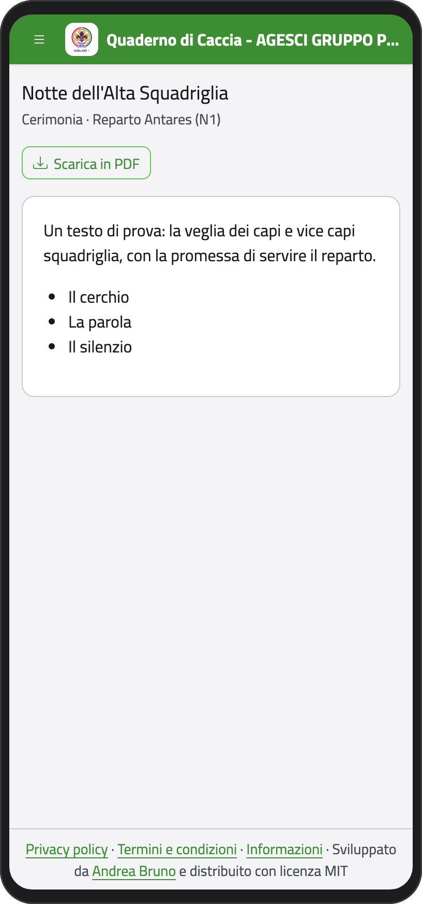

# Cerimonie e tradizioni

Il **libro delle cerimonie e tradizioni** raccoglie le cerimonie e le tradizioni del gruppo:
come si svolgono, cosa si dice, cosa si porta. Lo trovi nel menu, in **Cerimonie e
tradizioni**.

È una funzione facoltativa: c'è solo se il gruppo l'ha accesa nelle
[impostazioni](gruppo/impostazioni). Spenta, non compare da nessuna parte; quello che c'era
scritto resta e torna riaccendendola.

## Chi legge cosa

- **I capi** leggono tutte le voci, di tutte le unità.
- **I ragazzi e le ragazze** leggono solo le voci per cui li ha scelti chi le scrive, e solo
  finché sono nel gruppo. Se non ne hai nessuna, nel menu la voce non c'è.
- **I genitori** non leggono niente: molte cerimonie sono riservate.

Alcune cerimonie sono un segreto di chi le ha vissute: custodisci quello che leggi.

## Leggere una voce

1. In **Cerimonie e tradizioni** le voci sono divise in **Cerimonie** e **Tradizioni**;
   sotto il titolo c'è di chi è, tutto il gruppo o un'unità.
2. Tocca una voce per leggerla. **Scarica in PDF** la salva sul telefono o sul computer, per
   stamparla o leggerla la sera del fuoco.

Per ora il libro si legge solo con la rete.

:::{container} schermate
{.telefono width="30%"}
{.computer width="65%"}
:::

## Scrivere una voce

Le voci di **tutto il gruppo** le scrivono i capigruppo; quelle di un'**unità** lo staff
dell'unità (anche di un'unità collegata) e i capigruppo.

1. In **Cerimonie e tradizioni** tocca **Nuova voce**, oppure apri una voce e tocca
   **Modifica**.
2. Scrivi il **titolo**, scegli se è una **cerimonia** o una **tradizione** e di chi è
   (**Di**): tutto il gruppo o una delle tue unità.
3. Scrivi il testo con l'editor: titoli, grassetto, elenchi, tabelle.
4. In **Ragazzi/e che la leggono** scegli chi, tra i ragazzi e le ragazze del gruppo, può
   leggerla: cerca per nome o filtra per unità. Puoi scegliere anche ragazzi di un'altra
   unità, per esempio i lupetti che passeranno in reparto. I capi non serve sceglierli: la
   leggono tutti.
5. Tocca **Salva**.

**Elimina la voce** la toglie per tutti, dopo una conferma.

:::{container} schermate
{.telefono width="30%"}
{.computer width="65%"}
:::
