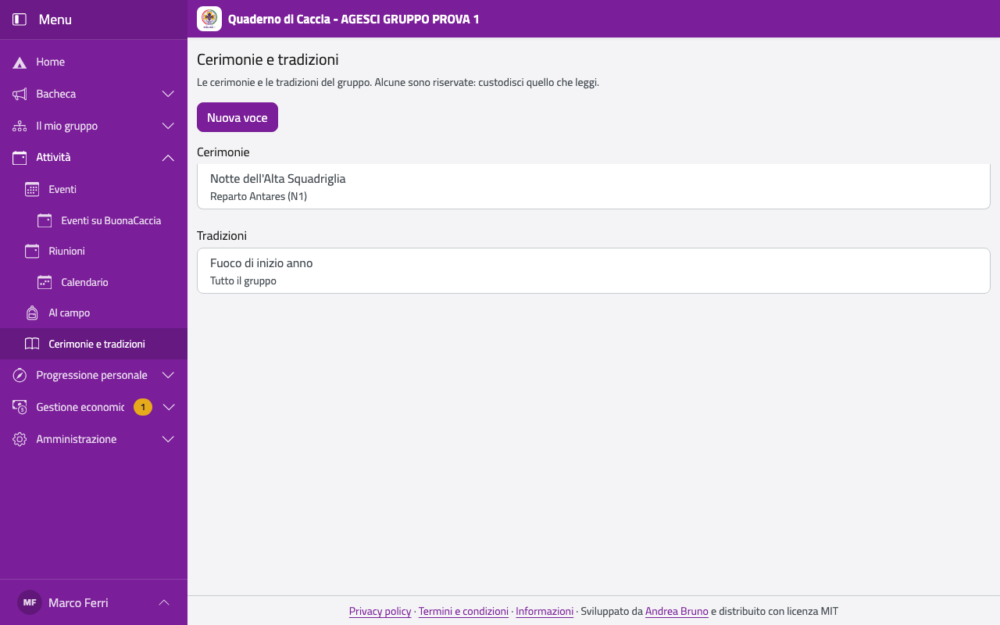
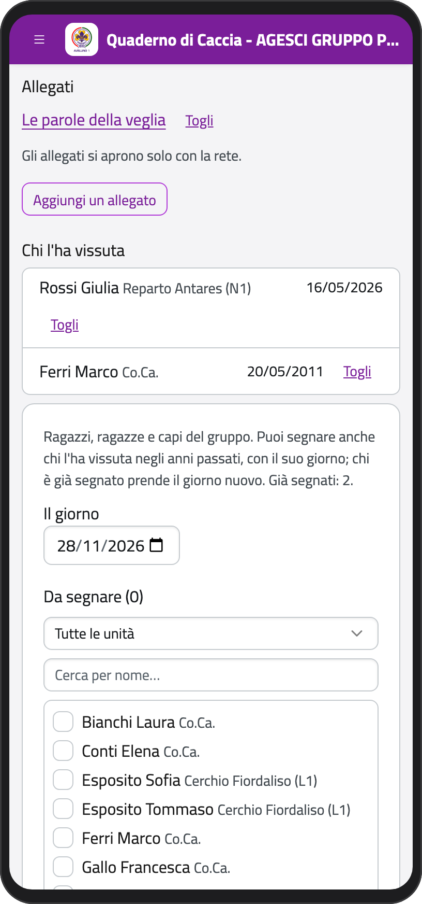
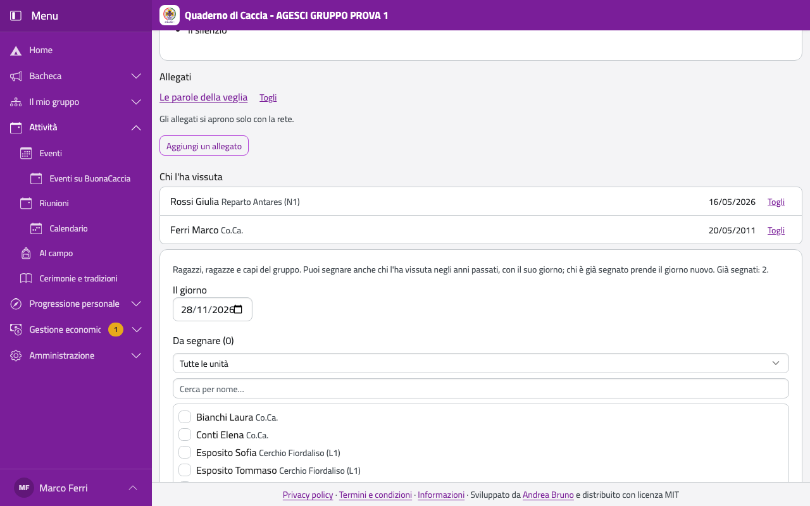
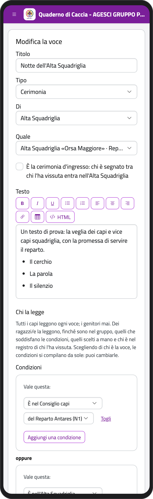
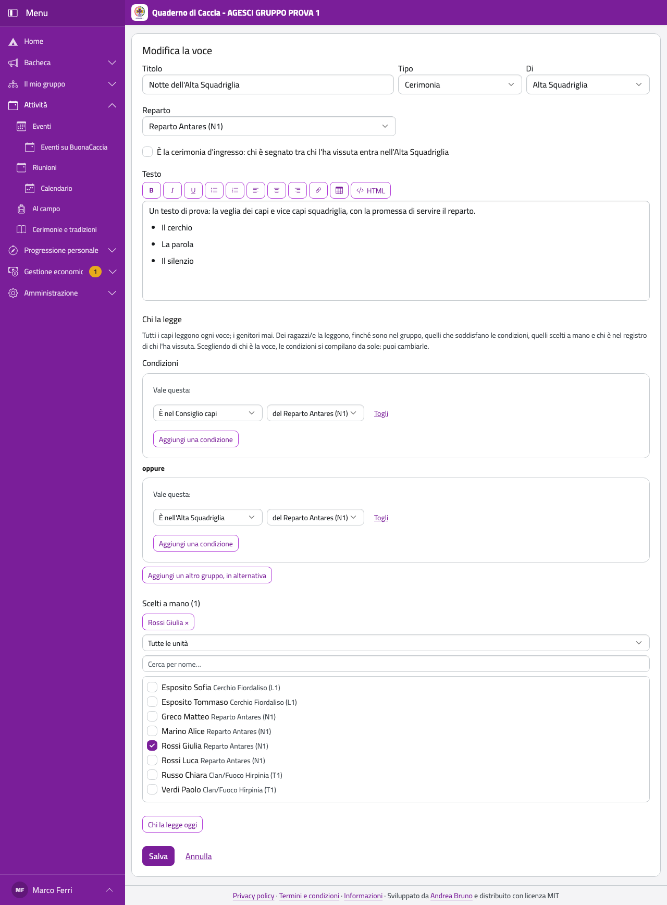

# Cerimonie e tradizioni

Il **libro delle cerimonie e tradizioni** raccoglie le cerimonie e le tradizioni del gruppo:
come si svolgono, cosa si dice, cosa si porta. Lo trovi nel menu, in **Cerimonie e
tradizioni**.

È una funzione facoltativa: c'è solo se il gruppo l'ha accesa nelle
[impostazioni](gruppo/impostazioni). Spenta, non compare da nessuna parte; quello che c'era
scritto resta e torna riaccendendola.

## Chi legge cosa

- **I capi** leggono tutte le voci, di tutte le unità.
- **I ragazzi e le ragazze** leggono solo le voci scritte per loro: perché soddisfano le
  condizioni della voce (per esempio sono nel Consiglio capi o hanno fatto la Promessa),
  perché chi la scrive li ha scelti a mano o perché sono nel registro di chi l'ha vissuta. Solo finché sono nel gruppo. Se non ne hai
  nessuna, nel menu la voce non c'è.
- **I genitori** non leggono niente: molte cerimonie sono riservate.

Alcune cerimonie sono un segreto di chi le ha vissute: custodisci quello che leggi.

## Leggere una voce

1. In **Cerimonie e tradizioni** le voci sono divise in **Cerimonie** e **Tradizioni**;
   sotto il titolo c'è di chi è: tutto il gruppo, la Comunità capi, una o più unità,
   l'Alta Squadriglia o il Consiglio capi di un reparto, una o più squadriglie, il Consiglio
   degli Anziani.
2. Tocca una voce per leggerla. **Scarica in PDF** la salva sul telefono o sul computer, per
   stamparla o leggerla la sera del fuoco.
3. Sotto il testo, in **Allegati**, ci sono i file della voce (il testo di un canto, uno
   schema, una foto): toccane uno per aprirlo. Li legge chi legge la voce.

### Senza rete

Ogni volta che apri **Cerimonie e tradizioni** con la rete, l'app salva sul telefono, cifrati
come gli altri dati (vedi [Proteggere il dispositivo](genitore/protezione)), l'elenco e i
testi delle voci che leggi.
Senza rete li leggi lo stesso: in alto c'è «Copia salvata sul dispositivo il …». Il PDF, gli
allegati e chi l'ha vissuta si vedono solo con la rete, e solo con la rete si scrive una
voce.

Se il dispositivo non è protetto con un PIN l'app non salva niente, e senza rete il libro non
si apre.

:::{container} schermate
{.telefono width="30%"}
{.computer width="65%"}
:::

## Scrivere una voce

Di chi è una voce decide chi la scrive; chi la legge lo decidono le condizioni (vedi sotto).

- **Tutto il gruppo** e **Comunità capi**: i capigruppo.
- **Una o più unità** (anche il noviziato): lo staff di una qualsiasi di quelle unità (anche di
  un'unità collegata) e i capigruppo. Lo staff aggiunge solo le proprie unità e ne tiene
  sempre almeno una.
- **Alta Squadriglia**, **Consiglio capi** e **una o più squadriglie**: lo staff del reparto
  (anche collegato) e i capigruppo. L'Alta Squadriglia si sceglie per nome, tra quelle aperte
  (vedi la pagina dell'[unità](capo/unita)).
- **Consiglio degli Anziani**: lo staff del branco o del cerchio e i capigruppo.

1. In **Cerimonie e tradizioni** tocca **Nuova voce**, oppure apri una voce e tocca
   **Modifica**.
2. Scrivi il **titolo**, scegli se è una **cerimonia** o una **tradizione** e di chi è
   (**Di**), poi le unità, il reparto, il branco o cerchio, o le squadriglie. Scegliendo di chi
   è, l'app compila le condizioni che corrispondono (per esempio «È in una squadriglia» per una
   voce di squadriglia): puoi cambiarle o toglierle.
3. Scrivi il testo con l'editor: titoli, grassetto, elenchi, tabelle.
4. In **Chi la legge** scegli quali ragazzi e ragazze possono leggerla (i capi non serve
   sceglierli: la leggono tutti):
   - con le **condizioni**, che valgono da sole anche per chi arriverà dopo: tocca **Aggiungi
     una condizione** e scegli quale (vedi sotto);
   - **scelti a mano**: cerca per nome o filtra per unità. Puoi scegliere anche ragazzi di
     un'altra unità.
5. Tocca **Chi la legge oggi** per vedere l'elenco dei ragazzi e delle ragazze che la
   leggerebbero, prima di salvare.
6. Tocca **Salva**.

### Gli allegati

Chi scrive la voce le aggiunge dei file: apri la voce, sotto il testo tocca **Aggiungi un
allegato**, scrivi **che cos'è** (il nome che vedranno gli altri), scegli un PDF o
un'immagine (JPEG o PNG) fino a 10 MB e tocca **Carica**. **Togli** lo toglie. Gli allegati
si aprono solo con la rete.

**Elimina la voce** la toglie per tutti, con i suoi allegati, dopo una conferma.

### Le condizioni

Una condizione dice chi legge la voce, ed è controllata ogni volta: chi entra nell'Alta
Squadriglia la legge da quel giorno, chi lascia il gruppo smette di leggerla.

- **È in un'unità** o **È in una branca**: i ragazzi e le ragazze di quell'unità o di quella
  branca (il noviziato è nella branca Rover e Scolte).
- **È in una squadriglia**: i suoi squadriglieri.
- **Ha un incarico**: capo o vice capo squadriglia, un altro incarico di squadriglia, il
  Consiglio degli Anziani.
- **È nel Consiglio capi**: i capi squadriglia e chi lo staff ha equiparato a loro, di
  qualsiasi reparto o di un reparto (con il reparto collegato).
- **È nell'Alta Squadriglia**, in qualsiasi o in quella scelta per nome: chi ne fa parte, non chi
  è nell'anticamera. Quando un'Alta Squadriglia si chiude non vale più per nessuno.
- **Passa da una branca all'altra**: da quando lo staff lo mette nel passaggio, e per sempre,
  anche dopo il passaggio (non se il passaggio viene annullato).
- **Ha fatto la Promessa**, **Ha raggiunto una tappa** (quella tappa o una successiva, nella
  branca scelta), **Ha preso la Partenza**.
- **Ha vissuto una voce del libro**: è nel [registro](#registro) di quella voce.

Le condizioni si mettono in **gruppi**. Dentro un gruppo devono valere **tutte insieme**: per
esempio «È nel Consiglio capi» e «Ha fatto la Promessa». Con **Aggiungi un altro gruppo, in
alternativa** ne aggiungi un altro, scritto dopo un **oppure**: basta che valga uno dei
gruppi. **Togli** toglie una condizione; togliendo l'ultima sparisce il gruppo.

I capi sestiglia e le pattuglie R/S l'app non li registra: per loro scegli i ragazzi a mano.

(registro)=

## Chi l'ha vissuta

Ogni voce ha il suo **registro**: chi ha vissuto quella cerimonia o tradizione, e quando. Lo
leggono tutti i capi e, sotto la voce, chi c'è segnato: chi è nel registro legge la voce,
anche senza condizioni né scelta a mano, e vede gli altri che l'hanno vissuta. Chi legge la
voce ma non è nel registro non lo vede.

Chi scrive la voce segna i partecipanti:

1. Apri la voce e, sotto il testo, tocca **Segna chi l'ha vissuta**.
2. Scegli **il giorno**: anche un giorno degli anni passati, per ricostruire chi l'ha vissuta
   prima dell'app.
3. In **Da segnare** scegli ragazzi, ragazze e capi del gruppo, poi tocca **Segna**. Chi era
   già segnato prende il giorno nuovo.

**Togli** toglie una persona dal registro. Chi lascia il gruppo resta nel registro.

### La cerimonia d'ingresso in Alta Squadriglia

In una voce dell'**Alta Squadriglia** lo staff può spuntare **È la cerimonia d'ingresso**: una
per ogni Alta Squadriglia. Chi viene segnato tra chi l'ha vissuta, se è un ragazzo o una
ragazza del reparto, entra nell'Alta Squadriglia quel giorno; chi lo staff fa entrare dalla
pagina dell'unità compare da solo tra chi l'ha vissuta, con il giorno in cui è entrato.

Chi è nell'anticamera dell'Alta Squadriglia non legge nessuna voce dell'Alta Squadriglia, nemmeno
se scelto a mano, finché non entra.

Quando l'Alta Squadriglia si chiude, le sue voci restano nel libro con il suo nome e «(chiusa)»:
le leggono i capi e chi le ha vissute. Nella nuova si possono copiare.

Il registro serve anche alle condizioni: con **Ha vissuto una voce del libro** una voce la
leggono, per esempio, solo quelli che hanno già vissuto un'altra cerimonia.

:::{container} schermate
{.telefono width="30%"}
{.computer width="65%"}
:::

:::{container} schermate
{.telefono width="30%"}
{.computer width="65%"}
:::
