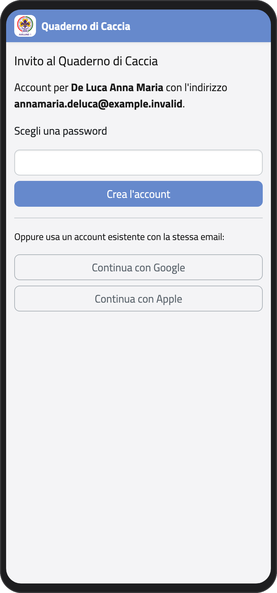
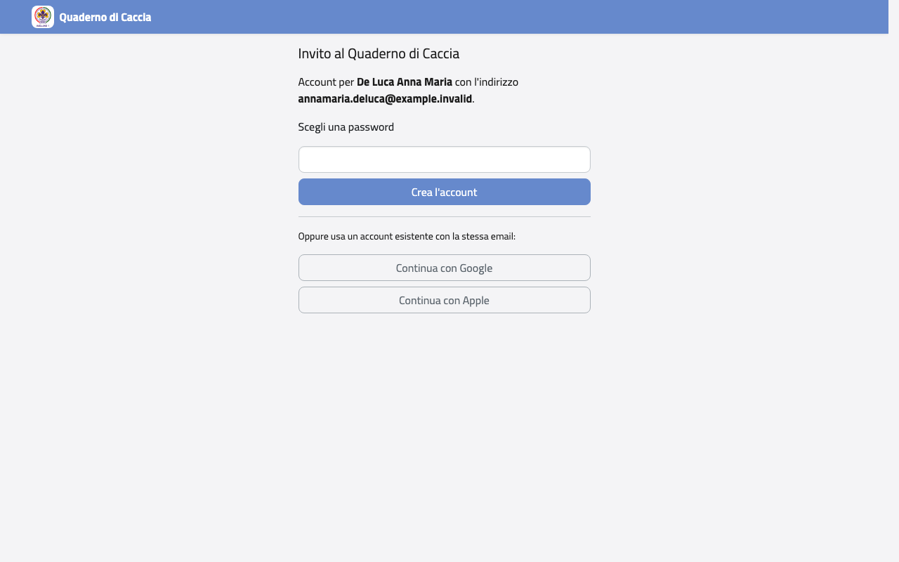
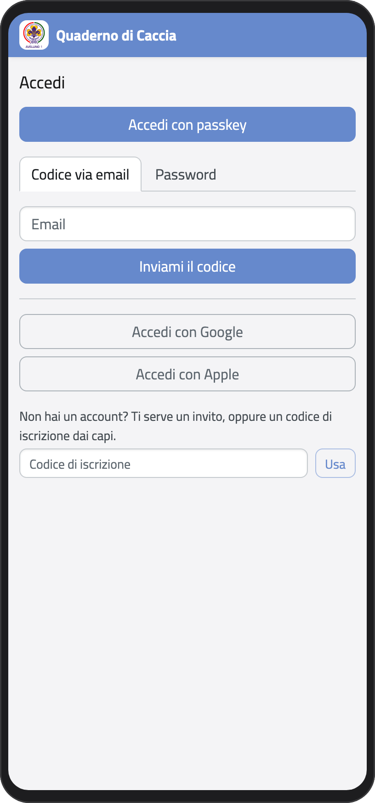
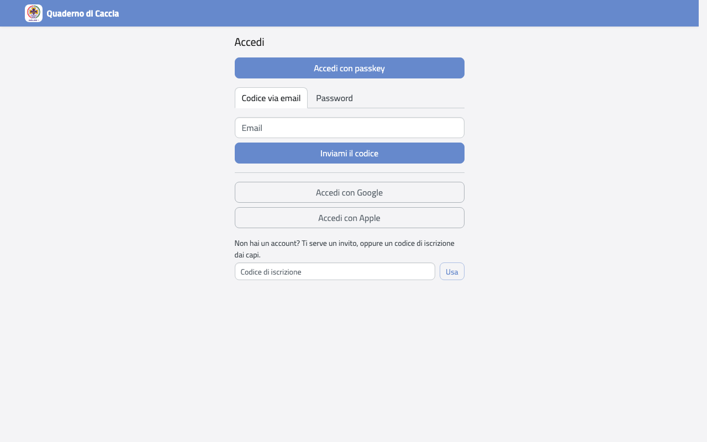
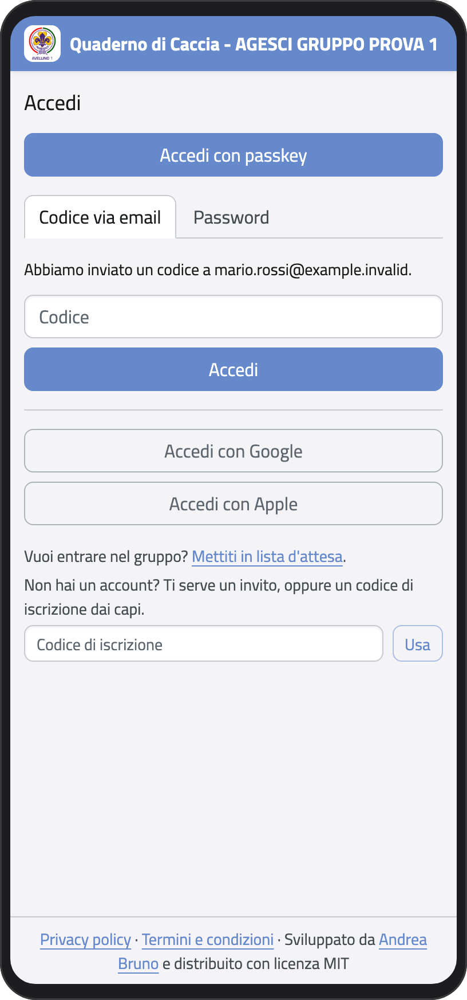
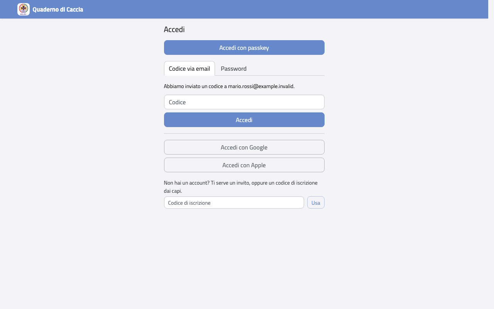
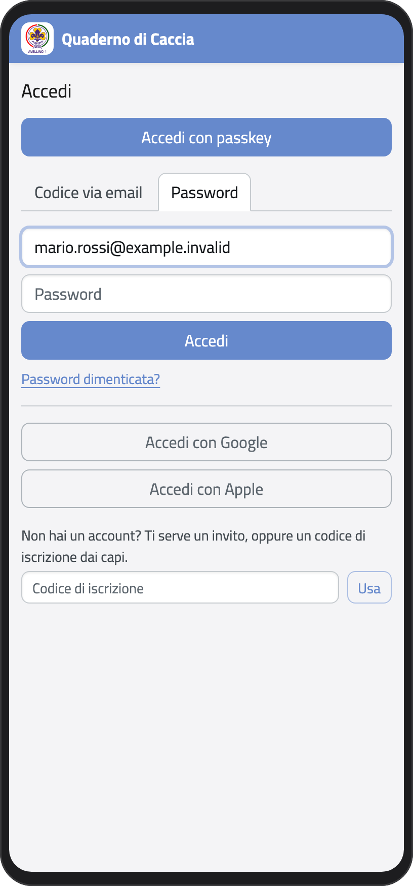
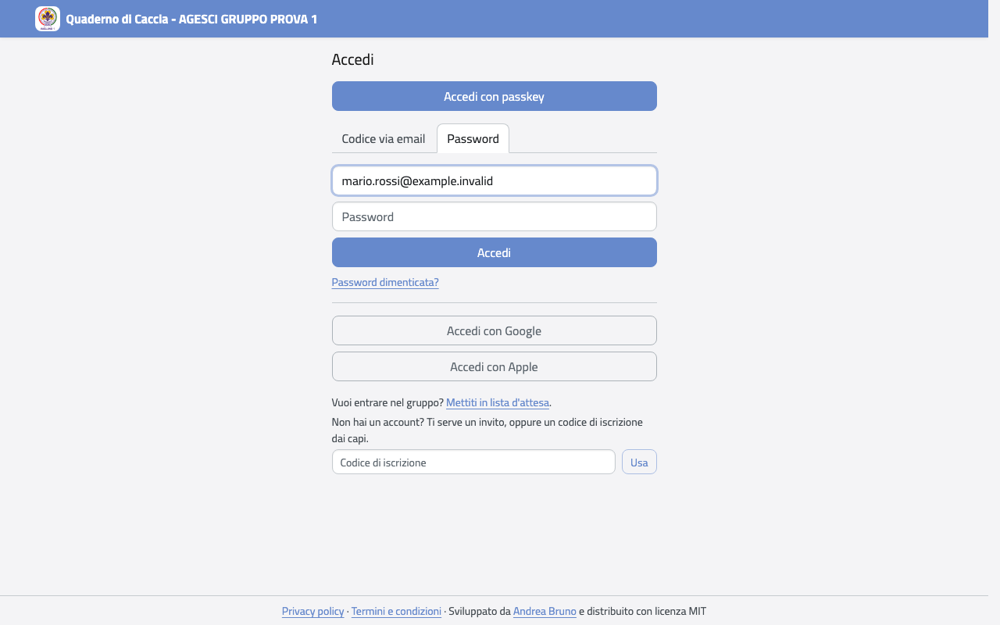
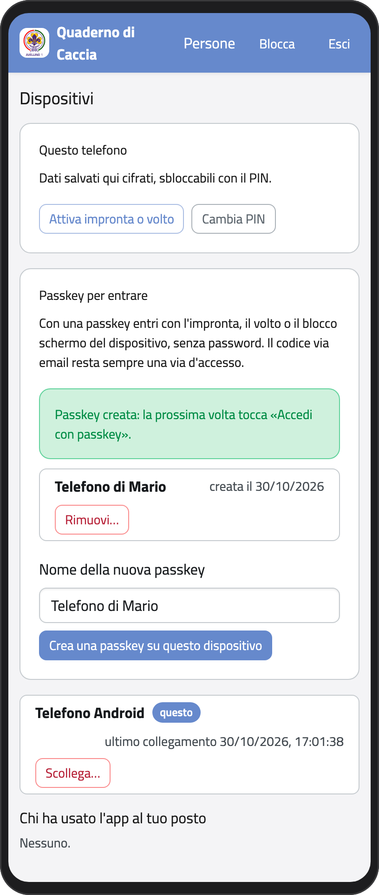
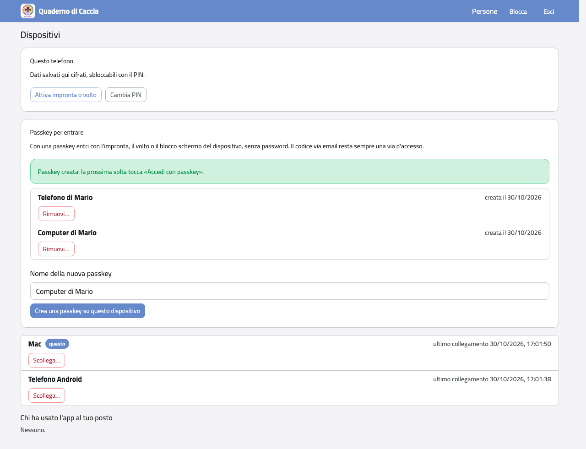

# Primo accesso

Per entrare ti serve un account. Non puoi crearlo da solo: lo apri con un **invito** che
ti mandano i capi, oppure con un **codice di iscrizione** se stai iscrivendo tuo figlio
per la prima volta.

## Con un invito

I capi ti mandano un'email con un link. L'invito vale 14 giorni ed è legato al tuo
indirizzo email: se scade, chiedine un altro ai capi.

1. Apri il link dell'email. Vedi il tuo nome e il tuo indirizzo email.
2. Scegli una password (almeno 8 caratteri) e tocca **Crea l'account**.
   In alternativa tocca **Continua con Google** o **Continua con Apple**, se hai un
   account Google o Apple con la stessa email.
3. Sei dentro: l'app ti chiede subito di [proteggere il telefono](protezione).

:::{container} schermate
{.telefono width="30%"}
{.computer width="65%"}
:::

## Entrare le volte successive

Apri <https://qdc.avellino1.it>. Puoi entrare in quattro modi.

:::{container} schermate
{.telefono width="30%"}
{.computer width="65%"}
:::

### Con un codice via email

Non serve ricordare la password.

1. Nella scheda **Codice via email** scrivi la tua email e tocca **Inviami il codice**.
2. Ti arriva un'email con un codice. Scrivilo e tocca **Accedi**.
   Il codice vale 3 minuti: se scade, chiedine un altro.

:::{container} schermate
{.telefono width="30%"}
{.computer width="65%"}
:::

### Con la password

1. Tocca la scheda **Password**.
2. Scrivi email e password e tocca **Accedi**.

Se hai dimenticato la password, tocca **Password dimenticata?**: ti arriva un'email per
sceglierne una nuova.

:::{container} schermate
{.telefono width="30%"}
{.computer width="65%"}
:::

### Con una passkey

Con una passkey entri con l'impronta, il volto o il blocco schermo del telefono, senza
scrivere niente. Prima devi crearla, una volta per ogni dispositivo:

1. Nella pagina iniziale tocca **Dispositivi e protezione di questo telefono**.
2. Nel riquadro **Passkey per entrare** controlla il nome (per esempio «Telefono di
   Mario») e tocca **Crea una passkey su questo dispositivo**.
3. Per sicurezza l'app ti chiede di confermare che sei tu: scrivi la tua password e
   tocca **Conferma**. Se hai già una passkey puoi toccare **Conferma con una passkey**.
4. Il telefono ti chiede l'impronta, il volto o il blocco schermo. Alla fine compare
   «Passkey creata».

Da quel momento, nella pagina di accesso tocca **Accedi con passkey**.

:::{container} schermate
{.telefono width="30%"}
{.computer width="65%"}
:::

Nello stesso riquadro vedi le tue passkey. Se cambi telefono, tocca **Rimuovi…** accanto a
quella vecchia e poi **Rimuovi**. Il codice via email funziona sempre, anche se hai una
passkey.

### Con Google o Apple

Tocca **Accedi con Google** o **Accedi con Apple** e segui i passi. Funziona se il tuo
account Google o Apple ha la stessa email del tuo account nel Quaderno di Caccia.

:::{warning}
Dopo 5 tentativi sbagliati l'accesso si blocca per un'ora. Se non ricordi la password,
usa il codice via email.
:::
