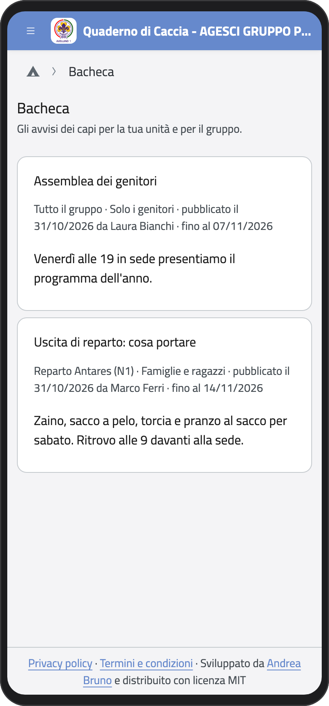
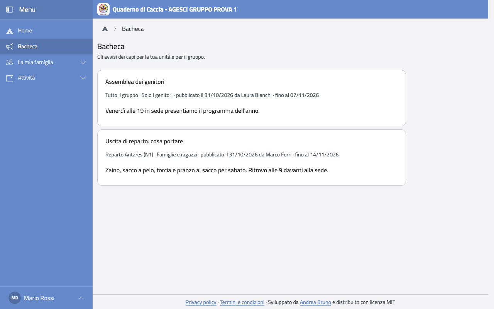

# Bacheca

Nella Home (o nel menu) tocca **Bacheca**: trovi gli avvisi dei capi per l'unità dei tuoi
figli e per tutto il gruppo. Ogni avviso dice per chi è, chi l'ha pubblicato e fino a
quando vale; quando scade sparisce.

:::{container} schermate
{.telefono width="30%"}
{.computer width="65%"}
:::

Alcuni avvisi arrivano anche per email, se chi li pubblica lo sceglie e se non hai
disattivato queste email (vedi [Le mie email](email)).
