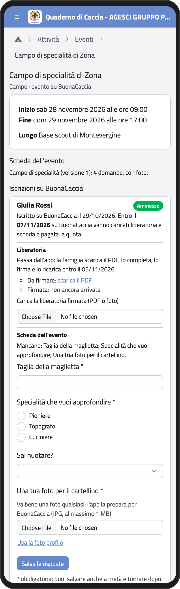
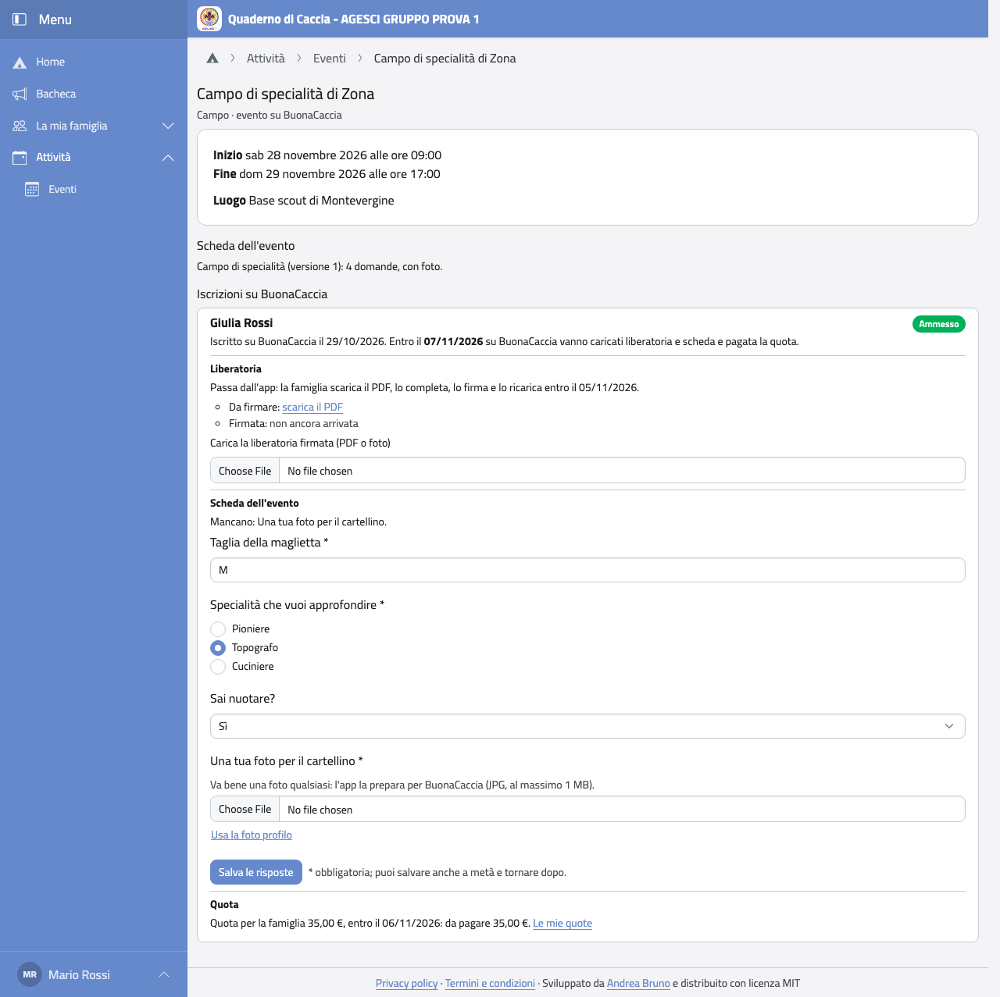
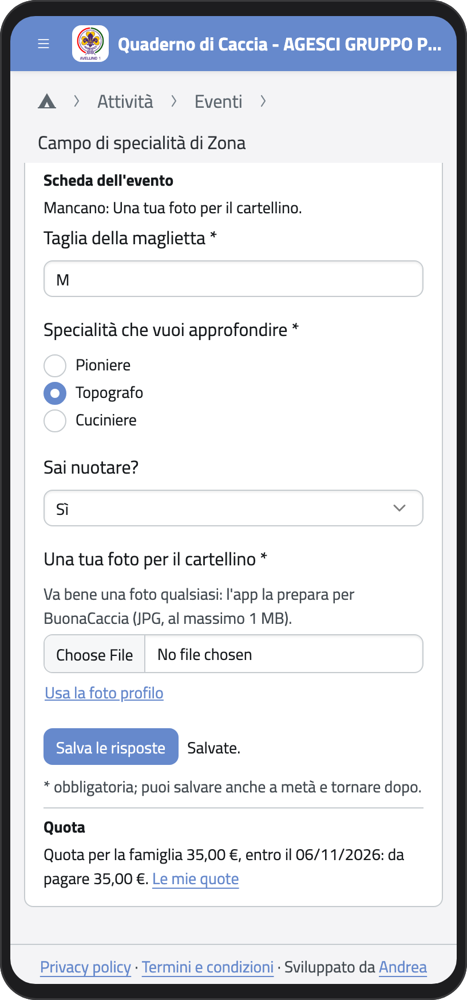
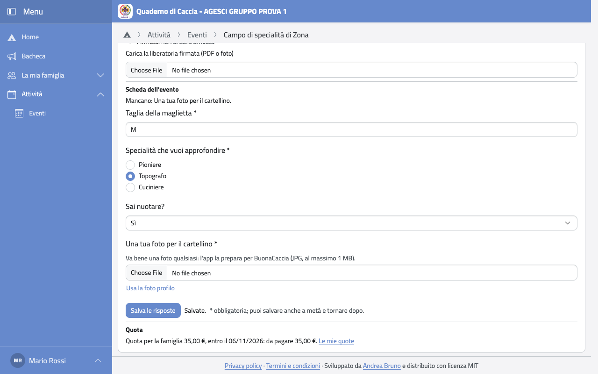

# Eventi su BuonaCaccia

Alcuni eventi non li organizza il gruppo ma la Zona, la Regione o l'AGESCI nazionale: per
esempio i campi di specialità, i campi di competenza o le Piccole Orme. Ci si iscrive su
**BuonaCaccia**, il sito dell'AGESCI per questi eventi. L'iscrizione la fanno i capi
dell'unità di tuo figlio; a te chiedono la liberatoria firmata, le risposte alla scheda
dell'evento e la quota.

Quando i capi iscrivono tuo figlio ti arriva un'email con l'evento e con quello che serve.
Prima delle scadenze arriva un promemoria, se manca ancora qualcosa.

## Dove trovarlo

1. Nella Home (o nel menu, nel gruppo **Attività**) tocca **Eventi**.
2. Tocca l'evento: sotto le date e il luogo, in **Iscrizioni su BuonaCaccia**, c'è
   l'iscrizione di tuo figlio, con la data entro cui va completata.

:::{container} schermate
{.telefono width="30%"}
{.computer width="65%"}
:::

## La liberatoria

La liberatoria è il modulo con cui i genitori autorizzano la partecipazione. BuonaCaccia
la manda ai capi, che la caricano nell'app: ti arriva un'email.

1. In **Liberatoria** tocca **scarica il PDF**.
2. Completala, firmala e fai una foto o una scansione.
3. In **Carica la liberatoria firmata** scegli il file (PDF o foto). Va caricata entro la
   data scritta sopra.

I capi la caricano su BuonaCaccia e la segreteria la controlla. Se la rifiuta, ti arriva
un'email con il motivo: firma una liberatoria nuova e caricala di nuovo.

:::{note}
A volte i capi chiedono di consegnare la liberatoria in un altro modo, per esempio a mano:
in quel caso nel riquadro c'è scritto «Arriva allo staff per altri canali» e la data entro
cui consegnarla.
:::

## La scheda dell'evento

Alcuni eventi hanno una scheda con delle domande (per esempio la taglia della maglietta o
la specialità da approfondire) e a volte una foto.

1. In **Scheda dell'evento** rispondi alle domande. Quelle con l'asterisco sono
   obbligatorie.
2. Per la foto scegli una foto qualsiasi di tuo figlio: l'app la prepara da sola per
   BuonaCaccia. Se nella sua scheda c'è già la foto, tocca **Usa la foto profilo**.
3. Tocca **Salva le risposte**. Puoi salvare anche a metà e tornare dopo: sopra le domande
   vedi cosa manca.

:::{container} schermate
{.telefono width="30%"}
{.computer width="65%"}
:::

Quando i capi hanno ricopiato le risposte su BuonaCaccia, non si possono più cambiare.

## La quota

Se l'evento ha una quota, in **Quota** vedi quanto versare al gruppo e entro quando. La
trovi anche in **Le mie quote** e la paghi come le altre (vedi [Quote](quote)).

:::{note}
Se tuo figlio ha un suo account, la scheda e la liberatoria le vede e le può compilare
anche lui. Se non usate l'app, i capi possono ricopiare le risposte da un modulo di carta.
:::
