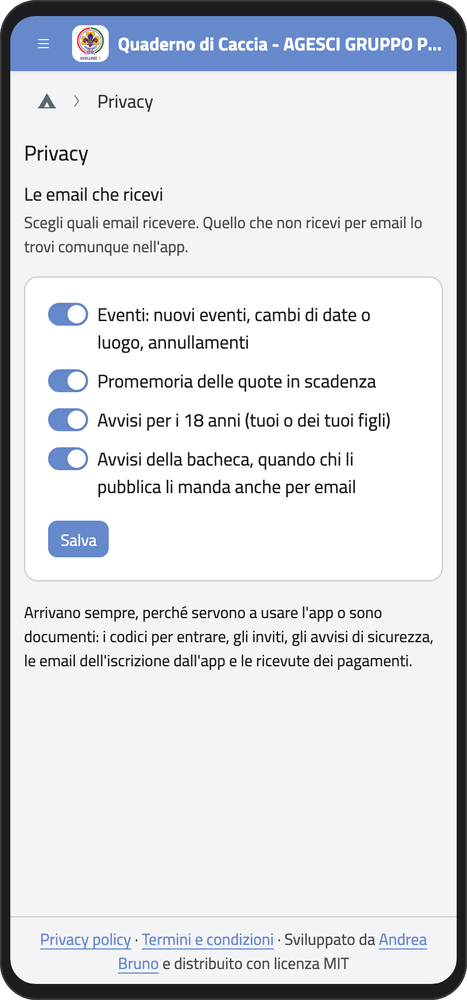
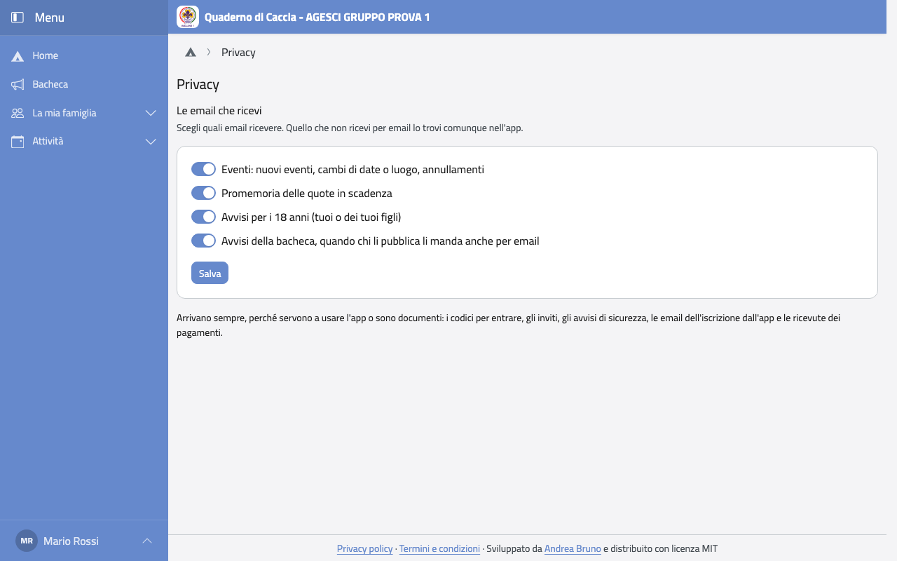

# Le mie email

Nella Home, in **Profilo** (o nel menu del profilo), tocca **Privacy**. In **Le email che ricevi**
scegli quali ricevere:

- eventi: nuovi eventi, cambi di date o luogo, annullamenti;
- promemoria delle quote in scadenza;
- avvisi per i 18 anni (tuoi o dei tuoi figli);
- avvisi della bacheca, quando chi li pubblica li manda anche per email.

Spegni quelle che non vuoi e tocca **Salva**. Quello che non ricevi per email lo trovi
comunque nell'app.

:::{container} schermate
{.telefono width="30%"}
{.computer width="65%"}
:::

Alcune email arrivano sempre, perché servono a usare l'app o sono documenti: i codici per
entrare, gli inviti, gli avvisi di sicurezza, le email dell'iscrizione dall'app e le
ricevute dei pagamenti.
