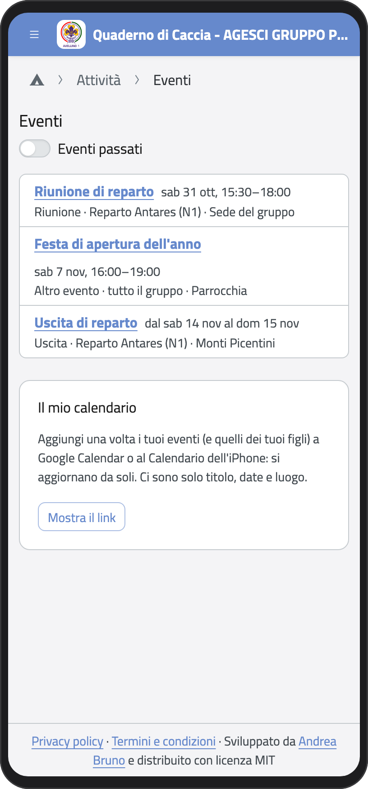
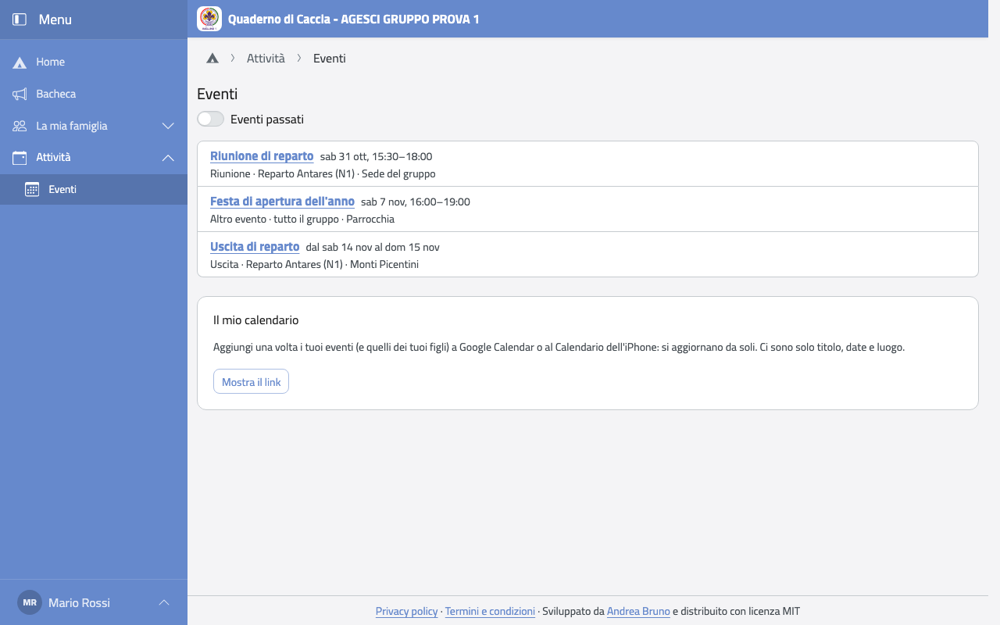
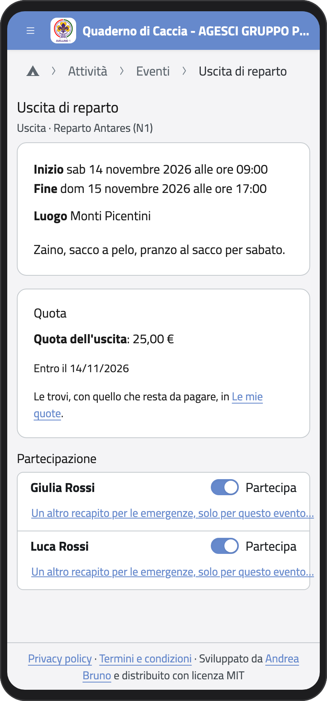
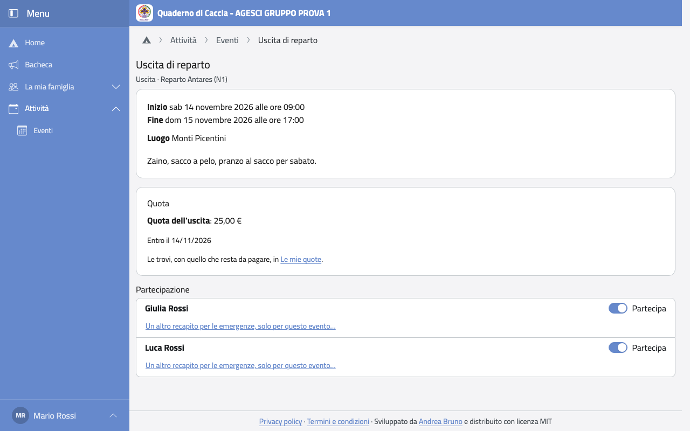
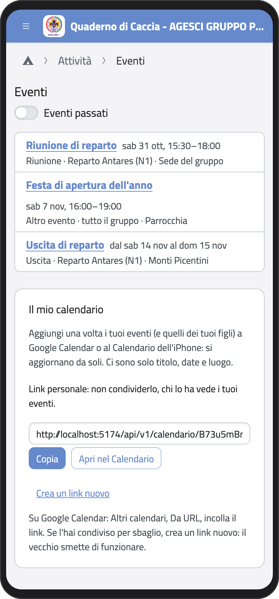
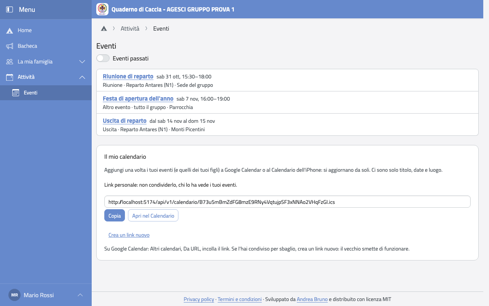

# Eventi e calendario

## Gli eventi

Nella Home (o nel menu, nel gruppo **Attività**) tocca **Eventi**. Vedi riunioni, uscite e campi dei tuoi figli e gli
eventi di tutto il gruppo, dal più vicino. Con **Eventi passati** vedi anche quelli già
fatti.

:::{container} schermate
{.telefono width="30%"}
{.computer width="65%"}
:::

Tocca un evento per vedere date, luogo, cosa portare e l'eventuale quota.

## Dire che tuo figlio non partecipa

Ogni figlio invitato ha un interruttore **Partecipa**.

1. Apri l'evento.
2. Nel riquadro **Partecipazione** spegni l'interruttore accanto al nome di tuo figlio:
   diventa **Non partecipa** e i capi lo vedono subito.

Se cambi idea, riaccendilo. Se l'evento ha una quota, quando tuo figlio non partecipa la
quota non pagata sparisce; se torna a partecipare, ricompare.

:::{container} schermate
{.telefono width="30%"}
{.computer width="65%"}
:::

## Il calendario del telefono

Puoi vedere gli eventi nel calendario del telefono (Google Calendar o il Calendario
dell'iPhone): si aggiornano da soli. Ci sono solo titolo, date e luogo.

1. In fondo alla pagina **Eventi**, nel riquadro **Il mio calendario**, tocca **Mostra il
   link**.
2. Tocca **Apri nel Calendario**. Oppure tocca **Copia** e su Google Calendar scegli
   **Altri calendari**, **Da URL** e incolla il link.

:::{container} schermate
{.telefono width="30%"}
{.computer width="65%"}
:::

:::{warning}
Il link è personale: chi lo ha vede i tuoi eventi. Se l'hai condiviso per sbaglio, tocca
**Crea un link nuovo**: il vecchio smette di funzionare.
:::
