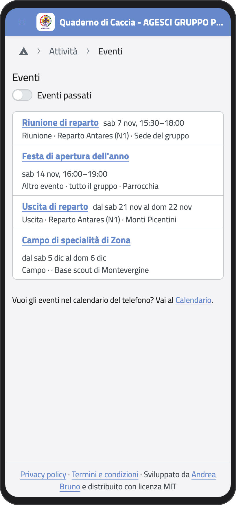
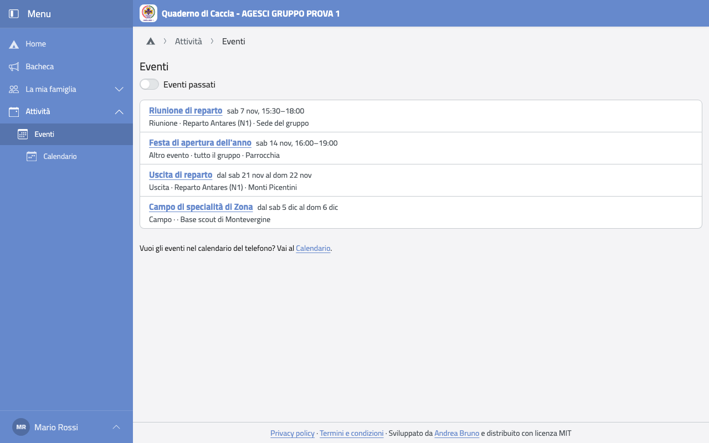
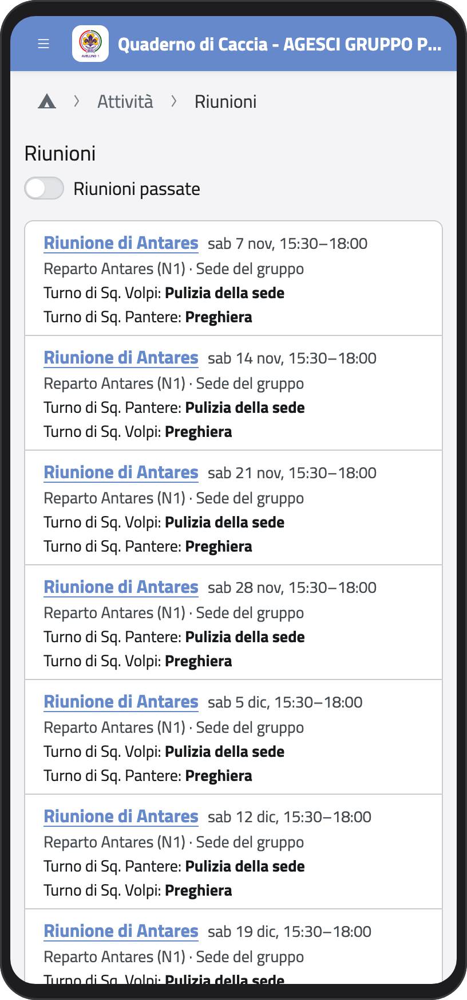
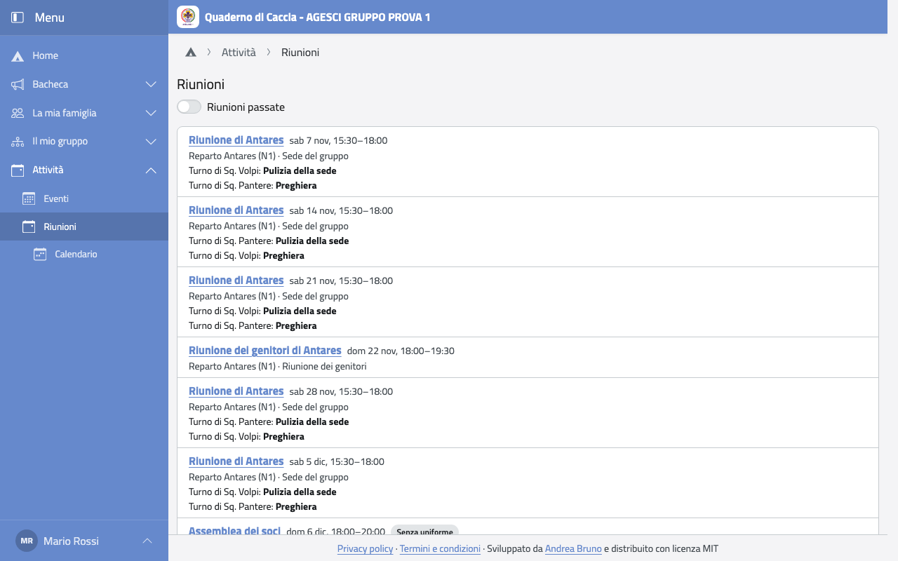
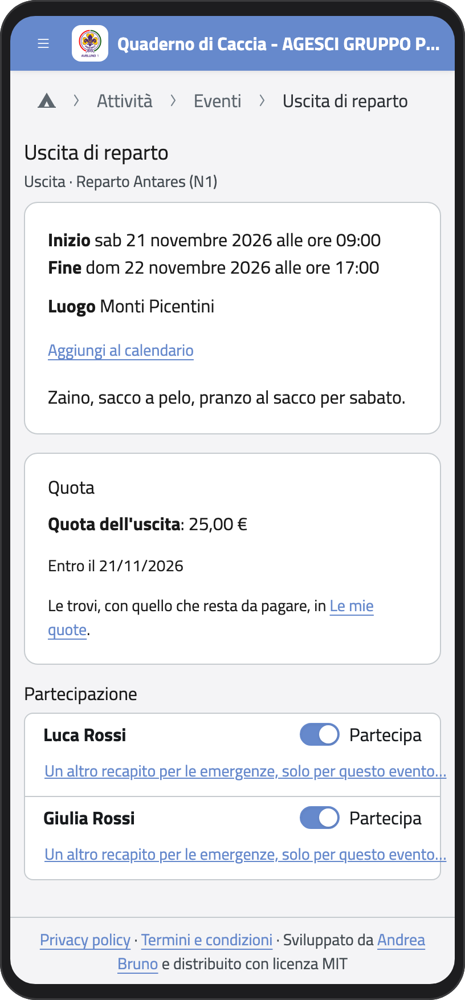
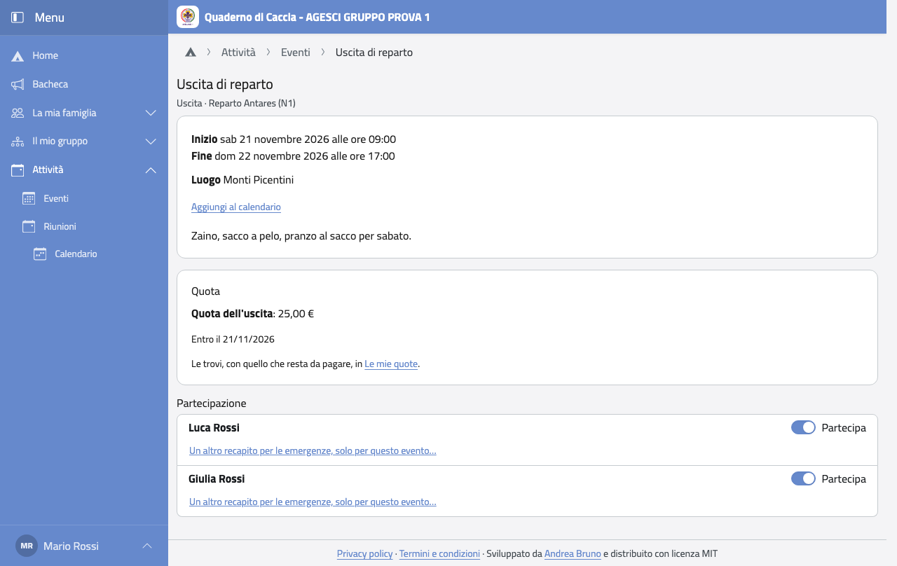
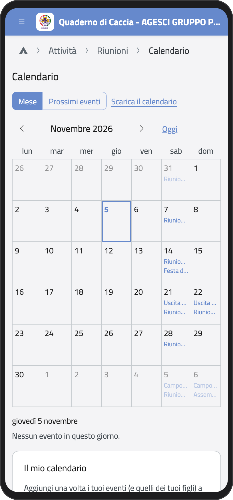
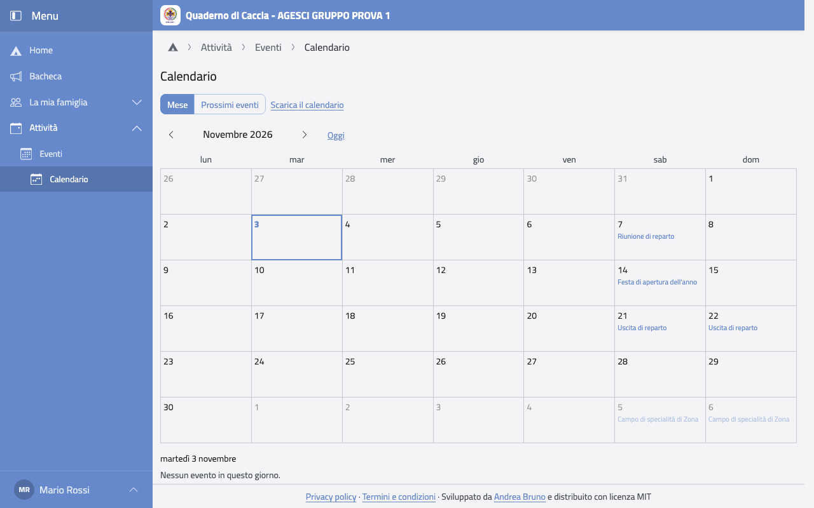
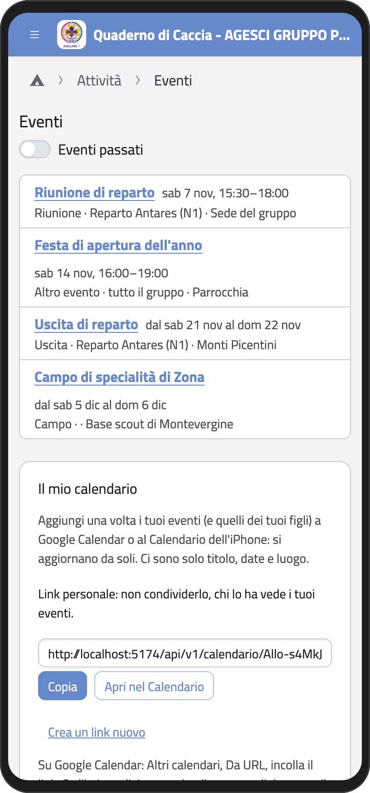
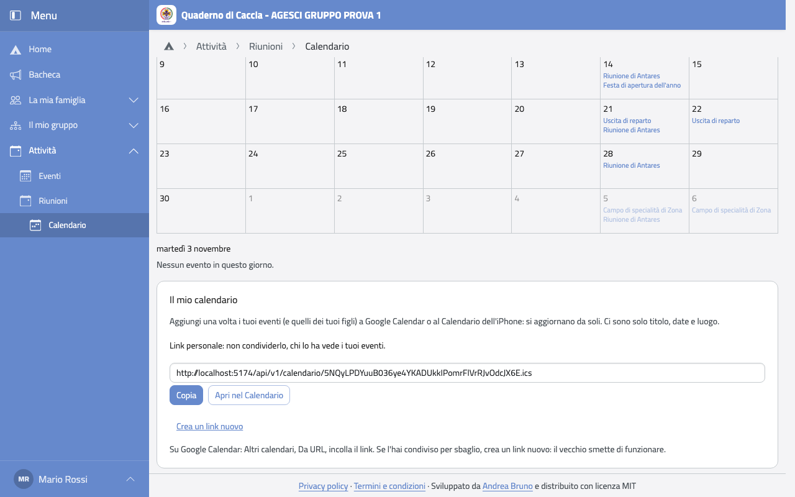

# Eventi e calendario

## Gli eventi

Nella Home (o nel menu, nel gruppo **Attività**) tocca **Eventi**. Vedi uscite e campi dei
tuoi figli e gli eventi di tutto il gruppo, dal più vicino. Con **Eventi passati** vedi anche quelli già
fatti.

:::{container} schermate
{.telefono width="30%"}
{.computer width="65%"}
:::

Tocca un evento per vedere date, luogo, cosa portare e l'eventuale quota.

Le riunioni sono in **Riunioni**, sempre in **Attività**: giorno, orari, località, se è con
l'uniforme e le informazioni dei capi (cosa portare, cosa si fa). Ricevi un'email solo se una
riunione viene spostata o annullata. Se l'unità ha i turni (pulizia, preghiera…), accanto a
ogni riunione vedi quello della squadriglia o della sestiglia di tuo figlio; se all'unità tocca un
turno del gruppo (per esempio la pulizia della sede), lo vedi sulle sue riunioni.

:::{container} schermate
{.telefono width="30%"}
{.computer width="65%"}
:::

## Dire che tuo figlio non partecipa

Ogni figlio invitato ha un interruttore **Partecipa**.

1. Apri l'evento.
2. Nel riquadro **Partecipazione** spegni l'interruttore accanto al nome di tuo figlio:
   diventa **Non partecipa** e i capi lo vedono subito.

Se cambi idea, riaccendilo. Se l'evento ha una quota, quando tuo figlio non partecipa la
quota non pagata sparisce; se torna a partecipare, ricompare.

:::{container} schermate
{.telefono width="30%"}
{.computer width="65%"}
:::

## Il calendario

Nella Home, accanto alla **Bacheca**, tocca **Calendario** (nel menu è nel gruppo
**Attività**, sotto **Eventi**). Vedi gli eventi tuoi e dei tuoi figli in due modi: tocca
**Mese** per il calendario del mese (tocca un giorno per vedere i suoi eventi, sotto) o
**Prossimi eventi** per l'elenco di quelli in programma. L'app si ricorda la scelta.

:::{container} schermate
{.telefono width="30%"}
{.computer width="65%"}
:::

## Gli eventi nel calendario del telefono

Puoi avere gli eventi anche nel calendario del telefono (Google Calendar o il Calendario
dell'iPhone), in due modi. Ci sono titolo, date e luogo; nelle riunioni dei genitori e
nell'assemblea, nelle note, anche l'ordine del giorno.

**Abbonarti**, una volta sola: da allora il calendario del telefono si aggiorna da solo.

1. In fondo alla pagina **Calendario**, nel riquadro **Il mio calendario**, tocca **Mostra
   il link**.
2. Tocca **Apri nel Calendario**. Oppure tocca **Copia** e su Google Calendar scegli
   **Altri calendari**, **Da URL**, e incolla il link.

Il link è personale: non condividerlo. Se l'hai condiviso per sbaglio, tocca **Crea un link
nuovo**: quello vecchio smette di funzionare.

:::{container} schermate
{.telefono width="30%"}
{.computer width="65%"}
:::

**Scaricare un file**, che il telefono aggiunge al suo calendario ma non aggiorna più: nella
pagina **Calendario** tocca **Scarica il calendario** per tutti gli eventi, oppure, nella
pagina di un evento, **Aggiungi al calendario** per quel solo evento.

## Le riunioni dei genitori

Quando lo staff o i capigruppo ti convocano a una riunione dei genitori ricevi un'email con la data,
il luogo e i documenti. Sono invitati entrambi i genitori. La riunione è anche nel tuo calendario; nella
sua pagina trovi i documenti, nel riquadro **Convocazione**, e dopo la riunione il verbale, quando è
definitivo: tocca **Leggi il verbale**. Non devi comunicare se vieni: le presenze le segnano i capi.

## L'assemblea dei soci

Sei invitato anche all'assemblea dei soci, convocata dai capigruppo: l'email e la pagina funzionano come
per le riunioni dei genitori. Hai diritto di voto per i tuoi figli minorenni; ogni minorenne vale un voto,
espresso da uno solo dei genitori, e scegliete voi chi. Se i tuoi figli nel gruppo sono tutti maggiorenni
partecipi per informazione, senza voto, e leggi comunque il verbale. Le votazioni si fanno in assemblea,
non nell'app.
