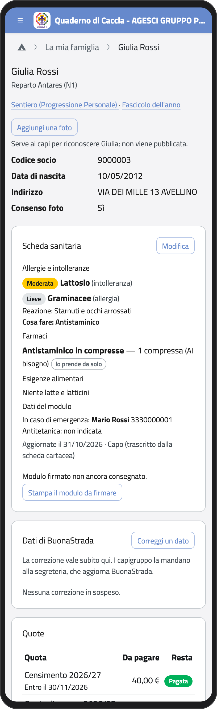
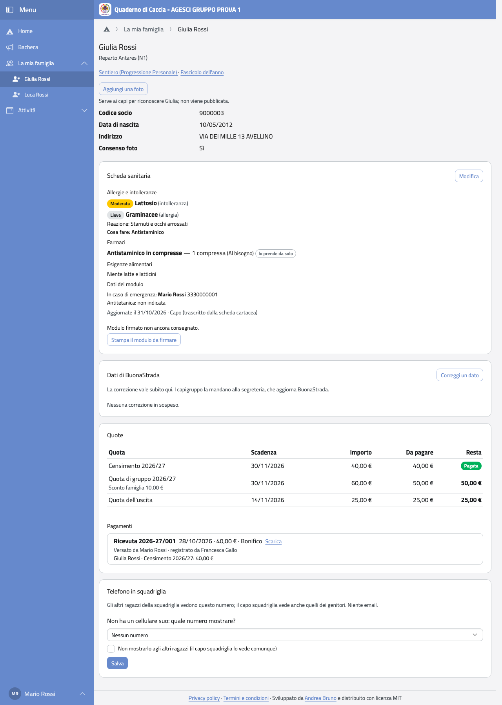
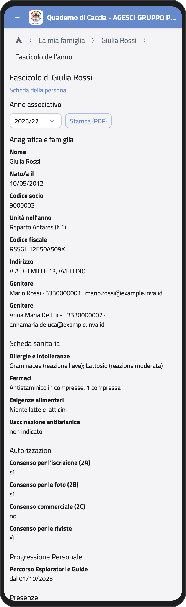
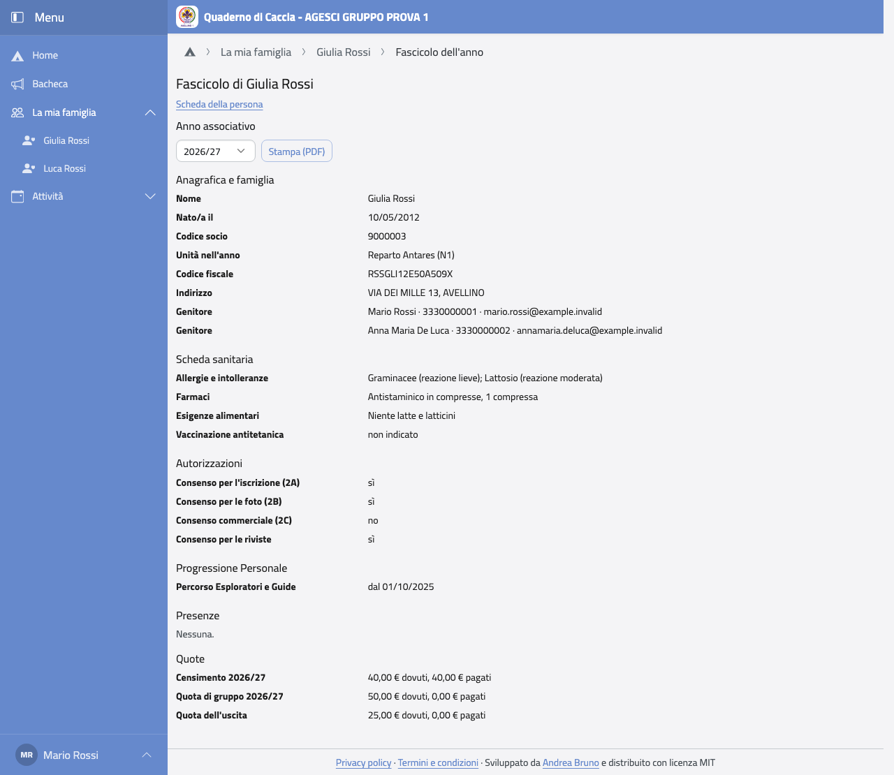
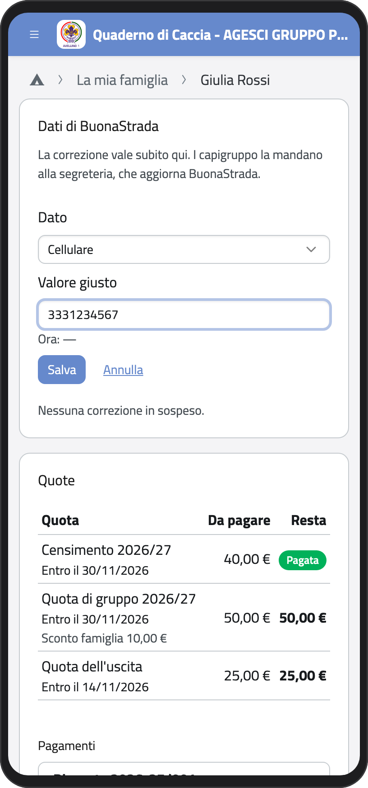
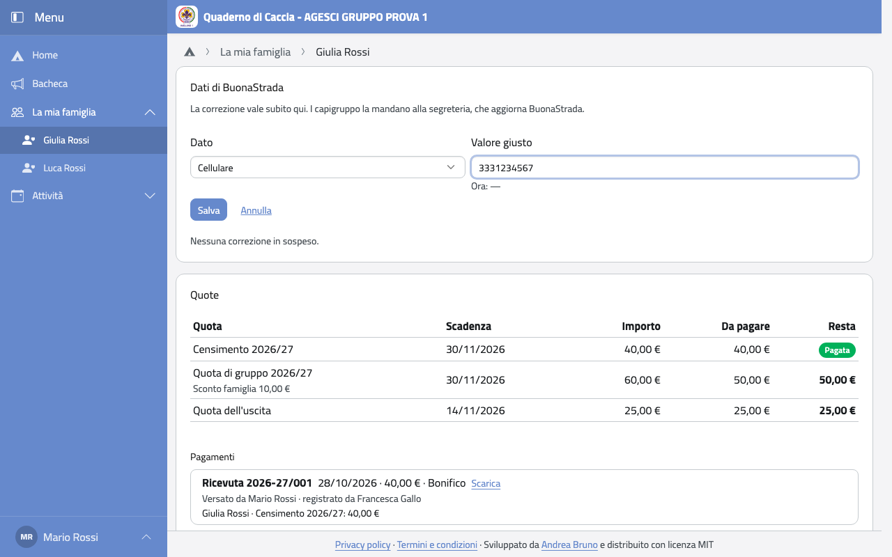

# I tuoi figli

Nella Home, in **La mia famiglia**, c'è un riquadro per ogni figlio: toccalo per aprire la
sua scheda. I tuoi figli sono anche nel menu, nel gruppo **La mia famiglia**.

## La scheda

In alto trovi l'unità, i dati che vengono da BuonaStrada (codice socio, data di nascita,
contatti, indirizzo, consensi) e i collegamenti al **Sentiero** (la Progressione
Personale) e al **Fascicolo dell'anno**. Più in basso ci sono la scheda sanitaria, i dati
da correggere, le quote e, per esploratori e guide, il telefono in squadriglia.

:::{container} schermate
{.telefono width="30%"}
{.computer width="65%"}
:::

## La foto

La foto serve ai capi per riconoscere tuo figlio, per esempio nelle iscrizioni agli eventi
su BuonaCaccia. Non viene pubblicata e gli altri ragazzi non la vedono.

1. Nella scheda tocca **Aggiungi una foto** (o **Cambia la foto**) e scegli una foto dal
   telefono.
2. Sposta la foto e ingrandiscila con **Ingrandisci** finché nel riquadro c'è solo tuo
   figlio: il resto della foto non viene caricato.
3. Tocca **Salva la foto**.

## Il fascicolo dell'anno

Tocca **Fascicolo dell'anno**: in una sola pagina trovi anagrafica e famiglia, scheda
sanitaria, autorizzazioni, Progressione Personale, presenze e quote di un anno
associativo. Scegli l'anno in alto; con **Stampa (PDF)** lo scarichi.

:::{container} schermate
{.telefono width="30%"}
{.computer width="65%"}
:::

## Correggere un dato di BuonaStrada

I dati anagrafici vengono da BuonaStrada, l'anagrafe dell'AGESCI. Se uno è sbagliato o
cambiato (un indirizzo, un cellulare, un consenso), correggilo qui: la correzione vale
subito nell'app, e i capigruppo la mandano alla segreteria, che aggiorna BuonaStrada.

1. Nella scheda, nel riquadro **Dati di BuonaStrada**, tocca **Correggi un dato**.
2. In **Dato** scegli cosa correggere.
3. In **Valore giusto** scrivi il dato corretto. Sotto vedi il valore attuale.
4. Tocca **Salva**. La correzione resta nel riquadro finché BuonaStrada non viene
   aggiornato.

:::{container} schermate
{.telefono width="30%"}
{.computer width="65%"}
:::

:::{note}
Nome, sesso, data e luogo di nascita e codice fiscale non li puoi correggere tu: chiedi ai
capi dell'unità o ai capigruppo. Quando tuo figlio compie 18 anni non correggi più i suoi
dati: lo fa lui.
:::
