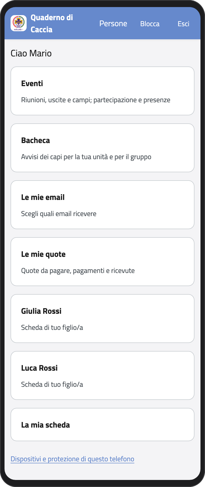
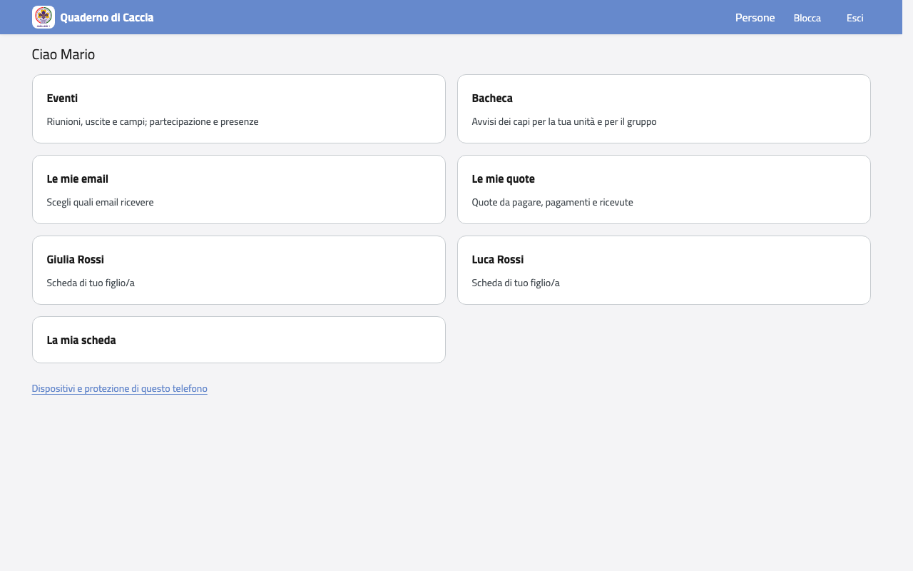

# Genitore

## Chi sei, cosa puoi fare

Sei il genitore (o chi ne fa le veci) di un ragazzo del gruppo. Nel Quaderno di Caccia
vedi i tuoi figli: la loro scheda, la scheda sanitaria, gli eventi, le quote, la
Progressione Personale e gli avvisi dei capi.

:::{note}
Non vedi i dati degli altri ragazzi, e non vedi le note che i capi tengono per sé.
:::

Quando entri, la pagina iniziale ti mostra quello che puoi fare: gli eventi, la bacheca,
le tue email, le quote e una scheda per ogni figlio.

:::{container} schermate
{.telefono width="30%"}
{.computer width="65%"}
:::

```{toctree}
:maxdepth: 1

accesso
protezione
```
