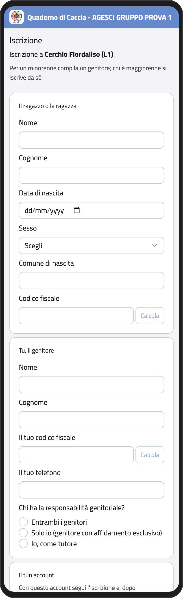
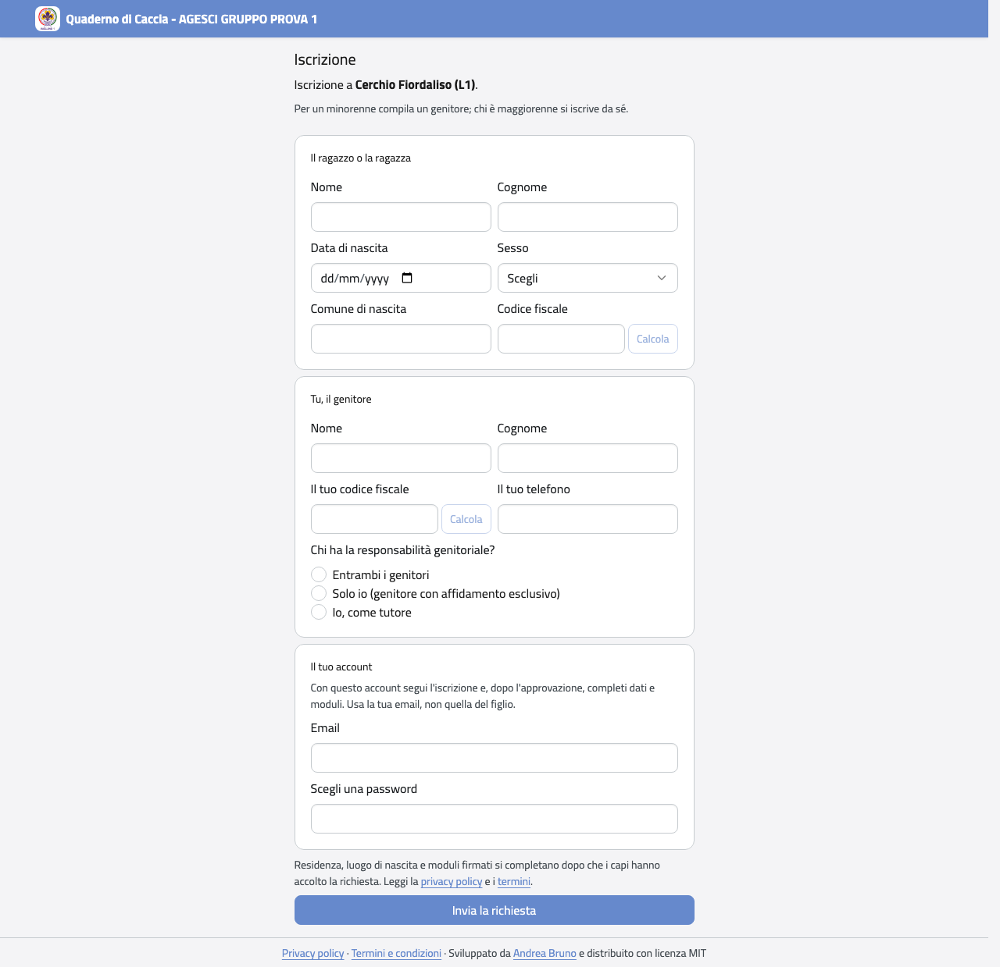

# Iscrivere un figlio

Per iscrivere un figlio nuovo dall'app ti serve un **codice di iscrizione**: te lo danno i
capi, come codice, link o QR code. Non serve avere già un account.

## Mandare la richiesta

1. Apri il link o inquadra il QR code. Se hai solo il codice, apri
   <https://qdc.avellino1.it>, scrivilo in fondo alla pagina di accesso, in **Codice di
   iscrizione**, e tocca **Usa**. Se tuo figlio era in lista d'attesa, il link arriva per
   email dai capi e i dati della lista sono già scritti.
2. In **Il ragazzo o la ragazza** scrivi nome, cognome, data di nascita, sesso e, se vuoi,
   il comune di nascita di tuo figlio. Se la data di nascita è di un maggiorenne, il
   modulo diventa quello per iscriversi da sé.
3. Scrivi il suo codice fiscale, oppure tocca **Calcola**: l'app te lo propone dai dati
   che hai scritto (ti chiede quelli che mancano). Controllalo sulla tessera sanitaria e
   tocca **Usa questo codice**.
4. In **Tu, il genitore** scrivi nome, cognome, codice fiscale e telefono.
5. In **Chi ha la responsabilità genitoriale?** scegli **Entrambi i genitori**, **Solo
   io** (affidamento esclusivo) o **Io, come tutore**. Con entrambi i genitori, in
   **L'altro genitore** scrivi anche i suoi dati, con telefono ed email.
6. In **Il tuo account** scrivi la tua email (non quella di tuo figlio) e scegli una
   password: con questo account segui l'iscrizione.
7. Tocca **Invia la richiesta**.

:::{container} schermate
{.telefono width="30%"}
{.computer width="65%"}
:::

## Dopo la richiesta

Ti arriva un'email: apri il link per confermare il tuo indirizzo. Poi i capi dell'unità
esaminano la richiesta e ti arriva un'email con la risposta. Nella Home, in
**Profilo**, trovi **La mia iscrizione**, con lo stato della richiesta.

Se la richiesta è accolta, completa l'iscrizione entro la data indicata:

1. Apri **La mia iscrizione**. Sotto la richiesta vedi cosa manca.
2. Completa i dati che servono a BuonaStrada (per esempio la residenza e il luogo di
   nascita).
3. Scarica i moduli, firmali e caricali come PDF o foto.

Quando è tutto completo, il gruppo inserisce tuo figlio in BuonaStrada, che gli dà il
codice socio definitivo.

:::{warning}
Se la data per completare passa, l'iscrizione si sospende: finché non completi, nell'app
vedi solo l'iscrizione e non la scheda di tuo figlio.
:::
