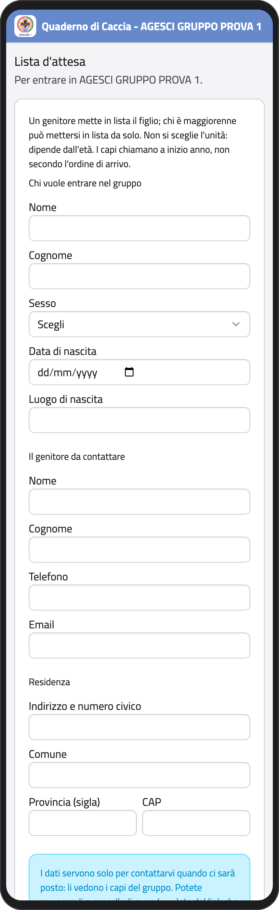
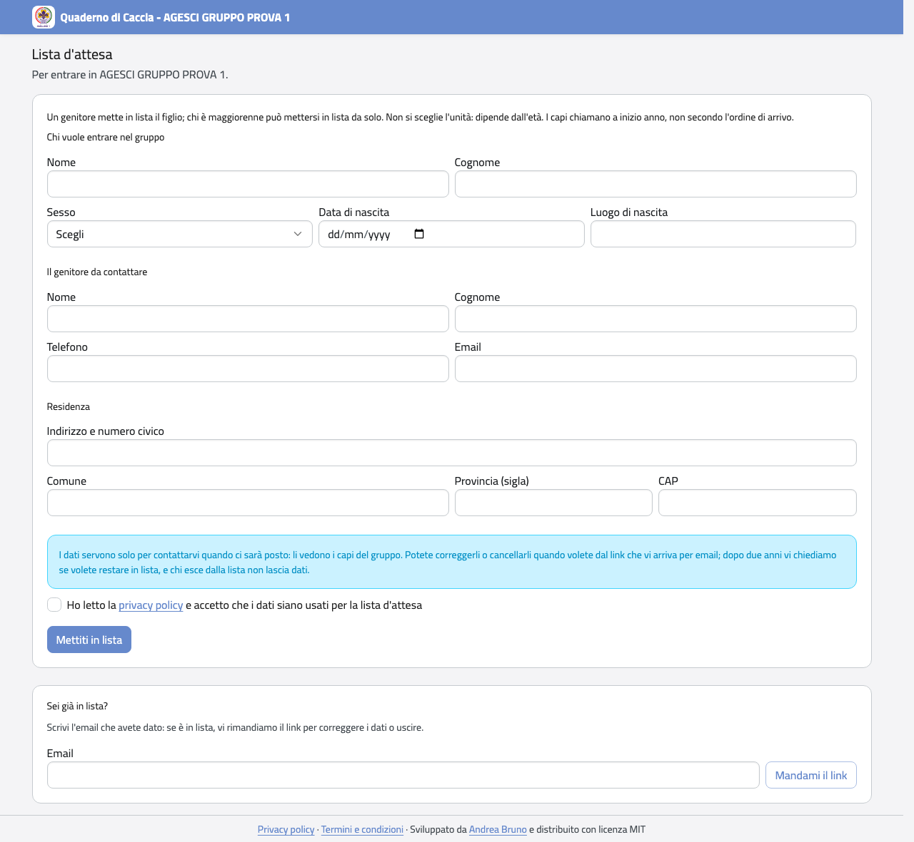
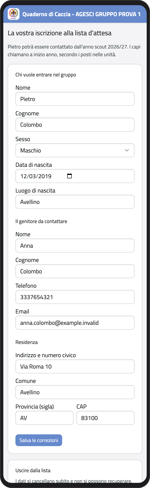
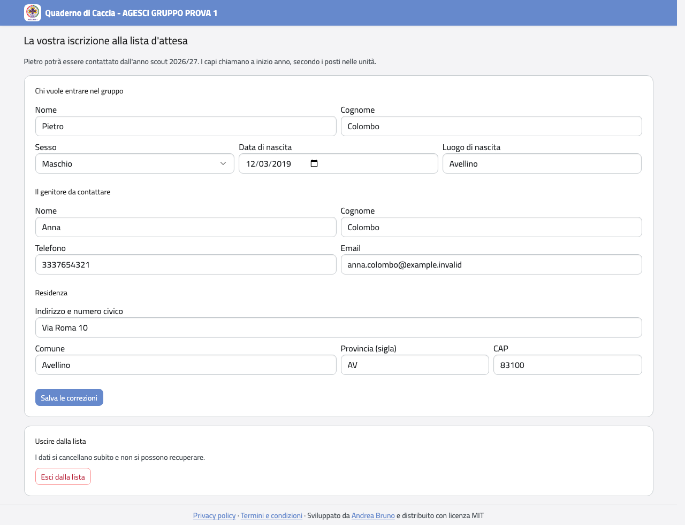

# Lista d'attesa

Se vuoi che tuo figlio entri nel gruppo, mettilo in lista d'attesa. Non serve un account e
non scegli l'unità: dipende dall'età. I capi chiamano a inizio anno, secondo i posti
nelle unità, non per ordine di arrivo.

## Mettersi in lista

1. Apri <https://qdc.avellino1.it> e, in fondo alla pagina di accesso, tocca **Mettiti in
   lista d'attesa**.
2. In **Chi vuole entrare nel gruppo** scrivi nome, cognome, sesso, data e luogo di
   nascita di tuo figlio.
3. In **Il genitore da contattare** scrivi il tuo nome, il telefono e l'email.
4. In **Residenza** scrivi l'indirizzo.
5. Leggi la privacy policy (il link è nel modulo), spunta la casella e tocca **Mettiti in
   lista**.

Se hai già 18 anni e vuoi entrare tu, spunta **Sono io: sono maggiorenne e mi iscrivo da
solo** e scrivi i tuoi contatti.

:::{container} schermate
{.telefono width="30%"}
{.computer width="65%"}
:::

Ti arriva un'email di conferma con un **link personale** e con l'anno scout da cui tuo
figlio potrà essere contattato. Conserva l'email: il link serve per tutto il resto.

## Correggere i dati o uscire dalla lista

1. Apri il link dell'email di conferma.
2. Correggi quello che serve e tocca **Salva le correzioni**.
3. Per uscire dalla lista tocca **Esci dalla lista** e poi **Sì, uscite dalla lista**: i
   dati si cancellano subito.

:::{container} schermate
{.telefono width="30%"}
{.computer width="65%"}
:::

Se non trovi più l'email, apri la pagina della lista d'attesa e, in **Sei già in lista?**,
scrivi l'email che hai dato e tocca **Mandami il link**.

:::{note}
Non vedi la posizione in lista: i capi scelgono secondo l'età e i posti nelle unità.
Quando c'è posto ti contattano e ti mandano il link per iscrivere tuo figlio (vedi
[Iscrivere un figlio](iscrizione)), con i dati della lista già scritti.
:::

## Restare in lista dopo due anni

Dopo due anni (contati da quando tuo figlio ha l'età per entrare in un'unità) ti arriva
un'email che chiede se volete restare in lista. Apri il link e tocca **Sì, restiamo in
lista**. Se non rispondi entro 30 giorni, tuo figlio esce dalla lista e i dati si
cancellano.
