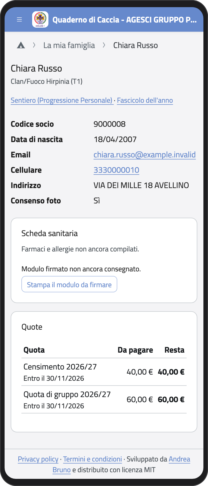
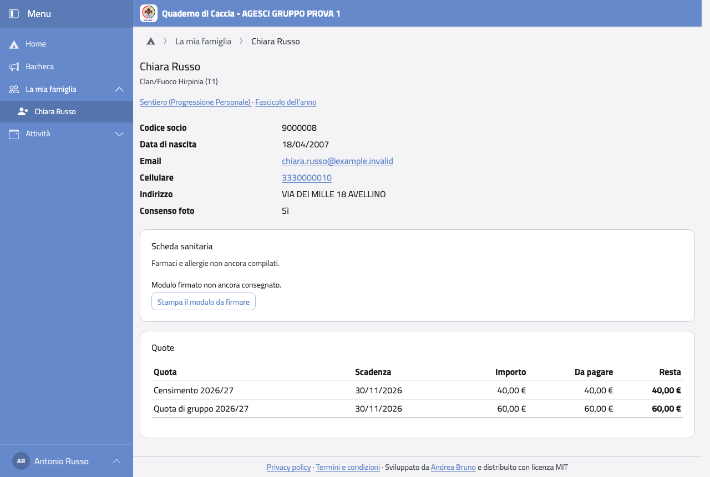

# Figli maggiorenni

Quando tuo figlio compie 18 anni decide lui cosa puoi continuare a vedere (lo sceglie
nella sua pagina **Privacy**), separatamente per:

- contatti e indirizzo;
- farmaci, allergie e alimentazione;
- il resto della scheda;
- quote, pagamenti e ricevute.

Finché non sceglie, vedi tutto come prima. Un mese prima del compleanno e il giorno dei
18 anni a te e a tuo figlio arriva un avviso via email.

Da maggiorenne, i suoi dati li scrive lui: tu non puoi più correggerli né cambiare la
scheda sanitaria. Nella pagina della scheda non vedi più i pulsanti per modificare.

:::{container} schermate
{.telefono width="30%"}
{.computer width="65%"}
:::
