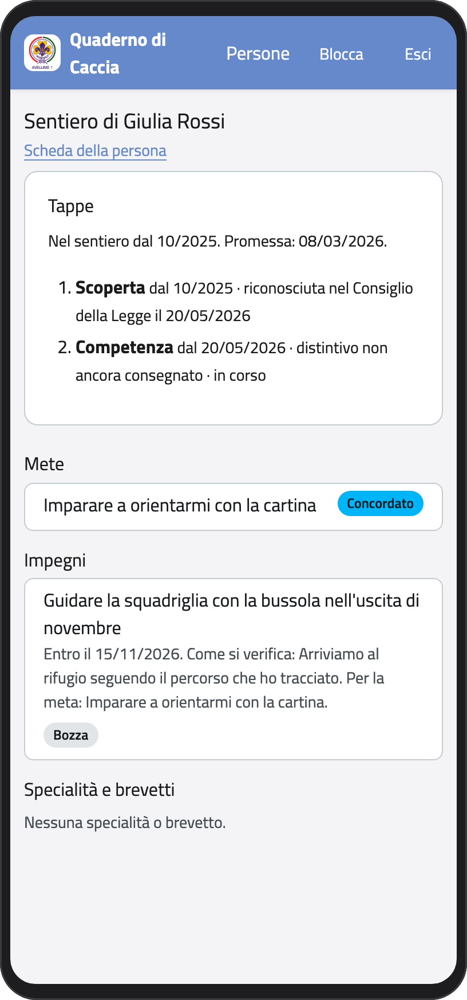
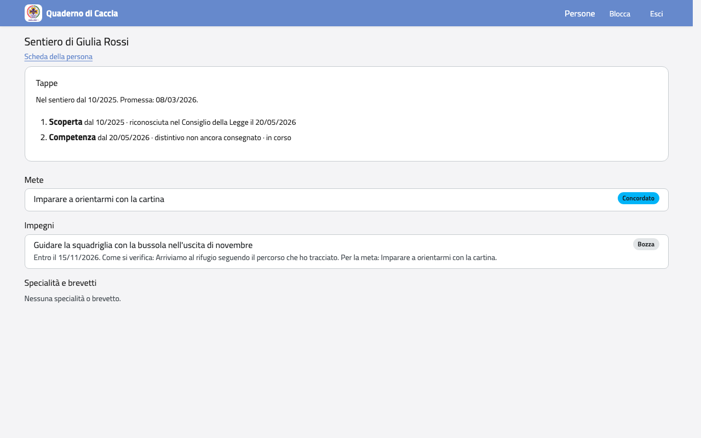

# Progressione Personale

La Progressione Personale è il cammino di tuo figlio nello scautismo. La scrivono i capi:
tu la puoi leggere.

1. Apri la scheda di tuo figlio.
2. Tocca **Sentiero (Progressione Personale)**.

Per esploratori e guide vedi:

- le **tappe** (Scoperta, Competenza, Responsabilità), con le date in cui il Consiglio
  della Legge le ha riconosciute, e la Promessa;
- le **mete** e gli **impegni** concordati con i capi, e a che punto sono;
- le **specialità** e i **brevetti**.

:::{container} schermate
{.telefono width="30%"}
{.computer width="65%"}
:::

La pagina cambia con la branca: per lupetti e coccinelle mostra la pista o il sentiero, il
momento, le prede o i voli e le specialità; per rover e scolte la Carta di clan, i passi
e il Punto della Strada.

:::{note}
Non vedi le parti riservate: per esempio quello che il rover o la scolta scrive per sé nel
Punto della Strada.
:::
