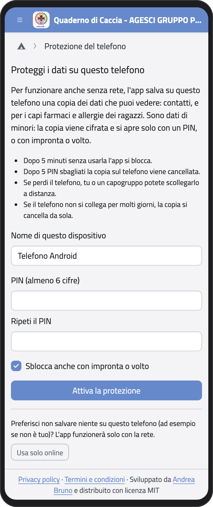
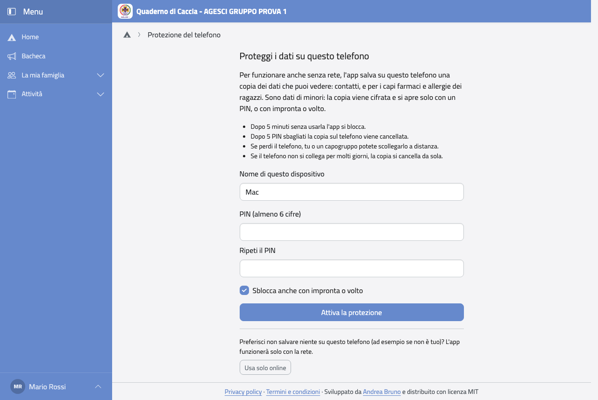
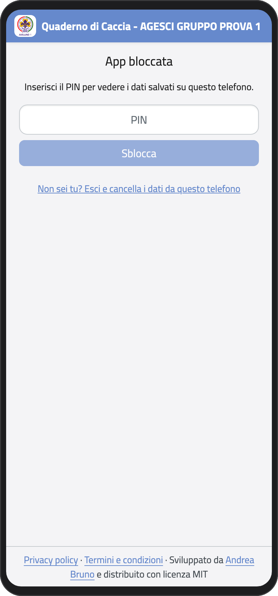
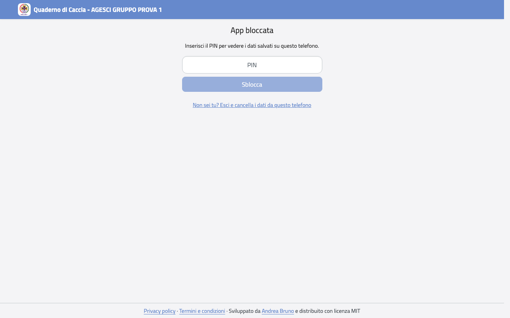
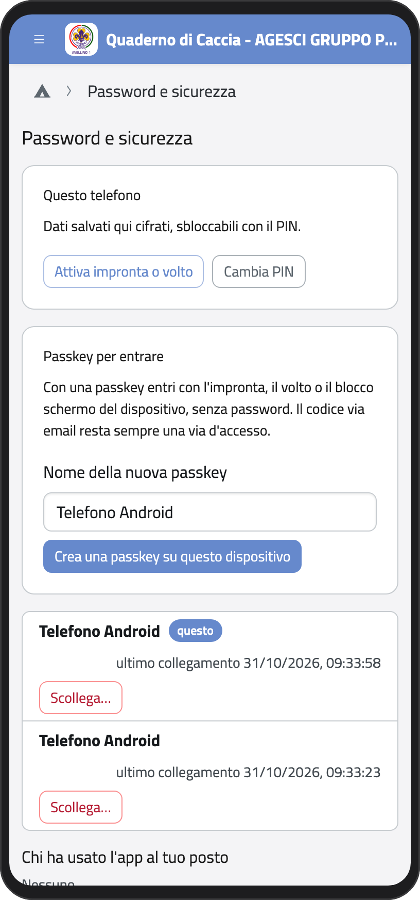
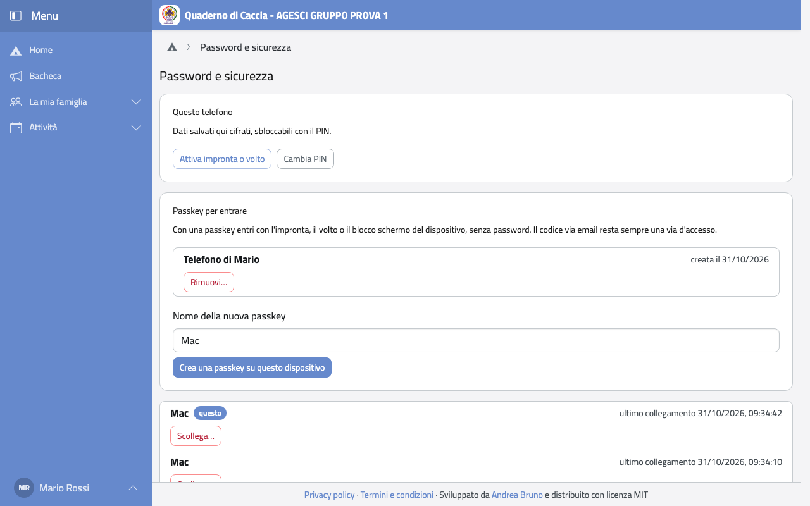

# Proteggere il telefono

La prima volta che entri da un telefono, l'app ti chiede come proteggerlo.

## Perché

Per funzionare anche senza rete, l'app tiene sul telefono una copia dei dati che puoi
vedere, per esempio i contatti dei tuoi figli. Sono dati di minori: la copia è cifrata e
si apre solo con un PIN che scegli tu (o con l'impronta o il volto).

## Scegliere il PIN

1. Controlla il **nome di questo dispositivo** (per esempio «Telefono di Mario»): ti
   servirà per riconoscerlo nell'elenco dei dispositivi.
2. Scegli un **PIN** di almeno 6 cifre e ripetilo.
3. Se il telefono lo permette, lascia la spunta su **Sblocca anche con impronta o
   volto**.
4. Tocca **Attiva la protezione**.

Se il telefono non è tuo, tocca invece **Usa solo online**: l'app non salva niente e
funziona solo con la rete.

:::{container} schermate
{.telefono width="30%"}
{.computer width="65%"}
:::

## Quando l'app si blocca

Dopo 5 minuti senza usarla, o quando la riapri, l'app si blocca. Scrivi il PIN (o usa
l'impronta) e tocca **Sblocca**. Puoi bloccarla anche tu: nel menu del profilo, sotto il
tuo nome, tocca **Blocca l'app**.

:::{container} schermate
{.telefono width="30%"}
{.computer width="65%"}
:::

:::{warning}
Dopo 5 PIN sbagliati la copia sul telefono viene cancellata. Non perdi niente: i dati
restano sul server. Rientri con email e password (o con il codice via email) e scegli un
nuovo PIN.
:::

Se non usi il telefono con la rete per 14 giorni, la copia si cancella da sola: alla
prossima apertura rientri e la scarichi di nuovo.

## Se perdi il telefono

Puoi scollegarlo da un altro telefono o dal computer. Al primo collegamento, il telefono
perso cancella i dati da solo.

1. Entra nel Quaderno di Caccia da un altro dispositivo.
2. Nella Home, in **Profilo**, tocca **Password e sicurezza**.
3. Accanto al telefono perso tocca **Scollega…** e poi **Scollega**.

Se non riesci a entrare, chiedi a un capogruppo di scollegarlo per te.

Nella stessa pagina puoi cambiare il PIN e attivare o disattivare l'impronta o il volto.

:::{container} schermate
{.telefono width="30%"}
{.computer width="65%"}
:::
