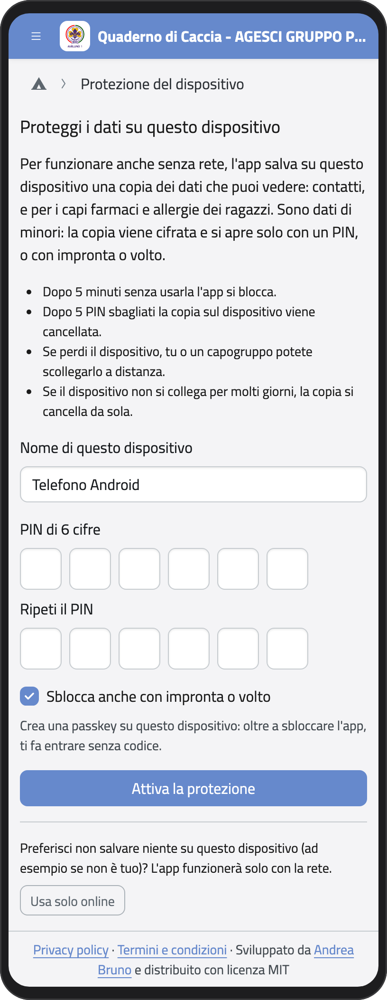
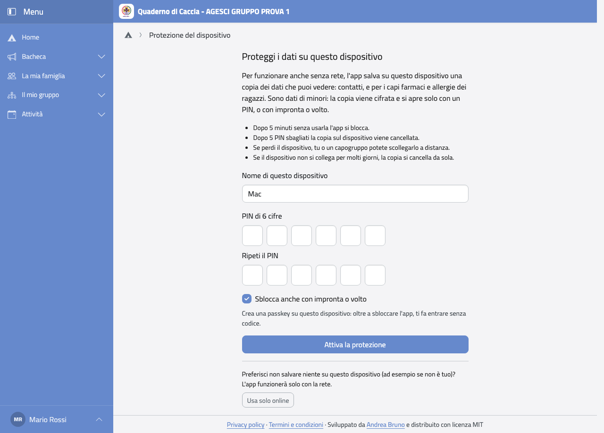
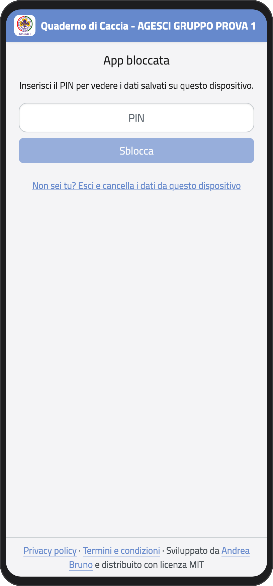
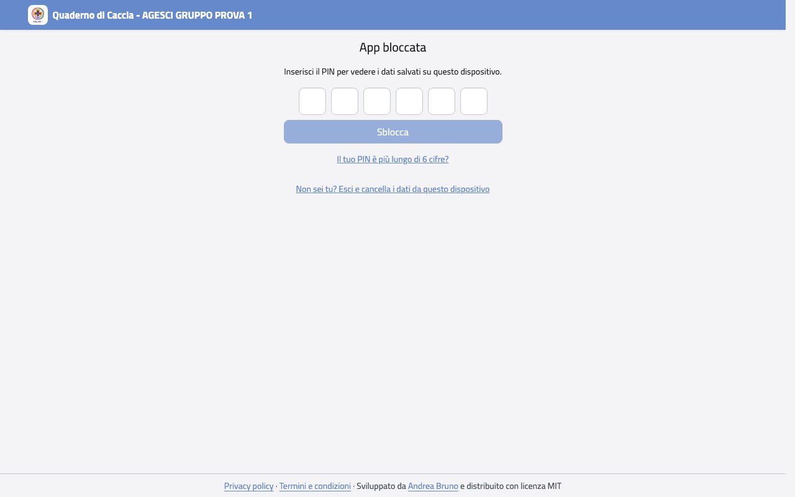
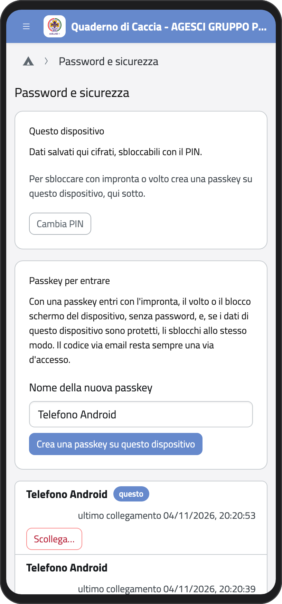
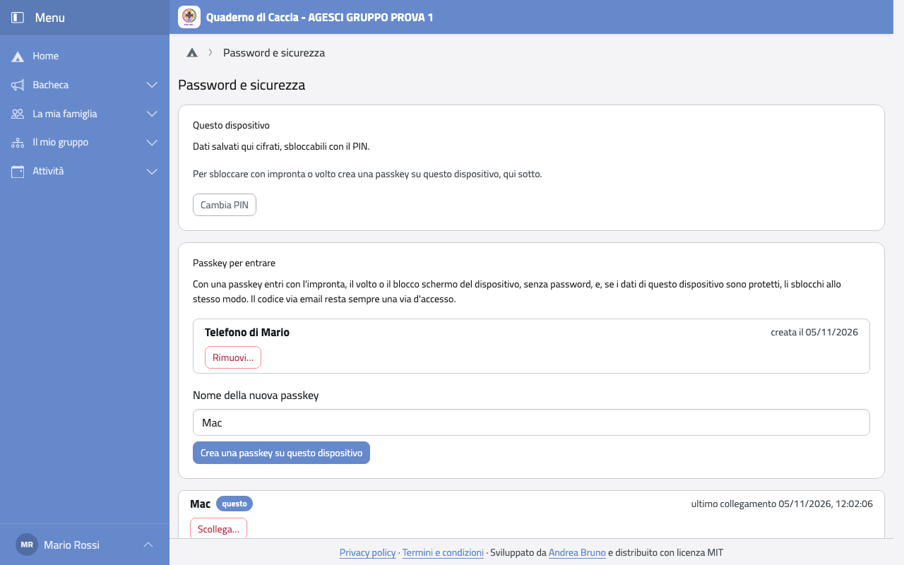

# Proteggere il dispositivo

La prima volta che entri da un telefono, un tablet o un computer, l'app ti chiede come
proteggerlo. Qui si parla di telefono, ma sul computer funziona allo stesso modo: l'app
dice «questo dispositivo».

## Perché

Per funzionare anche senza rete, l'app tiene sul telefono una copia dei dati che puoi
vedere, per esempio i contatti dei tuoi figli. Sono dati di minori: la copia è cifrata e
si apre solo con un PIN che scegli tu (o con l'impronta o il volto).

## Scegliere il PIN

1. Controlla il **nome di questo dispositivo** (per esempio «Telefono di Mario»): ti
   servirà per riconoscerlo nell'elenco dei dispositivi.
2. Scegli un **PIN** di 6 cifre, una per casella, e ripetilo.
3. Se il telefono lo permette, lascia la spunta su **Sblocca anche con impronta o
   volto**: l'app crea la passkey di questo dispositivo, che ti fa anche entrare senza
   codice.
4. Tocca **Attiva la protezione**.

Se sei entrato con la password, per sicurezza l'app ti chiede di confermarla prima di creare la
passkey: il PIN è già attivo, tocca **Crea la passkey** e segui i passi di [Con una
passkey](accesso.md#con-una-passkey). Puoi anche farlo dopo, o toccare **Continua con il solo
PIN**.

Se il telefono non è tuo, tocca invece **Usa solo online**: l'app non salva niente e
funziona solo con la rete.

:::{container} schermate
{.telefono width="30%"}
{.computer width="65%"}
:::

## Quando l'app si blocca

Dopo 5 minuti senza usarla, o quando la riapri, l'app si blocca. Scrivi il PIN: alla sesta
cifra l'app si sblocca da sola. Puoi usare anche l'impronta o il volto.

Se avevi scelto un PIN più lungo di 6 cifre, prima che il PIN diventasse di 6 cifre esatte,
tocca **Il tuo PIN è più lungo di 6 cifre?**, scrivilo e tocca **Sblocca**. Subito dopo l'app ti
chiede un PIN nuovo di 6 cifre; i dati sul telefono restano. Puoi bloccarla anche tu: nel menu del profilo, sotto il
tuo nome, tocca **Blocca l'app**.

:::{container} schermate
{.telefono width="30%"}
{.computer width="65%"}
:::

:::{warning}
Dopo 5 PIN sbagliati la copia sul telefono viene cancellata. Non perdi niente: i dati
restano sul server. Rientri con email e password (o con il codice via email) e scegli un
nuovo PIN.
:::

Se non usi il telefono con la rete per 14 giorni, la copia si cancella da sola: alla
prossima apertura rientri e la scarichi di nuovo.

## Se perdi il telefono

Puoi scollegarlo da un altro telefono o dal computer. Al primo collegamento, il telefono
perso cancella i dati da solo.

1. Entra nel Quaderno di Caccia da un altro dispositivo.
2. Nella Home, in **Profilo**, tocca **Password e sicurezza**.
3. Accanto al telefono perso tocca **Scollega…** e poi **Scollega**.

Se non riesci a entrare, chiedi a un capogruppo di scollegarlo per te.

Nella stessa pagina puoi cambiare il PIN e disattivare l'impronta o il volto.

L'impronta o il volto usano la **passkey di questo dispositivo**, la stessa che ti fa entrare
con **Accedi con passkey**: nell'elenco delle passkey è segnata «sblocca questo dispositivo».
Per attivarli crea la passkey in **Passkey per entrare** (vedi [Con una
passkey](accesso.md#con-una-passkey)). Se rimuovi quella passkey, l'app si sblocca con il PIN e
il telefono, se il browser lo permette, la toglie anche dal suo gestore delle password.

Alcuni browser creano la passkey ma non le permettono di sbloccare i dati salvati (per esempio
Chrome sul Mac, con l'app installata): l'app te lo dice, la passkey ti serve comunque per
entrare e i dati si sbloccano con il PIN. Sul Mac puoi usare Safari, con **File** → **Aggiungi
al Dock**.

Le versioni precedenti usavano una passkey di sblocco a parte, che compariva anche in **Accedi
con passkey** senza farti entrare. Se l'app te lo segnala, crea la passkey di questo
dispositivo: quella vecchia viene tolta.

:::{container} schermate
{.telefono width="30%"}
{.computer width="65%"}
:::
