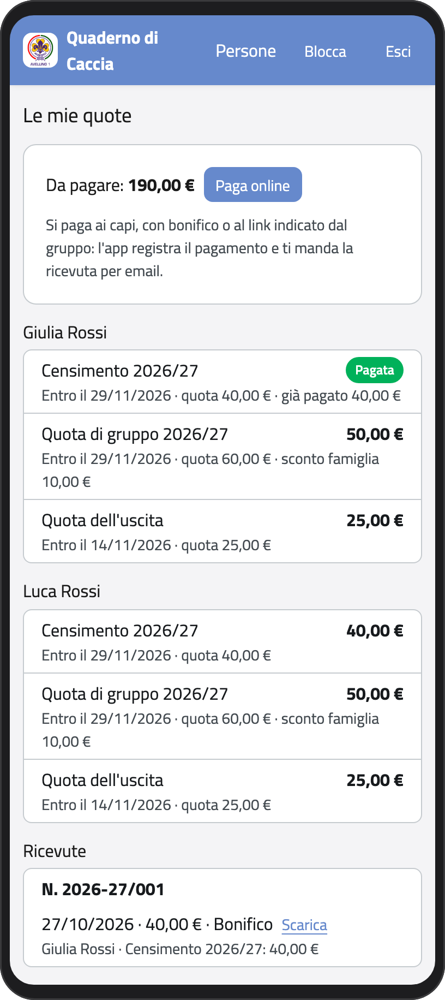
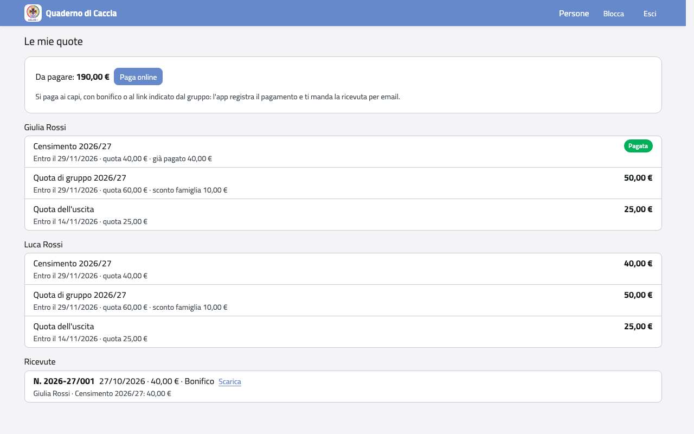

# Quote

Nella pagina iniziale tocca **Le mie quote**. In alto vedi quanto resta da pagare per
tutta la famiglia; sotto, le quote di ogni figlio con la scadenza, gli sconti e quanto hai
già pagato; in fondo, le ricevute.

:::{container} schermate
{.telefono width="30%"}
{.computer width="65%"}
:::

## Pagare

Si paga ai capi, in contanti o con bonifico, oppure con **Paga online** se il gruppo ha
indicato un link di pagamento. Chi riceve il pagamento lo registra nell'app: la quota
diventa **Pagata** e ti arriva la ricevuta per email.

## Sconti e agevolazioni

- **Sconto famiglia:** se in famiglia ci sono almeno due soci, alcune quote hanno uno
  sconto, già tolto dall'importo da pagare. Il censimento nazionale non ha sconto.
- **Agevolazioni:** se il gruppo copre una parte di una quota, vedi l'importo già ridotto.
  Chi non ha pagato lo sanno solo i capi e la tua famiglia.

## Ricevute

Ogni pagamento ha una ricevuta numerata. Tocca **Scarica** per avere il PDF. La ricevuta
non è un documento fiscale.

:::{note}
Le quote di un anno passato non ancora pagate restano tra quelle da pagare.
:::
