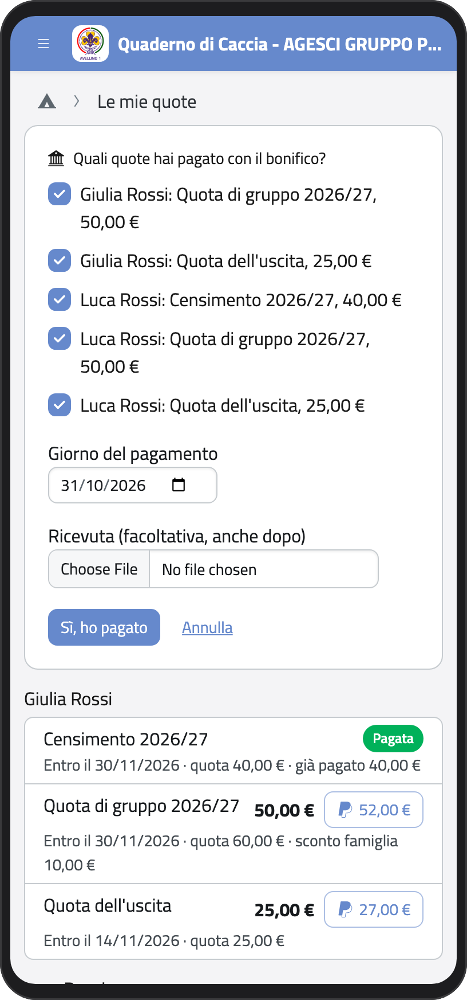
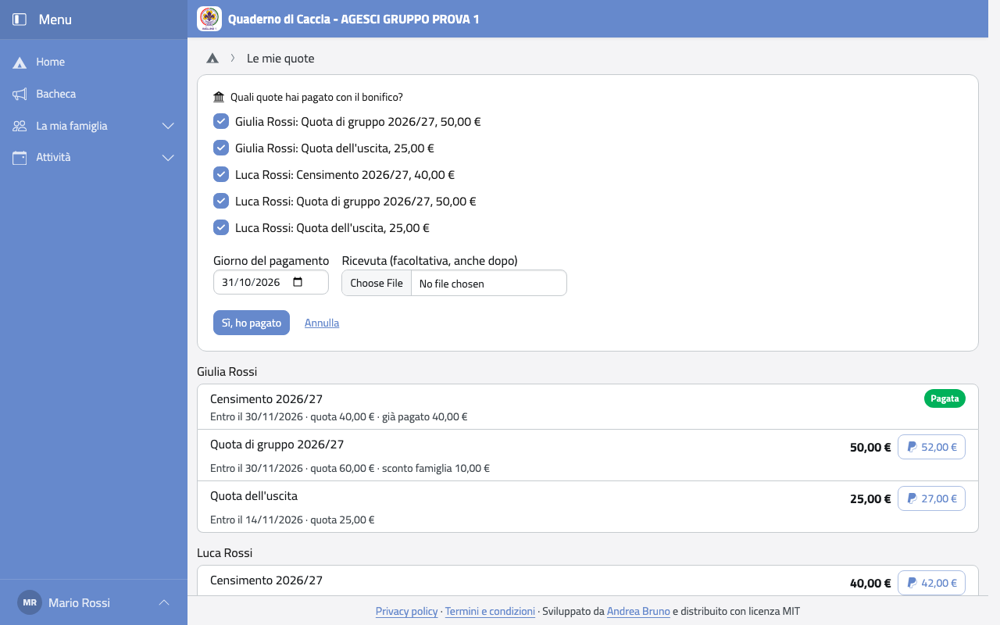

# Quote

Nella Home, in **Profilo** (o nel menu del profilo), tocca **Le mie quote**. In alto vedi quanto resta
da pagare per tutta la famiglia e come pagare; sotto, le quote di ogni figlio con la
scadenza, gli sconti e quanto hai già pagato; in fondo, le ricevute.

:::{container} schermate
{.telefono width="30%"}
{.computer width="65%"}
:::

## Pagare

In **Come pagare** vedi solo i modi che il gruppo accetta:

- **ai capi**, in contanti o con la carta: chi riceve il pagamento lo registra nell'app;
- **con bonifico**, all'IBAN che vedi (toccalo per selezionarlo e copiarlo);
- **con PayPal**: il gruppo può aggiungere una piccola somma per i costi di PayPal, e
  la vedi scritta prima di pagare.

Quando il pagamento è registrato, la quota diventa **Pagata** e ti arriva la ricevuta per
email.

### Con PayPal

1. Tocca **Paga tutto con PayPal** per pagare tutte le quote insieme, oppure il pulsante
   con l'importo accanto a una sola quota. Si apre PayPal con l'importo già scritto.
2. Paga su PayPal e torna nel Quaderno di Caccia.
3. L'app ti chiede **Hai completato il pagamento con PayPal?**. Controlla il giorno del
   pagamento e, se vuoi, carica la ricevuta di PayPal (PDF o foto). Tocca **Sì, ho
   pagato**; se non hai pagato, tocca **No, non ho pagato**.

### Con bonifico

1. Fai il bonifico dalla tua banca, all'IBAN e all'intestatario che vedi in **Come
   pagare**.
2. Nel Quaderno di Caccia tocca **Ho fatto il bonifico**.
3. Spunta le quote che hai pagato, scrivi il giorno del bonifico e, se vuoi, carica la
   ricevuta della banca (PDF o foto).
4. Tocca **Sì, ho pagato**.

:::{container} schermate
{.telefono width="30%"}
{.computer width="65%"}
:::

### Dopo la segnalazione

Le quote che hai segnalato restano **in verifica** finché un capo non controlla che il
pagamento sia arrivato. In **Pagamenti in verifica** puoi caricare la ricevuta anche dopo
(**Carica la ricevuta**) o, se ti sei sbagliato, toccare **Annulla la segnalazione**.
Quando il capo ha verificato, la quota diventa **Pagata** e ti arriva la ricevuta del
gruppo.

## Sconti e agevolazioni

- **Sconto famiglia:** se in famiglia ci sono almeno due soci, alcune quote hanno uno
  sconto, già tolto dall'importo da pagare. Il censimento nazionale non ha sconto.
- **Agevolazioni:** se il gruppo copre una parte di una quota, vedi l'importo già ridotto.
  Chi non ha pagato lo sanno solo i capi e la tua famiglia.

## Ricevute

Ogni pagamento ha una ricevuta numerata. Tocca **Scarica** per avere il PDF. La ricevuta
non è un documento fiscale.

:::{note}
Le quote di un anno passato non ancora pagate restano tra quelle da pagare.
:::
