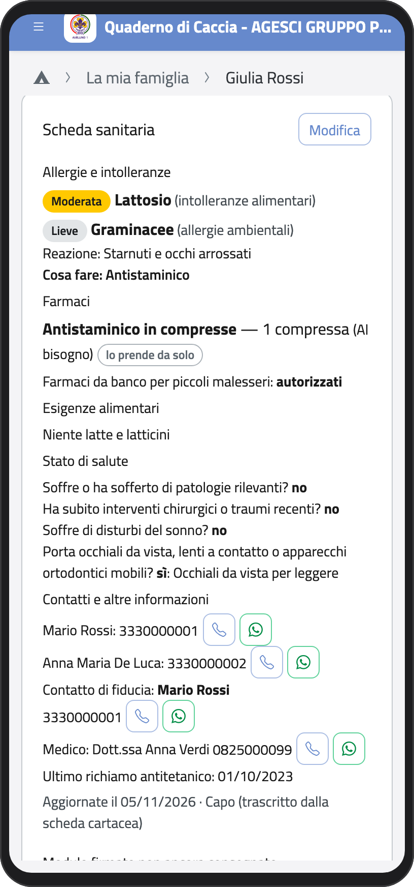
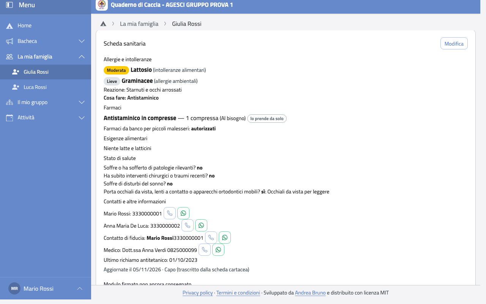
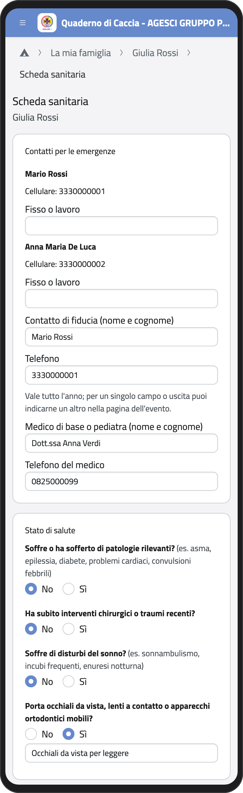
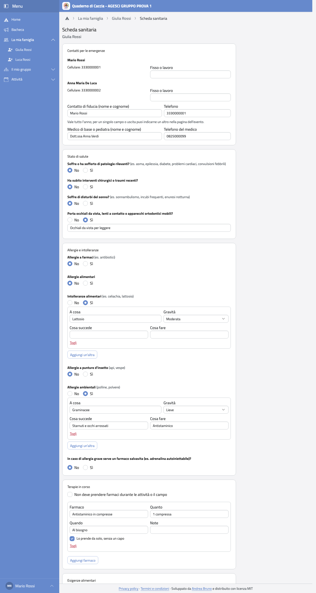
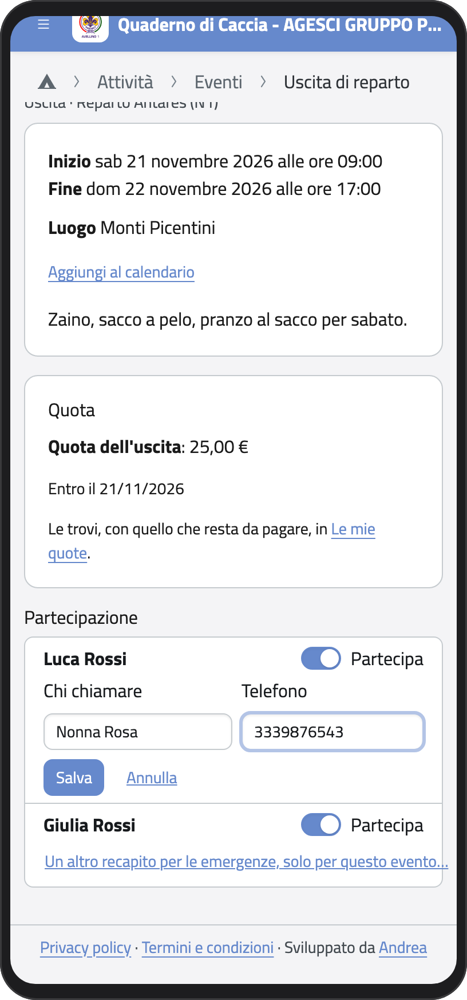
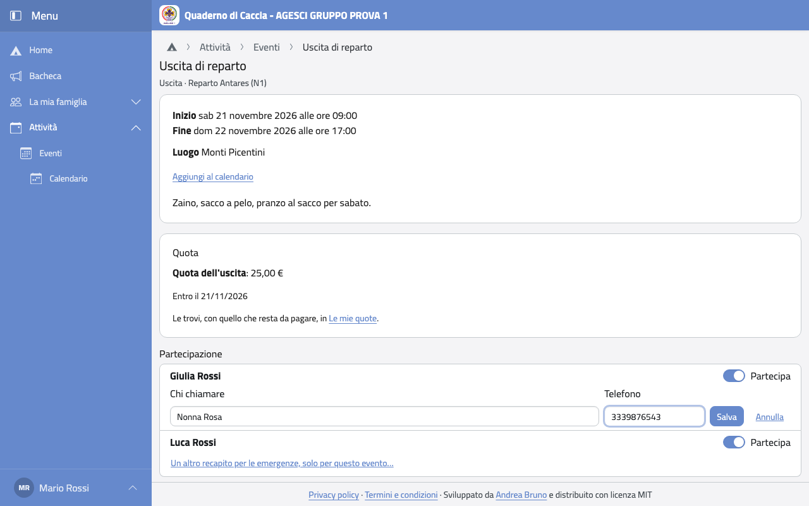

# Scheda sanitaria

La scheda sanitaria la compili tu: è la scheda sanitaria del gruppo, con le stesse parti
del modulo su carta. La leggono i capi dell'unità di tuo figlio; al campo, anche senza
rete, hanno con sé farmaci, allergie, intolleranze, esigenze alimentari, l'eventuale
farmaco salvavita e se possono dargli un farmaco da banco.

## Vederla

Nella scheda di tuo figlio c'è il riquadro **Scheda sanitaria**: allergie e intolleranze
con la loro gravità, farmaci, esigenze alimentari, stato di salute, i contatti per le
emergenze.

:::{container} schermate
{.telefono width="30%"}
{.computer width="65%"}
:::

## Compilarla o cambiarla

1. Nel riquadro **Scheda sanitaria** tocca **Compila** (o **Modifica**).
2. In **Contatti per le emergenze** controlla il tuo cellulare (viene da BuonaStrada) e
   scrivi, se vuoi, un **fisso o lavoro**: vale per tutti i tuoi figli. Poi un **contatto di
   fiducia** con il telefono e il **medico** di base o il pediatra.
3. In **Stato di salute** rispondi alle quattro domande; se rispondi **Sì**, spiega in
   breve.
4. In **Allergie e intolleranze** rispondi **No** o **Sì** per ognuno dei cinque tipi
   (farmaci, alimentari, intolleranze alimentari, punture d'insetto, ambientali). Per un
   **Sì** scrivi a cosa, la gravità, cosa succede e cosa fare; con **Aggiungi un'altra** ne
   scrivi più di una. Sotto, dì se serve un **farmaco salvavita**: va consegnato ai capi
   prima della partenza, con le istruzioni scritte.
5. In **Terapie in corso** tocca **Aggiungi farmaco** per ognuno: quanto, quando, e se lo
   prende da solo. Se non ne prende, spunta la casella.
6. In **Esigenze alimentari** scrivi cosa non mangia per motivi non medici. Non serve
   spiegare il motivo.
7. In **Antitetanica e farmaci da banco** scrivi la data dell'ultimo richiamo contro il
   tetano e dì se i capi possono dargli un farmaco da banco per piccoli malesseri.
8. **Altre informazioni** (tessera sanitaria, gruppo sanguigno, altre vaccinazioni, note)
   servono in caso di emergenza: compilale se vuoi.
9. Tocca **Salva**.

:::{container} schermate
{.telefono width="30%"}
{.computer width="65%"}
:::

## La scheda firmata e i documenti

La scheda va anche firmata.

1. Nel riquadro **Scheda sanitaria** tocca **Stampa il modulo da firmare**: è la scheda del
   gruppo già compilata, su carta intestata.
2. Firmala (se hai due genitori con la responsabilità genitoriale, firmate in due).
3. In **Documenti da allegare** carica la scheda firmata e i documenti che chiede: la
   tessera sanitaria o il codice fiscale di tuo figlio, il suo documento d'identità e il
   tuo. Scegli quale documento è, scegli il file (un PDF o una foto) e tocca **Carica**.

Un capo li controlla e li salva sul Drive del gruppo o sul suo computer: da quel momento
vengono cancellati dall'app, che si ricorda solo chi li ha verificati e quando. Finché un
documento non è verificato puoi toglierlo e caricarlo di nuovo. La prescrizione del
medico, se tuo figlio prende farmaci, consegnala ai capi.

Se poi cambi la scheda, compare l'avviso «La scheda è cambiata dopo l'ultima firma»: stampa
e firma di nuovo.

## Un altro recapito per un solo evento

Il contatto di fiducia vale tutto l'anno. Se per un campo o un'uscita è meglio
chiamare qualcun altro (per esempio sei in viaggio):

1. Apri l'evento (vedi [Eventi e calendario](eventi)).
2. Sotto il nome di tuo figlio tocca **Un altro recapito per le emergenze, solo per questo
   evento…**.
3. Scrivi chi chiamare e il telefono, e tocca **Salva**.

Con **Torna a quello di sempre** lo togli.

:::{container} schermate
{.telefono width="30%"}
{.computer width="65%"}
:::
