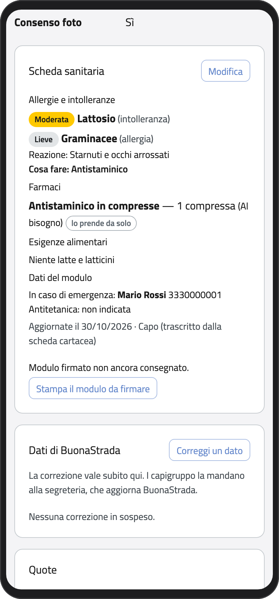
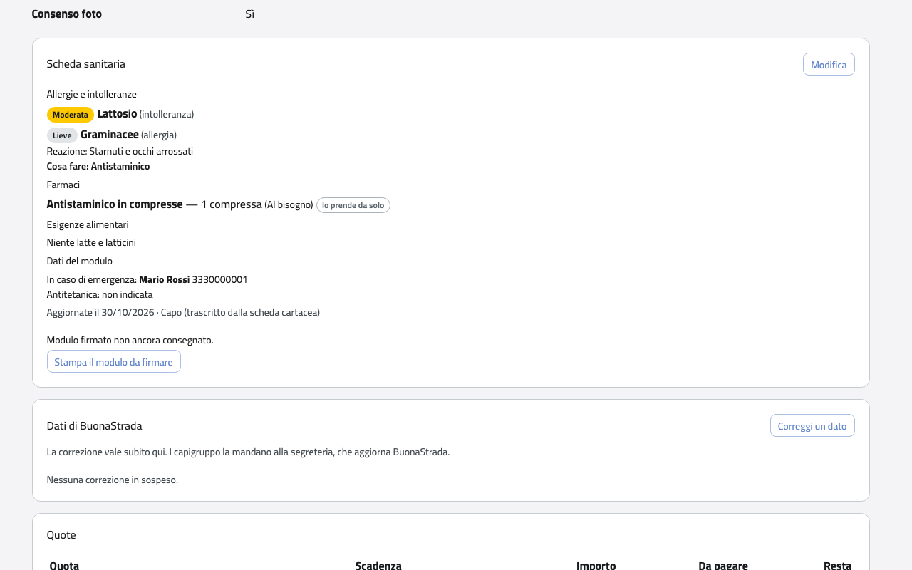
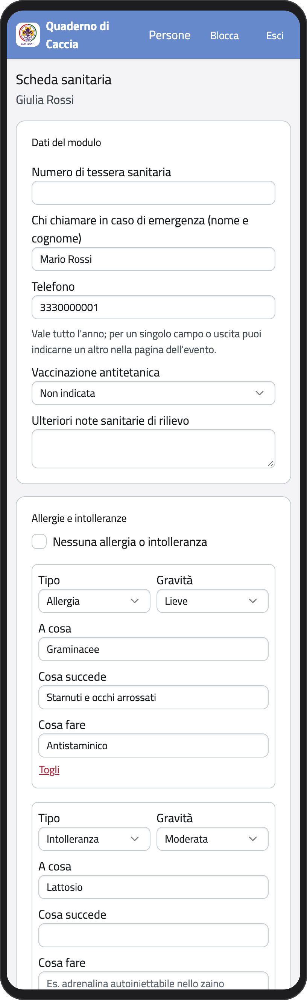
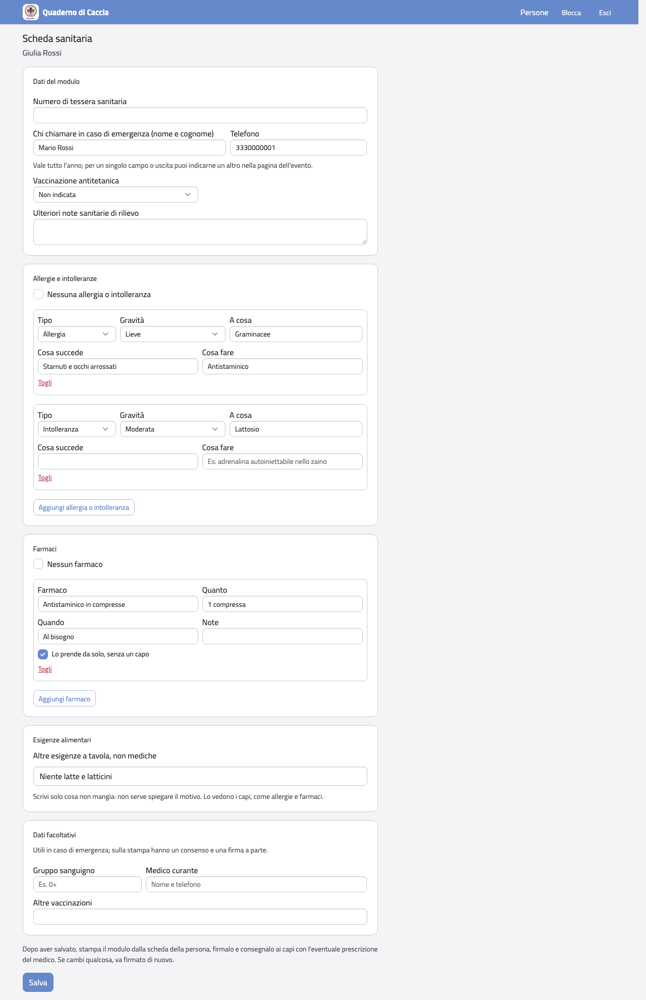
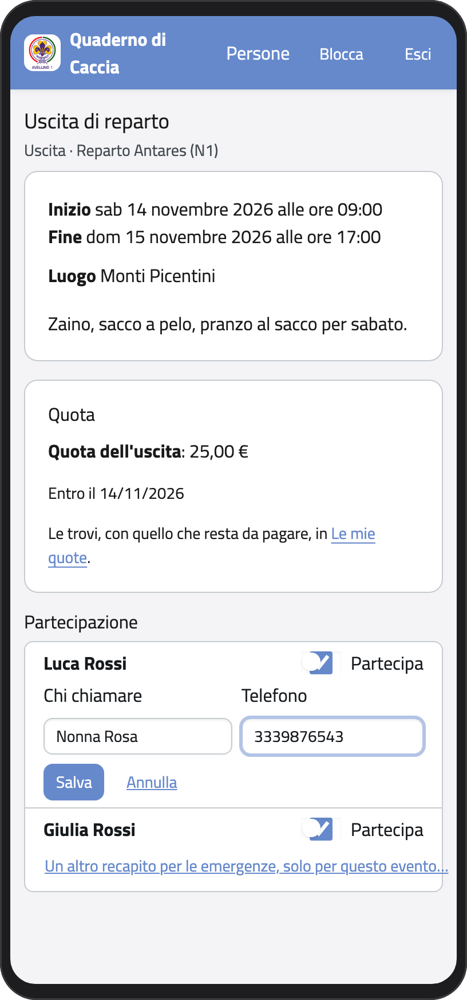
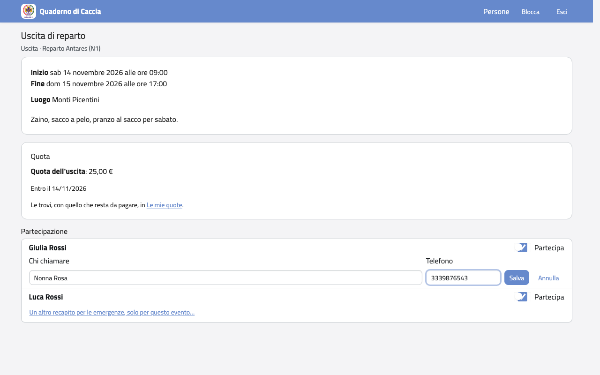

# Scheda sanitaria

La scheda sanitaria la compili tu. La leggono i capi dell'unità di tuo figlio; al campo,
anche senza rete, hanno con sé farmaci, allergie, intolleranze ed esigenze alimentari.

## Vederla

Nella scheda di tuo figlio c'è il riquadro **Scheda sanitaria**: allergie e intolleranze
con la loro gravità, farmaci, esigenze alimentari, chi chiamare in caso di emergenza.

:::{container} schermate
{.telefono width="30%"}
{.computer width="65%"}
:::

## Compilarla o cambiarla

1. Nel riquadro **Scheda sanitaria** tocca **Compila** (o **Modifica**).
2. In **Dati del modulo** scrivi il numero di tessera sanitaria e chi chiamare in caso di
   emergenza, con il telefono.
3. In **Allergie e intolleranze** tocca **Aggiungi allergia o intolleranza** per ognuna:
   tipo, gravità, a cosa, cosa succede e cosa fare. Se non ne ha, spunta **Nessuna allergia
   o intolleranza**.
4. In **Farmaci** tocca **Aggiungi farmaco** per ognuno: quanto, quando, e se lo prende da
   solo, senza un capo. Se non ne prende, spunta **Nessun farmaco**.
5. In **Esigenze alimentari** scrivi cosa non mangia per motivi non medici. Non serve
   spiegare il motivo.
6. I **Dati facoltativi** (gruppo sanguigno, medico curante, altre vaccinazioni) servono
   in caso di emergenza: compilali se vuoi.
7. Tocca **Salva**.

:::{container} schermate
{.telefono width="30%"}
{.computer width="65%"}
:::

## Il modulo firmato

La scheda va anche firmata su carta.

1. Nel riquadro **Scheda sanitaria** tocca **Stampa il modulo da firmare**: è il modulo
   AGESCI già compilato.
2. Firmalo e consegnalo ai capi, con la prescrizione del medico se tuo figlio prende
   farmaci.

I capi segnano la consegna nell'app. Se poi cambi la scheda, compare l'avviso «La scheda è
cambiata dopo l'ultima firma»: stampa e firma di nuovo.

## Un altro recapito per un solo evento

Chi chiamare in caso di emergenza vale tutto l'anno. Se per un campo o un'uscita è meglio
chiamare qualcun altro (per esempio sei in viaggio):

1. Apri l'evento (vedi [Eventi e calendario](eventi)).
2. Sotto il nome di tuo figlio tocca **Un altro recapito per le emergenze, solo per questo
   evento…**.
3. Scrivi chi chiamare e il telefono, e tocca **Salva**.

Con **Torna a quello di sempre** lo togli.

:::{container} schermate
{.telefono width="30%"}
{.computer width="65%"}
:::
