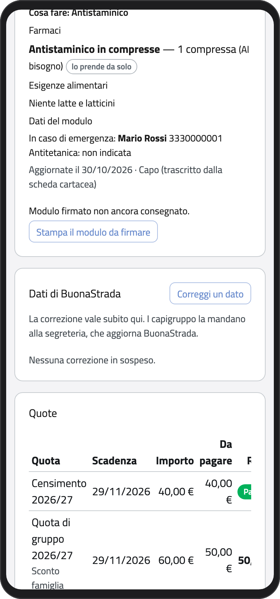
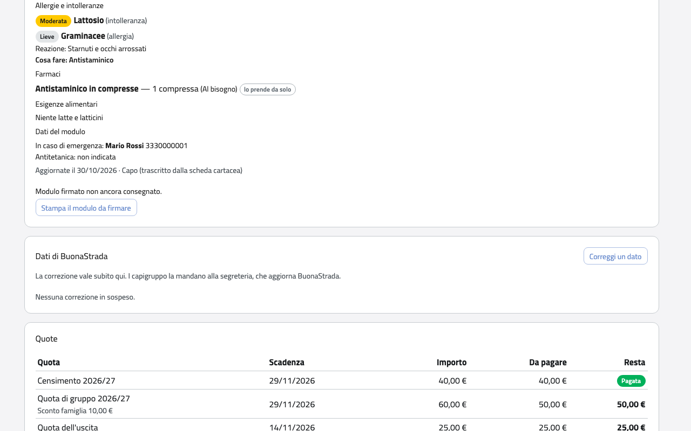

# Telefono in squadriglia

Gli esploratori e le guide di una squadriglia vedono i telefoni degli altri; il capo
squadriglia vede anche quelli dei genitori. Niente email.

Se tuo figlio ha un cellulare suo registrato in BuonaStrada, la squadriglia vede quello.
Altrimenti scegli tu quale numero mostrare:

1. Apri la scheda di tuo figlio e cerca il riquadro **Telefono in squadriglia**.
2. In **Non ha un cellulare suo: quale numero mostrare?** scegli il cellulare di un
   genitore, oppure **Nessun numero**.
3. Se hai più figli senza cellulare, spunta **Usalo per tutti i figli senza cellulare**.
4. Se non vuoi che gli altri ragazzi lo vedano, spunta **Non mostrarlo agli altri
   ragazzi**: il capo squadriglia lo vede comunque.
5. Tocca **Salva**.

:::{container} schermate
{.telefono width="30%"}
{.computer width="65%"}
:::
