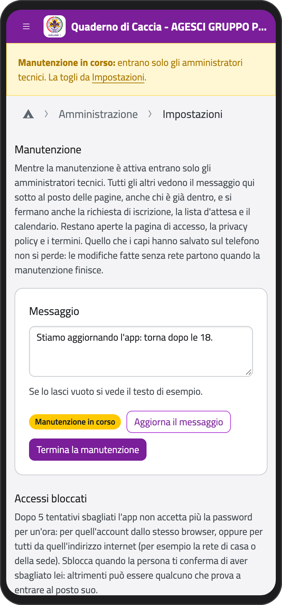
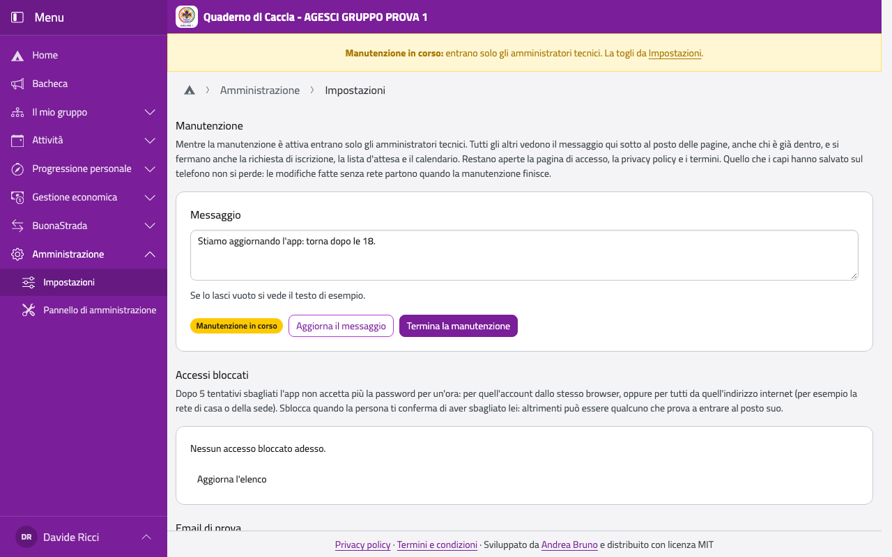
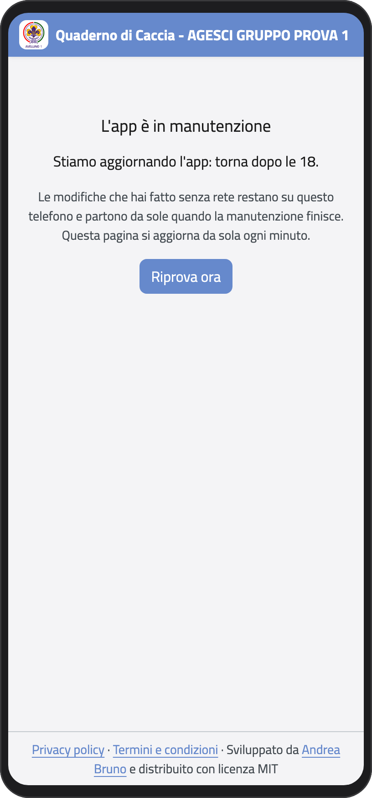
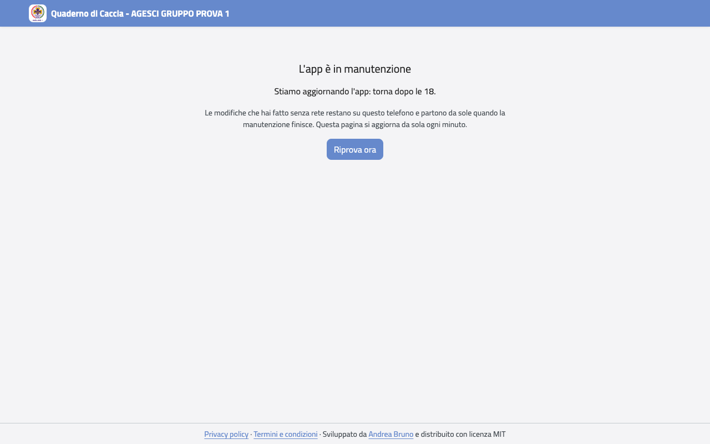
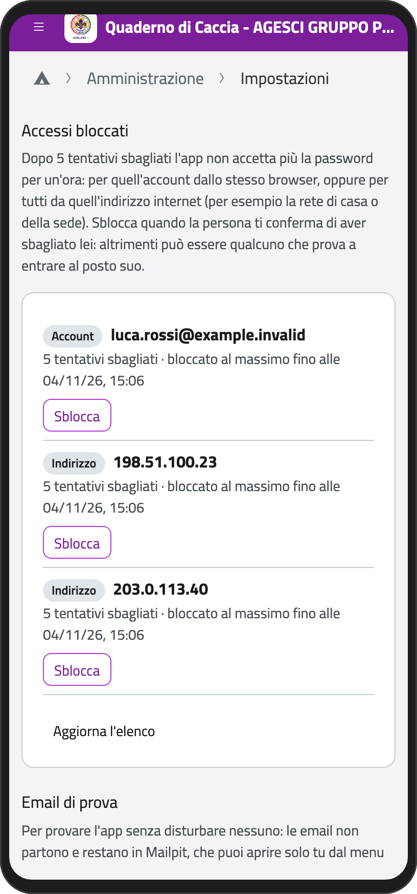
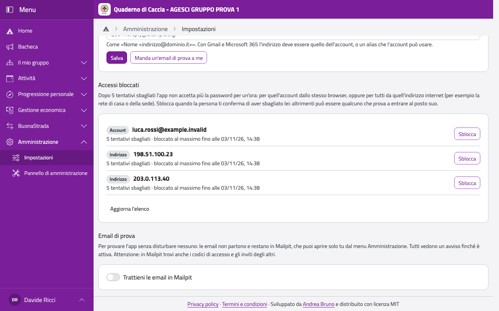

# Amministratore tecnico

L'amministratore tecnico cura la parte tecnica dell'app. Il primo lo crea chi installa l'app;
gli altri li nominano i capigruppo nell'**Organigramma**, e devono essere capi.
L'incarico non dà accesso ai dati educativi dei ragazzi.

Può:

- cambiare le **Impostazioni** del sito, i modelli delle email e le pagine legali (vedi
  [Impostazioni](impostazioni));
- importare da BuonaStrada e gestire le correzioni (vedi [BuonaStrada](buonastrada));
- nominare il **primo capogruppo**, quando il gruppo non ne ha (nell'**Organigramma**);
- impostare il **server di posta** e aprire il **Pannello di amministrazione** e la
  **modalità di prova delle email**;
- mettere l'app in **manutenzione** e **sbloccare gli accessi** di chi ha sbagliato la
  password troppe volte;
- **aggiornare l'app** a una versione nuova, se cura anche il server.

## Il pannello di amministrazione

Nel menu, in **Amministrazione**, tocca **Pannello di amministrazione**: è il pannello
tecnico, per correggere a mano un account, un invito, un'unità, un incarico. Usalo solo
quando l'app non offre un'altra strada.

:::{warning}
Le schede sanitarie, le note e le regole sul rapporto con i minori non sono nel pannello.
Il **registro delle modifiche** però conserva i valori cambiati, anche dei dati sanitari: per
questo l'amministratore tecnico è sempre un capo, o ha una delega dei capigruppo per i dati.
:::

## Il server di posta

In **Impostazioni**, **Server di posta**, scegli da dove partono le email: server, porta,
sicurezza, utente, password e mittente. Se lo lasci vuoto vale quello configurato da chi ha
installato l'app. Poi tocca **Manda un'email di prova a me**: se qualcosa non va, l'app ti
dice cosa controllare.

- **Gmail con accesso Google**, senza password: scegli questa voce, inserisci ID e segreto
  del client OAuth (li prepara chi installa, come spiega la guida di installazione), tocca
  **Salva** e poi **Collega Gmail**, ed entra con l'account da cui partono le email. Con
  **Scollega** togli il collegamento.
- **Google Workspace o Gmail via SMTP**: server `smtp.gmail.com`, porta 587, STARTTLS, utente
  l'indirizzo e come password una **password per le app** (la crei nell'account Google, con la
  verifica in due passaggi attiva; nel Workspace l'amministratore deve permetterle). Con il
  relay SMTP di Google: `smtp-relay.gmail.com`, senza utente né password.
- **Microsoft 365**: server `smtp.office365.com`, porta 587, STARTTLS, finché il tenant
  accetta utente e password. Per la posta istituzionale AGESCI decide chi amministra il tenant.
- **Un altro fornitore**: i dati che ti dà per l'SMTP.

Password e segreti restano cifrati sul server: dopo averli salvati non li rivedi più, puoi
solo sostituirli.

## La modalità di prova delle email

Per provare l'app senza disturbare nessuno: in **Impostazioni**, **Email di prova**, accendi
**Trattieni le email in Mailpit**. Le email non partono: restano in **Mailpit**, che apri dal
menu **Amministrazione** e vedi solo tu. Finché è accesa, tutti vedono in alto un avviso.

:::{warning}
In Mailpit trovi anche i codici di accesso e gli inviti degli altri. La modalità di prova si
può accendere solo se chi ha installato il server l'ha permessa: è pensata per un server di
prova, non per quello con i dati veri.
:::

## La manutenzione

Quando devi aggiornare l'app o sistemare qualcosa senza che nessuno ci lavori nel frattempo,
in **Impostazioni**, **Manutenzione**, scrivi un messaggio (per esempio fino a quando dura) e
tocca **Metti in manutenzione**.

Da quel momento entrano solo gli amministratori tecnici: tu vedi in alto un avviso giallo,
tutti gli altri vedono il tuo messaggio al posto delle pagine, anche chi era già dentro. Si
fermano anche la richiesta di iscrizione, la lista d'attesa e il calendario sul telefono;
restano aperte solo la pagina di accesso, la privacy policy e i termini.

:::{container} schermate
{.telefono width="30%"}
{.computer width="65%"}
:::

Ecco cosa vede un genitore che stava usando l'app:

:::{container} schermate
{.telefono width="30%"}
{.computer width="65%"}
:::

Nessuno perde niente: i dati salvati sul telefono restano, e le modifiche fatte senza rete
(per esempio le presenze al campo) aspettano e partono da sole quando la manutenzione finisce.
La pagina si aggiorna da sola ogni minuto.

Per cambiare il messaggio tocca **Aggiorna il messaggio**; quando hai finito, **Termina la
manutenzione**.

## Aggiornare l'app

Le versioni nuove escono su
[GitHub](https://github.com/AGESCI-Avellino-1/quaderno-di-caccia/releases), ognuna con le sue
note (cosa cambia, se c'è qualcosa da fare sul server) e il PDF del manuale. Leggi le note
prima di aggiornare, e scegli un momento in cui l'app si usa poco: durante l'aggiornamento
resta in manutenzione per qualche minuto.

Sul server, con l'utente che gestisce l'app:

```bash
cd /srv/qdc
scripts/aggiorna.sh
```

Lo script mette da solo l'app in manutenzione, fa il backup, installa la versione nuova,
controlla che risponda e toglie la manutenzione. I passi, uno per uno, sono nella guida di
installazione, in «Aggiornamenti».

Se la versione nuova non risponde, lo script **torna da solo alla versione di prima**:

- se dice che l'app è di nuovo alla versione di prima e risponde, non è cambiato niente:
  segnala il problema con le righe che lo script ha mostrato;
- se dice che il database era già cambiato, l'app resta in manutenzione: ripristina il backup
  che lo script ti indica, come spiega la guida di installazione in «Backup e ripristino»,
  poi togli la manutenzione da **Impostazioni**. Quello che era stato fatto dopo il backup si
  perde: avvisa i capi.

## Gli accessi bloccati

Dopo 5 tentativi sbagliati l'app smette di accettare la password per un'ora: per quell'account
dallo stesso browser, oppure per tutti da quell'indirizzo internet, per esempio la rete di
casa o della sede. In **Impostazioni**, **Accessi bloccati**, vedi i blocchi in corso: l'email
o l'indirizzo, quanti tentativi e fino a quando dura al massimo.

:::{container} schermate
{.telefono width="30%"}
{.computer width="65%"}
:::

Tocca **Sblocca** accanto a quello da togliere. L'elenco non si aggiorna da solo: tocca
**Aggiorna l'elenco** per vedere i blocchi nuovi.

:::{warning}
Sblocca quando la persona ti conferma di aver sbagliato lei. Se nessuno ha sbagliato, può
essere qualcuno che prova a entrare al posto suo: in quel caso lascia il blocco e avvisa i
capigruppo.
:::
