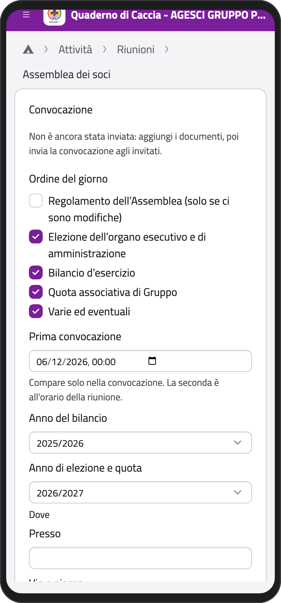
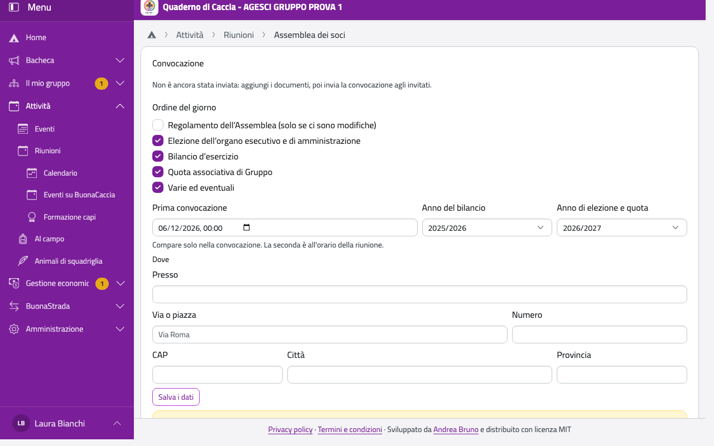

# Assemblea dei soci

L'assemblea dei soci la convocano i capigruppo, ed è di tutto il gruppo. Convocazione e verbale seguono
i modelli AGESCI, sulla carta intestata del gruppo: inserisci i dati e il testo lo compone l'app. Le
votazioni si fanno fuori dall'app, che ne riporta solo l'esito e non calcola deleghe e numero legale.

## Convocarla

1. In **Riunioni** tocca **Nuove riunioni**. In **Di chi** scegli **Assemblea dei soci**, poi il giorno
   e gli orari.
2. Apri l'assemblea. Nel riquadro **Convocazione** i punti dell'**Ordine del giorno** sono già
   spuntati, tranne il Regolamento, da spuntare solo se ci sono modifiche: togli quelli che non servono,
   perché per ogni punto il verbale ti chiederà i suoi dati.
   L'email di convocazione li riporta. Scegli, se servono, l'anno del bilancio (proposto l'ultimo chiuso) e quello di elezione e quota. Il bilancio
   chiuso al 30/09 di un anno si approva entro il 31/12 dello stesso anno.
3. La **Prima convocazione** è già proposta alle 00:00 del giorno della riunione e serve per il quorum:
   compare solo nella convocazione. La seconda è all'orario della riunione.
4. Scrivi dove si tiene, tocca **Salva i dati** e controlla l'**Anteprima della convocazione**. Se manca
   qualcosa, l'app te lo dice e non la invia.
5. Aggiungi gli altri documenti, per esempio il bilancio.
6. Se le presenze le segna qualcun altro, sceglilo in **Chi segna le presenze, oltre ai capigruppo** e
   tocca **Indica**.
7. Tocca **Invia la convocazione**: l'email parte una volta sola per tutti gli invitati, con il PDF della
   convocazione, anche se le email ai genitori sono spente nelle impostazioni. Da quel momento i dati non
   si cambiano più. I documenti aggiunti dopo arrivano da soli.

:::{container} schermate
{.telefono width="30%"}
{.computer width="65%"}
:::

## Chi è invitato e chi vota

| Invitati | Diritto di voto |
| --- | --- |
| Capi, rover e scolte maggiorenni | Sì, per sé |
| Genitori e tutori dei minorenni | Sì, per i figli |
| Genitori di maggiorenni senza figli minorenni | No, partecipano per informazione |

Il voto si conta per socio: ogni minorenne vale un voto, espresso da uno solo dei genitori, che scelgono
tra loro chi. Un capo che è anche genitore vota per sé e per il figlio. L'app segna solo chi è presente
e, accanto, se ha diritto di voto.

Nessuno deve comunicare se viene: le presenze si segnano nella pagina dell'assemblea, come per le altre
riunioni.

## Il verbale

L'assemblea deve avere il verbale: non si può dire che non c'è.

1. Segna le presenze.
2. Nel riquadro **Verbale** tocca **Compila il verbale**.
3. Scegli il **Presidente**, un socio maggiorenne o un genitore, e almeno un **Segretario**, tra i
   presenti, e tocca **Salva presidente e segretari**.
4. Inserisci ore di apertura e chiusura, scrutatori e, per ogni punto votato, favorevoli e contrari o
   **All'unanimità**. Secondo l'ordine del giorno ti chiede il **Risultato di bilancio**, da copiare dal
   Modello D dell'associazione (quello nell'app è solo una bozza), le quote con modalità e termini, le
   varie ed eventuali. Tocca **Salva i dati**: il testo non si scrive a mano.
5. Tocca **Rendi definitivo**: se manca qualcosa, l'app elenca cosa. Lo leggono tutti gli invitati e i capi. Nel PDF ci sono presidente e
   segretari con lo spazio per la firma, e l'elenco dei presenti: resta anche quando le presenze, dopo due
   anni, diventano totali annui.

Se non è definitivo, una settimana dopo l'assemblea arriva un promemoria ai capigruppo, e poi ogni
settimana finché non lo è. In **Riunioni**, ai capigruppo resta l'avviso **Verbale mancante**.

Per 5 anni nomi e presenti restano nel verbale anche se una persona chiede la cancellazione dei dati o
viene archiviata; poi il suo nome viene tolto.

## Il verbale separato del bilancio

Se il bilancio è all'ordine del giorno, spunta **Produci anche il verbale separato del bilancio**. Usa gli
stessi dati dell'assemblea, quindi non inserisci nulla due volte, ma ha stato e PDF propri: lo trovi nel
riquadro **Verbali collegati**, dove tocchi **Apri** e poi **Rendi definitivo**. Nel PDF ci sono le firme
di presidente e segretario e la dichiarazione di conformità dei capi gruppo.

## Il verbale su Capi Gruppo, rappresentante legale e sede

Serve solo quando cambia qualcosa, per esempio il capo gruppo che è anche rappresentante legale. Riguarda
solo l'Agenzia delle Entrate.

1. Apri la riunione di Comunità capi e, nel riquadro **Verbali collegati**, tocca **Aggiungi il verbale su
   Capi Gruppo, rappresentante legale o sede**.
2. In **Cosa cambia** spunta solo ciò che è cambiato: nel verbale c'è solo quella parte. Il rappresentante
   legale si sceglie tra i capi gruppo.
3. Codice fiscale, nascita e residenza vengono dalle schede: se manca qualcosa, l'app lo elenca e va
   completato nella scheda.
4. Segna le presenze, tocca **Salva i dati**, controlla l'**Anteprima** e tocca **Rendi definitivo**. Nel
   PDF c'è lo spazio per le firme dei presenti e dei capi gruppo.

In bozza lo vedono solo i capigruppo; definitivo, lo leggono tutti i capi e ogni lettura resta registrata.
Se non serve più, tocca **Non serve più**.

Rendere definitivo questo verbale non cambia nulla da solo: incarichi, sede e rappresentante legale restano
come sono, e li aggiorni a parte.
