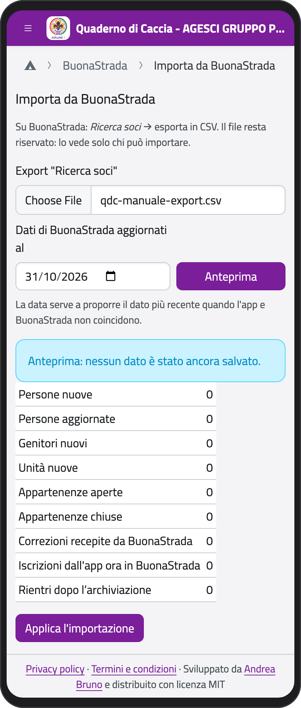
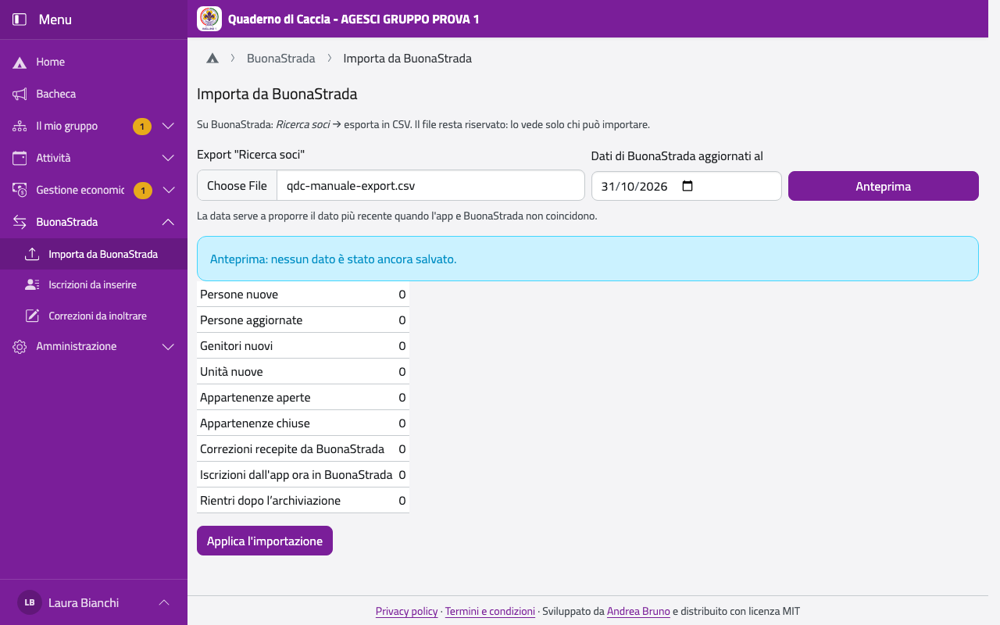

# BuonaStrada

BuonaStrada, l'anagrafe dell'AGESCI, resta la fonte dei dati dei soci. L'app la legge da un
file che scarichi tu, e ti aiuta a mandare alla segreteria le correzioni e i nuovi iscritti.

## Importare i dati

Lo fanno i capigruppo e l'amministratore tecnico, di solito a inizio anno e dopo ogni
cambiamento importante.

1. Su BuonaStrada apri **Ricerca soci** ed esporta in CSV.
2. Nel menu, in **BuonaStrada**, tocca **Importa da BuonaStrada**.
3. Scegli il file e, in **Dati di BuonaStrada aggiornati al**, il giorno in cui BuonaStrada
   era aggiornato (di solito oggi).
4. Tocca **Anteprima**: vedi cosa cambierebbe (persone nuove o aggiornate, genitori, unità,
   chi entra e chi esce), senza salvare niente.
5. Se l'app e BuonaStrada non coincidono (una correzione fatta nell'app, un'unità assegnata
   nell'app), in **L'app e BuonaStrada non coincidono** scegli per ogni dato quale tenere: è
   proposto il più recente. Se vince l'app, ricordati di correggere BuonaStrada.
6. Leggi gli **Avvisi** (righe saltate, dati non leggibili) e tocca **Applica
   l'importazione**.

:::{container} schermate
{.telefono width="30%"}
{.computer width="65%"}
:::

Cosa succede:

- chi si è iscritto dall'app prende il suo codice socio definitivo al posto di quello
  provvisorio;
- chi risulta uscito esce dalle sue unità (e dalla squadriglia); nessuno viene tolto solo
  perché manca dal file;
- le unità nuove nascono **senza nome**: daglielo dalla pagina dell'unità;
- chi rientra dopo essere stato archiviato viene riconosciuto (vedi [Fine anno e
  archivio](fine-anno));
- denominazione sociale e codice fiscale del gruppo, se li hai corretti nelle Impostazioni,
  restano quelli dell'app.

## Correzioni da inoltrare

Quando un genitore o un capo corregge un dato nell'app, la correzione vale subito, ma va
mandata alla segreteria perché aggiorni BuonaStrada. In **BuonaStrada**, tocca **Correzioni
da inoltrare** (il numero dice quante sono):

1. Manda le correzioni alla segreteria regionale (dal portale o per email).
2. Tocca **Segna come inoltrata** su ognuna.

Si chiudono da sole quando l'importazione le ritrova in BuonaStrada. Se una correzione è
sbagliata, **Scarta**, con il motivo (lo vede chi l'ha fatta): torna il valore di prima. Ogni
mattina, se ce ne sono di nuove, i capigruppo ricevono un riepilogo per email.

## Iscrizioni da inserire

Le iscrizioni fatte dall'app, quando la famiglia ha completato dati e moduli, vanno inserite a
mano in BuonaStrada. In **BuonaStrada**, tocca **Iscrizioni da inserire**: per ogni nuovo
socio trovi tutti i dati che chiede BuonaStrada. Puoi scaricarli con **Scarica in Excel
(XLSX)** o **Scarica in PDF**.

1. Inserisci la persona in BuonaStrada.
2. Tocca **Segna come inserita**.

Con la prossima importazione il codice socio provvisorio diventa quello vero e l'iscrizione
si chiude.

## Modulistica

In **Il mio gruppo**, tocca **Modulistica**: qui carichi i moduli vuoti (in PDF) che le
famiglie scaricano con l'iscrizione, firmano e ricaricano, per esempio «Informativa e consensi
2026/27». Aggiornali ogni anno; quelli vecchi si **disattivano**.
