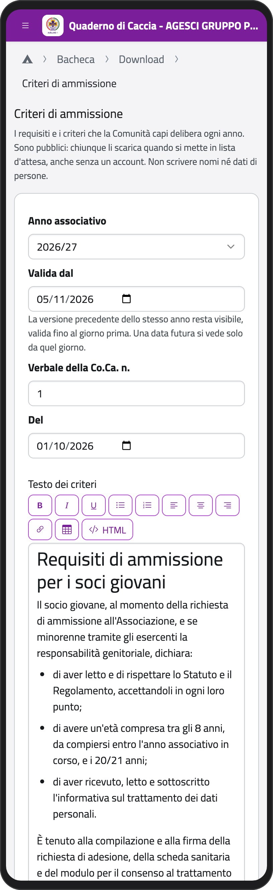
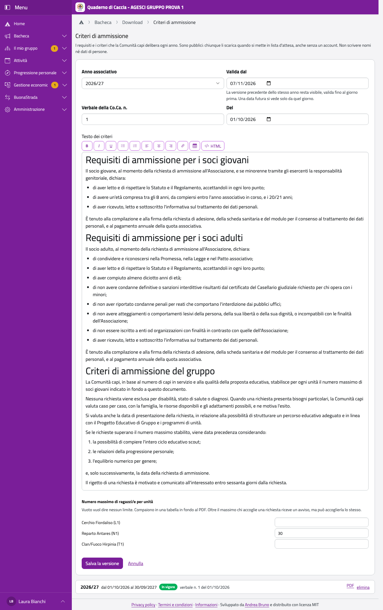

# I criteri di ammissione

Ogni anno associativo la Comunità capi delibera i requisiti e i criteri per ammettere nuovi soci. Averli
pubblicati prima aiuta a motivare una richiesta non accolta. I capigruppo li compilano nell'app, che ne
fa un PDF sulla carta intestata del gruppo. Tutti possono scaricarlo in **Download** e, anche senza un
account, quando mettono qualcuno in lista d'attesa.

:::{warning}
Il documento è pubblico: non scrivere nomi né dati di persone. Il testo di partenza è un esempio: prima di
usarlo verificalo con lo Statuto e il Regolamento, e adattalo a quello che la Comunità capi ha deciso.
:::

## Compilarli

1. In **Download**, nel riquadro **Criteri di ammissione**, tocca **Compila o aggiorna**.
2. Tocca **Nuova versione**. Il testo parte da quello dell'ultima versione o, la prima volta, dall'esempio.
3. Scegli l'**Anno associativo**, quello in corso o il successivo, e **Valida dal**.
4. Scrivi numero e data del **verbale della Co.Ca.** che li ha deliberati.
5. Modifica il testo.
6. In **Numero massimo di ragazzi/e per unità** scrivi i numeri decisi. Lascia vuoto dove non c'è un limite.
7. Tocca **Salva la versione**.

:::{container} schermate
{.telefono width="30%"}
{.computer width="65%"}
:::

## Se cambiano durante l'anno

Crea una nuova versione, indicando da quando vale. La precedente resta visibile a tutti, valida fino al
giorno prima. Una versione con una data futura si vede solo da quel giorno; fino ad allora la vedono solo i
capigruppo, che la trovano in questa pagina. Una versione salvata per sbaglio si toglie con **elimina**: torna
valida la precedente.

## Se quelli dell'anno non ci sono ancora

Finché mancano, chi li cerca vede gli ultimi pubblicati, con l'avviso che sono dell'anno precedente, che sono
solo una traccia e che i nuovi verranno caricati a breve. Il primo di ogni mese i capigruppo ricevono un
promemoria, finché non ci sono.

## Cosa cambia per le richieste

I numeri massimi non bloccano nulla: quando una richiesta riguarda un'unità già al massimo, chi la decide
vede un avviso e può accoglierla lo stesso. Vedi [Accogliere una richiesta](../capo/iscrizioni.md).
