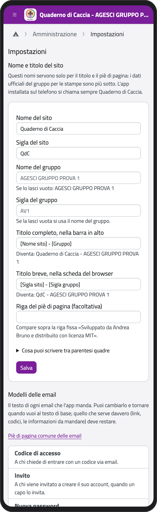
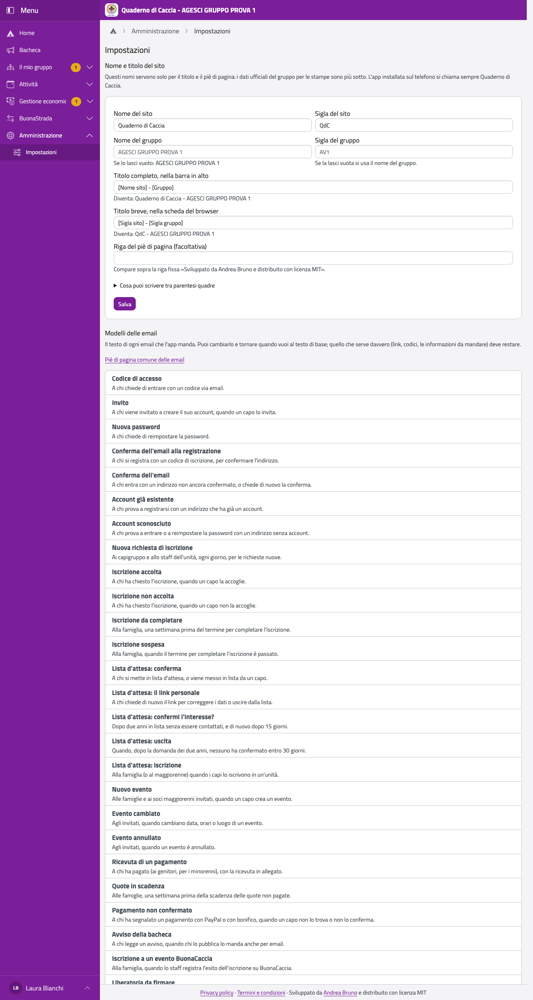
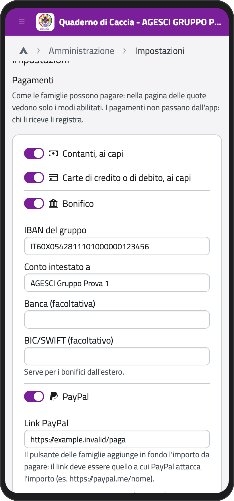
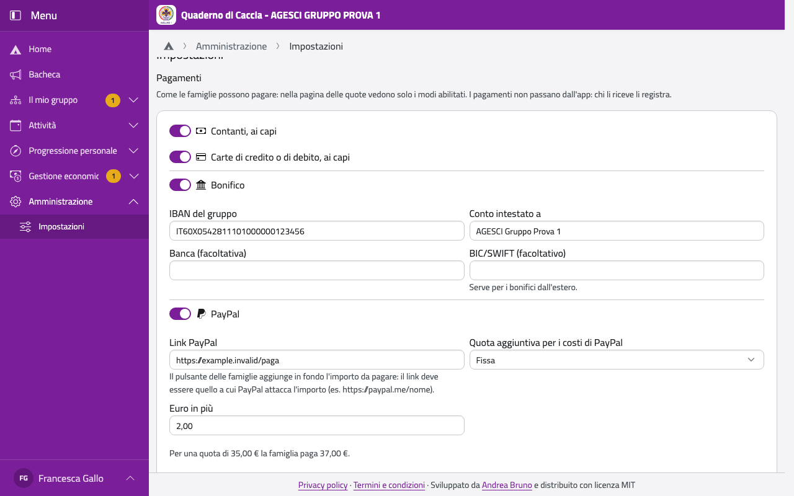

# Impostazioni

Nel menu, in **Amministrazione**, tocca **Impostazioni**. Ogni riquadro lo vede chi lo può
cambiare: i capigruppo e l'amministratore tecnico il sito, le email e le pagine legali; solo
i capigruppo l'intestazione delle stampe; i capigruppo e il tesoriere di gruppo i pagamenti.

:::{container} schermate
{.telefono width="30%"}
{.computer width="65%"}
:::

## Nome e titolo del sito

Il nome e la sigla del sito e del gruppo, il **titolo completo** (nella barra in alto), il
**titolo breve** (nella scheda del browser) e una **riga del piè di pagina** facoltativa.
Nei titoli puoi usare i segnaposto tra parentesi quadre, come [Nome sito], [Gruppo] o
[Pagina corrente] (l'elenco è in **Cosa puoi scrivere tra parentesi quadre**); sotto ogni
campo vedi come diventa. Questi nomi servono solo per il titolo: i dati ufficiali sono più
sotto.

## Intestazione delle stampe

I dati ufficiali del gruppo, sui moduli da firmare (come la scheda sanitaria) e sulle
ricevute: denominazione sociale, codice fiscale, sede, contatti, iscrizione al RUNTS (il
Registro unico nazionale del Terzo settore) e il **logo** (PNG o JPEG). Denominazione e codice
fiscale arrivano da BuonaStrada; se li correggi qui, l'importazione non li cambia più.

## Pagamenti

Come le famiglie possono pagare: accendi i modi che il gruppo accetta.

- **Contanti, ai capi** e **Carte di credito o di debito, ai capi**;
- **Bonifico**: IBAN, intestatario e, se vuoi, banca e BIC/SWIFT (per i bonifici dall'estero);
- **PayPal**: il link del gruppo (per esempio https://paypal.me/nome: l'app aggiunge in fondo
  l'importo) e la **quota aggiuntiva** per i costi di PayPal: nessuna, fissa, in percentuale
  o a fasce di importo (con quanto si aggiunge **oltre** la fascia più alta). Sotto vedi un
  esempio di quanto paga una famiglia.

:::{container} schermate
{.telefono width="30%"}
{.computer width="65%"}
:::

Le famiglie vedono, nelle loro quote, solo i modi accesi. La prima volta che accendi PayPal,
l'app crea in prima nota il conto PayPal, con saldo zero da oggi.

## Modelli delle email

Ogni email che l'app manda ha un modello: in **Modelli delle email** tocca quello da cambiare.

1. Cambia l'**Oggetto** e il **Testo** con l'editor (grassetto, elenchi, link, tabelle,
   immagini).
2. I **segnaposto** si inseriscono toccandoli; quelli indispensabili (per esempio il link o il
   codice) devono restare: se ne manca uno, il modello non si salva.
3. Tocca **Anteprima** per vederla con dati di esempio, poi **Salva**.

Con **Torna al testo di base** annulli le tue modifiche. Il **Piè di pagina comune delle
email** (per esempio con il logo) si aggiunge a tutte le email, tranne quelle in cui lo togli
dal loro modello.

## Privacy policy e termini

Le pagine pubbliche linkate in fondo a ogni pagina. Partono da un testo di base: cambialo con
l'editor e tocca **Pubblica**. Fallo controllare a chi segue la privacy per il gruppo prima di
considerarlo definitivo. Quando pubblichi una nuova privacy policy, a tutti ricompare
l'avviso sui cookie.
