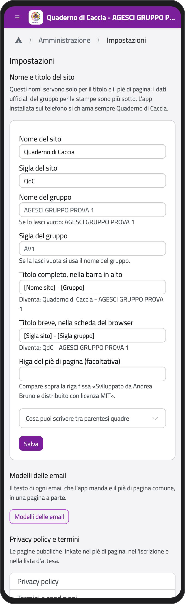
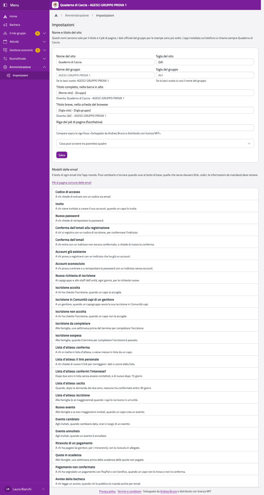
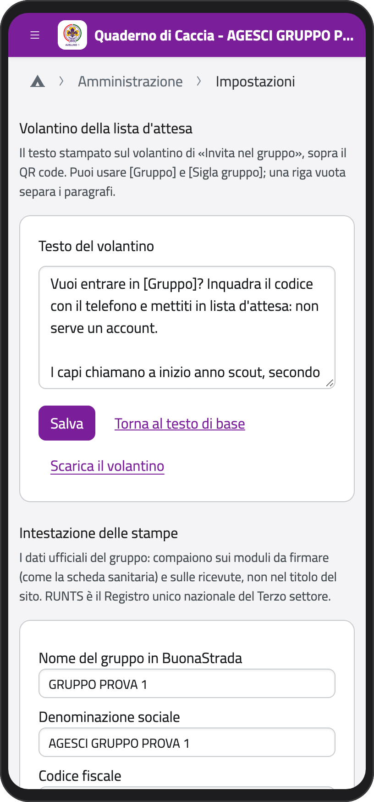
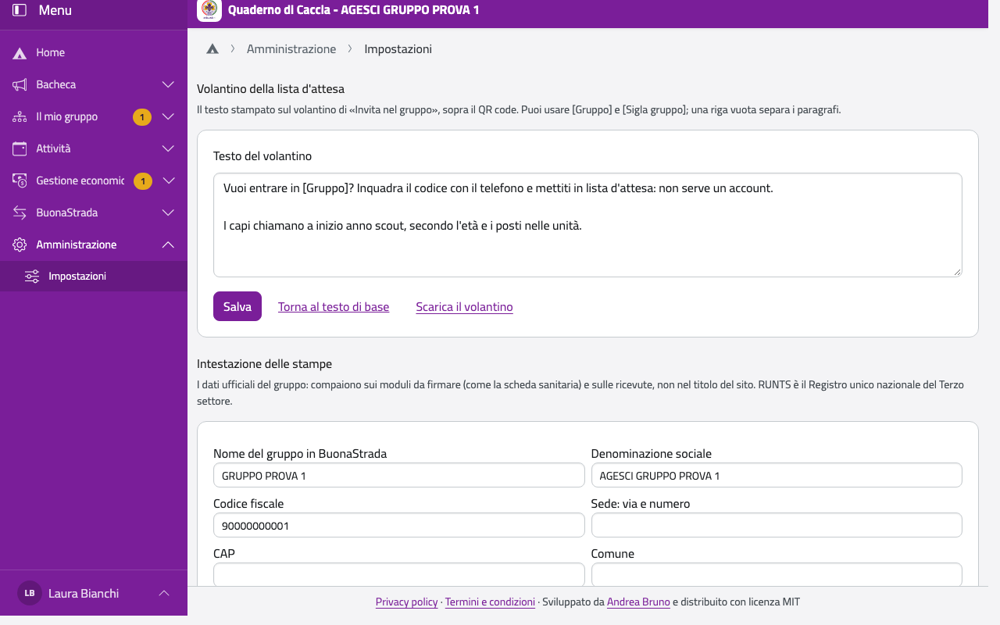
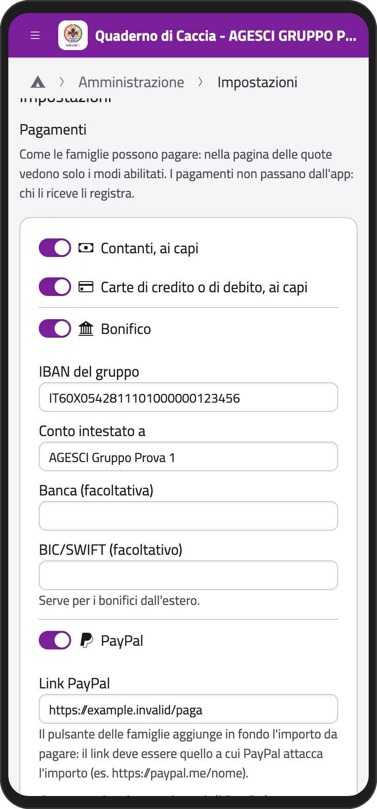
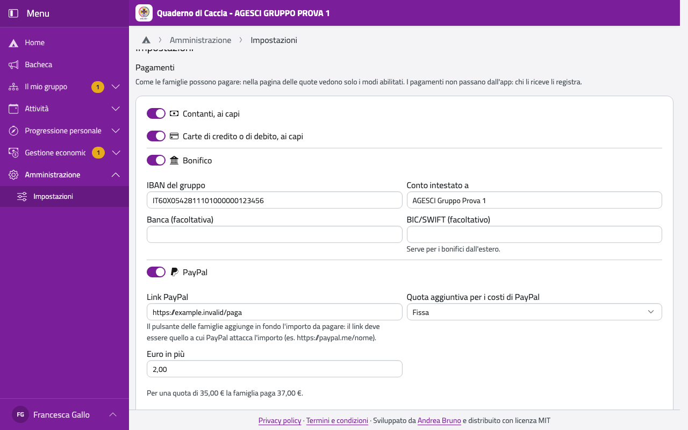
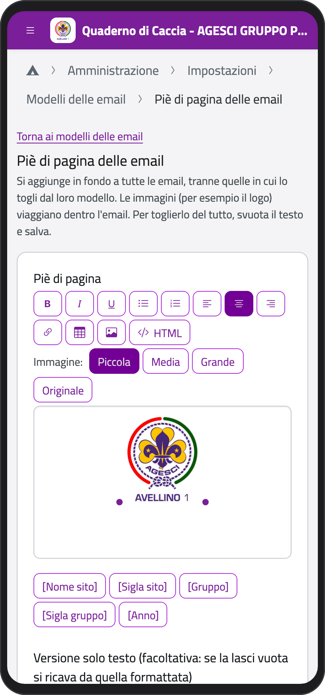
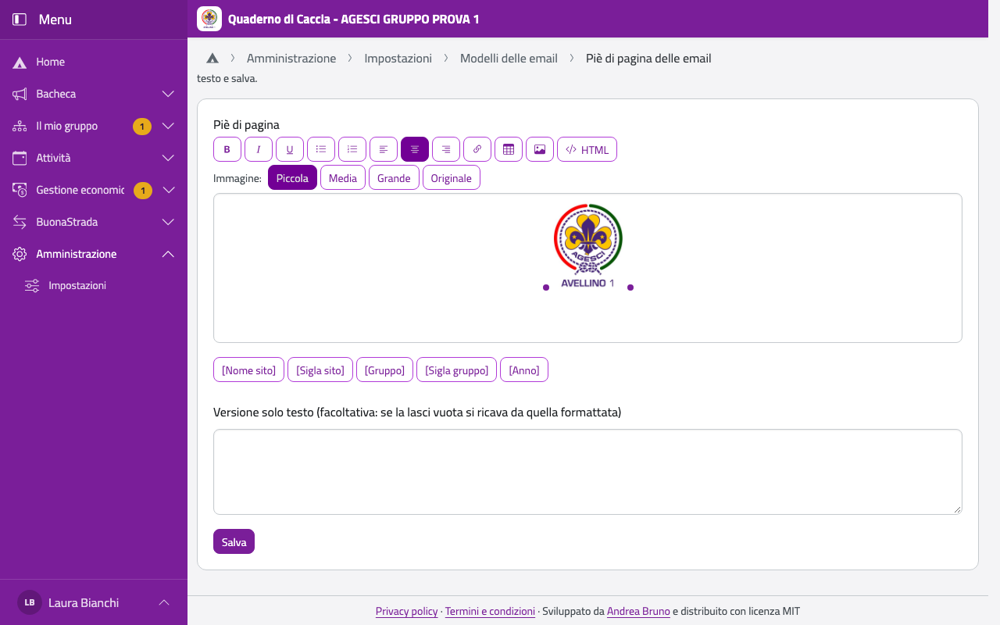

# Impostazioni

Nel menu, in **Amministrazione**, tocca **Impostazioni**. Ogni riquadro lo vede chi lo può
cambiare: i capigruppo e l'amministratore tecnico il sito, le email e le pagine legali; solo
i capigruppo l'intestazione delle stampe; i capigruppo e il tesoriere di gruppo i pagamenti.

:::{container} schermate
{.telefono width="30%"}
{.computer width="65%"}
:::

## Nome e titolo del sito

Il nome e la sigla del sito e del gruppo, il **titolo completo** (nella barra in alto), il
**titolo breve** (nella scheda del browser) e una **riga del piè di pagina** facoltativa.
Nei titoli puoi usare i segnaposto tra parentesi quadre, come [Nome sito], [Gruppo] o
[Pagina corrente] (l'elenco è in **Cosa puoi scrivere tra parentesi quadre**); sotto ogni
campo vedi come diventa. Questi nomi servono solo per il titolo: i dati ufficiali sono più
sotto.

## Intestazione delle stampe

I dati ufficiali del gruppo, sui moduli da firmare (come la scheda sanitaria) e sulle
ricevute: denominazione sociale, codice fiscale, sede, contatti, iscrizione al RUNTS (il
Registro unico nazionale del Terzo settore) e il **logo** (PNG o JPEG). Denominazione e codice
fiscale arrivano da BuonaStrada; se li correggi qui, l'importazione non li cambia più.

## Testi della scheda sanitaria

La scheda sanitaria stampata (vedi [Scheda sanitaria](../capo/sanitaria)) ha, sopra le firme,
una dichiarazione e un consenso al trattamento dei dati. In **Testi della scheda sanitaria**
un capogruppo li cambia e tocca **Salva**; **Torna al testo di base** rimette quelli del
modello del gruppo.

## Volantino della lista d'attesa

**Invita nel gruppo** (vedi
[Invitare altre famiglie](../genitore/lista-attesa.md#invitare-altre-famiglie)) offre a tutti
un volantino da stampare con il QR code della lista d'attesa. In **Volantino della lista
d'attesa** un capogruppo ne cambia il testo e tocca **Salva**; **Torna al testo di base**
rimette quello proposto dall'app. Nel testo puoi scrivere **[Gruppo]** e **[Sigla gruppo]**,
che sul volantino diventano il nome e la sigla del gruppo; una riga vuota separa i paragrafi.
**Scarica il volantino** mostra com'è venuto.

:::{container} schermate
{.telefono width="30%"}
{.computer width="65%"}
:::

## Pagamenti

Come le famiglie possono pagare: accendi i modi che il gruppo accetta.

- **Contanti, ai capi** e **Carte di credito o di debito, ai capi**;
- **Bonifico**: IBAN, intestatario e, se vuoi, banca e BIC/SWIFT (per i bonifici dall'estero);
- **PayPal**: il link del gruppo (per esempio https://paypal.me/nome: l'app aggiunge in fondo
  l'importo) e la **quota aggiuntiva** per i costi di PayPal: nessuna, fissa, in percentuale
  o a fasce di importo (con quanto si aggiunge **oltre** la fascia più alta). Sotto vedi un
  esempio di quanto paga una famiglia.

:::{container} schermate
{.telefono width="30%"}
{.computer width="65%"}
:::

Le famiglie vedono, nelle loro quote, solo i modi accesi. La prima volta che accendi PayPal,
l'app crea in prima nota il conto PayPal, con saldo zero da oggi.

## Modelli delle email

Ogni email che l'app manda ha un modello. Nelle Impostazioni tocca **Modelli delle email**: si
apre la pagina con l'elenco; tocca quello da cambiare.

1. Cambia l'**Oggetto** e il **Testo** con l'editor (grassetto, elenchi, link, tabelle,
   immagini).
2. I **segnaposto** si inseriscono toccandoli; quelli indispensabili (per esempio il link o il
   codice) devono restare: se ne manca uno, il modello non si salva.
3. Tocca **Anteprima** per vederla con dati di esempio, poi **Salva**.

Con **Torna al testo di base** annulli le tue modifiche. Il **Piè di pagina comune delle
email**, in cima alla stessa pagina (per esempio con il logo) si aggiunge a tutte le email, tranne quelle in cui lo togli
dal loro modello.

### L'editor di testo

È lo stesso nei modelli, nel piè di pagina e nella privacy policy e nei termini.

- **Allineamento**: con i tre pulsanti accanto agli elenchi metti il paragrafo a sinistra, al
  centro o a destra; vale anche per un'immagine dentro il paragrafo (per esempio il logo al
  centro).
- **Dimensione di un'immagine**: toccala; sotto i pulsanti compaiono **Piccola**, **Media**,
  **Grande** e **Originale**. Sul computer puoi anche trascinare uno degli angoli in basso.
  Nelle email un'immagine non è mai più larga del messaggio, anche sul telefono.
- **HTML**: il pulsante **HTML** mostra il codice del testo, da modificare a mano; toccalo di
  nuovo per tornare all'editor. Restano solo gli elementi che le email possono contenere
  (paragrafi, titoli, grassetto, corsivo, sottolineato, elenchi, link, tabelle, immagini
  caricate nell'app e allineamento): il resto si toglie, e l'editor ti dice cosa ha tolto.

:::{container} schermate
{.telefono width="30%"}
{.computer width="65%"}
:::

## Chi riceve le email

Quando inizi a usare l'app, le email non arrivano a nessuno: puoi importare i dati e
preparare tutto con calma. In **Chi riceve le email** accendi un gruppo alla volta, quando
gli hai presentato l'app: prima **Capi**, poi **Genitori** e **Ragazzi**.

- Finché un gruppo è spento, le email per lui non partono e non vengono tenute da parte:
  accendendolo non arrivano promemoria vecchi. Accanto al gruppo vedi quante non sono partite.
- Chi è in più gruppi, per esempio un capo che è anche genitore, le riceve se almeno uno è
  acceso.
- Partono sempre, a chiunque: i codici per entrare, il cambio della password, gli **inviti**
  (puoi invitare i capi anche prima di accendere i loro avvisi) e le email dell'iscrizione
  dall'app e della lista d'attesa.

## Privacy policy e termini

Le pagine pubbliche linkate in fondo a ogni pagina. Partono da un testo di base: cambialo con
l'editor e tocca **Pubblica**. Fallo controllare a chi segue la privacy per il gruppo prima di
considerarlo definitivo. Quando pubblichi una nuova privacy policy, a tutti ricompare
l'avviso sui cookie.
