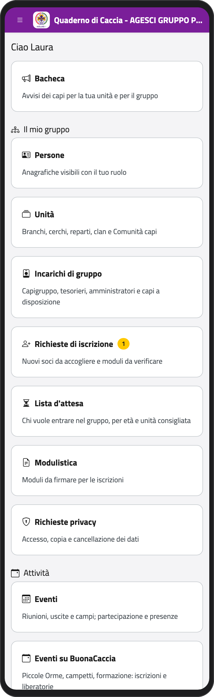
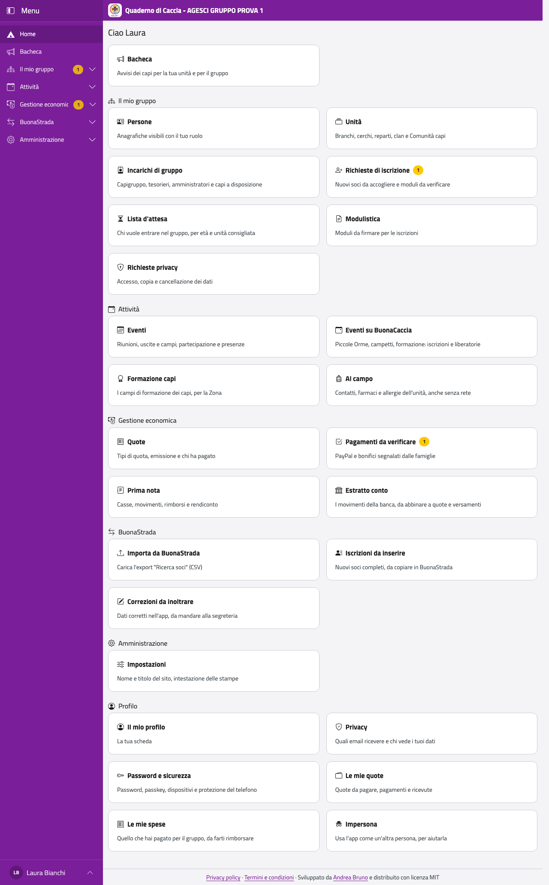

# Capogruppo, tesorieri, amministratore tecnico

## Chi sei, cosa puoi fare

Questa parte è per chi ha un incarico di gruppo:

- i **capigruppo** curano i rapporti con BuonaStrada (importazione, correzioni, nuovi
  iscritti), le unità e gli incarichi, le impostazioni dell'app, le richieste privacy e la
  fine dell'anno;
- il **tesoriere di gruppo** (con i capigruppo) gestisce quote, pagamenti, prima nota ed
  estratto conto; il **tesoriere di un'unità** e il capo unità registrano i pagamenti e i
  movimenti della loro unità;
- l'**amministratore tecnico** cura la parte tecnica: impostazioni del sito, modelli delle
  email, pannello di amministrazione.

Sei prima di tutto un capo: per il resto vale la [parte dei capi](../capo/index). I
capigruppo possono anche pubblicare avvisi per tutto il gruppo (vedi
[Bacheca](../capo/bacheca)) e usare l'app al posto di chiunque abbia un account (vedi
[Usare l'app al posto di…](../capo/impersona)).

Nel menu trovi in più i gruppi **BuonaStrada**, **Gestione economica** e
**Amministrazione**, e in **Il mio gruppo** le voci **Incarichi di gruppo**, **Modulistica**
e **Richieste privacy**.

:::{container} schermate
{.telefono width="30%"}
{.computer width="65%"}
:::

```{toctree}
:caption: Capigruppo
:maxdepth: 1

buonastrada
organizzazione
privacy
fine-anno
impostazioni
```

```{toctree}
:caption: Tesorieri
:maxdepth: 1

quote
pagamenti
prima-nota
estratto-conto
```

```{toctree}
:caption: Amministratore tecnico
:maxdepth: 1

amministratore
```
