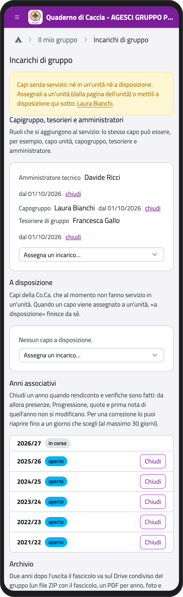
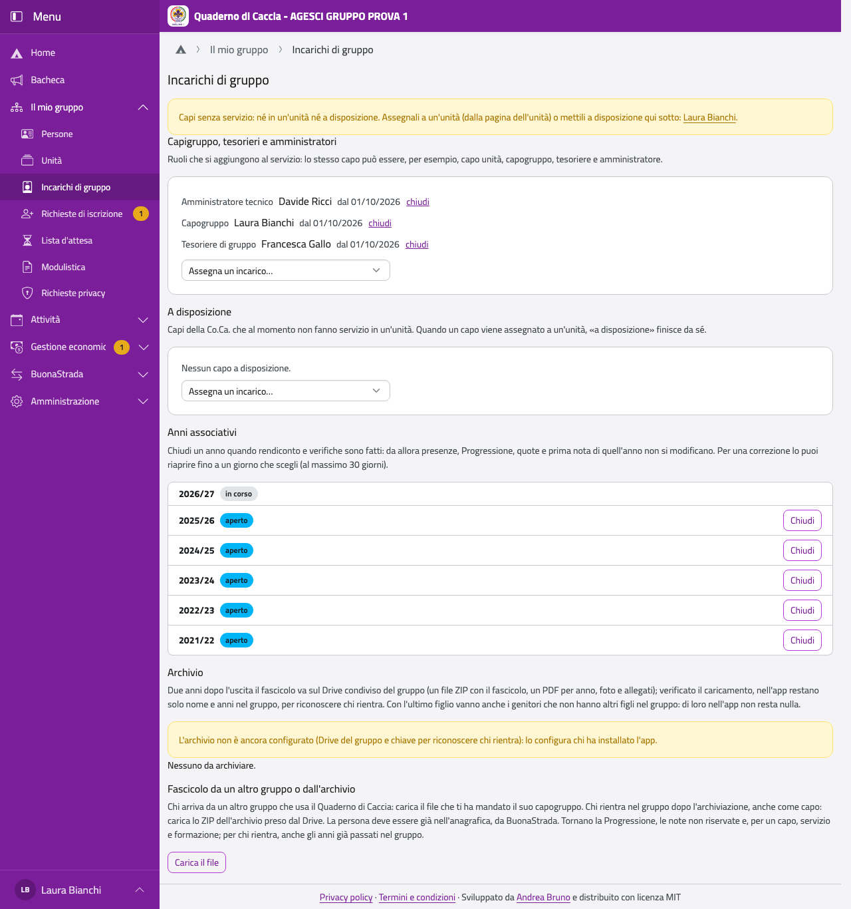

# Unità e incarichi

## Le unità

In **Il mio gruppo**, tocca **Unità**. Solo i capigruppo creano, rinominano e chiudono le
unità.

- **Nuova unità**: nome, tipo, composizione (maschile, femminile, mista) e, per branco e
  cerchio, l'ambientazione (giungla o bosco). La Comunità capi può non avere nome.
- Nella pagina di un'unità, **Modifica** per cambiare nome o ambientazione, collegarla a
  un'altra unità o chiuderla (togli la spunta da **Unità attiva**).

Le unità arrivano di solito dall'importazione da BuonaStrada, senza nome: il riquadro **Da
controllare** dell'unità te lo ricorda.

## Lo staff delle unità

Nella pagina dell'unità, in **Staff e incarichi**, scegli **Capo unità** o **Staff** in
**Assegna un incarico…**, la persona in **Chi**, e tocca **Assegna**. I capi unità sono al
massimo due nelle unità miste e in Comunità capi, uno nelle altre. Per chiudere un incarico,
**chiudi**.

## Gli incarichi di gruppo

In **Il mio gruppo**, tocca **Incarichi di gruppo**.

:::{container} schermate
{.telefono width="30%"}
{.computer width="65%"}
:::

- **Capigruppo, tesorieri e amministratori**: capogruppo e tesoriere di gruppo (al massimo
  due ciascuno), amministratore tecnico. Si aggiungono al servizio: lo stesso capo può
  essere capo unità e tesoriere.
- **A disposizione**: i capi della Comunità capi che oggi non fanno servizio in un'unità.
  Quando un capo viene assegnato a un'unità, «a disposizione» finisce da solo.

In alto un avviso elenca i **capi senza servizio**: assegnali a un'unità o mettili a
disposizione.

## Le eccezioni sulle squadriglie

Le squadriglie sono maschili o femminili. Quando la Comunità capi decide un'eccezione, un
capogruppo la registra nella scheda del ragazzo, in **Eccezioni sulla squadriglia**:

1. Tocca **Registra**.
2. Scegli il reparto, se può entrare nelle squadriglie **femminili** o **maschili**, il giorno
   della decisione in Co.Ca. e una **Motivazione** breve (è un dato delicato: la leggono tutti
   i capi).
3. Tocca **Registra**.

Con **revoca** la togli da oggi. L'eccezione finisce da sola quando il ragazzo lascia il
reparto. Ogni lettura resta nel registro degli accessi.
